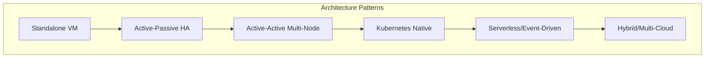
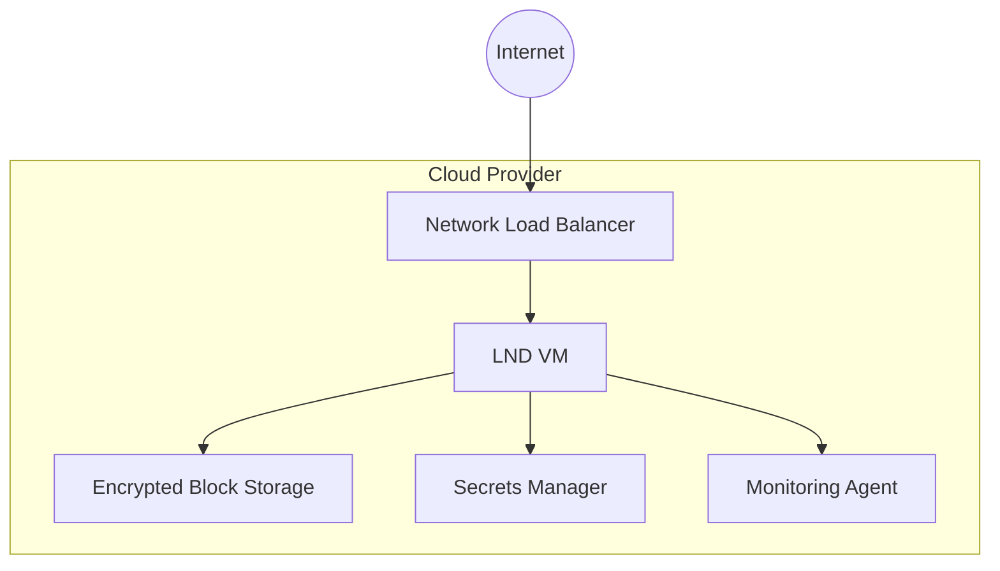
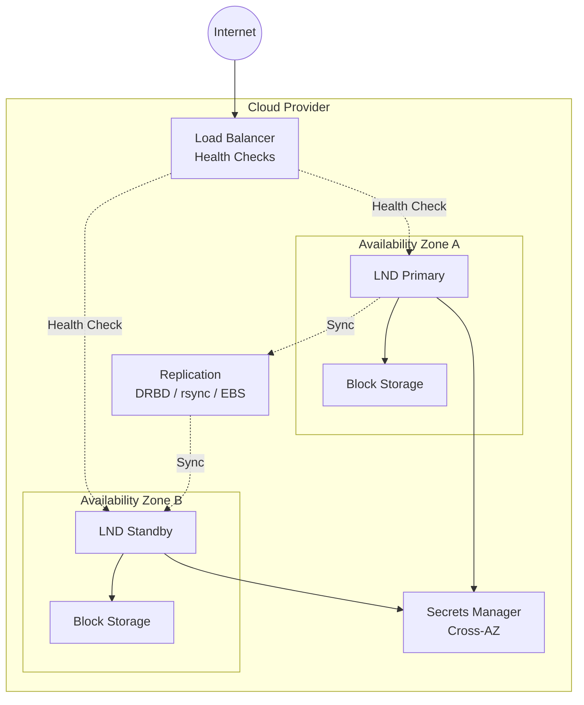
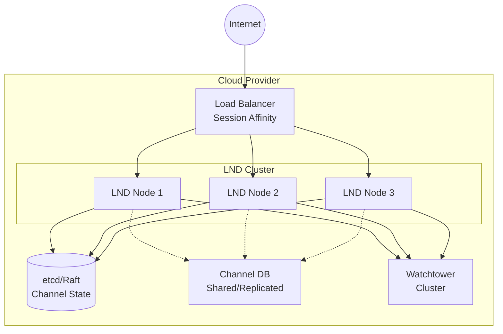
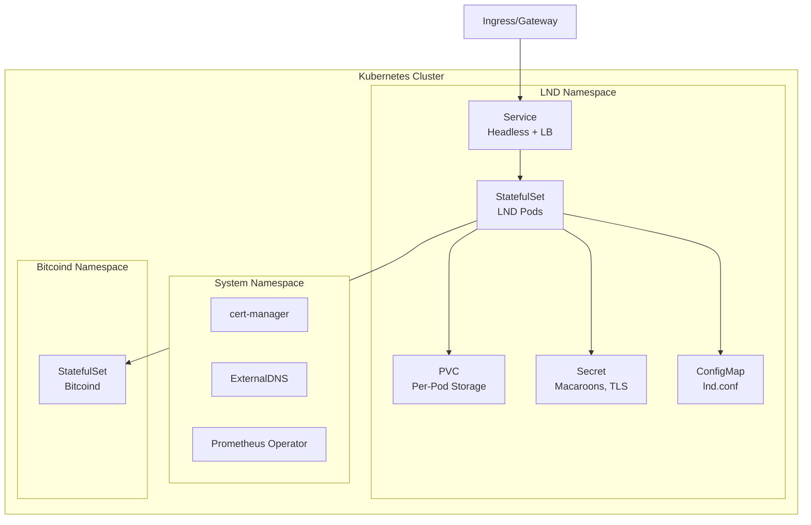
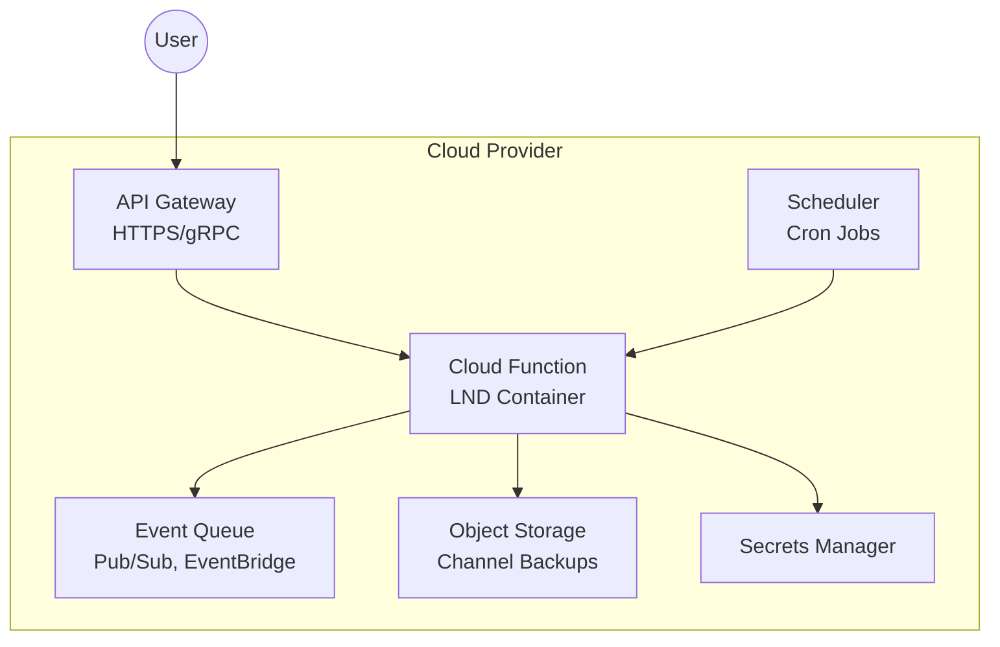
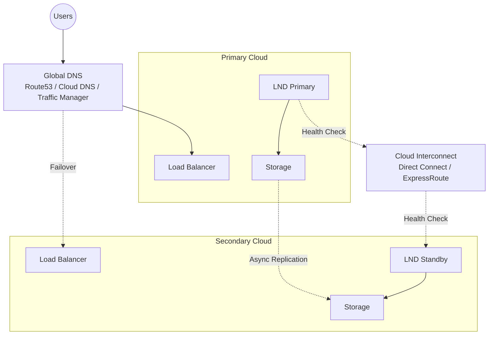

# Abstract

This document describes proven architecture patterns for running LND on cloud platforms. Patterns range from simple standalone deployments to highly available multi-node clusters with automated failover. Each pattern includes trade-offs, prerequisites, and references to implementation guides.

# 1. Pattern Taxonomy

**Figure 1:** Architecture pattern progression from simple to complex.

# 2. Pattern 1: Standalone VM

## 2.1 Architecture [Figure 2]

**Figure 2:** Standalone VM pattern.

## 2.2 Characteristics

| Aspect | Details |
|--------|---------|
| **Availability** | Single AZ, no automatic failover |
| **Recovery** | Manual (restore from snapshot) |
| **Scaling** | Vertical (resize instance) |
| **Operations** | SSH/SSM access, systemd management |
| **Cost** | Lowest (~$50-200/mo) |
| **Complexity** | Low |

## 2.3 When to Use

- Development/staging environments
- Low-value nodes (< 1 BTC capacity)
- Teams with strong VM ops skills
- Compliance requiring dedicated instances

## 2.4 Implementation Reference

- AWS: [§12.1] (Tutorial: AWS LND on VM)
- GCP: [§12.2] (Tutorial: GCP LND on VM)
- Azure: [§12.3] (Tutorial: Azure LND on VM)

# 3. Pattern 2: Active-Passive HA

## 3.1 Architecture [Figure 3]

**Figure 3:** Active-Passive HA pattern with cross-AZ replication.

## 3.2 Characteristics

| Aspect | Details |
|--------|---------|
| **Availability** | Multi-AZ, automatic failover (~30-60s) |
| **Recovery** | Automated via health checks |
| **Data Consistency** | Async replication (RPO ~1-5 min) |
| **Scaling** | Vertical only |
| **Cost** | 2x compute + replication |
| **Complexity** | Medium |

## 3.3 Failover Process

1. **Health check fails** on primary (LND RPC, P2P port)
2. **Load balancer** marks primary unhealthy
3. **Traffic shifts** to standby
4. **Standby promotes** to primary (mounts shared storage or syncs)
5. **DNS/Service discovery** updates

## 3.4 Implementation Reference

- Requires: Shared storage (EFS, Filestore, Azure Files) or block replication
- AWS: EBS Multi-Attach (io2) or DRBD on gp3
- GCP: Regional Persistent Disk (beta) or DRBD
- Azure: Shared Disks (Premium SSD v2) or DRBD

# 4. Pattern 3: Active-Active Multi-Node

## 4.1 Architecture [Figure 4]

**Figure 4:** Active-Active multi-node pattern with shared state.

## 4.2 Characteristics

| Aspect | Details |
|--------|---------|
| **Availability** | Multi-AZ, no single point of failure |
| **Scaling** | Horizontal (add nodes) |
| **Throughput** | Linear with nodes (HTLC routing) |
| **Complexity** | High (distributed systems) |
| **Cost** | N x compute + shared state |

## 4.3 Challenges

- **Channel state synchronization**: LND doesn't natively support active-active
- **Solution**: Single writer (leader) + read replicas, or external coordination
- **Watchtower**: Must monitor all nodes
- **Macaroon rotation**: Distributed coordination required

## 4.4 Current Recommendation

Use **Pattern 2 (Active-Passive)** for production until LND adds native clustering support. See [§10.5] for experimental multi-node approaches.

# 5. Pattern 4: Kubernetes Native

## 5.1 Architecture [Figure 5]

**Figure 5:** Kubernetes-native pattern with StatefulSet.

## 5.2 Characteristics

| Aspect | Details |
|--------|---------|
| **Availability** | Pod disruption budgets, multi-AZ nodes |
| **Scaling** | Horizontal (replicas), vertical (VPA) |
| **GitOps** | ArgoCD/Flux sync from Git |
| **Cloud Integration** | IRSA (AWS), Workload Identity (GCP), Entra WI (Azure) |
| **Operations** | kubectl, Helm, Kustomize |

## 5.3 Key Components

- **StatefulSet**: Stable network identity, ordered deployment
- **PersistentVolumeClaim**: Per-pod block storage
- **Headless Service**: Direct pod-to-pod communication
- **LoadBalancer Service**: External access for P2P/gRPC/REST
- **ConfigMap/Secret**: Configuration and secrets management

## 5.4 Implementation Reference

- AWS EKS: [§12.4]
- GCP GKE: [§12.5]
- Azure AKS: [§12.6]
- Helm Chart: [§11.5] (Shared Terraform Modules)

# 6. Pattern 5: Serverless / Event-Driven

## 6.1 Architecture [Figure 6]

**Figure 6:** Serverless pattern for intermittent LND operations.

## 6.2 Use Cases

| Use Case | Trigger | Duration |
|----------|---------|----------|
| Channel backup | Scheduled (daily) | < 2 min |
| Watchtower check | Block height change | < 30s |
| Rebalancing | Fee rate change | < 5 min |
| Invoice settlement | Webhook | < 10s |
| Node health check | Scheduled (5m) | < 10s |

## 6.3 Limitations

- **Cold starts**: 100-500ms latency spike
- **State persistence**: Must use external storage (EFS, Cloud SQL, Disk)
- **P2P connectivity**: Requires VPC connector / Private Service Connect
- **Long-running**: Max 15-60 min (Lambda/Cloud Run)

## 6.4 Implementation Reference

- AWS Lambda: [§12.7]
- GCP Cloud Run: [§12.8]
- Azure Container Apps: (Planned)

# 7. Pattern 6: Hybrid / Multi-Cloud

## 7.1 Architecture [Figure 7]

**Figure 7:** Multi-cloud disaster recovery pattern.

## 7.2 Characteristics

| Aspect | Details |
|--------|---------|
| **RTO** | 1-5 minutes (DNS failover) |
| **RPO** | 1-5 minutes (async replication) |
| **Cost** | 2x primary + interconnect |
| **Complexity** | Very high |

## 7.3 Implementation Reference

- Cross-cloud VPN: [§03.4]
- Global DNS: [§03.5]
- Tutorial: [§12.9] (Cross-Cloud HA)

# 8. Pattern Selection Guide

| Requirement | Recommended Pattern |
|-------------|---------------------|
| Dev/Test | Pattern 1 (Standalone) |
| Production, < 1 BTC | Pattern 1 + Backups |
| Production, 1-10 BTC | Pattern 2 (Active-Passive) |
| Production, > 10 BTC | Pattern 4 (Kubernetes) |
| High throughput routing | Pattern 4 (Kubernetes) |
| Event-driven automation | Pattern 5 (Serverless) |
| Regulatory multi-region | Pattern 6 (Multi-Cloud) |
| Team has K8s expertise | Pattern 4 (Kubernetes) |
| Team prefers VM ops | Pattern 2 (Active-Passive) |

# References

[1] Lightning Network Daemon, "High Availability," https://github.com/lightningnetwork/lnd/blob/master/docs/ha.md
[2] Kubernetes, "StatefulSet Documentation," https://kubernetes.io/docs/concepts/workloads/controllers/statefulset/
[3] AWS, "EBS Multi-Attach," https://docs.aws.amazon.com/ebs/latest/userguide/ebs-multi-attach.html
[4] Google Cloud, "Regional Persistent Disks," https://cloud.google.com/compute/docs/disks/regional-persistent-disk
[5] Microsoft Azure, "Shared Disks," https://learn.microsoft.com/azure/virtual-machines/disks-shared
