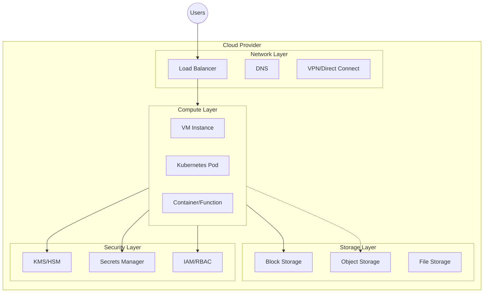

# Abstract

This document provides a comprehensive overview of deploying Lightning Network Daemon (LND) on major cloud platforms. We analyze architecture patterns, compare cloud provider offerings, and establish the foundation for detailed implementation guides. The goal is to enable operators to make informed decisions about infrastructure, security, and operational models for production LND deployments.

# 1. Introduction

## 1.1 Background

The Lightning Network (LN) is a Layer 2 payment protocol built on Bitcoin, enabling instant, low-cost transactions through a network of payment channels. LND is the most widely deployed LN node implementation, written in Go by Lightning Labs. Running LND in production requires careful consideration of:

- **Availability**: LN nodes must be online to route payments and monitor channels
- **Security**: Private keys (macaroons, TLS certs, seed) require hardware-grade protection
- **Performance**: Sub-millisecond latency for HTLC processing, high IOPS for channel state
- **Scalability**: Dynamic channel management, multi-node architectures

## 1.2 Cloud Deployment Models

Three primary deployment models exist for LND on cloud platforms:

| Model | Description | Use Case | Trade-offs |
|-------|-------------|----------|------------|
| **Self-Managed VM** | LND on EC2/GCE/VM with attached storage | Full control, custom kernels, HSM integration | Operational overhead, manual scaling |
| **Managed Kubernetes** | LND on EKS/GKE/AKS with operators | GitOps, auto-scaling, cloud-native integrations | Complexity, resource overhead |
| **Serverless/Container** | LND on Lambda/Cloud Run/Container Apps | Event-driven, pay-per-use, minimal ops | Cold starts, stateless limitations, cost at scale |

## 1.3 Architecture Patterns [Figure 1]



**Figure 1:** High-level cloud architecture for LND deployment.

# 2. Cloud Provider Comparison [Table 1]

| Capability | AWS | GCP | Azure |
|------------|-----|-----|-------|
| **Compute** | EC2, Fargate, Lambda | GCE, Cloud Run, Cloud Functions | VM, Container Apps, Functions |
| **Kubernetes** | EKS | GKE | AKS |
| **Block Storage** | EBS (gp3, io2) | Persistent Disk (SSD, Balanced) | Managed Disks (Premium SSD) |
| **Object Storage** | S3 | Cloud Storage | Blob Storage |
| **Load Balancing** | NLB, ALB, GWLB | Cloud Load Balancing | Azure Load Balancer |
| **Secrets** | Secrets Manager, Parameter Store | Secret Manager | Key Vault |
| **KMS** | KMS, CloudHSM | Cloud KMS, Cloud HSM | Key Vault, Dedicated HSM |
| **Identity** | IAM, IAM Roles for SA | IAM, Workload Identity | Entra ID, Managed Identity |
| **Monitoring** | CloudWatch, X-Ray | Cloud Monitoring, Trace | Monitor, App Insights |
| **Regions** | 33+ | 39+ | 60+ |

**Table 1:** Cloud provider service mapping for LND infrastructure.

# 3. LND Architecture Overview [§10.1]

LND consists of several key components:

1. **Chain Backend**: Bitcoin node interface (btcd, bitcoind, neutrino)
2. **Channel Database**: BoltDB for channel state, graph, invoices
3. **Router**: Path finding, HTLC forwarding, fee calculation
4. **RPC Services**: gRPC (10009), REST (8080), P2P (9735)
5. **Security**: Macaroon-based auth, TLS encryption, seed encryption

# 4. Deployment Decision Framework

## 4.1 Choose Self-Managed VM When:

- Need HSM integration (CloudHSM, Dedicated HSM)
- Custom kernel/modules required
- Predictable, steady-state workloads
- Team has strong Linux/ops expertise
- Compliance requires dedicated tenancy

## 4.2 Choose Kubernetes When:

- GitOps workflow mandated
- Multi-node HA with automated failover
- Dynamic scaling based on channel count
- Cloud-native integrations (IRSA, Workload Identity)
- Platform team manages K8s clusters

## 4.3 Choose Serverless When:

- Event-driven channel operations
- Intermittent workloads (watchtowers, backups)
- Prototype/experimentation
- Cost optimization for low-throughput nodes
- Team prefers zero-infrastructure management

# 5. Security Considerations

## 5.1 Key Management Hierarchy

```
Master Seed (BIP39)
  ├── Wallet Seed (BIP32)
  │     ├── Channel Keys (per-channel)
  │     ├── HTLC Keys (per-HTLC)
  │     └── Commitment Keys
  ├── TLS Certificate (node identity)
  ├── Macaroon Root Key (auth)
  └── Backup Encryption Key
```

All keys at rest must use cloud KMS/HSM. See [§07.1] for implementation.

## 5.2 Network Security

- Private subnets only for LND nodes
- Load balancer in public subnet (TLS termination)
- VPC peering / Private Link for bitcoind
- Security groups / firewall rules: deny by default
- See [§03] for detailed networking

# 6. Operational Requirements

## 6.1 Monitoring Essentials

| Metric | Alert Threshold | Source |
|--------|-----------------|--------|
| `lnd_chain_sync_status` | < 1 for 5m | Prometheus |
| `lnd_num_peers` | < 3 for 10m | Prometheus |
| `lnd_pending_htlcs` | > 100 for 5m | Prometheus |
| Disk usage | > 80% | CloudWatch/Cloud Monitoring |
| CPU utilization | > 85% sustained | CloudWatch/Cloud Monitoring |

## 6.2 Backup Strategy

- **Channel state**: Continuous replication to object storage [§10.4]
- **SCB (Static Channel Backups)**: Per-channel, encrypted
- **Full node backup**: Weekly snapshot of block storage
- **Disaster recovery**: Cross-region replication, RTO < 1h, RPO < 5m

# 7. Cost Optimization

## 7.1 Compute

- **Spot/Preemptible**: 60-70% savings for stateless components
- **Reserved Instances**: 30-40% savings for steady-state
- **Right-sizing**: Monitor CPU/memory, downsize during low activity
- **Graviton/ARM**: 20% better price/performance on AWS/GCP

## 7.2 Storage

- **gp3 / Balanced PD / Premium SSD v2**: Baseline performance, burst credits
- **Tiered storage**: Hot channel state on block, cold backups on object
- **Lifecycle policies**: Transition to IA/Archive after 30/90 days

# 8. Conclusion

Cloud deployment of LND offers significant advantages over self-hosted infrastructure: global availability, managed services, compliance certifications, and operational tooling. The choice between VM, Kubernetes, and serverless depends on team expertise, compliance requirements, and scaling needs. Subsequent sections provide detailed implementation guides for each pattern.

# References

[1] Lightning Network Daemon, "LND Documentation," https://github.com/lightningnetwork/lnd
[2] Bitcoin Core, "RPC API Reference," https://developer.bitcoin.org/reference/rpc/
[3] AWS, "EC2 User Guide," https://docs.aws.amazon.com/ec2/
[4] Google Cloud, "Compute Engine Documentation," https://cloud.google.com/compute/docs
[5] Microsoft Azure, "Virtual Machines Documentation," https://learn.microsoft.com/azure/virtual-machines/

# Appendices

## A. Acronyms

| Acronym | Definition |
|---------|------------|
| LN | Lightning Network |
| LND | Lightning Network Daemon |
| HTLC | Hashed Timelock Contract |
| SCB | Static Channel Backup |
| P2P | Peer-to-Peer |
| RPC | Remote Procedure Call |
| gRPC | Google Remote Procedure Call |
| TLS | Transport Layer Security |
| KMS | Key Management Service |
| HSM | Hardware Security Module |
| IAM | Identity and Access Management |
| RBAC | Role-Based Access Control |
| VPC | Virtual Private Cloud |
| NLB | Network Load Balancer |
| IOPS | Input/Output Operations Per Second |
| RTO | Recovery Time Objective |
| RPO | Recovery Point Objective |
