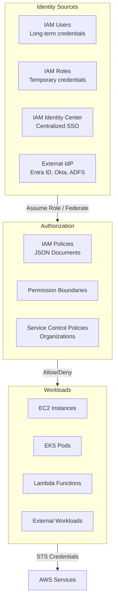
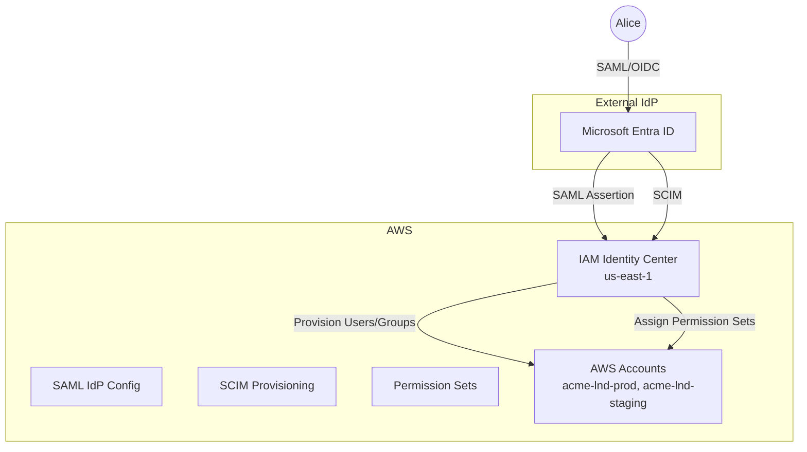
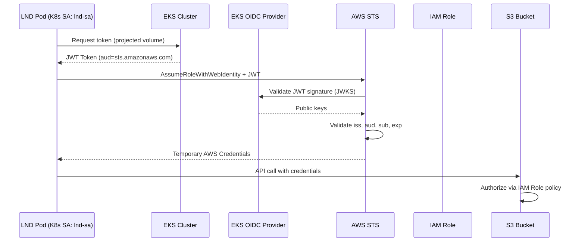

# Abstract

This document provides a comprehensive implementation guide for identity and access management on Amazon Web Services (AWS). We cover the AWS IAM core model (users, groups, roles, policies), IAM Identity Center for centralized SSO, SAML 2.0 and OIDC federation patterns for workforce access, Security Token Service (STS) for cross-account and external identity access, and IAM Roles for Service Accounts (IRSA) for Kubernetes workloads. The running Acme Corp example demonstrates Entra ID federation to AWS via IAM Identity Center (SAML), and EKS pods accessing AWS services via IRSA. Cross-references to SAML/OIDC fundamentals [§02.1], [§02.2], [§02.3] and Azure Entra configuration [§02.8] enable end-to-end understanding.

# 1. Introduction

## 1.1 AWS Identity Model Overview

AWS identity operates on a **shared responsibility model**: AWS secures the infrastructure; you secure identities and permissions.



**Figure 1:** AWS identity architecture: Identity sources → Authorization → Workloads → AWS Services.

## 1.2 Running Example: Acme Corp on AWS

| Element | Configuration |
|---------|---------------|
| **Organization** | `acmecorp` (AWS Organizations) |
| **Account** | `acme-lnd-prod` (123456789012) |
| **IAM Identity Center** | Enabled in `us-east-1`, connected to Entra ID |
| **Workforce User** | Alice (`alice@acmecorp.com`, Entra objectId: `a1b2c3d4...`) |
| **EKS Cluster** | `acme-lnd-cluster` (Kubernetes 1.29) |
| **Workload** | LND pod in EKS (Kubernetes SA: `lnd-sa`) |
| **SAML Provider** | `EntraID-SAML` (in IAM) |
| **OIDC Provider** | `oidc.eks.us-east-1.amazonaws.com/id/EXAMPLED539D4633E53DE1B71EXAMPLE` |
| **IRSA Role** | `arn:aws:iam::123456789012:role/LND-IRSA-Role` |

# 2. IAM Core Model

## 2.1 Identity Types

| Type | Credential | Use Case | Rotation |
|------|------------|----------|----------|
| **IAM User** | Access Keys (AKIA...) | Human operators (legacy), service accounts | Manual |
| **IAM Group** | N/A | Collect users for policy attachment | N/A |
| **IAM Role** | Temporary (STS) | Workloads, cross-account, federation | Automatic (1hr default) |
| **Identity Center User** | SSO session | Workforce access via IdP | IdP-managed |

**Table 1:** AWS identity types and credential characteristics.

## 2.2 IAM Policies

Policies are JSON documents defining permissions:

```json
{
  "Version": "2012-10-17",
  "Statement": [
    {
      "Sid": "LNDBucketAccess",
      "Effect": "Allow",
      "Action": [
        "s3:PutObject",
        "s3:GetObject",
        "s3:ListBucket"
      ],
      "Resource": [
        "arn:aws:s3:::acme-lnd-logs",
        "arn:aws:s3:::acme-lnd-logs/*"
      ],
      "Condition": {
        "StringEquals": {
          "aws:PrincipalTag/costCenter": "security"
        }
      }
    }
  ]
}
```

**Listing 1:** IAM policy with condition on principal tag.

### Policy Types

| Type | Attached To | Scope |
|------|-------------|-------|
| **Identity-based** | Users, Groups, Roles | What identity can do |
| **Resource-based** | S3 buckets, KMS keys, SQS queues | Who can access resource |
| **Permission Boundaries** | Users, Roles | Maximum permissions |
| **SCPs** | Organization, OUs | Account-level guardrails |
| **Session Policies** | STS AssumeRole calls | Further restrict session |

## 2.3 Condition Keys

```json
"Condition": {
  "StringEquals": {
    "aws:PrincipalTag/department": "security",
    "aws:RequestedRegion": "us-east-1"
  },
  "Bool": {
    "aws:MultiFactorAuthPresent": "true"
  },
  "IpAddress": {
    "aws:SourceIp": ["203.0.113.0/24"]
  }
}
```

**Listing 2:** Common condition keys for least-privilege policies.

# 3. IAM Identity Center (Successor to AWS SSO)

## 3.1 Architecture

IAM Identity Center provides centralized workforce SSO across AWS accounts and applications.



**Figure 2:** IAM Identity Center with external IdP (Entra ID) via SAML + SCIM.

## 3.2 SAML Federation (Entra ID → IAM Identity Center)

### Entra Enterprise Application Setup

1. **Entra ID → Enterprise Applications → New Application → Create your own**
2. **Name**: `AWS IAM Identity Center`
3. **Single Sign-On → SAML**
4. **Basic SAML Configuration**:
   - **Identifier (Entity ID)**: `https://identitycenter.amazonaws.com/saml/metadata`
   - **Reply URL (ACS)**: `https://identitycenter.amazonaws.com/saml/assertion`
   - **Relay State**: (optional, for deep linking)

### IAM Identity Center SAML Configuration

1. **Identity Center → Settings → Identity source → Change → External IdP**
2. **Upload Entra Federation Metadata XML**
3. **Configure attribute mapping**:
   - Subject: `http://schemas.microsoft.com/identity/claims/objectidentifier`
   - Email: `http://schemas.xmlsoap.org/ws/2005/05/identity/claims/emailaddress`
   - Given Name: `http://schemas.xmlsoap.org/ws/2005/05/identity/claims/givenname`
   - Family Name: `http://schemas.xmlsoap.org/ws/2005/05/identity/claims/surname`
   - Groups: `http://schemas.microsoft.com/ws/2008/06/identity/claims/groups`

**Listing 3:** Key SAML attribute mappings for Entra → Identity Center.

## 3.3 SCIM Provisioning

Automatically provisions Entra users/groups into Identity Center:

```bash
# In Entra Enterprise App → Provisioning
# Mode: Automatic
# Tenant URL: https://identitycenter.amazonaws.com/scim/v2
# Secret Token: (from Identity Center → Settings → SCIM)
# Mappings:
#   - User: objectId → userName, email, name.givenName, name.familyName
#   - Group: objectId → displayName, members
```

**Listing 4:** SCIM provisioning configuration (Entra → Identity Center).

## 3.4 Permission Sets

Permission Sets are templates for IAM roles created in target accounts:

```json
{
  "Name": "LNDOperator",
  "Description": "LND node operator permissions",
  "SessionDuration": "PT4H",
  "InlinePolicy": {
    "Version": "2012-10-17",
    "Statement": [
      {
        "Effect": "Allow",
        "Action": [
          "ec2:DescribeInstances",
          "ec2:StartInstances",
          "ec2:StopInstances",
          "ebs:DescribeVolumes",
          "cloudwatch:GetMetricStatistics"
        ],
        "Resource": "*"
      }
    ]
  },
  "ManagedPolicies": [
    "arn:aws:iam::aws:policy/AmazonS3ReadOnlyAccess"
  ]
}
```

**Listing 5:** Permission Set definition for LND operators.

## 3.5 Account Assignments

Map Entra groups → Permission Sets → AWS Accounts:

| Entra Group | Permission Set | Target Accounts |
|-------------|----------------|-----------------|
| `AWS-LND-Admins` | `LNDAdmin` | `acme-lnd-prod`, `acme-lnd-staging` |
| `AWS-LND-Operators` | `LNDOperator` | `acme-lnd-prod` |
| `AWS-Security-Auditors` | `SecurityAudit` | All accounts |

**Table 2:** Account assignment matrix.

# 4. SAML Federation (AWS as SP)

## 4.1 Direct IAM SAML Provider (Without Identity Center)

For federated access to AWS Console/APIs without Identity Center:

### Create SAML Provider in IAM

```bash
aws iam create-saml-provider \
  --saml-metadata-document file://entra-metadata.xml \
  --name EntraID-SAML
```

**Listing 6:** Create SAML provider in IAM.

### SAML Role Trust Policy

```json
{
  "Version": "2012-10-17",
  "Statement": [
    {
      "Effect": "Allow",
      "Principal": {
        "Federated": "arn:aws:iam::123456789012:saml-provider/EntraID-SAML"
      },
      "Action": "sts:AssumeRoleWithSAML",
      "Condition": {
        "StringEquals": {
          "saml:aud": "https://signin.aws.amazon.com/saml"
        },
        "StringLike": {
          "saml:iss": "https://sts.windows.net/acmecorp-tenant-id/"
        }
      }
    }
  ]
}
```

**Listing 7:** IAM Role trust policy for SAML federation.

### SAML Attribute Mapping to Session Tags

```json
{
  "Version": "2012-10-17",
  "Statement": [
    {
      "Effect": "Allow",
      "Action": "sts:TagSession",
      "Resource": "*",
      "Condition": {
        "StringEquals": {
          "aws:RequestTag/costCenter": "security"
        }
      }
    }
  ]
}
```

**Listing 8:** Session tag policy for attribute-based access.

## 4.2 Entra ID Configuration for Direct SAML

| Entra Field | Value |
|-------------|-------|
| **Identifier (Entity ID)** | `https://signin.aws.amazon.com/saml` |
| **Reply URL (ACS)** | `https://signin.aws.amazon.com/saml` |
| **Relay State** | `https://console.aws.amazon.com/` |

**Table 3:** Entra SAML config for direct AWS federation.

# 5. OIDC Federation

## 5.1 GitHub Actions → AWS

### Create OIDC Provider in IAM

```bash
aws iam create-open-id-connect-provider \
  --url https://token.actions.githubusercontent.com \
  --client-id-list sts.amazonaws.com \
  --thumbprint-list 6938fd4d98bab03faadb97b34396831e3780aea1
```

**Listing 9:** Create GitHub OIDC provider.

### IAM Role Trust Policy for GitHub

```json
{
  "Version": "2012-10-17",
  "Statement": [
    {
      "Effect": "Allow",
      "Principal": {
        "Federated": "arn:aws:iam::123456789012:oidc-provider/token.actions.githubusercontent.com"
      },
      "Action": "sts:AssumeRoleWithWebIdentity",
      "Condition": {
        "StringEquals": {
          "token.actions.githubusercontent.com:aud": "sts.amazonaws.com"
        },
        "StringLike": {
          "token.actions.githubusercontent.com:sub": "repo:acmecorp/lnd-infra:*"
        }
      }
    }
  ]
}
```

**Listing 10:** GitHub Actions OIDC trust policy.

## 5.2 Generic OIDC Provider Pattern

```bash
aws iam create-open-id-connect-provider \
  --url https://<issuer-url> \
  --client-id-list <audience> \
  --thumbprint-list <cert-thumbprint>
```

**Listing 11:** Generic OIDC provider creation.

# 6. Security Token Service (STS)

## 6.1 AssumeRole (Cross-Account)

```bash
# Assume role in another account
aws sts assume-role \
  --role-arn arn:aws:iam::999999999999:role/CrossAccountRole \
  --role-session-name AcmeCorpSession \
  --duration-seconds 3600 \
  --external-id "acmecorp-unique-id"
```

**Listing 12:** Cross-account AssumeRole with External ID.

## 6.2 AssumeRoleWithSAML (Direct Federation)

```bash
# Get SAML assertion from Entra (via browser or CLI)
# Then exchange for AWS credentials
aws sts assume-role-with-saml \
  --role-arn arn:aws:iam::123456789012:role/SAML-Federated-Role \
  --principal-arn arn:aws:iam::123456789012:saml-provider/EntraID-SAML \
  --saml-assertion "$(cat saml-assertion.xml | base64 -w 0)" \
  --duration-seconds 3600
```

**Listing 13:** SAML assertion exchange for AWS credentials.

## 6.3 AssumeRoleWithWebIdentity (OIDC)

```bash
# Exchange OIDC token for AWS credentials
aws sts assume-role-with-web-identity \
  --role-arn arn:aws:iam::123456789012:role/OIDC-Federated-Role \
  --web-identity-token "$(cat oidc-token.txt)" \
  --duration-seconds 3600
```

**Listing 14:** OIDC token exchange for AWS credentials.

## 6.4 GetFederationToken (Custom Identity Broker)

```bash
# For custom identity brokers
aws sts get-federation-token \
  --name "AcmeBrokerSession" \
  --policy file://session-policy.json \
  --duration-seconds 43200
```

**Listing 15:** GetFederationToken for custom brokers.

# 7. IAM Roles for Service Accounts (IRSA)

## 7.1 Architecture

IRSA enables Kubernetes pods to assume IAM roles via OIDC federation.



**Figure 3:** IRSA flow: Pod → EKS OIDC → STS → IAM Role → AWS Service.

## 7.2 Prerequisites

1. **EKS Cluster with OIDC Provider** (enabled by default on 1.23+)
2. **IAM OIDC Provider** registered in AWS:
   ```bash
   aws iam create-open-id-connect-provider \
     --url https://oidc.eks.us-east-1.amazonaws.com/id/EXAMPLED539D4633E53DE1B71EXAMPLE \
     --client-id-list sts.amazonaws.com \
     --thumbprint-list 9e99a48a9960b14926bb7f3b02e22da2b0ab7280
   ```

## 7.3 IAM Role for Pod

```json
{
  "Version": "2012-10-17",
  "Statement": [
    {
      "Effect": "Allow",
      "Principal": {
        "Federated": "arn:aws:iam::123456789012:oidc-provider/oidc.eks.us-east-1.amazonaws.com/id/EXAMPLED539D4633E53DE1B71EXAMPLE"
      },
      "Action": "sts:AssumeRoleWithWebIdentity",
      "Condition": {
        "StringEquals": {
          "oidc.eks.us-east-1.amazonaws.com/id/EXAMPLED539D4633E53DE1B71EXAMPLE:aud": "sts.amazonaws.com",
          "oidc.eks.us-east-1.amazonaws.com/id/EXAMPLED539D4633E53DE1B71EXAMPLE:sub": "system:serviceaccount:lnd:lnd-sa"
        }
      }
    }
  ]
}
```

**Listing 16:** IRSA role trust policy for Kubernetes service account.

## 7.4 Kubernetes Service Account Annotation

```yaml
apiVersion: v1
kind: ServiceAccount
metadata:
  name: lnd-sa
  namespace: lnd
  annotations:
    eks.amazonaws.com/role-arn: arn:aws:iam::123456789012:role/LND-IRSA-Role
```

**Listing 17:** Kubernetes SA with IRSA role annotation.

## 7.5 Pod Specification

```yaml
apiVersion: v1
kind: Pod
metadata:
  name: lnd-pod
  namespace: lnd
spec:
  serviceAccountName: lnd-sa
  containers:
  - name: lnd
    image: acmecorp/lnd:v0.18.2
    env:
    - name: AWS_DEFAULT_REGION
      value: "us-east-1"
    # AWS SDK automatically uses projected token volume
```

**Listing 18:** Pod using IRSA service account.

# 8. AWS as IdP (IAM Identity Center → GCP WIF)

## 8.1 SAML Metadata from Identity Center

1. **Identity Center → Settings → SAML metadata**
2. **Download metadata XML** (contains Entity ID, ACS URL, Signing Cert)
3. **Upload to GCP Workforce Identity Federation** as SAML provider

## 8.2 GCP WIF Provider Config for AWS Identity Center

```bash
gcloud iam workforce-pools providers create-saml aws-ic-saml-provider \
  --location=global \
  --workforce-pool=aws-workforce-pool \
  --display-name="AWS Identity Center SAML" \
  --idp-metadata-file=aws-ic-metadata.xml \
  --attribute-mapping="google.subject=assertion.attributes['http://schemas.xmlsoap.org/ws/2005/05/identity/claims/nameidentifier'],google.groups=assertion.attributes['http://schemas.microsoft.com/ws/2008/06/identity/claims/groups']" \
  --attribute-condition="assertion.attributes['https://aws.amazon.com/SAML/Attributes/RoleSessionName'] != ''"
```

**Listing 19:** GCP WIF provider for AWS Identity Center SAML.

# 9. Monitoring & Audit

## 9.1 CloudTrail

```bash
# Federated sign-in events
aws cloudtrail lookup-events \
  --lookup-attributes AttributeKey=EventName,AttributeValue=ConsoleLogin \
  --start-time 2026-11-20T00:00:00Z

# AssumeRole events
aws cloudtrail lookup-events \
  --lookup-attributes AttributeKey=EventName,AttributeValue=AssumeRole \
  --start-time 2026-11-20T00:00:00Z
```

**Listing 20:** CloudTrail queries for federation audit.

## 9.2 IAM Access Analyzer

```bash
# Find external access to resources
aws accessanalyzer list-findings \
  --analyzer-arn arn:aws:access-analyzer:us-east-1:123456789012:analyzer/OrganizationAnalyzer \
  --filter '{"resourceType": ["AWS::S3::Bucket"], "status": ["ACTIVE"]}'
```

**Listing 21:** IAM Access Analyzer for external access detection.

# References

[1] AWS, "IAM User Guide," https://docs.aws.amazon.com/IAM/latest/UserGuide/
[2] AWS, "IAM Identity Center User Guide," https://docs.aws.amazon.com/singlesignon/latest/userguide/
[3] AWS, "Security Token Service API Reference," https://docs.aws.amazon.com/STS/latest/APIReference/
[4] AWS, "IAM Roles for Service Accounts," https://docs.aws.amazon.com/eks/latest/userguide/iam-roles-for-service-accounts.html
[5] AWS, "SAML 2.0 Federation," https://docs.aws.amazon.com/IAM/latest/UserGuide/id_roles_providers_saml.html
[6] AWS, "OIDC Federation," https://docs.aws.amazon.com/IAM/latest/UserGuide/id_roles_providers_oidc.html
[7] AWS, "CloudTrail User Guide," https://docs.aws.amazon.com/awscloudtrail/latest/userguide/
[8] AWS, "IAM Access Analyzer," https://docs.aws.amazon.com/IAM/latest/UserGuide/access-analyzer.html

# Appendices

## Appendix A: Terraform Module — IAM Identity Center Configuration

```hcl
# modules/aws/identity-center/main.tf
variable "identity_store_id" {
  type        = string
  description = "Identity Center Identity Store ID"
}

variable "permission_sets" {
  type = map(object({
    name        = string
    description = string
    session_duration = string
    inline_policy = optional(string)
    managed_policy_arns = optional(list(string))
  }))
  description = "Permission Set definitions"
}

variable "account_assignments" {
  type = list(object({
    permission_set_name = string
    principal_type      = string # "USER" or "GROUP"
    principal_id        = string
    target_id           = string # Account ID
    target_type         = string # "AWS_ACCOUNT"
  }))
  description = "Account assignments"
}

# Permission Sets
resource "aws_ssoadmin_permission_set" "sets" {
  for_each = var.permission_sets
  
  instance_arn       = data.aws_ssoadmin_instances.default.arns[0]
  name               = each.key
  description        = each.value.description
  session_duration   = each.value.session_duration
  
  dynamic "inline_policy" {
    for_each = each.value.inline_policy != "" ? [each.value.inline_policy] : []
    content {
      policy = inline_policy.value
    }
  }
}

resource "aws_ssoadmin_managed_policy_attachment" "attachments" {
  for_each = var.permission_sets
  for_each = each.value.managed_policy_arns
  
  instance_arn       = data.aws_ssoadmin_instances.default.arns[0]
  permission_set_arn = aws_ssoadmin_permission_set.sets[each.key].arn
  managed_policy_arn = each.value
}

# Account Assignments
resource "aws_ssoadmin_account_assignment" "assignments" {
  for_each = { for idx, a in var.account_assignments : "${idx}" => a }
  
  instance_arn       = data.aws_ssoadmin_instances.default.arns[0]
  permission_set_arn = aws_ssoadmin_permission_set.sets[each.value.permission_set_name].arn
  principal_type     = each.value.principal_type
  principal_id       = each.value.principal_id
  target_id          = each.value.target_id
  target_type        = each.value.target_type
}
```

**Listing A-1:** Terraform module for IAM Identity Center permission sets and assignments.

## Appendix B: Terraform Module — SAML Federation with Entra ID

```hcl
# modules/aws/saml-federation/main.tf
variable "saml_metadata_xml" {
  type        = string
  description = "Entra ID Federation Metadata XML"
}

variable "role_name" {
  type        = string
  default     = "SAML-Federated-Role"
}

variable "session_tags" {
  type = map(string)
  default = {}
}

# SAML Provider
resource "aws_iam_saml_provider" "entra" {
  name                   = "EntraID-SAML"
  saml_metadata_document = var.saml_metadata_xml
}

# IAM Role for SAML Federation
resource "aws_iam_role" "saml_federated" {
  name = var.role_name
  
  assume_role_policy = jsonencode({
    Version = "2012-10-17"
    Statement = [{
      Effect    = "Allow"
      Principal = {
        Federated = aws_iam_saml_provider.entra.arn
      }
      Action = "sts:AssumeRoleWithSAML"
      Condition = {
        StringEquals = {
          "saml:aud" = "https://signin.aws.amazon.com/saml"
        }
      }
    }]
  })
  
  tags = merge(var.session_tags, {
    "ManagedBy" = "terraform"
  })
}

# Example inline policy for LND operations
resource "aws_iam_role_policy" "lnd_access" {
  role = aws_iam_role.saml_federated.id
  
  policy = jsonencode({
    Version = "2012-10-17"
    Statement = [{
      Effect = "Allow"
      Action = [
        "ec2:DescribeInstances",
        "ec2:StartInstances",
        "ec2:StopInstances",
        "ebs:DescribeVolumes",
        "s3:GetObject",
        "s3:PutObject",
        "s3:ListBucket"
      ]
      Resource = "*"
    }]
  })
}
```

**Listing B-1:** Terraform module for AWS SAML federation with Entra ID.

## Appendix C: Terraform Module — IRSA for EKS

```hcl
# modules/aws/irsa/main.tf
variable "cluster_name" {
  type        = string
  description = "EKS Cluster name"
}

variable "oidc_provider_arn" {
  type        = string
  description = "EKS OIDC Provider ARN"
}

variable "namespace" {
  type        = string
  description = "Kubernetes namespace"
}

variable "service_account" {
  type        = string
  description = "Kubernetes Service Account name"
}

variable "role_name" {
  type        = string
  description = "IAM Role name"
}

variable "policy_json" {
  type        = string
  description = "IAM Policy document as JSON"
}

# IAM Role for IRSA
resource "aws_iam_role" "irsa" {
  name = var.role_name
  
  assume_role_policy = jsonencode({
    Version = "2012-10-17"
    Statement = [{
      Effect = "Allow"
      Principal = {
        Federated = var.oidc_provider_arn
      }
      Action = "sts:AssumeRoleWithWebIdentity"
      Condition = {
        StringEquals = {
          "${replace(var.oidc_provider_arn, "arn:aws:iam::[0-9]+:oidc-provider/", "")}:aud" = "sts.amazonaws.com"
          "${replace(var.oidc_provider_arn, "arn:aws:iam::[0-9]+:oidc-provider/", "")}:sub" = "system:serviceaccount:${var.namespace}:${var.service_account}"
        }
      }
    }]
  })
  
  tags = {
    "ManagedBy" = "terraform"
    "IRSA"      = "true"
  }
}

# Inline Policy
resource "aws_iam_role_policy" "irsa_policy" {
  role   = aws_iam_role.irsa.id
  policy = var.policy_json
}

# Kubernetes Service Account (for reference - applied via kubectl)
output "service_account_yaml" {
  value = yamlencode({
    apiVersion = "v1"
    kind       = "ServiceAccount"
    metadata = {
      name      = var.service_account
      namespace = var.namespace
      annotations = {
        "eks.amazonaws.com/role-arn" = aws_iam_role.irsa.arn
      }
    }
  })
}
```

**Listing C-1:** Terraform module for EKS IRSA role with Kubernetes SA annotation output.

## Appendix D: Principal Identifier Formats Reference

| Federation Type | Context | Identifier Format |
|-----------------|---------|-------------------|
| **SAML (Direct)** | IAM Role Principal | `arn:aws:iam::123456789012:saml-provider/EntraID-SAML` |
| **SAML (Identity Center)** | IdC User | `arn:aws:identitystore::d-1234567890:user/...` |
| **OIDC (GitHub)** | IAM Role Principal | `arn:aws:iam::123456789012:oidc-provider/token.actions.githubusercontent.com` |
| **OIDC (IRSA)** | IAM Role Principal | `arn:aws:iam::123456789012:oidc-provider/oidc.eks.region.amazonaws.com/id/...` |
| **STS AssumeRole** | Session Principal | `arn:aws:sts::123456789012:assumed-role/RoleName/SessionName` |
| **Web Identity** | Federated Principal | `arn:aws:sts::123456789012:assumed-role/RoleName/SubjectFromToken` |

**Table D-1:** AWS federated principal identifier formats.