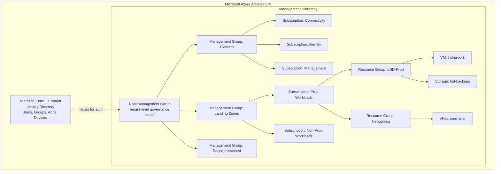
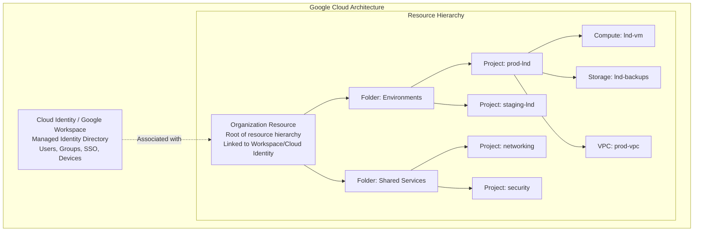

# Abstract

This document provides a comprehensive cloud-level architecture comparison across AWS, GCP, and Azure. It covers the **resource hierarchy** (organizational governance structure), **identity architecture** (separation of identity plane vs authorization plane, with deep dive on Entra ID vs Azure RBAC), **CSPM capabilities** (Defender for Cloud vs Security Hub vs Security Command Center), and **productivity platforms** (Microsoft 365 vs Google Workspace). Unlike deployment architecture, this focuses on the cloud's native organizational, governance, and identity architecture that determines how you structure, secure, and manage resources at scale.

---

# 1. Cloud Resource Hierarchy Architecture

## 1.1 Why Resource Hierarchy Matters

The resource hierarchy is the **governance backbone** of every cloud. It determines:
- **Policy inheritance** (SCPs, Org Policies, Azure Policies)
- **Billing boundaries** (Account, Project, Subscription)
- **Access control scope** (where IAM bindings apply)
- **Compliance enforcement** (where guardrails attach)
- **Cost allocation** (chargeback/showback)

## 1.2 Architecture Comparison

### Microsoft Azure



**Figure 1:** Azure Resource Hierarchy (Identity + Management separation)

| Level | Purpose | Policy Attachment | Billing Boundary |
|-------|---------|-------------------|------------------|
| **Entra ID Tenant** | Identity directory (users, groups, apps, devices) | Conditional Access, Entitlement Management, Identity Protection | N/A (identity only) |
| **Root Management Group** | Top of management hierarchy | Azure Policies, Blueprints, Policy Initiatives | No |
| **Management Groups** | Logical grouping (platform, landing zones, environments) | Azure Policies, Role Assignments | No |
| **Subscriptions** | **Billing boundary**, quota limit, hard isolation | Azure Policies, RBAC, Cost Management | **Yes** (invoice, spending limits) |
| **Resource Groups** | Lifecycle management, RBAC scope | RBAC, Azure Policy, Locks | No (logical) |
| **Resources** | Actual services (VM, Storage, VNet, etc.) | RBAC, Resource-specific policies | No |

**Key Azure Distinction**: **Entra ID Tenant is separate from Management Hierarchy**. The tenant is the identity provider; management groups/subscriptions are the governance hierarchy. They are linked but distinct.

---

### Google Cloud Platform



**Figure 2:** GCP Resource Hierarchy

| Level | Purpose | Policy Attachment | Billing Boundary |
|-------|---------|-------------------|------------------|
| **Cloud Identity / Workspace** | Managed identity directory (users, groups, SSO, devices) | SSO, MFA, Context-Aware Access, Device Management | N/A |
| **Organization Resource** | **Root of resource hierarchy**, linked to Workspace | Org Policies, IAM Allow Policies, VPC Service Controls | No (billing at project) |
| **Folders** | Grouping (environments, departments, teams) | Org Policies, IAM Allow Policies | No |
| **Projects** | **Billing boundary**, API enablement, quota, isolation | IAM Allow Policies, Org Policies, VPC SC | **Yes** (billing account) |
| **Resources** | Services (VM, GCS, Cloud SQL, etc.) | IAM Allow Policies | No |

**Key GCP Distinction**: **Organization Resource ≠ Identity Directory**. The Organization is the hierarchy root; Cloud Identity/Workspace is the directory. They are linked via verified domain. A domain can only be associated with one Organization.

---

### Amazon Web Services

```mermaid
graph TB
    subgraph AWS[AWS Architecture]
        MgmtAccount[Management Account<br/>Payer, Org admin, Security Hub admin]
        
        subgraph Org[AWS Organizations]
            RootOU[Root OU]
            
            RootOU --> OU1[OU: Security]
            RootOU --> OU2[OU: Infrastructure]
            RootOU --> OU3[OU: Workloads]
            RootOU --> OU4[OU: Sandbox]
            
            OU1 --> Acc1[Account: Audit/Log Archive]
            OU1 --> Acc2[Account: Security Tooling]
            
            OU2 --> Acc3[Account: Network/Connectivity]
            OU2 --> Acc4[Account: Identity/IAM]
            
            OU3 --> Acc5[Account: Prod-LND]
            OU3 --> Acc6[Account: Non-Prod-LND]
            
            Acc5 --> Res1[VPC, EC2, RDS, S3]
            Acc5 --> Res2[EKS Cluster]
        end
        
        IAMIdentityCenter[IAM Identity Center<br/>Workforce SSO + Permission Sets]
        
        MgmtAccount -->|Manages| Org
        MgmtAccount -->|Configures| IAMIdentityCenter
```

**Figure 3:** AWS Resource Hierarchy

| Level | Purpose | Policy Attachment | Billing Boundary |
|-------|---------|-------------------|------------------|
| **Management Account** | Payer, Organizations admin, delegated admin services | SCPs (at Root/OU), CloudFormation StackSets | **Yes** (pays for all) |
| **AWS Organizations** | Central governance for accounts | SCPs (Service Control Policies) | No (management account pays) |
| **Organizational Units (OUs)** | Group accounts (Security, Infra, Workloads, Sandbox) | SCPs, Tag Policies, Backup Policies | No |
| **AWS Accounts** | **Hard isolation boundary**, quota, billing, **billing boundary** | IAM Policies, Resource Policies, SCPs inherited | **Yes** (separate bill, consolidated) |
| **Resources** | Services (EC2, S3, RDS, etc.) | IAM Policies, Resource Policies | No |

**Key AWS Distinction**: **Accounts are the hard isolation boundary**. No resource sharing across accounts without explicit cross-account roles or Resource Access Manager. Organizations provides governance via SCPs (which are **deny-by-default guardrails**, not allow policies).

---

## 1.3 Hierarchy Comparison Matrix

| Aspect | Azure | GCP | AWS |
|--------|-------|-----|-----|
| **Identity Directory** | Entra ID Tenant (separate) | Cloud Identity / Workspace (linked to Org) | IAM Identity Center (separate) / IAM Users (legacy) |
| **Hierarchy Root** | Root Management Group | Organization Resource | Organizations Root OU |
| **Grouping Layer** | Management Groups (nested) | Folders (nested) | Organizational Units (nested) |
| **Billing/Isolation Boundary** | **Subscription** | **Project** | **Account** |
| **Resource Container** | Resource Group | Project (also billing) | Account (also billing) |
| **Policy Inheritance** | Azure Policy (Allow + Deny) | Org Policies (Constraints) + IAM Allow Policies | SCPs (Deny guardrails) + IAM Policies |
| **Hard Isolation** | Subscription | Project | Account |
| **Max Nesting** | 6 levels (Mgmt Groups) | 4 levels (Org → Folder → Folder → Project) | 5 levels (Root → OU → OU → OU → Account) |

---

# 2. CSPM Detailed Comparison: Defender for Cloud vs Security Hub vs SCC

## 2.1 Architecture Overview

| CSPM | Architecture | Data Sources | Multi-Cloud |
|------|--------------|--------------|-------------|
| **Azure Defender for Cloud** | Azure-native, extends to AWS/GCP via connectors | Azure resources, AWS (CloudTrail, Config), GCP (Cloud Asset, Config) | Yes (native connectors) |
| **AWS Security Hub** | AWS-native, aggregates findings | AWS Config, GuardDuty, Inspector, Macie, IAM Access Analyzer, Partner integrations | Limited (via partner integrations) |
| **GCP Security Command Center (SCC)** | GCP-native, organization-level | GCP resources, Cloud Asset Inventory, Cloud Logging, Partner findings | Limited (via partner integrations) |

## 2.2 Feature Comparison Matrix

| Capability | Azure Defender for Cloud (P2) | AWS Security Hub | GCP SCC (Premium) |
|------------|------------------------------|------------------|-------------------|
| **Frameworks Supported** | CIS, PCI DSS, NIST, ISO, SOC, GDPR, HIPAA, FedRAMP, Azure Well-Architected | CIS, PCI DSS, NIST, ISO, SOC, AWS Foundational | CIS, PCI DSS, NIST, ISO, SOC, GDPR, HIPAA |
| **Managed Controls** | 200+ (built-in) | 300+ (AWS + custom) | 200+ (detectors) |
| **Custom Controls** | Yes (Initiatives, Policies) | Yes (Custom Insights, Controls) | Yes (Custom Detectors) |
| **Multi-Account/Project** | Native (Management Groups) | Native (Organizations) | Native (Org-level SCC) |
| **Multi-Cloud** | **Yes** (AWS, GCP connectors) | Limited (Partner: Wiz, Orca, Prisma) | Limited (Partner) |
| **Asset Inventory** | Yes (Resource Graph) | Yes (Config + Resource Explorer) | Yes (Cloud Asset Inventory) |
| **Attack Path Analysis** | **Yes** (Attack Path) | No (requires Inspector) | No (requires Chronicle) |
| **Cloud Workload Protection** | Defender for Servers/Containers/Apps (P2) | GuardDuty + Inspector (separate) | VM Manager, Container Analysis (separate) |
| **Vulnerability Scanning** | Defender for Servers (Qualys) | Inspector (EC2, ECR, Lambda) | VM Manager (OS patch), Container Analysis |
| **Data Security** | Purview integration, DLP | Macie (separate) | Cloud DLP (separate) |
| **Threat Detection** | Defender plans (Servers, SQL, Storage, etc.) | GuardDuty (separate) | SCC Threat Detection (Premium) |
| **Compliance Dashboard** | **Yes** (Regulatory compliance) | Yes (Standards) | Yes (Standards) |
| **Automated Remediation** | Logic Apps, Automation, GitHub Actions | SSM Automation, Lambda, EventBridge | Cloud Functions, Config Connector |
| **SIEM Integration** | **Sentinel (native)**, Splunk, QRadar | OpenSearch, Splunk, Sumo Logic | Chronicle (native), Splunk |
| **API/Automation** | REST, PowerShell, CLI, Terraform | REST, CLI, Terraform | REST, CLI, Terraform |
| **GDPR-Specific** | GDPR Blueprint, Purview Data Map | Macie (PII), Artifact | Cloud DLP, Artifact |

## 2.3 Pricing Comparison (Monthly, Estimated)

| Tier | Azure Defender for Cloud | AWS Security Hub | GCP SCC |
|------|--------------------------|------------------|---------|
| **Free Tier** | CSPM (CIS, Azure policies), Secure Score | CIS AWS Foundations, basic findings | Free tier (basic detectors, 30-day retention) |
| **Paid Tier** | **P2: $15/resource/month** (VM, SQL, Storage, Key Vault, etc.) | **$0.0010/finding/month** + $0.0001/assessment | **Premium: $0.02/asset/hour** (~$14.40/asset/month) |
| **Workload Protection** | Included in P2 (Servers, Containers, SQL, etc.) | Separate: GuardDuty ($4M events), Inspector ($0.06/asset) | Separate: VM Manager, Container Analysis |
| **Data Retention** | 90 days (free), 730 days (P2) | 90 days (extendable via S3) | 30 days (free), 13 months (Premium) |
| **Multi-Cloud Cost** | Included in P2 per resource | Partner-dependent (Wiz ~$100K+/yr) | Partner-dependent |

**Cost Example** (100 VMs, 50 SQL DBs, 20 Storage accounts):
| Provider | Monthly Estimate |
|----------|------------------|
| **Azure Defender P2** | (100+50+20) × $15 = **$2,550/mo** |
| **AWS Security Hub** | ~$500-1,000/mo (findings-based) + GuardDuty/Inspector |
| **GCP SCC Premium** | (170 assets) × $14.40 = **$2,448/mo** + workload protection |

## 2.4 Key Differentiators

| Differentiator | Azure Defender for Cloud | AWS Security Hub | GCP SCC |
|----------------|--------------------------|------------------|---------|
| **Best For** | **Hybrid/Multi-cloud + Microsoft ecosystem** | AWS-only shops | GCP-only shops |
| **Attack Path** | **Built-in** (unique) | No | No |
| **Sentinel Integration** | **Native** (single pane) | Requires OpenSearch/Splunk | Chronicle (separate product) |
| **Purview/Compliance** | **GDPR Blueprint, Purview Data Map** | Macie + Artifact | Cloud DLP + Artifact |
| **Governance** | Management Groups + Azure Policy | Organizations + Config | Org Policies + Policy Controller |
| **Ease of Onboarding** | Single click (P2) | Enable per region | Enable at Org level |

**Recommendation**:
- **Microsoft 365 / Azure shops**: Defender for Cloud P2 (best integration, attack paths, Sentinel)
- **AWS-native**: Security Hub + GuardDuty + Inspector (cost-effective at scale)
- **GCP-native**: SCC Premium (strong detectors, Chronicle integration)
- **Multi-cloud**: Defender for Cloud (native AWS/GCP connectors) or vendor CSPM (Wiz, Prisma, Orca)

---

# 3. Azure Identity Architecture: Entra ID vs Azure RBAC

## 3.1 The Two-Plane Model

Azure separates **Identity (Authentication)** from **Authorization (Access Control)**:

```mermaid
graph TB
    subgraph IdentityPlane[Identity Plane - Microsoft Entra ID]
        Users[Users, Groups, Devices]
        Apps[App Registrations, Enterprise Apps]
        CondAccess[Conditional Access Policies]
        Entitlement[Entitlement Management]
        IdentityProtection[Identity Protection]
        PIMA[Privileged Identity Management]
        ExtIdentities[External Identities (B2B/B2C)]
    end
    
    subgraph AuthZPlane[Authorization Plane - Azure RBAC]
        MgmtGroups[Management Groups]
        Subscriptions[Subscriptions]
        ResourceGroups[Resource Groups]
        Resources[Resources]
        RoleAssignments[Role Assignments (Principal + Role + Scope)]
        CustomRoles[Custom Roles]
        DenyAssignments[Deny Assignments]
    end
    
    EntraID[Entra ID Tenant] -->|Authenticates| Users
    EntraID -->|Issues Tokens| Apps
    EntraID -->|Enforces| CondAccess
    EntraID -->|Manages| Entitlement
    EntraID -->|Protects| IdentityProtection
    
    Users -->|Authenticated Principal| RoleAssignments
    Apps -->|Service Principal| RoleAssignments
    Groups -->|Group Membership| RoleAssignments
    
    RoleAssignments -->|Grants Access| Subscriptions
    RoleAssignments -->|Grants Access| ResourceGroups
    RoleAssignments -->|Grants Access| Resources
```

**Figure 4:** Azure Two-Plane Identity Architecture

## 3.2 Entra ID (Identity Plane) - What You Configure Here

| Capability | Description | Where Configured |
|------------|-------------|------------------|
| **Users & Groups** | Create/manage users, dynamic groups, group licensing | Entra ID → Users, Groups |
| **Authentication Methods** | Passwordless (FIDO2, Phone sign-in), MFA, Windows Hello | Entra ID → Authentication Methods |
| **Conditional Access** | **Policy engine**: if (user + device + location + risk) then (require MFA, block, require compliant device) | Entra ID → Protection → Conditional Access |
| **Identity Protection** | Risk-based (user risk, sign-in risk), automated remediation | Entra ID → Protection → Identity Protection |
| **Privileged Identity Management (PIM)** | Just-in-time admin, time-bound roles, approval workflows | Entra ID → PIM |
| **Entitlement Management** | Access packages, catalogs, self-service access requests, lifecycle | Entra ID → Identity Governance → Entitlement Management |
| **External Identities (B2B/B2C)** | Guest users, partner organizations, customer identities | Entra ID → External Identities |
| **App Registrations** | OAuth/OIDC apps, API permissions, client secrets, certificates | Entra ID → App Registrations |
| **Enterprise Applications** | SAML SSO for gallery/custom apps, provisioning (SCIM), user assignment | Entra ID → Enterprise Applications |
| **Domain Management** | Custom domains, verification, federation (AD FS) | Entra ID → Custom Domain Names |
| **Company Branding** | Sign-in page customization, MFA prompts | Entra ID → Branding |
| **Naming Policies** | Group naming, expiration, classification | Entra ID → Groups → Policies |

## 3.3 Azure RBAC (Authorization Plane) - What You Configure Here

| Capability | Description | Where Configured |
|------------|-------------|------------------|
| **Role Assignments** | Principal (User/Group/SP/MI) + Role + Scope | Subscription → Access Control (IAM) |
| **Built-in Roles** | Owner, Contributor, Reader, + 200+ service-specific | Azure Portal → IAM → Roles |
| **Custom Roles** | Custom permission sets (Actions, NotActions, DataActions) | Subscription → IAM → Custom Roles |
| **Deny Assignments** | Explicit deny (Blueprints, Managed Apps) | Azure Policy, Blueprints |
| **Management Group Policies** | Azure Policy (Audit, Deny, DeployIfNotExists, Modify) | Management Groups → Policies |
| **Subscription Policies** | Policy assignments at subscription level | Subscription → Policies |
| **Resource Locks** | CanNotDelete, ReadOnly | Resource → Locks |
| **Azure AD Roles (Entra ID roles)** | Global Admin, Security Admin, User Admin, etc. | Entra ID → Roles and Admins (separate from Azure RBAC) |

## 3.4 Critical Distinction: Entra ID Roles vs Azure RBAC Roles

| Aspect | Entra ID Roles (Directory Roles) | Azure RBAC Roles |
|--------|----------------------------------|------------------|
| **Scope** | **Tenant-wide** (directory) | **Subscription/Resource Group/Resource** |
| **Purpose** | Manage Entra ID itself (users, groups, apps, domains) | Manage Azure resources (VMs, Storage, Network, etc.) |
| **Examples** | Global Admin, Security Admin, User Admin, Application Admin | Owner, Contributor, Reader, Virtual Machine Contributor |
| **Assignment** | Entra ID → Roles and Admins | Subscription/RG → Access Control (IAM) |
| **Inheritance** | None (tenant-wide) | Inherits down hierarchy (Mgmt Group → Sub → RG → Resource) |
| **Managed By** | Global Admins, Privileged Role Admins | Owners, User Access Admins at scope |

> **Key Point**: Entra ID roles manage **identity system**; Azure RBAC roles manage **cloud resources**. They are completely separate role systems.

## 3.4 Conditional Access Deep Dive

Conditional Access is the **policy engine** of Entra ID. It evaluates signals at authentication time:

```mermaid
flowchart TD
    Auth[Authentication Request] --> Signals[Collect Signals]
    Signals --> User[User/Group]
    Signals --> Device[Device Platform, State, Compliance]
    Signals --> Location[IP, Named Locations, Geo]
    Signals --> App[Cloud App/Resource]
    Signals --> Risk[Sign-in Risk, User Risk]
    Signals --> Client[Client App (Browser, Mobile, Exchange)]
    
    Signals --> Policy[Conditional Access Policy]
    Policy -->|Match| Decision[Grant/Block]
    Decision -->|Grant| Controls[Require MFA, Compliant Device, Hybrid Join, Approved App, Session Limits]
    Decision -->|Block| Deny[Access Denied]
    Decision -->|Session| SessionControls[Sign-in Frequency, Persistent Browser, App Enforced Restrictions]
```

**Figure 5:** Conditional Access Evaluation Flow

### Common Conditional Access Policies

| Policy Name | Conditions | Grant Controls | Purpose |
|-------------|------------|----------------|---------|
| **Require MFA for Admins** | Users: Directory Roles (Global Admin, etc.) | Require MFA | Protect privileged accounts |
| **Require MFA for All Users** | All Users, All Cloud Apps | Require MFA | Baseline security |
| **Block Legacy Auth** | Client Apps: Exchange ActiveSync, IMAP, POP, SMTP | Block | Prevent password spray |
| **Require Compliant Device** | Users: All, Apps: All, Device: Not Compliant | Require Compliant Device | Zero Trust device posture |
| **Block High-Risk Countries** | Locations: High-risk named locations | Block | Geo-blocking |
| **Risk-Based MFA** | Sign-in Risk: High/Medium | Require MFA | Identity Protection integration |
| **Require PIM Activation** | Users: PIM-eligible, Apps: Azure Management | Require MFA + Approval | Just-in-time admin |

## 3.5 Entitlement Management

Entitlement Management provides **identity governance** for access lifecycle:

| Component | Purpose |
|-----------|---------|
| **Access Packages** | Bundle of resources (Groups, Apps, SharePoint sites) with policies |
| **Catalogs** | Container for access packages (delegated to business owners) |
| **Policies** | Who can request, approval workflow, expiration, reviews |
| **Connected Organizations** | External partner organizations (B2B) with automated access |
| **Access Reviews** | Periodic attestation (quarterly, monthly) with recommendations |

**Use Case**: Instead of IT manually adding users to groups, business owners create access packages. Users request access → approval workflow → automatic provisioning → expiration → review.

---

# 4. Productivity Platform Comparison: Microsoft 365 vs Google Workspace

## 4.1 Licensing Tiers

### Microsoft 365 Enterprise

| Plan | Monthly/User (Annual Commit) | Key Features |
|------|------------------------------|--------------|
| **E3** | $36.00 | Office apps (desktop + web), 1 TB OneDrive, Teams, Exchange (50 GB), SharePoint, Intune (basic), Azure AD P1, Defender for Office 365 P1, Information Protection, eDiscovery |
| **E5** | $57.00 | **Everything in E3 +**: Defender for Office 365 P2, Defender for Endpoint P2, Cloud App Security, Identity Protection, PIM, Entitlement Management, Advanced eDiscovery, Communication Compliance, Insider Risk, Customer Lockbox, Advanced Audit, Power BI Pro |
| **F3** | $8.00 | Frontline workers: Web/mobile Office, 2 GB OneDrive, Teams, Exchange (2 GB), SharePoint, Intune, Azure AD P1 |

### Google Workspace

| Plan | Monthly/User (Annual Commit) | Key Features |
|------|------------------------------|--------------|
| **Business Starter** | $6.00 | 30 GB storage, Gmail, Meet (100 participants), Drive, Docs, Sheets, Slides, Chat, Calendar, Admin Console |
| **Business Standard** | $12.00 | 2 TB storage, Meet (150 participants + recording), Drive, Vault (basic), Security Center (basic) |
| **Business Plus** | $18.00 | 5 TB storage, Meet (500 participants + attendance), Vault (advanced), Security Center, eDiscovery, DLP (basic), Context-Aware Access |
| **Enterprise Standard** | $20.00* | 5 TB +, Meet (500 + noise cancellation), Vault, Security Center, DLP, Context-Aware Access, S/MIME, CSE |
| **Enterprise Plus** | $30.00* | **Everything in Standard +**: Security Center (advanced), DLP (advanced), CSE (Client-Side Encryption), S/MIME, Meet (1000 + live streaming), Endpoint Management, AppSheet Core |

*Pricing varies by region/commitment; contact sales for Enterprise.

---

## 4.2 Feature Comparison Matrix

| Capability | Microsoft 365 E5 | Google Workspace Enterprise Plus |
|------------|------------------|----------------------------------|
| **Email** | Exchange Online (100 GB mailbox, 150 MB attachments) | Gmail (unlimited storage, 50 MB attachments) |
| **Calendar** | Outlook Calendar (delegation, room finder) | Google Calendar (appointment slots, out of office) |
| **File Storage** | OneDrive (1 TB/user), SharePoint (1 TB + 10 GB/license) | Drive (unlimited, 5 TB/user minimum) |
| **Collaboration** | Teams (300 participants, breakout rooms, live captions, recording, webinars 1000) | Meet (1000, live streaming 100k, noise cancellation, breakout rooms), Chat, Spaces |
| **Document Editing** | Office Apps (Desktop + Web: Word, Excel, PowerPoint) | Docs, Sheets, Slides (Web-only, .docx/.xlsx/.pptx compatible) |
| **Intranet/Portal** | SharePoint (sites, pages, lists, libraries, Power Platform) | Sites (basic), AppSheet (no-code apps) |
| **Automation** | Power Automate, Power Apps, Power BI Pro (included) | AppSheet Core, Apps Script, Looker Studio |
| **Security - Identity** | **Entra ID P2** (PIM, Identity Protection, Entitlement Mgmt) | **Context-Aware Access**, Security Center, 2SV enforcement |
| **Security - Endpoint** | **Defender for Endpoint P2** (EDR, AV, ASR, ATP) | **Chrome Enterprise**, Endpoint Management, BeyondCorp |
| **Security - Email** | **Defender for Office 365 P2** (Safe Links, Attachments, Auto-investigation) | **Security Center Advanced**, DLP, Phishing protection |
| **Security - Cloud Apps** | **Defender for Cloud Apps** (CASB, Shadow IT, OAuth apps) | **Security Center**, OAuth app monitoring |
| **Compliance** | **Purview** (Data Map, DLP, Insider Risk, Communication Compliance, eDiscovery Premium, Records Mgmt) | **Vault** (Retention, Hold, Export), DLP, S/MIME, CSE |
| **Analytics** | **Power BI Pro** (included), Viva Insights, Adoption Score | Looker Studio, Work Insights, Security Center dashboards |
| **Voice/PSTN** | Teams Phone (add-on), Calling Plans | Meet hardware, Voice (add-on via partners) |
| **Developer Platform** | Power Platform (Dataverse, Connectors), Graph API | Apps Script, AppSheet, Workspace APIs, Chat API |

---

## 4.3 Security Feature Deep Dive

### Microsoft 365 E5 Security Stack

| Component | Capability | Equivalent in Google |
|-----------|------------|---------------------|
| **Entra ID P2** | PIM, Identity Protection, Entitlement Mgmt, Risk-based CA | Context-Aware Access, Security Center |
| **Defender for Endpoint P2** | EDR, AV, ASR, Automated Investigation, Threat Hunting | Chrome Enterprise + Endpoint Management |
| **Defender for Office 365 P2** | Safe Links/Attachments, Campaign Views, Auto-investigation | Security Center Advanced, Phishing Protection |
| **Defender for Cloud Apps** | CASB, Shadow IT Discovery, OAuth App Control, Session Control | Security Center (OAuth monitoring) |
| **Purview** | Data Map, DLP, Insider Risk, Comm Compliance, eDiscovery, Records | Vault, DLP, CSE (Client-Side Encryption) |
| **Defender for Identity** | AD Sensor, Lateral Movement Detection, Honeytoken | N/A (no on-prem AD equivalent) |
| **Defender for Cloud Apps** | Session control, Reverse proxy, API connectors | Limited |

### Google Workspace Enterprise Plus Security Stack

| Component | Capability | Equivalent in Microsoft |
|-----------|------------|------------------------|
| **Context-Aware Access** | Device posture, IP, Geo, User risk → allow/block | Conditional Access (Entra ID P1/P2) |
| **Security Center** | Dashboard, Phishing protection, Malware detection, OAuth monitoring | Defender for Office 365 + Cloud Apps |
| **Data Loss Prevention (DLP)** | Rules for Drive, Gmail, Chat, Chat; OCR, Predefined detectors | Purview DLP (Exchange, SharePoint, Teams, Endpoint) |
| **Client-Side Encryption (CSE)** | Customer-held keys for Drive, Gmail, Calendar, Meet | Purview (Double Key Encryption) |
| **Vault** | Retention, Hold, Search, Export for Gmail, Drive, Chat, Meet | Purview eDiscovery + Retention |
| **S/MIME** | Email encryption/signing (managed certs) | Purview S/MIME |
| **Endpoint Management** | ChromeOS, Windows, Mac, iOS, Android policies | Intune (included in E3/E5) |
| **Advanced Protection Program** | High-risk user enrollment (security keys, limited apps) | N/A (similar to PIM + CA) |

---

## 4.4 Pricing Comparison (Annual Commit, Per User/Month)

| Scenario | Microsoft 365 | Google Workspace |
|----------|---------------|------------------|
| **Knowledge Worker (Full Security)** | **E5: $57.00** | **Enterprise Plus: ~$30.00** |
| **Knowledge Worker (Standard Security)** | **E3: $36.00** | **Enterprise Standard: ~$20.00** |
| **Frontline/Deskless** | **F3: $8.00** | **Business Starter: $6.00** |
| **Add-ons** | Teams Phone ($8), Power BI Premium ($20), Defender for Cloud Apps ($?) | Voice (partner), AppSheet ($5-15), Looker ($30-125) |
| **Total Cost of Ownership** | Higher license cost, but includes: Power BI Pro, Defender stack, Purview, Phone add-on | Lower license cost, but add-ons for: Voice, Advanced Analytics, AppSheet |

**Cost Insight**: Google Workspace is **~40-50% cheaper** at license level. However, Microsoft 365 E5 includes **Defender for Endpoint P2 ($5.20/user), Defender for Office 365 P2, Purview, Power BI Pro ($10), PIM** — which would cost significantly more as add-ons in Google. Total security stack cost is comparable when fully loaded.

---

## 4.5 Integration with Cloud Identity

| Aspect | Microsoft 365 + Azure | Google Workspace + GCP |
|--------|----------------------|------------------------|
| **Identity Source** | **Entra ID** (single directory for M365 + Azure) | **Cloud Identity / Workspace** (single directory for Workspace + GCP) |
| **SSO to Cloud Console** | Native (Entra ID = Azure identity) | Native (Workspace = GCP identity) |
| **Conditional Access / Context-Aware** | Entra ID CA policies apply to Azure + M365 | Context-Aware Access applies to Workspace + GCP |
| **Privileged Access** | PIM (Entra ID P2) for Azure + M365 roles | Context-Aware Access + Admin Roles |
| **Provisioning** | SCIM to Entra ID, HR-driven (Workday, SuccessFactors) | SCIM to Cloud Identity, HR-driven |
| **B2B Collaboration** | Entra ID External Identities (B2B) | Workspace Sharing + Groups |
| **Logging** | Unified in Microsoft 365 Audit + Azure Activity Log | Unified in Cloud Audit Logs + Admin Reports |

---

## 4.6 Decision Matrix

| Requirement | Choose Microsoft 365 | Choose Google Workspace |
|-------------|---------------------|------------------------|
| **Existing Microsoft Ecosystem** | Windows, Active Directory, Office desktop apps | N/A |
| **Advanced Endpoint Security** | Defender for Endpoint P2 (EDR) needed | Chrome Enterprise sufficient |
| **Data Governance/Compliance** | Purview (Insider Risk, Comm Compliance, Records) | Vault + DLP + CSE sufficient |
| **Desktop Office Apps Required** | Word/Excel/PowerPoint desktop critical | Web-only acceptable |
| **Teams vs Meet** | Teams (300, webinars, breakout, PSTN) | Meet (1000, live stream, noise cancel) |
| **Power Platform / Low-Code** | Power Apps, Automate, BI Pro needed | AppSheet, Apps Script, Looker Studio |
| **Cost Optimization** | Willing to pay premium for integrated stack | License cost primary driver |
| **Multi-Cloud Identity** | Entra ID as central IdP for AWS/GCP | Cloud Identity as central IdP for AWS/Azure |
| **On-Premises AD Integration** | Hybrid AD (Entra Connect, PHS/PTA/Federation) | Google Cloud Directory Sync (GCDS) |

---

## 4.7 Free Trial Comparison: Cloud Platforms & Productivity Suites

### 4.7.1 Cloud Platform Free Trials

| Aspect | AWS | GCP | Azure |
|--------|-----|-----|-------|
| **Trial Duration** | 12 months (Free Tier) | 90 days (trial credit) | 30 days (credit) + 12 months (select services) |
| **Free Credit** | None (service-based free tier) | **$300 USD** (90 days) | **$200 USD** (30 days) |
| **Payment Method Required** | **Yes** — Credit/debit card at signup | **Yes** — Credit/debit card required | **Yes** — Credit/debit card for verification |
| **Card Authorization Hold** | Small verification charge ($1-2, refunded) | **₹3,000 INR (~$36 USD)** temporary hold on debit/credit card | Small verification ($1-2, refunded) |
| **Free Tier Services** | 12-month: EC2 t2/t3.micro, RDS, S3, Lambda, DynamoDB<br>Always Free: Lambda 1M req, S3 5 GB, CloudFront 50 GB | Always Free: e2-micro (1 in us regions), 5 GB Cloud Storage, 1 GB Logging | 12-month: B1S VM (750 hrs), SQL DB (250 GB), Cosmos DB (5 GB), Blob (5 GB), Bandwidth (15 GB) |
| **Identity/Admin Console Access** | IAM Identity Center (free), AWS Console (full) | **Google Admin Console NOT available** — requires paid Workspace/Cloud Identity (~$6/user/mo) | Entra ID Free tier included (500K objects, SSO for 10 apps) |
| **Workspace/Identity Suite** | Not applicable (use third-party) | **Google Workspace/Cloud Identity NOT included** — separate paid subscription (~$6/user/mo for Business Starter) | Entra ID Free tier included; Entra ID P1/P2 requires paid license |
| **Services NOT in Free Tier** | EKS control plane, NAT Gateway, Transit Gateway, Shield Advanced, Global Accelerator | Cloud Interconnect, Cloud Armor Premium, Cloud NGFW, SCC Premium, Anthos, Vertex AI | Azure Firewall, Front Door, DDoS Protection Standard, Defender P2, ExpressRoute, Virtual WAN |
| **Trial Expiration Behavior** | Services continue within Always Free limits; paid services stop | Services stop if not upgraded; data retained 30 days then deleted | Subscription disabled; data retained 90 days then deleted |
| **Upgrade Path** | Automatic (pay-as-you-go billing) | Must upgrade billing account to paid | Upgrade to pay-as-you-go subscription |
| **Student/Developer Programs** | AWS Educate ($100 credit), Activate for Startups | Google Cloud for Education, Startup Program | Azure for Students ($100 credit), VS Subscribers ($50-150/mo) |

References: [AWS Free Tier](https://aws.amazon.com/free/), [Google Cloud Free Trial](https://cloud.google.com/free), [Azure Free Account](https://azure.microsoft.com/free/)

---

### 4.7.2 Productivity Suite Trials (Microsoft 365 vs Google Workspace)

| Aspect | Microsoft 365 | Google Workspace |
|--------|---------------|------------------|
| **Trial Duration** | 30 days (most plans) | 14 days (Business plans), 30 days (Enterprise) |
| **Users Included** | Up to 25 users | Up to 10 users (Business), 50 users (Enterprise) |
| **Payment Method** | Credit card required (not charged until trial ends) | Credit card required |
| **Admin Console Access** | **Full Microsoft 365 Admin Center** — all features available | **Full Google Admin Console** — all features available during trial |
| **Entra ID / Cloud Identity** | Entra ID P2 trial included (PIM, Identity Protection, Entitlement Mgmt) | Cloud Identity Premium trial included (Context-Aware Access, Security Center) |
| **Desktop Apps** | Full Office desktop apps (Windows/Mac) | N/A (web-only) |
| **Teams vs Meet** | Full Teams (300 participants, webinars, PSTN add-on) | Full Meet (up to 1000 participants, live streaming) |
| **Security Features in Trial** | Entra ID P2 (PIM, Identity Protection), Defender for Office 365 P2, Defender for Endpoint P2, Purview trial | Context-Aware Access, Security Center Advanced, DLP, Vault, CSE trial |
| **Data Retention Post-Trial** | 30 days grace period, then data deleted | 30 days grace period, then data deleted |
| **Migration Support** | FastTrack (eligible tenants), migration tools | Migration tools (G Suite Migration, Data Migration Service) |
| **Post-Trial Commitment** | Monthly or Annual commit (monthly ~20% premium) | Monthly or Annual commit (monthly ~20% premium) |

References: [Microsoft 365 Trial](https://www.microsoft.com/microsoft-365/business/compare-all-microsoft-365-business-products), [Google Workspace Trial](https://workspace.google.com/intl/en_in/pricing.html)

---

# 5. Cloud-Level Architecture Summary

## 5.1 Decision Framework

| Decision Point | Azure | GCP | AWS |
|----------------|-------|-----|-----|
| **Resource Hierarchy** | Subscription = billing boundary; Mgmt Groups for policy | Project = billing boundary; Folders for policy | Account = billing boundary; OUs for SCPs |
| **Identity** | **Entra ID** (separate tenant) + Azure RBAC (separate plane) | **Cloud Identity/Workspace** (linked to Org) + IAM | **IAM Identity Center** (separate) / IAM Users |
| **CSPM** | **Defender for Cloud P2** (multi-cloud, attack paths, Sentinel) | SCC Premium (strong detectors, Chronicle) | Security Hub + GuardDuty + Inspector |
| **Productivity** | **Microsoft 365 E5** (integrated security stack, Purview, Power Platform) | **Google Workspace Enterprise Plus** (CSE, Vault, Meet) | N/A (use third-party) |
| **Governance** | Management Groups + Azure Policy (Allow+Deny) | Org Policies (Constraints) + IAM Allow Policies | Organizations + SCPs (Deny Guardrails) |
| **Compliance** | Purview (Data Map, DLP, Insider Risk, Records) | Cloud DLP + Vault + CSE | Macie + Security Hub + Audit Manager |

## 5.2 LND-Specific Cloud Architecture Recommendations

| Component | Recommended Architecture |
|-----------|-------------------------|
| **Resource Hierarchy** | **Azure**: Separate subscriptions (Network, Identity, Prod-LND, Non-Prod-LND) under Mgmt Groups<br>**GCP**: Separate projects (Prod, Staging, Networking, Security) under Folders<br>**AWS**: Separate accounts (Audit, Security, Network, Prod-LND, Non-Prod) under OUs |
| **Identity** | **Azure**: Entra ID for workforce (CA, PIM, Entitlement), Managed Identity for workloads<br>**GCP**: Cloud Identity + WIF (Workforce + Workload)<br>**AWS**: IAM Identity Center (SAML+SCIM) + IRSA for EKS |
| **Security** | **Azure**: Defender for Cloud P2 + Sentinel + Purview<br>**GCP**: SCC Premium + Chronicle + Cloud DLP<br>**AWS**: Security Hub + GuardDuty + Inspector + Macie |
| **Productivity** | **Microsoft 365 E5** (if using Azure/Entra ID) — integrated stack<br>**Google Workspace Enterprise Plus** (if using GCP) — CSE, Vault |
| **Network** | **Azure**: Virtual WAN + Azure Firewall Premium + Private Link<br>**GCP**: NCC + Cloud NGFW + PSC<br>**AWS**: Cloud WAN + Network Firewall + PrivateLink |

---

# References

[1] Microsoft, "Azure Resource Hierarchy," https://learn.microsoft.com/azure/cloud-adoption-framework/ready/azure-best-practices/resource-hierarchy
[2] Microsoft, "Entra ID Documentation," https://learn.microsoft.com/entra/
[3] Microsoft, "Azure RBAC Documentation," https://learn.microsoft.com/azure/role-based-access-control/
[4] Microsoft, "Conditional Access Documentation," https://learn.microsoft.com/entra/identity/conditional-access/
[5] Microsoft, "Entitlement Management Documentation," https://learn.microsoft.com/entra/id-governance/entitlement-management-overview
[6] Microsoft, "Defender for Cloud Documentation," https://learn.microsoft.com/azure/defender-for-cloud/
[7] Microsoft, "Microsoft 365 Enterprise Plans," https://www.microsoft.com/microsoft-365/enterprise/compare-office-365-plans
[8] Microsoft, "Purview Documentation," https://learn.microsoft.com/azure/purview/

[9] Google Cloud, "Resource Hierarchy," https://cloud.google.com/resource-manager/docs/cloud-platform-resource-hierarchy
[10] Google Cloud, "Cloud Identity Documentation," https://cloud.google.com/identity/docs/overview
[11] Google Cloud, "Security Command Center," https://cloud.google.com/security-command-center/docs
[12] Google Cloud, "Google Workspace Pricing," https://workspace.google.com/pricing.html
[13] Google Cloud, "Context-Aware Access," https://cloud.google.com/identity/docs/context-aware-access

[14] AWS, "Organizations Documentation," https://docs.aws.amazon.com/organizations/latest/userguide/
[15] AWS, "IAM Identity Center Documentation," https://docs.aws.amazon.com/singlesignon/latest/userguide/
[16] AWS, "Security Hub Documentation," https://docs.aws.amazon.com/securityhub/latest/userguide/
[17] AWS, "Control Tower Documentation," https://docs.aws.amazon.com/controltower/latest/userguide/

[18] Microsoft, "Microsoft 365 E5 Security," https://www.microsoft.com/security/business/microsoft-365-security
[19] Google Workspace, "Enterprise Security," https://workspace.google.com/security/
[20] Forrester, "The Total Economic Impact of Microsoft 365 E5 Security," 2023
[21] Forrester, "The Total Economic Impact of Google Workspace," 2023

---

# Appendices

## A. Entra ID Built-in Roles Quick Reference

| Role | Scope | Key Permissions |
|------|-------|-----------------|
| **Global Administrator** | Tenant | Full access to all Entra ID and Microsoft 365 admin centers |
| **Security Administrator** | Tenant | Security Center, Identity Protection, Conditional Access, PIM |
| **User Administrator** | Tenant | Create/manage users, groups, support tickets, service health |
| **Application Administrator** | Tenant | App Registrations, Enterprise Apps, App Proxy |
| **Cloud Application Administrator** | Tenant | App Registrations, Enterprise Apps (no App Proxy) |
| **Privileged Role Administrator** | Tenant | Manage role assignments for privileged roles, PIM |
| **Compliance Administrator** | Tenant | Purview, eDiscovery, Audit, Retention policies |
| **Intune Administrator** | Tenant | Microsoft Intune management |
| **Teams Administrator** | Tenant | Microsoft Teams admin center |
| **SharePoint Administrator** | Tenant | SharePoint Online admin center |

## B. Azure RBAC Built-in Roles Quick Reference

| Role | Scope | Key Permissions |
|------|-------|-----------------|
| **Owner** | Sub/RG/Resource | Full access + delegate access (User Access Administrator) |
| **Contributor** | Sub/RG/Resource | Create/manage all resources (no User Access Admin) |
| **Reader** | Sub/RG/Resource | View all resources (no create/update/delete) |
| **User Access Administrator** | Sub/RG/Resource | Manage role assignments (grant access) |
| **Virtual Machine Contributor** | Sub/RG/Resource | Manage VMs, disks, snapshots, extensions |
| **Storage Account Contributor** | Sub/RG/Resource | Manage storage accounts, containers, blobs |
| **Network Contributor** | Sub/RG/Resource | Manage VNets, NSGs, Load Balancers, Public IPs |
| **Security Admin** | Sub/RG/Resource | Security Center, policies, alerts, recommendations |
| **Key Vault Administrator** | Sub/RG/Resource | Manage Key Vault, keys, secrets, certificates |
| **Log Analytics Contributor** | Sub/RG/Resource | Manage Log Analytics workspaces, queries |

## C. Azure Policy Effects Quick Reference

| Effect | Behavior |
|--------|----------|
| **Deny** | Block resource creation/update (hard block) |
| **Audit** | Log non-compliance (no block) |
| **Append** | Add fields to request (e.g., tags) |
| **DeployIfNotExists** | Deploy resource if missing (remediation) |
| **Modify** | Modify request (e.g., add tags, change SKU) |
| **AuditIfNotExists** | Audit if related resource missing |
| **EnforceOPAConstraint** | Gatekeeper v3 policy (Kubernetes) |
| **EnforceRegoPolicy** | Gatekeeper v2 policy (Kubernetes) |

## D. Microsoft 365 vs Google Workspace Security Feature Matrix

| Security Area | Microsoft 365 E5 | Google Workspace Enterprise Plus |
|---------------|------------------|----------------------------------|
| **Identity Protection** | Entra ID P2 (Risk, PIM, Entitlement) | Context-Aware Access |
| **Endpoint Security** | Defender for Endpoint P2 (EDR) | Chrome Enterprise + Endpoint Mgmt |
| **Email Security** | Defender for Office 365 P2 | Security Center Advanced |
| **Cloud App Security** | Defender for Cloud Apps (CASB) | Security Center (OAuth monitoring) |
| **Data Protection** | Purview (DLP, Insider Risk, Comm Compliance) | Vault, DLP, CSE |
| **Identity Governance** | PIM, Entitlement Mgmt, Access Reviews | Admin Roles, Context-Aware Access |
| **Threat Intelligence** | Defender Threat Intelligence, Graph | Security Center Threat Intel |
| **Compliance** | Purview (eDiscovery, Records, Insider Risk) | Vault (Retention, Hold, Export) |
| **Encryption** | Double Key Encryption, Customer Key | Client-Side Encryption (CSE), S/MIME |
| **Audit/Logging** | Unified Audit Log, Advanced Audit | Cloud Audit Logs, Admin Reports |

---

This document provides the cloud-level architecture foundation. For deployment patterns, see [§00-cloud-intro.architecture-patterns]. For cross-cloud federation patterns, see [§04-cross-cloud.identity-federation-patterns]. For security services comparison, see [§04-cross-cloud.security-networking-comparison].