# Abstract

This document provides an exhaustive comparison of cloud-native security and networking services across AWS, GCP, and Azure. It covers: (1) Security services including DDoS protection, WAF, cloud-native NGFW, bastion hosts, and endpoint protection; (2) Network security including VPN, SD-WAN, MPLS, VPC peering, and PrivateLink; (3) Network components including cloud routers, NAT gateways, shared VPC, and VPC peering communication; (4) DNS and load balancing services; (5) Kubernetes security; (6) CSPM/compliance including GDPR policy enforcement; (7) Third-party vendor integration (Palo Alto Networks, Fortinet, Check Point) with feature parity and cost analysis. All comparisons include architectural explanations, feature matrices, and cost references.

# Table of Contents

1. [Security Services Overview](#1-security-services-overview)
2. [DDoS Protection](#2-ddos-protection)
3. [Web Application Firewall (WAF)](#3-web-application-firewall-waf)
4. [Cloud-Native Network Firewall (NGFW)](#4-cloud-native-network-firewall-ngfw)
5. [Bastion Hosts and Secure Access](#5-bastion-hosts-and-secure-access)
6. [Endpoint Protection and EDR](#6-endpoint-protection-and-edr)
7. [Network Security: VPN, SD-WAN, MPLS](#7-network-security-vpn-sdwan-mpls)
8. [VPC Peering and Private Connectivity](#8-vpc-peering-and-private-connectivity)
9. [Network Components: Router, Switch, NAT, Shared VPC](#9-network-components-router-switch-nat-shared-vpc)
10. [DNS Services](#10-dns-services)
11. [Load Balancing Services](#11-load-balancing-services)
12. [Kubernetes Security](#12-kubernetes-security)
13. [CSPM and Compliance (GDPR, Policy Enforcement)](#13-cspm-and-compliance-gdpr-policy-enforcement)
14. [Third-Party Vendor Integration](#14-third-party-vendor-integration)
15. [Cost Comparison](#15-cost-comparison)
16. [Decision Matrix](#16-decision-matrix)

---

# 1. Security Services Overview

## 1.1 Security Service Categories

Each cloud provider offers a layered security model:

| Layer | AWS | GCP | Azure |
|-------|-----|-----|-------|
| **Network Perimeter** | Network Firewall, Shield, WAF | Cloud Armor, Cloud NGFW | Azure Firewall, Front Door WAF, DDoS Protection |
| **Host/Endpoint** | GuardDuty, Inspector | Security Command Center, VM Manager | Defender for Cloud, Defender for Endpoint |
| **Identity** | IAM, Identity Center, Cognito | Cloud Identity, IAM, Identity Platform | Entra ID, Entra ID Protection |
| **Data** | Macie, KMS, S3 Encryption | Cloud DLP, Cloud KMS, CMEK | Purview, Key Vault, CMK |
| **Compliance** | Security Hub, Config, Audit Manager | Security Command Center, Policy Controller | Defender for Cloud, Azure Policy, Purview |
| **Operations** | CloudTrail, CloudWatch | Cloud Audit Logs, Cloud Logging | Azure Monitor, Activity Log |

## 1.2 Shared Responsibility by Service

| Service Type | Provider Responsibility | Customer Responsibility |
|--------------|------------------------|------------------------|
| **Native SaaS Security** (Shield, Armor, DDoS Protection) | Infrastructure, scaling, signature updates | Rule configuration, tuning, monitoring |
| **Managed Firewall** (Network Firewall, Cloud NGFW, Azure Firewall) | Control plane, HA, updates | Rule sets, logging, integration |
| **Host Security** (GuardDuty, Defender) | Detection engine, threat intel | Response, remediation, custom rules |
| **CSPM** (Security Hub, SCC, Defender for Cloud) | Control framework, assessments | Remediation, custom policies, exceptions |

---

# 2. DDoS Protection

## 2.1 Service Architecture

### AWS Shield
- **Shield Standard**: Automatic, free, L3/L4 protection for all AWS resources (CloudFront, ALB, NLB, Global Accelerator, Route 53, Elastic IP). Mitigates SYN floods, UDP reflection, volumetric attacks up to network capacity.
- **Shield Advanced**: $3,000/month per organization. Adds L7 protection for CloudFront, ALW, Global Accelerator. Includes 24/7 DDoS Response Team (DRT), cost protection for scaling during attacks, advanced metrics, SLA.

### Google Cloud Armor (DDoS)
- **Standard**: Free L3/L4 protection for Cloud Load Balancing (external HTTP(S), TCP/UDP, SSL Proxy). Automatic mitigation of volumetric attacks.
- **Cloud Armor Premium**: Pay-per-use ($0.75/million requests + $5/policy/month). Adds L7 WAF rules, adaptive protection (ML-based), named IP lists, geo-based rules, rate limiting, bot management, SIEM integration.

### Azure DDoS Protection
- **Basic**: Free, automatic L3/L4 protection for all public IPs in VNet. No SLA, no attack analytics.
- **Standard**: $2,944/month per protected resource (Public IP, LB Frontend, App Gateway, Front Door). Includes L3/L4/L7 protection, adaptive tuning, attack analytics, 24/7 Rapid Response Team, cost protection (credits for scale-out during attacks), SLA 99.99%.

## 2.2 Feature Comparison

| Feature | AWS Shield Standard | AWS Shield Advanced | GCP Cloud Armor Standard | GCP Cloud Armor Premium | Azure DDoS Basic | Azure DDoS Standard |
|---------|---------------------|---------------------|--------------------------|-------------------------|------------------|---------------------|
| **Cost** | Free | $3,000/mo/org | Free | $0.75M req + $5/policy/mo | Free | $2,944/mo/resource |
| **L3/L4 Volumetric** | Yes | Yes | Yes | Yes | Yes | Yes |
| **L7 Application** | No | Yes (ALB, CF) | No | Yes (LB, CDN) | No | Yes (all) |
| **Adaptive/ML Tuning** | No | Yes | No | Yes | No | Yes |
| **Attack Analytics** | Limited | Detailed | Limited | Detailed | None | Detailed |
| **24/7 Response Team** | No | Yes (DRT) | No | No | No | Yes (RRT) |
| **Cost Protection** | No | Yes (scaling credits) | No | No | No | Yes (scale credits) |
| **SLA** | No | Yes | No | Yes | No | 99.99% |
| **Protected Resources** | CF, ALB, NLB, GA, R53, EIP | All above + EC2, NLB | Cloud LB (ext) | All LB types, CDN | All public IPs | All public IPs |
| **Custom Rules** | No | Yes (WAF integration) | No | Yes (WAF rules) | No | Yes (WAF policies) |

## 2.3 Architecture and Deployment

```mermaid
graph TB
    subgraph AWS[AWS Shield]
        Std[Shield Standard: Automatic<br/>CloudFront, ALB, NLB, GA, R53, EIP]
        Adv[Shield Advanced: $3K/mo<br/>L7, DRT, Cost Protection, SLA]
    end
    
    subgraph GCP[GCP Cloud Armor]
        StdG[Standard: Free L3/L4<br/>Cloud LB (External)]
        Prem[Premium: Pay-per-use<br/>L7 WAF, Adaptive, Bot Mgmt]
    end
    
    subgraph Azure[Azure DDoS]
        Bas[Basic: Free L3/L4<br/>All Public IPs]
        StdA[Standard: $2,944/mo<br/>L3/L4/L7, RRT, Cost Protection]
    end
    
    Attacker((Attacker)) --> Std
    Attacker --> StdG
    Attacker --> Bas
    Std --> Adv
    StdG --> Prem
    Bas --> StdA
```

**Figure 1:** DDoS Protection Architecture Layers

## 2.4 LND-Specific Considerations

| LND Component | Recommended Protection | Rationale |
|---------------|------------------------|-----------|
| **P2P Port (9735)** | Network-level (Shield Std / Armor Std / DDoS Basic) | L4 volumetric protection for gossip protocol |
| **RPC/REST (10009/8080)** | Application-level (Shield Adv / Armor Prem / DDoS Std) | L7 protection for API endpoints |
| **Cost Optimization** | Start with free tiers, upgrade on attack history | Free tiers cover 95% of volumetric attacks |

---

# 3. Web Application Firewall (WAF)

## 3.1 Service Architecture

### AWS WAF
- **Deployment**: Global (CloudFront) or Regional (ALB, API Gateway, AppSync, Cognito, App Runner, Verified Access)
- **Rule Types**: Managed rule groups (AWS, AWS Marketplace), Custom rules (IP match, geo, regex, SQLi, XSS, rate-based, label-based)
- **Pricing**: $5/web ACL/month + $1/rule/month + $0.60/million requests
- **Logging**: Kinesis Data Firehose → S3, CloudWatch Logs, Data Lake
- **Integration**: Firewall Manager for multi-account management

### Google Cloud Armor (WAF)
- **Deployment**: Cloud Load Balancing (external HTTP(S), SSL Proxy, TCP Proxy), Cloud CDN
- **Rule Types**: Preconfigured WAF rules (OWASP CRS 3.1/3.3), Custom rules (CEL expressions), Rate limiting, Named IP lists, Geo rules, Adaptive protection (ML)
- **Pricing**: Standard Tier: Free (preconfigured only). Premium: $5/policy/month + $0.75/million requests
- **Logging**: Cloud Logging → BigQuery, Pub/Sub, Cloud Storage
- **Integration**: Security Command Center, Chronicle SIEM

### Azure WAF
- **Deployment**: Application Gateway (v2), Front Door (Standard/Premium), Azure CDN
- **Rule Types**: Managed rule sets (OWASP CRS 3.0/3.1/3.2, Microsoft Bot Manager), Custom rules (match conditions, rate limiting, geo, IP reputation)
- **Pricing**: App Gateway WAF: $0.75/hour + $0.008/GB. Front Door WAF: $1/month/policy + $0.60/million requests
- **Logging**: Log Analytics, Event Hubs, Storage Accounts
- **Integration**: Defender for Cloud, Sentinel, Firewall Manager (multi-policy)

## 3.2 Feature Comparison

| Feature | AWS WAF | GCP Cloud Armor | Azure WAF |
|---------|---------|-----------------|-----------|
| **Managed Rules (OWASP)** | Yes (AWS Managed Rules) | Yes (OWASP CRS 3.1/3.3) | Yes (CRS 3.0/3.1/3.2 + Bot Manager) |
| **Custom Rules** | Yes (JSON, CEL-like) | Yes (CEL expressions) | Yes (Match conditions) |
| **Rate Limiting** | Yes (rate-based rules) | Yes (rate limiting action) | Yes (rate limit rules) |
| **Geo Blocking** | Yes (geo match) | Yes (geo match) | Yes (geo match) |
| **IP Reputation** | Yes (IP sets, reputation lists) | Yes (IP lists, threat intel) | Yes (IP reputation, threat intel) |
| **Bot Management** | Yes (Bot Control managed rule) | Yes (Bot Management) | Yes (Bot Manager rule set) |
| **API Protection** | Yes (API Gateway, AppSync) | Yes (API Gateway integration) | Yes (API Management + Front Door) |
| **SIEM Integration** | Kinesis, CloudWatch, S3 | Cloud Logging, BigQuery, Chronicle | Log Analytics, Sentinel, Event Hub |
| **Multi-Account/Policy Mgmt** | Firewall Manager | Security Command Center | Firewall Manager, Policy initiatives |
| **Pricing Model** | $5/ACL/mo + $1/rule/mo + $0.60/M req | Premium: $5/policy/mo + $0.75/M req | AG: $0.75/hr + $0.008/GB; FD: $1/policy/mo + $0.60/M req |

## 3.3 Rule Language Comparison

| Aspect | AWS WAF | GCP Cloud Armor | Azure WAF |
|--------|---------|-----------------|-----------|
| **Rule Language** | JSON with condition builders | CEL (Common Expression Language) | Match conditions (GUI/API) |
| **Expressiveness** | Moderate | High (CEL is Turing-complete subset) | Moderate |
| **Variables** | Headers, query, body, URI, method, IP, country | Headers, query, body, path, method, IP, region, JA3 fingerprint | Headers, query, body, URI, method, IP, country, cookies |
| **Logic Operators** | AND, OR, NOT | AND, OR, NOT, ternary, functions | AND, OR, NOT |
| **Rate Limit Keys** | IP, Header, Query, Cookie, Custom | IP, Header, Cookie, Custom | IP, Header, Cookie |

## 3.4 LND-Specific WAF Rules

| LND Endpoint | Recommended WAF Rules |
|--------------|----------------------|
| **REST API (8080)** | Rate limit (100 req/min/IP), Block SQLi/XSS, Allow only known paths (/v1/*), Block unexpected methods |
| **gRPC (10009)** | Not directly supported (use TCP LB + Network Firewall) | N/A | Not directly supported |
| **P2P (9735)** | Not applicable (TCP/UDP, use Network Firewall) | N/A | Not applicable |

---

# 4. Cloud-Native Network Firewall (NGFW)

## 4.1 Service Architecture

### AWS Network Firewall
- **Type**: Managed stateful firewall (Suricata-based)
- **Deployment**: VPC-level (subnet insertion via firewall endpoints)
- **Inspection**: L3-L7, stateful, intrusion prevention (IPS), domain filtering, TLS inspection (certificate management)
- **Rule Engine**: Suricata rules, domain lists, IP sets, stateful rules (pass/drop/alert), stateless rules
- **HA**: Automatic multi-AZ (2+ endpoints per VPC)
- **Logging**: Flow logs (NetFlow), Alert logs (JSON) → S3, CloudWatch Logs, Kinesis Firehose
- **Central Management**: Firewall Manager (multi-account, multi-VPC)
- **Pricing**: $0.395/hour per endpoint + $0.065/GB processed + $0.01/rule-group/month

### Google Cloud NGFW (Cloud Next-Generation Firewall)
- **Type**: Managed NGFW (Palo Alto Networks VM-Series based)
- **Deployment**: Network Firewall Policies applied to VPC (global or regional)
- **Inspection**: L3-L7, App-ID, User-ID, Content-ID (AV, Anti-Spyware, URL Filtering, WildFire), TLS Decryption
- **Rule Engine**: PAN-OS rule base (security rules, NAT, QoS, DoS protection)
- **HA**: Active/Active (regional), Global policy enforcement
- **Logging**: Cloud Logging → BigQuery, Chronicle, Pub/Sub
- **Central Management**: Panorama (optional), Firewall Policy hierarchy (Org → Folder → Project)
- **Pricing**: $0.50/hour per firewall instance + $0.07/GB processed (varies by feature tier)

### Azure Firewall (Standard / Premium)
- **Type**: Managed stateful firewall (Microsoft-built Standard, Palo Alto-based Premium)
- **Deployment**: Hub-and-spoke (Firewall subnet in hub VNet)
- **Inspection**: 
  - **Standard**: L3-L7, FQDN filtering, SQL/HTTP/HTTPS inspection, threat intelligence
  - **Premium**: All Standard + TLS Inspection, IDPS (signature-based), URL Filtering, Web Categories
- **Rule Engine**: Network rules (L3/L4), Application rules (L7), NAT rules
- **HA**: Zone-redundant (99.99% SLA), Active/Active across zones
- **Logging**: Log Analytics, Event Hubs, Storage Accounts
- **Central Management**: Firewall Manager (policy hierarchy, multi-region)
- **Pricing**: 
  - Standard: $1.25/hour + $0.016/GB
  - Premium: $1.50/hour + $0.02/GB

## 4.2 Feature Comparison

| Feature | AWS Network Firewall | GCP Cloud NGFW | Azure Firewall Standard | Azure Firewall Premium |
|---------|---------------------|----------------|------------------------|------------------------|
| **Engine** | Suricata (open-source) | Palo Alto VM-Series | Microsoft | Palo Alto (PAN-OS) |
| **L7 App Identification** | Domain lists, Suricata rules | App-ID (3000+ apps) | FQDN tags, custom FQDN | App-ID (limited), URL Filtering |
| **IPS/IDS** | Suricata rules (ET Pro, custom) | Content-ID (AV, Anti-Spyware, WildFire) | Threat Intelligence (Microsoft) | IDPS (PAN-OS signatures) |
| **TLS Inspection** | Yes (cert management) | Yes (forward proxy, inbound) | No | Yes (forward proxy, inbound) |
| **URL Filtering** | Domain lists only | PAN-DB (80+ categories) | FQDN only | Web Categories (PAN-DB) |
| **Sandboxing** | No | WildFire (cloud) | No | No (integrate with Defender) |
| **User-ID/Group-ID** | No | Yes (AD, SAML, LDAP) | No | No |
| **Central Management** | Firewall Manager | Panorama / Policy Hierarchy | Firewall Manager | Firewall Manager |
| **HA Model** | Multi-AZ endpoints | Regional Active/Active | Zone-redundant | Zone-redundant |
| **Logging** | S3, CWL, Kinesis | Cloud Logging, BigQuery, Chronicle | Log Analytics, Event Hub, Storage | Log Analytics, Event Hub, Storage |
| **Third-Party Integration** | Limited | Panorama ecosystem | Sentinel, Defender | Sentinel, Defender, Panorama |
| **Pricing (Hourly + Data)** | $0.395/hr + $0.065/GB | $0.50/hr + $0.07/GB | $1.25/hr + $0.016/GB | $1.50/hr + $0.02/GB |

## 4.3 Deployment Patterns

### AWS: Distributed Firewall per VPC
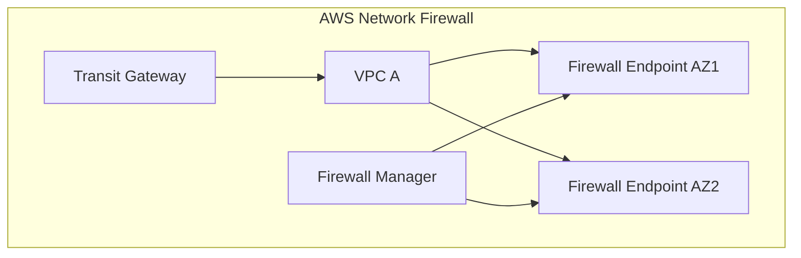

### GCP: Hierarchical Policy (Org → Folder → Project)
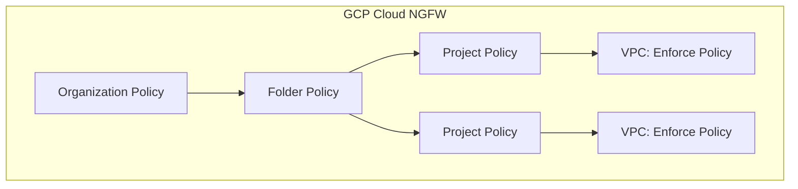

### Azure: Hub-and-Spoke with Firewall Manager
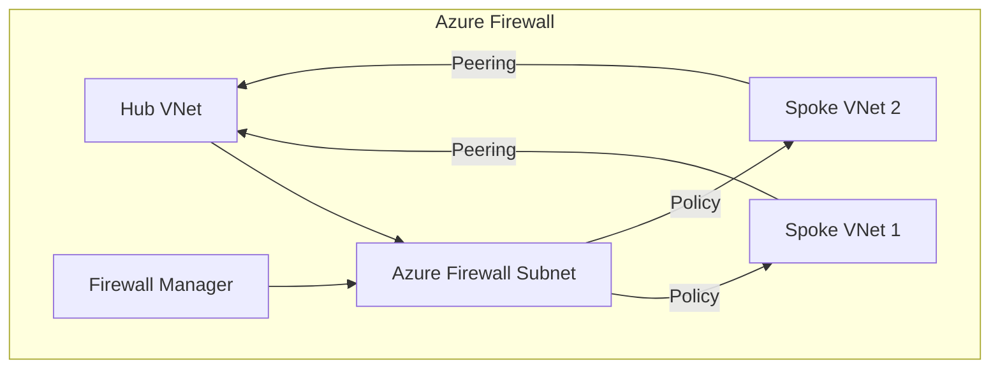

## 4.4 Third-Party NGFW in Cloud (Marketplace)

| Vendor | AWS | GCP | Azure | Deployment Model |
|--------|-----|-----|-------|------------------|
| **Palo Alto Networks** | VM-Series (BYOL/PAYG) | VM-Series (Native NGFW) | VM-Series (Native Premium) | Active/Active, Auto-scale |
| **Fortinet** | FortiGate-VM (BYOL/PAYG) | FortiGate-VM | FortiGate-VM | Active/Passive, HA |
| **Check Point** | CloudGuard (BYOL/PAYG) | CloudGuard | CloudGuard | ClusterXL, Auto-scale |
| **Cisco** | Secure Firewall (FMC managed) | N/A | N/A | FMC Central |
| **Versa** | Versa Director + VOS | Versa | Versa | SD-WAN + Security |

---

# 5. Bastion Hosts and Secure Access

## 5.1 Service Comparison

| Feature | AWS | GCP | Azure |
|---------|-----|-----|-------|
| **Native Bastion** | EC2 Instance Connect Endpoint | IAP (Identity-Aware Proxy) | Azure Bastion |
| **Protocol** | SSH/RDP via browser/CLI | SSH/RDP via browser/CLI (IAP TCP forwarding) | SSH/RDP via browser/CLI (HTML5) |
| **Authentication** | IAM (IAM policies, MFA) | IAM + IAP (OIDC, context-aware) | Entra ID (MFA, Conditional Access) |
| **Network** | No public IP needed | No public IP needed | No public IP needed |
| **Logging** | CloudTrail, CloudWatch | Cloud Audit Logs, Cloud Logging | Azure Monitor, Log Analytics |
| **Cost** | Free (Connect Endpoint) | IAP: $0.025/hour per tunnel | Standard: $0.19/hour; Standard v2: $0.29/hour |
| **Scaling** | Per VPC | Per project | Per VNet (up to 100 instances) |
| **Recording** | Session Manager (optional) | Not native (use third-party) | Session recording (preview) |
| **File Transfer** | SCP via Connect | SCP via IAP | SCP/SFTP via Bastion |

## 5.2 Architecture

### AWS: EC2 Instance Connect Endpoint + Session Manager
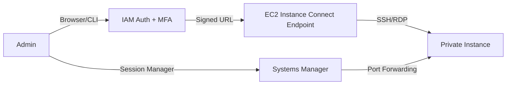

### GCP: Identity-Aware Proxy (IAP)
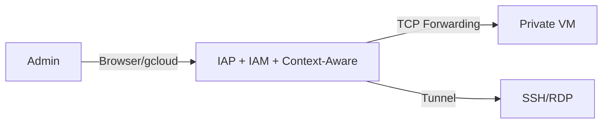

### Azure: Azure Bastion
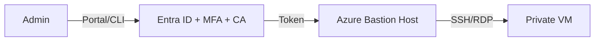

## 5.3 Feature Details

### AWS Systems Manager Session Manager
- **No SSH keys required**: IAM-based authentication
- **Port forwarding**: Local port → remote port (bastion-less RDP/DB access)
- **Run commands**: Execute scripts across fleets
- **Audit**: Full command logging to CloudWatch/S3
- **Cost**: Free (Session Manager), $0.003/connection (Connect Endpoint)

### GCP IAP (Identity-Aware Proxy)
- **Context-aware access**: Device posture, IP, geo, user risk
- **TCP forwarding**: `gcloud compute start-iap-tunnel` or browser
- **Programmatic access**: Service accounts with IAP-secured resources
- **Cost**: $0.025/hour per active tunnel

### Azure Bastion
- **HTML5 client**: Browser-based SSH/RDP (no client install)
- **Native TLS**: End-to-end encryption
- **Scalable**: Standard (2 instances), Standard v2 (up to 100, auto-scale)
- **VNet injection**: Deploy in dedicated Bastion subnet (/26 minimum)
- **Cost**: Standard $0.19/hr, Standard v2 $0.29/hr + data transfer

---

# 6. Endpoint Protection and EDR

## 6.1 Cloud-Native EDR/XDR

| Feature | AWS GuardDuty + Inspector | GCP Security Command Center + VM Manager | Azure Defender for Cloud + Defender for Endpoint |
|---------|---------------------------|------------------------------------------|--------------------------------------------------|
| **Threat Detection** | ML-based (EC2, S3, IAM, DNS, Kubernetes) | SCC detectors (VM, Container, Network) | Defender for Cloud (CSPM) + MDE (EDR) |
| **Vulnerability Scanning** | Inspector (EC2, ECR, Lambda) | VM Manager (OS patch, CVE scanning) | Defender for Cloud (Qualys integration) |
| **EDR Agent** | No native agent (uses VPC flow, CloudTrail) | No native agent (uses Ops Agent) | **MDE Agent** (Linux/Windows/macOS) |
| **Automated Response** | Lambda + EventBridge | Cloud Functions + Eventarc | Logic Apps / Automation Accounts |
| **Integration** | Security Hub, Detective | Chronicle, SIEM | Sentinel, Defender XDR |
| **Cost** | GuardDuty: $1M events $4.00; Inspector: $0.06/asset | SCC: Free tier + Premium $0.02/asset/hr | Defender for Cloud: Free tier + P2 $15/resource/mo; MDE P2: $5.20/user/mo |

---

# 7. Network Security: VPN, SD-WAN, MPLS

## 7.1 VPN Services

### AWS VPN
| Type | Specification |
|------|---------------|
| **Site-to-Site VPN** | IPsec (IKEv1/v2), AES-128/256, SHA-1/2, DH Groups 2/14/24. 1.25 Gbps per tunnel. Active/Active (BGP). $0.05/hour/tunnel + data out. |
| **Client VPN** | OpenVPN-based, SAML/OIDC/AD auth, MFA, split-tunnel, $0.10/hour/connection + $0.05/GB. |
| **VPN CloudHub** | Hub-and-spoke for multiple on-prem sites. |

### GCP Cloud VPN
| Type | Specification |
|------|---------------|
| **HA VPN** | 99.99% SLA, 2 VPN gateways per region, 3 Gbps per tunnel, BGP/Static routing, IPsec (IKEv2). $0.06/hour/gateway + data out. |
| **Classic VPN** | Single gateway, 3 Gbps, static routes only. Deprecated for new deployments. |
| **Partner Interconnect** | VPN as a service via partners (e.g., Cisco, Fortinet). |

### Azure VPN Gateway
| Type | Specification |
|------|---------------|
| **Site-to-Site** | IPsec/IKEv2, Active/Active (BGP), up to 10 Gbps (VpnGw1-5). $0.04-$0.86/hour + data out. |
| **Point-to-Site** | OpenVPN, IKEv2, SSTP. RADIUS/Entra ID auth. $0.03/hour/connection. |
| **ExpressRoute + VPN** | Failover, encryption over ExpressRoute. |

## 7.2 SD-WAN Integration

| Provider | Native SD-WAN | Partner Integration |
|----------|---------------|---------------------|
| **AWS** | AWS Cloud WAN (managed WAN) | Transit Gateway Connect (Cisco, Aviatrix, Aruba, Fortinet, Versa) |
| **GCP** | Network Connectivity Center (hub/spoke) | Partner Interconnect (Cisco, Fortinet, Palo Alto, Versa) |
| **Azure** | Virtual WAN (hub, secured hub) | Virtual WAN partners (Cisco, Fortinet, Palo Alto, Aruba, Versa, Barracuda) |

### AWS Cloud WAN
- **Core Network**: Global network backbone managed by AWS
- **Segments**: Logical isolation (prod, dev, security)
- **Attachments**: VPC, VPN, Direct Connect, Cloud WAN Connect (SD-WAN)
- **Routing**: Centralized policy, segment routing
- **Cost**: $0.075/hour per attachment + $0.02/GB

### Azure Virtual WAN
- **Hub Types**: Basic (VPN only), Standard (VPN + ExpressRoute + P2S + Firewall + NVA)
- **Secured Hub**: Azure Firewall + Firewall Manager policy
- **Routing**: BGP, custom routes, NVA integration
- **Global**: Hub-to-hub mesh across regions
- **Cost**: Standard hub $0.25/hour + $0.02/GB

### GCP Network Connectivity Center
- **Hub-and-Spoke**: VPC spokes, hybrid spokes (VPN, Interconnect, third-party)
- **Mesh**: Spoke-to-spoke via hub
- **Policy**: Route advertisement, firewall integration
- **Cost**: $0.01/hour per spoke + data processing

## 7.3 MPLS and Private Connectivity

| Feature | AWS Direct Connect | GCP Cloud Interconnect | Azure ExpressRoute |
|---------|-------------------|------------------------|-------------------|
| **Layer** | Layer 2 (VLAN) / Layer 3 (BGP) | Layer 2 (VLAN) / Layer 3 (BGP) | Layer 3 (BGP) |
| **Bandwidth** | 1/10/100 Gbps (Dedicated), 50 Mbps-10 Gbps (Hosted) | 10/100 Gbps (Dedicated), 50 Mbps-10 Gbps (Partner) | 50 Mbps - 100 Gbps (Direct: 10/100 Gbps) |
| **Redundancy** | Dual connections, diverse paths | Dual connections, diverse paths | Active/Active (ExpressRoute), Zone-redundant |
| **Global Reach** | DX Gateway + TGW | NCC + Interconnect | ExpressRoute Global Reach |
| **Encryption** | MACsec (10/100 Gbps), IPsec over DX | MACsec (Dedicated), IPsec over Partner | MACsec (Direct), IPsec over ExpressRoute |
| **SLA** | 99.99% (Dedicated) | 99.99% (Dedicated HA) | 99.95% (Standard), 99.99% (Direct) |
| **Cost Model** | Port-hour + data out | Port-hour + data out | Port-hour + data out |

---

# 8. VPC Peering and Private Connectivity

## 8.1 VPC Peering Comparison

| Feature | AWS VPC Peering | GCP VPC Peering | Azure VNet Peering |
|---------|-----------------|-----------------|-------------------|
| **Scope** | Region-scoped (inter-region via Transit Gateway) | Global (single VPC spans regions) | Region-scoped (Global peering for cross-region) |
| **Transitivity** | Non-transitive (requires TGW for hub-spoke) | Non-transitive (export/import custom routes) | Non-transitive (Global peering + Virtual WAN for transit) |
| **Max Connections** | 125 per VPC (soft limit) | 25 per VPC (soft limit) | 500 per VNet |
| **Cross-Account** | Yes (requires acceptance) | Yes (requires IAM permissions) | Yes (requires RBAC permissions) |
| **Cross-Region** | Inter-Region Peering (since 2020) | Native (global VPC) | Global VNet Peering |
| **IP Overlap** | Not allowed | Not allowed | Not allowed |
| **Bandwidth** | Same as instance type limits | 1-2 Gbps per VM (up to 200 Gbps with NCC) | Same as VM size limits |
| **Cost** | Free (data transfer at normal rates) | Free (data transfer at normal rates) | Free (data transfer at normal rates) |

## 8.2 Private Service Access (PaaS without Public IP)

| Service | AWS PrivateLink | GCP Private Service Connect (PSC) | Azure Private Link |
|---------|-----------------|-----------------------------------|-------------------|
| **Mechanism** | Interface VPC Endpoint (ENI in subnet) | PSC Endpoint (internal IP in subnet) | Private Endpoint (NIC in subnet) |
| **Supported Services** | 100+ (S3, DynamoDB, RDS, CloudWatch, etc.) | 50+ (Cloud SQL, Storage, AI, custom) | 100+ (Storage, SQL, Cosmos, Key Vault, custom) |
| **DNS Integration** | Private Hosted Zone (auto) | Cloud DNS Private Zone (auto) | Private DNS Zone (auto) |
| **Access Control** | VPC Endpoint Policy | IAM on PSC Endpoint | RBAC on Private Endpoint |
| **Cost** | $0.01/hour/endpoint + $0.01/GB | $0.01/hour/endpoint + $0.01/GB | Free (endpoint) + $0.01/GB |
| **Custom Services** | Yes (Network Load Balancer + Endpoint Service) | Yes (PSC for custom services) | Yes (Private Link Service) |

---

# 9. Network Components: Router, Switch, NAT, Shared VPC

## 9.1 Cloud Network Components

| Component | AWS | GCP | Azure |
|-----------|-----|-----|-------|
| **Router** | Transit Gateway (TGW), VPC Router (implicit) | Cloud Router (BGP), NCC Hub | Virtual WAN Hub, VNet Gateway |
| **Switch** | Implicit (VPC = distributed switch) | Implicit (VPC = global distributed switch) | Implicit (VNet = distributed switch) |
| **NAT Gateway** | NAT Gateway (managed, 45 Gbps, per AZ) | Cloud NAT (managed, regional, 1-100 Gbps) | NAT Gateway (zoned, up to 50 Gbps) |
| **Firewall** | Network Firewall, Security Groups, NACLs | Cloud NGFW, Firewall Rules (Hierarchical) | Azure Firewall, NSG, ASG |
| **Load Balancer** | NLB, ALB, GWLB, CLB | Cloud LB (Global/Regional), Cloud CDN | LB (Standard), Front Door, App Gateway |
| **VPN Gateway** | Virtual Private Gateway / Transit Gateway | Cloud VPN (HA VPN) | VPN Gateway |
| **Direct Connect** | Direct Connect, Transit Gateway Connect | Cloud Interconnect (Dedicated/Partner) | ExpressRoute (Standard/Direct) |

## 9.2 NAT Gateway Comparison

| Feature | AWS NAT Gateway | GCP Cloud NAT | Azure NAT Gateway |
|---------|-----------------|---------------|-------------------|
| **Type** | Managed, per AZ | Managed, regional | Managed, zonal |
| **Throughput** | 45 Gbps (burst to 100 Gbps) | Up to 100 Gbps (auto-scale) | Up to 50 Gbps |
| **Elastic IPs** | Up to 8 per gateway | Auto-assigned (shared) or BYOIP | Up to 16 public IPs |
| **Private IP Source** | Subnet route table | Subnet route table (custom) | Subnet route table |
| **Logging** | VPC Flow Logs | Cloud Logging (VPC Flow Logs) | NSG Flow Logs |
| **Cost** | $0.045/hour + $0.045/GB | $0.01/VM/hour + $0.045/GB | $0.045/hour + $0.045/GB |
| **High Availability** | Per AZ (deploy 1 per AZ for HA) | Regional (automatic) | Zone-redundant (Standard SKU) |

## 9.3 Shared VPC (Multi-Project/Tenant Networking)

| Feature | AWS | GCP | Azure |
|---------|-----|-----|-------|
| **Concept** | Shared VPCs (Resource Access Manager) | Shared VPC (Host Project + Service Projects) | VNet Sharing (via RBAC) / Azure Virtual Network Manager |
| **Central Management** | VPC Owner account shares subnets | Host Project owns VPC, Service Projects attach | Central IT owns VNet, delegates subnets via RBAC |
| **IPAM** | AWS IPAM (cross-account) | Cloud IPAM (global) | Azure IPAM (via Azure Network Manager) |
| **Security Boundaries** | Security Groups + NACLs per subnet | Hierarchical Firewall Policies (Org → Folder → Project) | NSG + ASG per subnet, Azure Firewall Manager policies |
| **Billing** | Owner pays for VPC resources; Service Projects pay for their resources | Host Project pays for VPC; Service Projects pay for their resources | Central pays for VNet; Service Projects pay for their resources |
| **Use Case** | Multi-account orgs, central network team | Multi-project orgs, central network team | Multi-subscription orgs, central network team |

## 9.4 VPC Peering Communication Flow

### How Traffic Flows in Peered VPCs

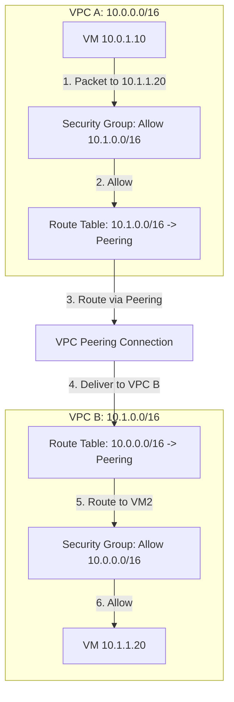

**Figure 2:** VPC Peering Traffic Flow

### Key Points:
1. **No Gateway/Router**: Peering is a direct Layer 3 connection between VPC routers
2. **No Single Point of Failure**: Distributed, highly available
3. **Security Groups/NSGs**: Still evaluate traffic (source/destination CIDR)
4. **MTU**: 9001 (jumbo frames) supported on AWS/GCP/Azure
4. **No Transitive Routing**: A↔B and B↔C ≠ A↔C (use TGW/NCC/Virtual WAN for transit)

## 9.5 Can You Deploy Manual Router/Switch in Cloud?

| Capability | AWS | GCP | Azure |
|------------|-----|-----|-------|
| **Custom Router (BGP/OSPF)** | Yes (EC2 with FRR/BIRD, Transit Gateway Connect) | Yes (VM with FRR/BIRD, NCC third-party spoke) | Yes (VM with FRR/BIRD, Virtual WAN NVA) |
| **Virtual Switch** | Not directly (VPC is the switch) | Not directly (VPC is the switch) | Not directly (VNet is the switch) |
| **Layer 2 Extension** | No (VPC is L3) | No (VPC is L3) | No (VNet is L3) |
| **Use Cases** | SD-WAN integration, on-prem routing protocols | Hybrid routing, third-party NVA | NVA, SD-WAN, ExpressRoute BGP |
| **Marketplace NVAs** | Cisco CSR, Aviatrix, Fortinet, Palo Alto, Versa | Palo Alto, Fortinet, Check Point, Cisco | Cisco CSR, Palo Alto, Fortinet, Check Point, Versa |

> **Key Insight**: Cloud VPCs/VNets are **Layer 3 fabrics** (distributed routers). You cannot create a traditional Layer 2 switch or bridge between subnets. For L2 adjacency, use:
> - **AWS**: Transit Gateway Connect + SD-WAN appliance
> - **GCP**: NCC + Partner Interconnect + appliance
> - **Azure**: Virtual WAN + NVA

---

# 10. DNS Services

## 10.1 DNS Service Comparison

| Feature | AWS Route 53 | GCP Cloud DNS | Azure DNS |
|---------|--------------|---------------|-----------|
| **Type** | Authoritative + Recursive (Resolver) | Authoritative | Authoritative + Recursive (Private Resolver) |
| **Public Zones** | Yes | Yes | Yes |
| **Private Zones** | Yes (VPC-associated) | Yes (VPC networks) | Yes (VNet-linked) |
| **Split Horizon** | Yes (views) | Yes (private zones + forwarding) | Yes (private resolver) |
| **Health Checks** | Yes (TCP/HTTP/HTTPS, CloudWatch) | Yes (integrated with Cloud LB) | Yes (Private Resolver + Front Door) |
| **Traffic Routing** | Latency, Geo, Weighted, Failover, Multivalue | Geo, Weighted (via LB) | Priority, Weighted, Geographic (Front Door) |
| **DNSSEC** | Yes (signing + validation) | Yes (signing + validation) | Yes (signing + validation) |
| **Logging** | Query Logging (CloudWatch, S3) | Query Logging (Cloud Logging) | Diagnostic Logs (Log Analytics) |
| **Private Resolver** | Route 53 Resolver (inbound/outbound endpoints) | Cloud DNS Forwarding (peering + policies) | Azure Private Resolver (inbound/outbound) |
| **Hybrid DNS** | Resolver + DHCP Options | DNS Forwarding + Peering | Private Resolver + Custom DNS |
| **Cost (per zone/month)** | $0.50 | $0.20 | $0.50 |
| **Cost (per million queries)** | $0.40 | $0.40 | $0.40 |

## 10.2 Private DNS Resolution Patterns

### AWS Route 53 Resolver
- **Inbound Endpoint**: On-premises → AWS private zones
- **Outbound Endpoint**: AWS → on-premises / external DNS
- **Rules**: Conditional forwarding (domain → target IPs)
- **Cost**: $0.125/hour/endpoint + $0.0004/million queries

### GCP Cloud DNS Forwarding
- **Forwarding Zones**: Domain → target name servers (via VPN/Interconnect)
- **Peering Zones**: Private zone peering (send queries to peer VPC)
- **Server Policies**: Alternative name servers for VPC
- **Cost**: Included in Cloud DNS pricing

### Azure Private Resolver
- **Inbound Endpoint**: On-premises → Azure private zones
- **Outbound Endpoint**: Azure → on-premises / external DNS
- **Rulesets**: Forwarding rules (domain → DNS servers)
- **Cost**: $0.10/hour/endpoint + $0.0004/million queries

---

# 11. Load Balancing Services

## 11.1 Load Balancer Comparison

| Feature | AWS | GCP | Azure |
|---------|-----|-----|-------|
| **L4 (Network)** | NLB (Layer 4, TLS passthrough) | Cloud LB (External TCP/UDP, SSL Proxy) | Standard LB (Layer 4), Front Door (L4 preview) |
| **L7 (Application)** | ALB (HTTP/HTTPS/gRPC), CLB (legacy) | Cloud LB (External HTTP/S, Internal HTTP/S) | Application Gateway (v2), Front Door |
| **Global Anycast** | Global Accelerator (separate) | Cloud LB (Premium Tier: native anycast) | Front Door (native anycast) |
| **TLS Termination** | ALB, NLB (TLS listener), Global Accelerator | Cloud LB (managed certs, self-managed) | App Gateway, Front Door (managed certs) |
| **Health Checks** | TCP, HTTP, HTTPS, gRPC | TCP, HTTP, HTTPS, gRPC, gRPC health | TCP, HTTP, HTTPS |
| **WAF Integration** | AWS WAF (ALB, CloudFront, API GW) | Cloud Armor (native) | Azure WAF (App Gateway, Front Door) |
| **Backend Types** | Instance, IP, Lambda, ALB | Instance groups, NEGs (GCE, GKE, Cloud Run) | VMSS, IP, App Service, AKS, Functions |
| **Session Affinity** | ALB (cookie), NLB (source IP) | Client IP, Generated cookie, Header | App Gateway (cookie), Front Door (cookie) |
| **Cost Model** | Hourly + LCU | Hourly + GB processed | Hourly + GB processed |

## 11.2 Load Balancer Architecture

### AWS
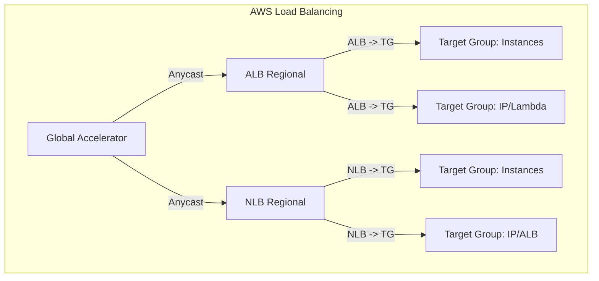

### GCP
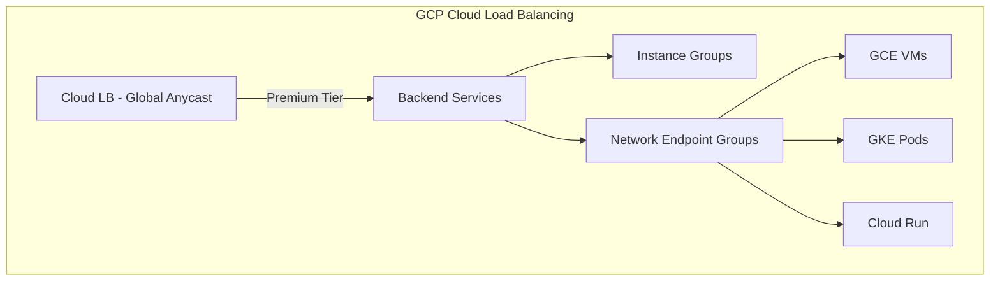

### Azure
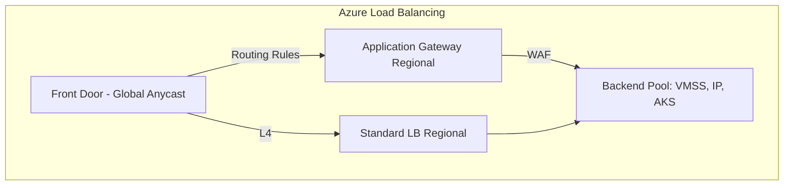

## 11.3 LND-Specific Load Balancer Configuration

| LND Service | Port | Protocol | Recommended LB | Health Check |
|-------------|------|----------|----------------|--------------|
| **P2P Gossip** | 9735 | TCP | NLB / TCP LB / Standard LB | TCP (SYN) |
| **gRPC** | 10009 | HTTP/2 | ALB / Cloud LB HTTP / App Gateway | gRPC Health Check |
| **REST API** | 8080 | HTTP/1.1 | ALB / Cloud LB HTTP / App Gateway | HTTP GET /health |

---

# 12. Kubernetes Security

## 12.1 Managed Kubernetes Security Comparison

| Feature | AWS EKS | GCP GKE | Azure AKS |
|---------|---------|---------|-----------|
| **Control Plane** | Managed (AWS) | Managed (Google) | Managed (Microsoft) |
| **Control Plane Hardening** | Private endpoint, auth configurator | Private cluster, master authorized networks | Private cluster, authorized IP ranges |
| **Worker Node Security** | EC2 (AMI, SSM, IMDSv2) | GCE (Shielded VM, Confidential VM, CMEK) | VMSS (Trusted Launch, Confidential VM, CMEK) |
| **Pod Security** | Pod Security Standards (admission), IRSA | Pod Security Standards, Workload Identity, Binary Authz | Pod Security Standards, Azure AD Workload Identity, Policy |
| **Network Policy** | Calico (Tigera), Cilium, AWS VPC CNI | Calico, Cilium, GKE Dataplane V2 | Azure CNI (Cilium), Calico, Network Policy |
| **Service Mesh** | App Mesh (Envoy), Istio (EKS addon) | Traffic Director (Istio), Anthos Service Mesh | Azure Service Mesh (Istio), Open Service Mesh |
| **Secrets** | Secrets Store CSI Driver, KMS | Secrets Store CSI Driver, Secret Manager, KMS | Secrets Store CSI Driver, Key Vault, Key Vault CSI |
| **Image Security** | ECR Image Scanning, Signer | Artifact Registry Analysis, Binary Authz, Cosign | ACR Image Scanning, Notary, Cosign |
| **Runtime Security** | GuardDuty EKS Runtime, Inspector | GKE Security Posture, Workload Runtime Security | Defender for Containers (Defender for Cloud) |
| **Compliance** | EKS Best Practices, CIS Benchmarks | GKE Hardening Guide, CIS Benchmarks | AKS Security Baseline, CIS Benchmarks |
| **Cost** | $0.10/hour/cluster + EC2 | Free (Standard) / $0.10/hour/cluster (Autopilot per pod) | Free |

## 12.2 Workload Identity Comparison

| Feature | AWS IRSA | GKE Workload Identity | Azure AD Workload Identity |
|---------|----------|----------------------|----------------------------|
| **Mechanism** | OIDC Provider + IAM Role | GKE Metadata Server + STS | Azure AD OIDC + Federated Credentials |
| **Token Exchange** | Pod → EKS OIDC → STS → AWS Creds | Pod → Metadata Server → STS → GCP Creds | Pod → Azure AD → Azure Token |
| **Granularity** | Per ServiceAccount | Per ServiceAccount | Per ServiceAccount |
| **Multi-Cluster** | Separate OIDC per cluster | Fleet Workload Identity | Cluster-wide |
| **On-Premises** | EKS Anywhere + IAM Roles Anywhere | GKE On-Prem + WIF | AKS Hybrid + Entra ID |

## 12.3 Kubernetes Network Security

| Feature | AWS VPC CNI | GKE Dataplane V2 | Azure CNI (Cilium) |
|---------|-------------|------------------|--------------------|
| **CNI Plugin** | AWS VPC CNI (AWS-maintained) | gke-dataplane-v2 (eBPF/Cilium) | Azure CNI (Cilium-based) |
| **Pod IP** | ENI-based (from VPC CIDR) | Pod IP from VPC CIDR (alias IP) | VNet IP (from VNet CIDR) |
| **Network Policy** | Calico (managed), Cilium | Native (Cilium), Calico | Native (Cilium), Calico |
| **Encryption** | IPsec (VPC), TLS (mTLS via Mesh) | WireGuard (Dataplane V2), IPsec | IPsec (VNet), WireGuard (Cilium) |
| **Visibility** | VPC Flow Logs | VPC Flow Logs, Cilium Hubble | NSG Flow Logs, Cilium Hubble |
| **Egress Control** | Security Groups + NACLs | Hierarchical Firewall Policies | NSG + Azure Firewall |

---

# 13. CSPM and Compliance (GDPR, Policy Enforcement)

## 13.1 Cloud Security Posture Management (CSPM)

| Feature | AWS Security Hub | GCP Security Command Center (SCC) | Azure Defender for Cloud |
|---------|------------------|-----------------------------------|--------------------------|
| **Frameworks** | CIS, PCI DSS, NIST, ISO, SOC, AWS Foundational | CIS, PCI DSS, NIST, ISO, SOC, GDPR, HIPAA | CIS, PCI DSS, NIST, ISO, SOC, GDPR, HIPAA, FedRAMP |
| **Controls** | 300+ managed controls | 200+ detectors (Premium) | 200+ secure score controls |
| **Custom Controls** | Yes (custom insights) | Yes (custom detectors) | Yes (custom initiatives) |
| **Multi-Account/Project** | Native (Organizations) | Native (Org-level SCC) | Native (Management Groups) |
| **Remediation** | Automation (SSM, Lambda) | Cloud Functions, Config Connector | Logic Apps, Automation, GitHub Actions |
| **Integration** | Security Lake, Detective, Config | Chronicle, Cloud Logging, Config Connector | Sentinel, Azure Policy, Arc |
| **Cost** | Free tier (CIS) + $0.0010/findings/mo | Free tier + Premium $0.02/asset/hr | Free tier + P2 $15/resource/mo |
| **GDPR-Specific** | Data protection controls | Data protection detectors, DLP integration | GDPR blueprint, Purview integration |

## 13.2 Policy as Code and Enforcement

| Feature | AWS | GCP | Azure |
|---------|-----|-----|-------|
| **Policy Language** | CloudFormation Guard, Rego (OPA) | Rego (OPA), CEL | Rego (OPA), Bicep, Azure Policy |
| **Policy Engine** | Config Rules, GuardDuty | Policy Controller (Gatekeeper), Org Policies | Azure Policy (Gatekeeper), Initiative Definitions |
| **Enforcement Modes** | Detective (Config), Preventive (SCP, IAM) | Preventive (Admission Controller), Audit (Org Policy) | Audit, Deny, DeployIfNotExists, Modify |
| **Drift Detection** | Config Rules (periodic) | Config Connector (continuous) | Azure Policy (continuous) |
| **Auto-Remediation** | SSM Automation, Lambda | Cloud Functions, Config Connector | Logic Apps, Automation, Guest Configuration |
| **GitOps Integration** | cfn-guard, kubeconform | kpt, Config Sync, Policy Controller | Flux, ArgoCD, Azure Policy Add-on for AKS |

## 13.3 GDPR Compliance Automation

| Feature | AWS | GCP | Azure |
|---------|-----|-----|-------|
| **Data Discovery** | Macie (PII detection) | Cloud DLP (PII, custom infoTypes) | Purview (Data Map, Classification) |
| **Data Residency** | Region control, Data sovereignty | Region control, Data residency | Region control, Sovereign clouds |
| **Right to Erasure** | S3 Object Lock, Macie automation | Cloud DLP de-identification, lifecycle | Purview data actions, Blob immutable storage |
| **Consent Management** | Custom (Cognito, Pinpoint) | Custom (Identity Platform) | Custom (Entra ID, API Management) |
| **Audit Trail** | CloudTrail (immutable) | Cloud Audit Logs (immutable) | Activity Log (immutable), Purview Audit |
| **DPA/BAA** | Available (Artifact) | Available (Artifact) | Available (Trust Center) |
| **Certification** | ISO 27001, SOC, PCI, FedRAMP | ISO 27001, SOC, PCI, FedRAMP | ISO 27001, SOC, PCI, FedRAMP |

## 13.4 Continuous Compliance Monitoring

```mermaid
graph TB
    subgraph CSPM[Continuous Compliance Loop]
        Scan[Continuous Scan\n(Config Rules / Policy Controller / Azure Policy)]
        Detect[Drift Detection\n(Findings / Violations / Non-compliant)]
        Alert[Alert & Ticket\n(Security Hub / SCC / Defender)]
        Remediate[Auto/Manual Remediation\n(SSM / Cloud Functions / Logic Apps)]
        Verify[Verify & Close\n(Re-scan / Attestation)]
        Report[Compliance Report\n(Dashboard / Audit / Attestation)]
    end
    
    Scan --> Detect
    Detect --> Alert
    Alert --> Remediate
    Remediate --> Verify
    Verify --> Report
    Report --> Scan
```

**Figure 3:** Continuous Compliance Monitoring Loop

---

# 14. Third-Party Vendor Integration

## 14.1 Palo Alto Networks

| Product | AWS | GCP | Azure | Key Features |
|---------|-----|-----|-------|--------------|
| **VM-Series NGFW** | Marketplace (BYOL/PAYG), CloudFormation, Terraform | Native Cloud NGFW (managed), VM-Series | Native Azure Firewall Premium, VM-Series | App-ID, User-ID, Content-ID, WildFire, Panorama |
| **Prisma Cloud** | CWP (Compute), CSPM, CNAPP | CWP, CSPM, CNAPP | CWP, CSPM, CNAPP | Full lifecycle, Shift-left, Runtime |
| **Prisma Access (SSE)** | PoPs globally, Cloud SWG, CASB, DLP | PoPs globally | PoPs globally | ZTNA, SWG, CASB, DLP, RBI |
| **Cortex XDR/XSOAR** | Agent, Collector, SOAR | Agent, Collector, SOAR | Agent, Collector, SOAR | EDR, XDR, SOAR automation |

### Palo Alto Deployment Models

| Model | AWS | GCP | Azure |
|-------|-----|-----|-------|
| **Native Managed** | N/A | Cloud NGFW (Google-managed) | Azure Firewall Premium (MS-managed) |
| **BYOL VM-Series** | EC2, Auto-scale (Lambda + ASG) | GCE, Instance Groups | VMSS, Availability Zones |
| **PAYG VM-Series** | Marketplace (hourly) | Marketplace (hourly) | Marketplace (hourly) |
| **Panorama** | EC2, Centralized mgmt | GCE, Centralized mgmt | VM, Centralized mgmt |
| **Auto-Scale** | Lambda + ASG + GWLBe | Instance Groups + NCC | VMSS + Firewall Manager |

## 14.2 Fortinet

| Product | AWS | GCP | Azure | Key Features |
|---------|-----|-----|-------|--------------|
| **FortiGate-VM** | Marketplace (BYOL/PAYG), CloudFormation | Marketplace, Instance Groups | Marketplace, VMSS | NGFW, SD-WAN, ZTNA, Switch/AP Controller |
| **FortiWeb (WAF)** | Marketplace, ALB integration | Marketplace | Marketplace | ML-based WAF, API protection, Bot mitigation |
| **FortiCASB / FortiDLP** | SaaS | SaaS | SaaS | CASB, DLP, Shadow IT |
| **FortiSIEM / FortiSOAR** | Collector, Agent | Collector, Agent | Collector, Agent | SIEM, SOAR |
| **FortiManager / FortiAnalyzer** | Central mgmt, Logging | Central mgmt, Logging | Central mgmt, Logging | Single pane of glass |

### Fortinet Unique Advantage: **Security Fabric**
- **Native Integration**: FortiGate + FortiSwitch + FortiAP + FortiClient
- **AWS**: Transit Gateway Connect for SD-WAN fabric extension
- **GCP**: NCC + Partner Interconnect for fabric extension
- **Azure**: Virtual WAN + NVA for fabric extension

## 14.3 Check Point

| Product | AWS | GCP | Azure | Key Features |
|---------|-----|-----|-------|--------------|
| **CloudGuard Network** | Marketplace (BYOL/PAYG), Auto-scale | Marketplace, Instance Groups | Marketplace, VMSS | NGFW, IPS, URLF, App Control, Anti-Bot |
| **CloudGuard Posture** | CSPM, CNAPP | CSPM, CNAPP | CSPM, CNAPP | Cloud security posture, Compliance |
| **CloudGuard Workload** | Container security, Serverless | Container security, Serverless | Container security, Serverless | Runtime protection, Image scanning |
| **CloudGuard Dome9** | CSPM, IaC scanning | CSPM, IaC scanning | CSPM, IaC scanning | Graph-based visualization |
| **Quantum Spark** | SMB appliance | SMB appliance | SMB appliance | All-in-one for small branch |

### Check Point Unique: **Infinity Architecture**
- **Unified Management**: Smart Console (single pane)
- **ThreatCloud**: Shared threat intelligence across all products
- **Infinity Portal**: Unified licensing, monitoring, API

## 14.4 Vendor Feature Parity Matrix

| Capability | Palo Alto | Fortinet | Check Point | Cloud Native |
|------------|-----------|----------|-------------|--------------|
| **NGFW (App-ID/App Control)** | Excellent (App-ID) | Excellent (App Control) | Excellent (App Control) | Basic (FQDN) |
| **IPS/IDS** | Excellent (Content-ID) | Good (IPS) | Excellent (IPS) | Basic (Threat Intel) |
| **URL Filtering** | Excellent (PAN-DB) | Good (FortiGuard) | Excellent (URLF) | Basic (FQDN only) |
| **Sandboxing** | WildFire (Cloud) | FortiSandbox (Cloud/On-prem) | SandBlast (Cloud) | No |
| **TLS Inspection** | Yes (Forward/Inbound) | Yes (Forward/Inbound) | Yes (Forward/Inbound) | Azure FW Prem / GCP NGFW |
| **User-ID/Identity** | Excellent (AD, SAML, Kerberos) | Good (FSSO, RADIUS) | Good (Identity Awareness) | No |
| **SD-WAN** | Prisma SD-WAN | FortiGate SD-WAN | Quantum Spark | AWS Cloud WAN / Azure vWAN |
| **Central Mgmt** | Panorama | FortiManager | Smart Console / Infinity | Firewall Manager / NCC / Panorama |
| **Cloud-Native Mgmt** | Prisma Cloud | FortiCNP | CloudGuard Posture | Security Hub / SCC / Defender |
| **API/Automation** | Excellent (REST, Terraform, Ansible) | Good (REST, Terraform, Ansible) | Excellent (REST, Terraform, Ansible) | Native (CLI, SDK, Terraform) |

---

# 15. Cost Comparison

## 15.1 Security Services Monthly Cost (Estimated, us-east-1/us-central1/East US)

| Service | AWS | GCP | Azure |
|---------|-----|-----|-------|
| **DDoS Protection** | Free (Std) / $3,000/mo (Adv) | Free (Std) / Pay-per-use (Prem) | Free (Basic) / $2,944/mo (Std) |
| **WAF** | $5/ACL + $1/rule + $0.60/M req | Free (Std) / $5/policy + $0.75/M req (Prem) | $0.75/hr (AG) / $1/policy + $0.60/M req (FD) |
| **Network Firewall** | $0.395/hr + $0.065/GB | $0.50/hr + $0.07/GB | $1.25/hr + $0.016/GB (Std) / $1.50/hr + $0.02/GB (Prem) |
| **Bastion** | Free (Connect) / $0.003/conn | $0.025/hr/tunnel (IAP) | $0.19/hr (Std) / $0.29/hr (Std v2) |
| **DDoS + WAF + FW (Typical App)** | ~$500-2,000/mo | ~$300-1,500/mo | ~$1,000-3,000/mo |

## 15.2 Third-Party NGFW Cost (VM-Series, PAYG, c5.xlarge equivalent)

| Vendor | AWS (Hourly) | GCP (Hourly) | Azure (Hourly) | Annual (730 hrs) |
|--------|--------------|--------------|----------------|------------------|
| **Palo Alto VM-Series** | $0.68/hr (PAYG) | $0.68/hr | $0.68/hr | ~$5,960 |
| **FortiGate-VM** | $0.58/hr | $0.58/hr | $0.58/hr | ~$5,070 |
| **Check Point CloudGuard** | $0.62/hr | $0.62/hr | $0.62/hr | ~$5,430 |
| **Azure Firewall Premium** | N/A | N/A | $1.50/hr | ~$13,140 |
| **GCP Cloud NGFW** | N/A | $0.50/hr | N/A | ~$4,380 |

> **Note**: Third-party NGFW includes compute cost. Cloud-native firewalls (AWS Network Firewall, GCP NGFW, Azure Firewall) are typically cheaper for equivalent throughput.

## 15.3 VPN and Private Connectivity Cost

| Service | AWS | GCP | Azure |
|---------|-----|-----|-------|
| **Site-to-Site VPN** | $0.05/hr/tunnel + data | $0.06/hr/gateway + data | $0.04-0.86/hr (SKU) + data |
| **Client VPN** | $0.10/hr/conn + $0.05/GB | N/A (use IAP) | $0.03/hr/conn + data |
| **Direct Connect / Interconnect / ExpressRoute (10 Gbps)** | $2.25/hr + data | $2.50/hr + data | $0.05/hr + data (varies) |
| **Transit Gateway / NCC / Virtual WAN** | $0.075/hr/attachment + $0.02/GB | $0.01/hr/spoke + data | $0.25/hr/hub + $0.02/GB |

---

# 16. Decision Matrix

## 16.1 By Security Requirement

| Requirement | Best Choice | Rationale |
|-------------|-------------|-----------|
| **Lowest Cost DDoS + WAF** | GCP (Standard tiers free) | Free L3/L4 DDoS + preconfigured WAF |
| **Best L7 DDoS + WAF Integration** | AWS Shield Advanced + WAF | Unified console, DRT, cost protection |
| **Best Native NGFW** | GCP Cloud NGFW (Palo Alto native) | PAN-OS features, App-ID, WildFire, Panorama |
| **Best Hybrid NGFW** | Azure Firewall Premium + Palo Alto | PAN-OS + Azure integration, Firewall Manager |
| **Best CSPM for GDPR** | Azure Defender for Cloud (P2) | Purview integration, GDPR blueprint, Sovereign clouds |
| **Best CSPM for Multi-Cloud** | Prisma Cloud / Wiz / Orca | Vendor-agnostic, single pane |
| **Best Bastion/Zero Trust Access** | GCP IAP (context-aware) | Device posture, IP, geo, no public IP |
| **Best Kubernetes Security** | GKE (Workload Identity, Binary Authz, Dataplane V2) | Native integration, Autopilot |
| **Best SD-WAN Integration** | AWS Cloud WAN / Azure Virtual WAN | Managed hub, partner ecosystem |
| **Lowest Total Security Cost** | GCP (free tiers + pay-per-use) | Pay only for premium features used |

## 16.2 By Organization Profile

| Profile | Recommended Stack |
|---------|-------------------|
| **Cloud-Native Startup** | GCP: Free DDoS/WAF, IAP, Cloud NGFW, GKE Autopilot |
| **Enterprise Microsoft Shop** | Azure: Entra ID, Defender for Cloud P2, Azure Firewall Premium, AKS, Virtual WAN |
| **AWS-Centric Enterprise** | AWS: Shield Adv, WAF, Network Firewall, Security Hub, EKS, TGW |
| **Multi-Cloud Enterprise** | Vendor CSPM (Prisma/Wiz) + Cloud-native per cloud + Terraform |
| **Regulated/Financial** | Azure (Sovereign clouds, Purview, Defender P2) or AWS (GovCloud, Macie, Security Hub) |
| **Global Low-Latency App** | GCP Premium Tier (anycast LB, Cloud CDN, global VPC) |

## 16.3 LND-Specific Security Architecture

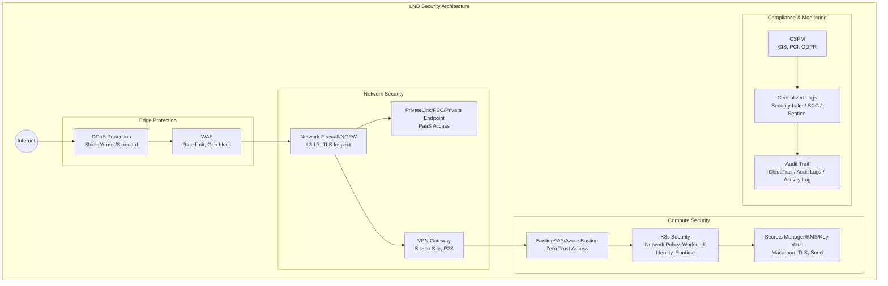

**Figure 4:** LND End-to-End Security Architecture

---

# References

[1] AWS, "Shield Documentation," https://docs.aws.amazon.com/waf/latest/developerguide/shield-chapter.html
[2] AWS, "WAF Documentation," https://docs.aws.amazon.com/waf/latest/developerguide/
[3] AWS, "Network Firewall Documentation," https://docs.aws.amazon.com/network-firewall/latest/developerguide/
[4] AWS, "EC2 Instance Connect Documentation," https://docs.aws.amazon.com/AWSEC2/latest/UserGuide/ec2-instance-connect.html
[5] AWS, "Site-to-Site VPN Documentation," https://docs.aws.amazon.com/vpn/latest/s2svpn/
[5] AWS, "Transit Gateway Documentation," https://docs.aws.amazon.com/vpc/latest/tgw/
[6] AWS, "Route 53 Documentation," https://docs.aws.amazon.com/Route53/latest/DeveloperGuide/
[7] AWS, "Security Hub Documentation," https://docs.aws.amazon.com/securityhub/latest/userguide/
[8] AWS, "EKS Best Practices," https://aws.github.io/aws-eks-best-practices/

[9] Google Cloud, "Cloud Armor Documentation," https://cloud.google.com/armor/docs
[10] Google Cloud, "Cloud NGFW Documentation," https://cloud.google.com/network-security/docs/firewall
[11] Google Cloud, "IAP Documentation," https://cloud.google.com/iap/docs
[12] Google Cloud, "Cloud VPN Documentation," https://cloud.google.com/vpn/docs
[13] Google Cloud, "Cloud Interconnect Documentation," https://cloud.google.com/network-connectivity/docs/interconnect
[14] Google Cloud, "Cloud DNS Documentation," https://cloud.google.com/dns/docs
[15] Google Cloud, "Cloud Load Balancing Documentation," https://cloud.google.com/load-balancing/docs
[16] Google Cloud, "Security Command Center Documentation," https://cloud.google.com/security-command-center/docs
[17] Google Cloud, "GKE Security Documentation," https://cloud.google.com/kubernetes-engine/docs/how-to/hardening-your-cluster
[18] Google Cloud, "Network Connectivity Center," https://cloud.google.com/network-connectivity/docs/network-connectivity-center/overview

[19] Microsoft, "Azure DDoS Protection Documentation," https://learn.microsoft.com/azure/ddos-protection/
[20] Microsoft, "Azure WAF Documentation," https://learn.microsoft.com/azure/web-application-firewall/
[21] Microsoft, "Azure Firewall Documentation," https://learn.microsoft.com/azure/firewall/
[22] Microsoft, "Azure Bastion Documentation," https://learn.microsoft.com/azure/bastion/
[23] Microsoft, "VPN Gateway Documentation," https://learn.microsoft.com/azure/vpn-gateway/
[24] Microsoft, "ExpressRoute Documentation," https://learn.microsoft.com/azure/expressroute/
[25] Microsoft, "Virtual WAN Documentation," https://learn.microsoft.com/azure/virtual-wan/
[26] Microsoft, "Azure DNS Documentation," https://learn.microsoft.com/azure/dns/
[27] Microsoft, "Front Door Documentation," https://learn.microsoft.com/azure/frontdoor/
[28] Microsoft, "Defender for Cloud Documentation," https://learn.microsoft.com/azure/defender-for-cloud/
[29] Microsoft, "AKS Security Documentation," https://learn.microsoft.com/azure/aks/security-concepts
[30] Microsoft, "Purview Documentation," https://learn.microsoft.com/azure/purview/

[31] Palo Alto Networks, "VM-Series Deployment Guide," https://docs.paloaltonetworks.com/vm-series/
[32] Palo Alto Networks, "Prisma Cloud Documentation," https://docs.prismacloud.io/
[33] Fortinet, "FortiGate-VM Deployment Guide," https://docs.fortinet.com/document/fortigate-vm/
[34] Fortinet, "FortiWeb Documentation," https://docs.fortinet.com/document/fortiweb/
[35] Check Point, "CloudGuard Network Documentation," https://supportcenter.checkpoint.com/supportcenter/portal?eventSubmit_doGoviewsolutiondetails=&solutionid=sk149231
[36] Check Point, "CloudGuard Posture Management," https://www.checkpoint.com/cloudguard/cloudguard-posture-management/

[37] AWS, "Network Firewall Pricing," https://aws.amazon.com/network-firewall/pricing/
[38] Google Cloud, "Cloud Armor Pricing," https://cloud.google.com/armor/pricing
[34] Microsoft, "Azure Firewall Pricing," https://azure.microsoft.com/pricing/details/azure-firewall/
[35] Microsoft, "Azure DDoS Protection Pricing," https://azure.microsoft.com/pricing/details/ddos-protection/

# Appendices

## A. Security Service Inventory by Provider

### AWS Security Services
| Category | Services |
|----------|----------|
| **Network** | Shield, WAF, Network Firewall, Firewall Manager, VPC Security Groups, NACLs, PrivateLink |
| **Host** | GuardDuty, Inspector, Security Hub, Detective, Macie |
| **Identity** | IAM, IAM Identity Center, Cognito, STS, Resource Access Manager |
| **Data** | KMS, CloudHSM, S3 Encryption, Macie, Secrets Manager |
| **Compliance** | Config, Audit Manager, Artifact, Security Hub, CloudTrail |
| **Operations** | CloudWatch, CloudTrail, X-Ray, Systems Manager |

### GCP Security Services
| Category | Services |
|----------|----------|
| **Network** | Cloud Armor, Cloud NGFW, Cloud VPN, Cloud Interconnect, PSC, NCC |
| **Host** | SCC, VM Manager, Container Analysis, Binary Authorization |
| **Identity** | Cloud Identity, IAM, Identity Platform, WIF (Workforce/Workload) |
| **Data** | Cloud KMS, Cloud HSM, CMEK, Secret Manager, Cloud DLP |
| **Compliance** | Org Policies, Policy Controller, SCC, Cloud Audit Logs, Config Connector |
| **Operations** | Cloud Logging, Cloud Monitoring, Cloud Trace, Error Reporting |

### Azure Security Services
| Category | Services |
|----------|----------|
| **Network** | DDoS Protection, WAF, Azure Firewall, Firewall Manager, VPN Gateway, ExpressRoute, Private Link |
| **Host** | Defender for Cloud, Defender for Endpoint, Defender for Servers, VM Insights |
| **Identity** | Entra ID, Entra ID Protection, Entra ID Governance, WIF, PIM |
| **Data** | Key Vault, Managed HSM, Purview, Information Protection, CMK |
| **Compliance** | Azure Policy, Defender for Cloud, Purview, Activity Log, Blueprints |
| **Operations** | Azure Monitor, Log Analytics, Sentinel, Automation, Arc |

## B. Network Service Inventory by Provider

### AWS Network Services
| Category | Services |
|----------|----------|
| **Core** | VPC, Subnets, Route Tables, IGW, NAT Gateway, Egress-Only IGW |
| **Connectivity** | Transit Gateway, VPN, Direct Connect, PrivateLink, VPC Peering, TGW Connect |
| **Load Balancing** | NLB, ALB, GWLB, CLB, Global Accelerator |
| **DNS** | Route 53, Route 53 Resolver |
| **Edge** | CloudFront, CloudFront Functions, Lambda@Edge |
| **Management** | VPC Flow Logs, Network Manager, IPAM, Reachability Analyzer |

### GCP Network Services
| Category | Services |
|----------|----------|
| **Core** | VPC (Global), Subnets (Regional), Routes, Cloud Router, Cloud NAT |
| **Connectivity** | VPN (HA), Interconnect (Dedicated/Partner), PSC, NCC, Peering |
| **Load Balancing** | Cloud LB (Global/Regional), Cloud CDN, Traffic Director |
| **DNS** | Cloud DNS, Cloud DNS Forwarding, Private Resolver |
| **Edge** | Cloud CDN, Media CDN |
| **Management** | VPC Flow Logs, Network Intelligence Center, Connectivity Tests |

### Azure Network Services
| Category | Services |
|----------|----------|
| **Core** | VNet, Subnets, Route Tables, NAT Gateway, Bastion |
| **Connectivity** | VPN Gateway, ExpressRoute, Private Link, Virtual WAN, Peering |
| **Load Balancing** | Standard LB, Application Gateway, Front Door, Traffic Manager |
| **DNS** | Azure DNS, Private Resolver, Private DNS Zones |
| **Edge** | Front Door, Azure CDN |
| **Management** | NSG Flow Logs, Network Watcher, IPAM, Connection Monitor |

## C. Compliance Framework Mapping

| Control Framework | AWS Service | GCP Service | Azure Service |
|-------------------|-------------|-------------|---------------|
| **CIS Benchmarks** | Security Hub (CIS) | SCC (CIS) | Defender for Cloud (CIS) |
| **PCI DSS** | Security Hub (PCI) | SCC (PCI) | Defender for Cloud (PCI) |
| **NIST 800-53** | Security Hub (NIST) | SCC (NIST) | Defender for Cloud (NIST) |
| **ISO 27001** | Artifact, Security Hub | SCC, Artifact | Defender for Cloud, Trust Center |
| **SOC 1/2/3** | Artifact | Artifact | Trust Center |
| **FedRAMP** | Artifact (GovCloud) | Artifact (Assured Workloads) | Azure Government, Trust Center |
| **HIPAA** | Artifact (BAA) | Artifact (BAA) | Trust Center (BAA) |
| **GDPR** | Macie, Artifact | Cloud DLP, SCC, Artifact | Purview, Defender for Cloud, Trust Center |

## D. API and Automation Endpoints

| Provider | Security API | Network API | CSPM API |
|----------|--------------|-------------|----------|
| **AWS** | GuardDuty, Security Hub, Inspector, WAF, Network Firewall | EC2, VPC, TGW, Route 53, ELB, VPN, DX | Security Hub, Config, Audit Manager |
| **GCP** | SCC, Cloud Armor, Cloud NGFW, IAP, Binary Authz | Compute, VPC, Cloud Router, Cloud DNS, Cloud LB, VPN, Interconnect | SCC, Org Policy, Policy Controller |
| **Azure** | Defender for Cloud, WAF, Azure Firewall, Bastion, DDoS | Network, Virtual WAN, DNS, Front Door, LB, VPN, ER | Defender for Cloud, Policy, Purview |

## E. Learning Path for Security Engineers

1. **Foundation**: Cloud provider fundamentals (this document)
2. **Identity**: IAM/Entra ID/Cloud Identity deep dive
3. **Network Security**: VPC/VNet, Security Groups/NSG, Peering, PrivateLink
3. **Perimeter**: DDoS, WAF, Network Firewall/NGFW
4. **Access**: Bastion/IAP/Azure Bastion, VPN, Private Connectivity
5. **Host/Container**: GuardDuty/SCC/Defender, K8s Security
6. **Data**: KMS/Key Vault/Cloud KMS, Macie/DLP/Purview
7. **Compliance**: CSPM, Policy as Code, GDPR automation
8. **Operations**: Logging, SIEM integration, Incident response
9. **Advanced**: Third-party integration, Multi-cloud, Zero Trust