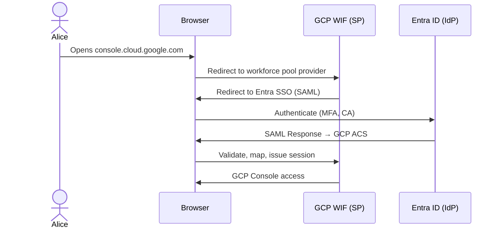
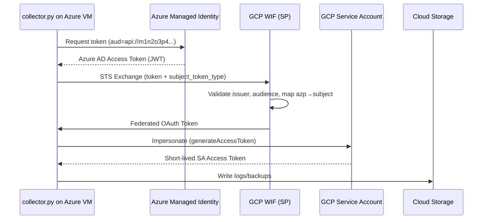
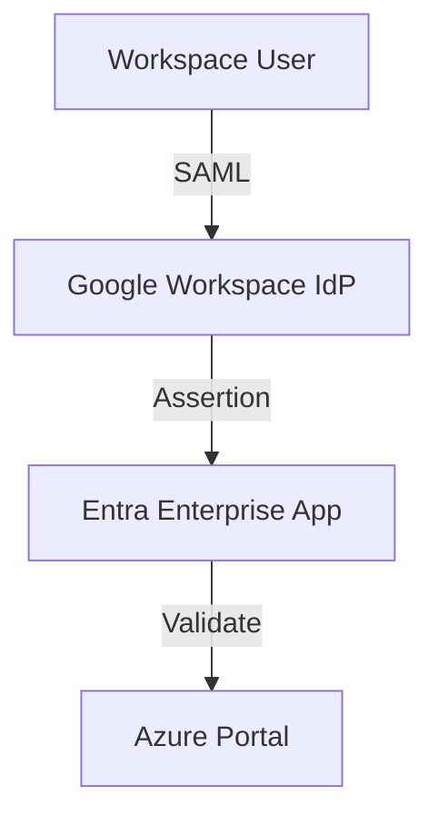
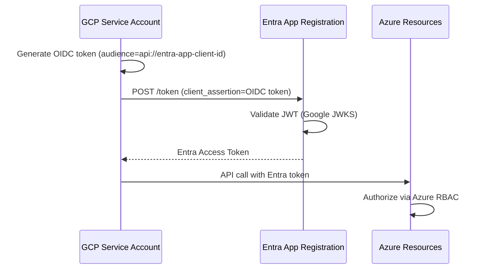
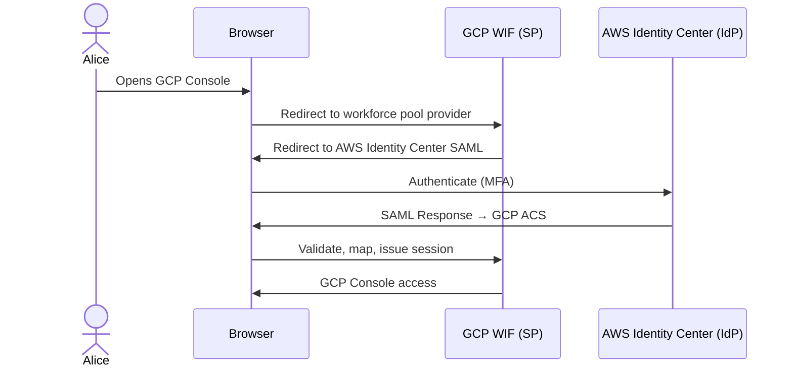
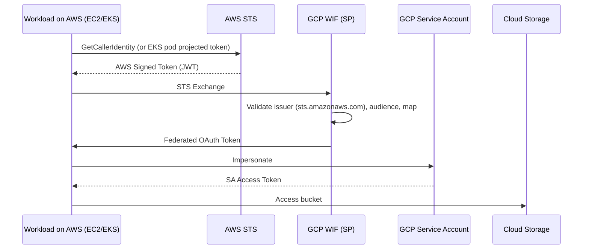
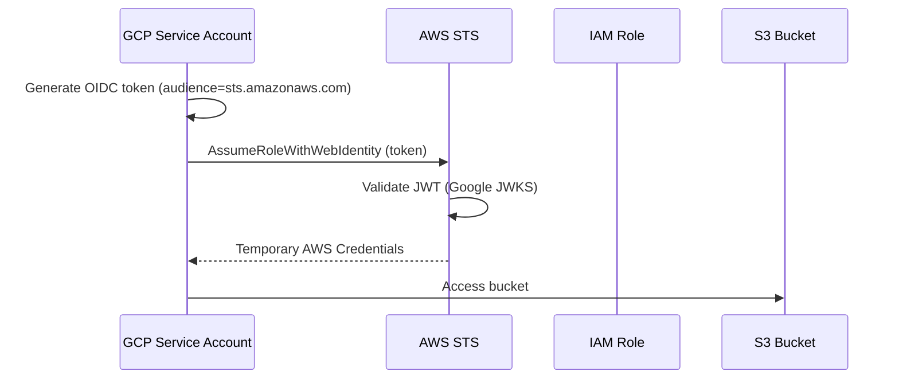
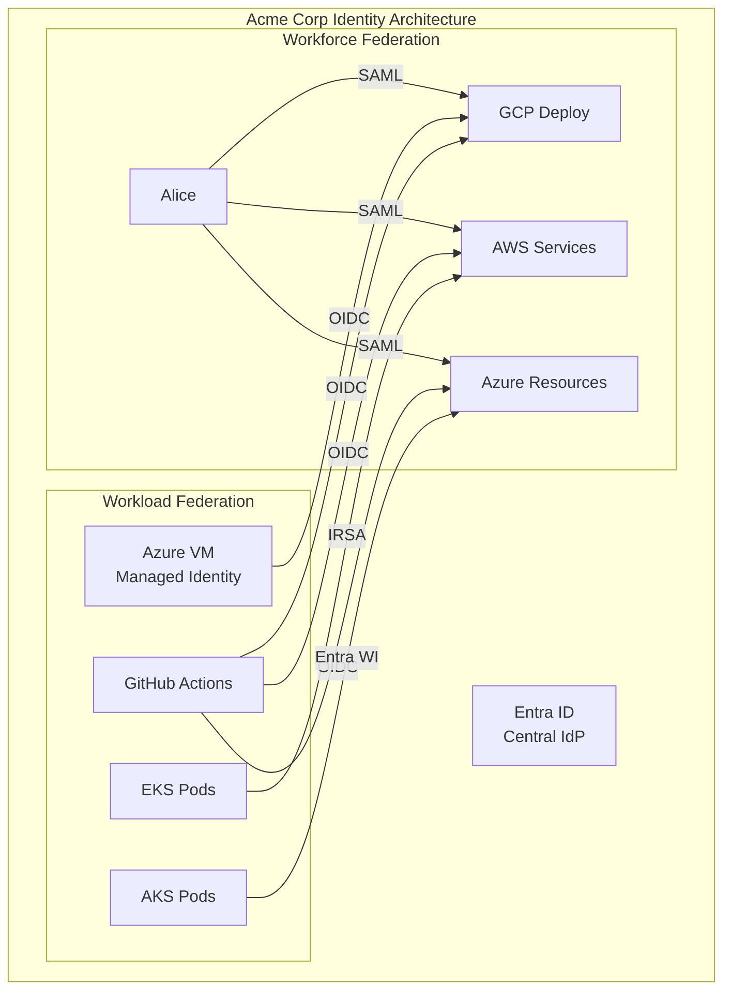
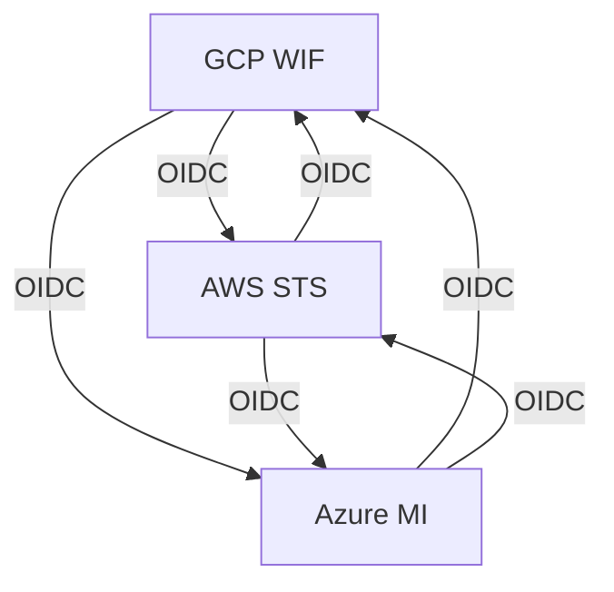
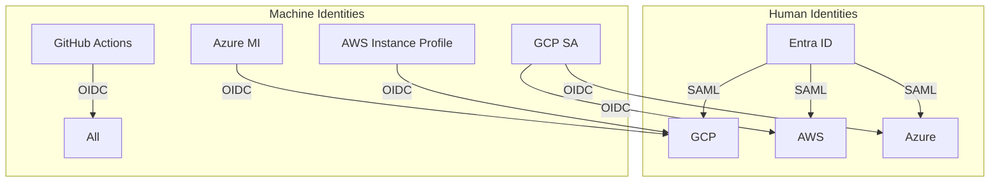

# Abstract

This document provides a comprehensive analysis of cross-cloud identity federation patterns between Google Cloud Platform (GCP), Amazon Web Services (AWS), and Microsoft Azure. The fundamental principle is **directionality**: Cloud A trusting Cloud B is distinct from Cloud B trusting Cloud A. We cover all six directional combinations for both workforce (human) and workload (machine) identities, using the running Acme Corp example. Implementation patterns include: Pattern A (Central IdP), Pattern B (Workload Mesh), and Pattern C (Hybrid). All patterns reference SAML/OIDC fundamentals [§02.1], [§02.2], [§02.3] and cloud-specific implementations [§02.4], [§02.6], [§02.8].

# 1. Introduction

## 1.1 The Directionality Principle

> **Core Principle**: Federation trust is **unidirectional**. Cloud A → Cloud B means Cloud B (SP) trusts Cloud A (IdP). This is NOT symmetric.

```mermaid
graph LR
    subgraph Direction1[Cloud A (IdP) → Cloud B (SP)]
        A1[Cloud A IdP] -->|Assertion/Token| B1[Cloud B SP]
        B1 -->|Validate| B2[Cloud B IAM]
    end
    
    subgraph Direction2[Cloud B (IdP) → Cloud A (SP)]
        B3[Cloud B IdP] -->|Assertion/Token| A2[Cloud A SP]
        A2 -->|Validate| A3[Cloud A IAM]
    end
    
    Direction1 -.->|Different Config| Direction2
```

**Figure 1:** Directionality principle: Two separate trust configurations required for bidirectional access.

## 1.2 Running Example: Acme Corp Multi-Cloud

| Element | Configuration |
|---------|---------------|
| **Primary IdP** | Microsoft Entra ID (`acmecorp.onmicrosoft.com`) |
| **GCP** | Project `acme-lnd-prod`, Workforce Pool `entra-workforce-pool`, Workload Pool `azure-workload-pool` |
| **AWS** | Account `123456789012`, IAM Identity Center in `us-east-1` |
| **Azure** | Tenant `acmecorp.onmicrosoft.com`, Managed Identity `acme-lnd-vm-mi` |
| **User** | Alice (`alice@acmecorp.com`, Entra Object ID: `a1b2c3d4...`) |
| **Workload** | `collector.py` on Azure VM (MI Client ID: `m1n2o3p4...`) |

# 2. Directionality Matrix

## 2.1 Workforce Federation (Human Users)

| Direction | IdP (Source) | SP (Target) | Protocol | Acme Corp Example |
|-----------|--------------|-------------|----------|-------------------|
| **Entra → GCP** | Entra ID | GCP WIF | SAML / OIDC | Alice → GCP Console |
| **Entra → AWS** | Entra ID | AWS Identity Center | SAML | Alice → AWS Console |
| **GCP → Entra** | Google Workspace | Entra Enterprise App | SAML | Workspace User → Azure Portal |
| **GCP → AWS** | Google Workspace | AWS Identity Center | SAML | Workspace User → AWS Console |
| **AWS → Entra** | IAM Identity Center | Entra Enterprise App | SAML | Identity Center User → Azure Portal |
| **AWS → GCP** | IAM Identity Center | GCP WIF | SAML | Identity Center User → GCP Console |

**Table 1:** Workforce federation directionality matrix (6 combinations).

## 2.2 Workload Federation (Machine Identities)

| Direction | IdP (Source) | SP (Target) | Protocol | Acme Corp Example |
|-----------|--------------|-------------|----------|-------------------|
| **Azure MI → GCP** | Azure Managed Identity | GCP WIF | OIDC | `collector.py` on Azure VM → GCS |
| **AWS → GCP** | AWS STS / EC2 Instance Profile | GCP WIF | OIDC | EKS Pod → GCS |
| **GitHub → GCP** | GitHub Actions OIDC | GCP WIF | OIDC | CI/CD → GCP Deploy |
| **GCP SA → Azure** | GCP Service Account | Entra WIF | OIDC | Cloud Run → Azure Key Vault |
| **GCP SA → AWS** | GCP Service Account | AWS STS | OIDC | Cloud Run → S3 |
| **Azure MI → AWS** | Azure Managed Identity | AWS STS | OIDC | Azure VM → S3 |
| **GitHub → Azure** | GitHub Actions OIDC | Entra WIF | OIDC | CI/CD → Azure |
| **GitHub → AWS** | GitHub Actions OIDC | AWS STS | OIDC | CI/CD → AWS |

**Table 2:** Workload federation directionality matrix (8+ combinations).

# 3. GCP ↔ Azure Federation

## 3.1 GCP Trusts Azure (Entra as IdP)

### 3.1.1 Workforce: Entra User → GCP Console

**Architecture**: [§02.4] Workforce Identity Federation (SAML)



**Figure 2:** Workforce federation: Entra User → GCP Console.

**Key Configuration** (from [§02.4], [§02.8]):
- **GCP**: Workforce Pool `entra-workforce-pool`, SAML Provider `entra-saml-provider`
- **Entra**: Enterprise App `Google Cloud - Workforce Federation`, SAML config with GCP Entity ID/ACS
- **IAM**: `principalSet://.../group/g1h2i3j4...` → `roles/viewer` on `acme-lnd-prod`

### 3.1.2 Workload: Azure VM → GCS

**Architecture**: [§02.5] Workload Identity Federation (OIDC)



**Figure 3:** Workload federation: Azure VM → GCS via GCP WIF.

**Key Configuration** (from [§02.5], [§02.8]):
- **GCP**: Workload Pool `azure-workload-pool`, Provider `azure-mi-provider`
- **Azure**: User-Assigned MI `acme-lnd-vm-mi` on VM
- **IAM**: `principal://.../subject/m1n2o3p4...` → `roles/iam.workloadIdentityUser` on SA → `roles/storage.objectCreator` on bucket

## 3.2 Azure Trusts GCP (Google as IdP)

### 3.2.1 Workforce: Google Workspace User → Azure Portal

**Architecture**: Entra Enterprise App with Google Workspace as SAML IdP



**Figure 4:** Google Workspace User → Azure Portal.

**Configuration**:
1. **Google Admin Console → Security → SSO with third-party IdP** → Add Entra as SAML SP
2. **Entra → Enterprise Applications → New → Non-gallery** → SAML config with Google metadata
3. **Attribute mapping**: Google `email` → Entra `userPrincipalName`

### 3.2.2 Workload: GCP Service Account → Azure Resources

**Architecture**: Entra Workload Identity Federation trusting GCP Service Account OIDC tokens



**Figure 5:** Workload federation: GCP Service Account → Azure.

**Configuration**:
1. **Entra App Registration** with federated credential:
   - Issuer: `https://accounts.google.com`
   - Subject: `projects/acme-lnd-prod/serviceAccounts/svc@acme-lnd-prod.iam.gserviceaccount.com`
   - Audience: `api://<entra-app-client-id>`
2. **Azure RBAC**: Assign role to Entra App Service Principal

# 4. GCP ↔ AWS Federation

## 4.1 GCP Trusts AWS

### 4.1.1 Workforce: AWS Identity Center User → GCP Console

**Architecture**: GCP WIF SAML Provider with AWS Identity Center as IdP



**Figure 6:** Workforce federation: AWS Identity Center User → GCP Console.

**Configuration** (from [§02.6], [§02.4]):
- **AWS Identity Center**: Enable SAML metadata download
- **GCP**: Workforce Pool `aws-workforce-pool`, SAML Provider `aws-ic-saml-provider`
- **Attribute mapping**: AWS `NameID` → `google.subject`, AWS `Groups` → `google.groups`

### 4.1.2 Workload: AWS Workload → GCP

**Architecture**: GCP WIF OIDC Provider with AWS STS as IdP



**Figure 7:** Workload federation: AWS → GCS via GCP WIF.

**Configuration** (from [§02.5]):
- **GCP**: Workload Pool `aws-workload-pool`, Provider `aws-provider`
- **AWS**: No additional config (uses existing STS/IAM)
- **IAM**: `principal://.../subject/arn:aws:sts::...` → SA impersonation

## 4.2 AWS Trusts GCP

### 4.2.1 Workforce: Google Workspace User → AWS Console

**Architecture**: AWS Identity Center SAML with Google Workspace as IdP

**Configuration**:
1. **Google Admin Console → SSO** → Add AWS Identity Center as SAML SP
2. **AWS Identity Center → Settings → Identity source → External IdP** → Upload Google metadata
3. **Attribute mapping**: Google `email` → Identity Center `userName`

### 4.2.2 Workload: GCP Service Account → AWS

**Architecture**: AWS IAM Role trusting GCP Service Account OIDC token



**Figure 8:** Workload federation: GCP Service Account → AWS S3.

**Configuration**:
1. **AWS IAM OIDC Provider**: `https://accounts.google.com` (thumbprint: Google cert)
2. **IAM Role Trust Policy**:
```json
{
  "Version": "2012-10-17",
  "Statement": [{
    "Effect": "Allow",
    "Principal": { "Federated": "arn:aws:iam::123456789012:oidc-provider/accounts.google.com" },
    "Action": "sts:AssumeRoleWithWebIdentity",
    "Condition": {
      "StringEquals": {
        "accounts.google.com:aud": "sts.amazonaws.com",
        "accounts.google.com:sub": "projects/acme-lnd-prod/serviceAccounts/svc@acme-lnd-prod.iam.gserviceaccount.com"
      }
    }
  }]
}
```

**Listing 1:** AWS IAM Role trust policy for GCP Service Account.

# 5. Azure ↔ AWS Federation

## 5.1 Azure Trusts AWS

### 5.1.1 Workforce: AWS Identity Center User → Azure Portal

**Architecture**: Entra Enterprise App with AWS Identity Center as SAML IdP

**Configuration**:
1. **AWS Identity Center** → Download SAML metadata
2. **Entra → Enterprise Applications → Non-gallery** → SAML with AWS metadata
3. **Attribute mapping**: AWS `NameID` → Entra `userPrincipalName`

### 5.1.2 Workload: AWS Workload → Azure

**Architecture**: Entra Workload Identity Federation trusting AWS STS token

```json
{
  "issuer": "https://sts.amazonaws.com",
  "subject": "arn:aws:sts::123456789012:assumed-role/RoleName/SessionName",
  "audiences": ["api://<entra-app-client-id>"]
}
```

**Listing 2:** Entra federated credential for AWS workload.

## 5.2 AWS Trusts Azure

### 5.2.1 Workforce: Entra User → AWS Console

**Architecture**: AWS Identity Center SAML with Entra as IdP

**Configuration** (from [§02.6], [§02.8]):
1. **Entra Enterprise App** → SAML for AWS Identity Center
2. **AWS Identity Center** → Upload Entra metadata
3. **Attribute mapping**: Entra `objectidentifier` → Identity Center `userId`

### 5.2.2 Workload: Azure VM → AWS

**Architecture**: AWS IAM Role trusting Azure Managed Identity OIDC token

```json
{
  "Version": "2012-10-17",
  "Statement": [{
    "Effect": "Allow",
    "Principal": { "Federated": "arn:aws:iam::123456789012:oidc-provider/login.microsoftonline.com/acmecorp-tenant-id/v2.0" },
    "Action": "sts:AssumeRoleWithWebIdentity",
    "Condition": {
      "StringEquals": {
        "login.microsoftonline.com/acmecorp-tenant-id/v2.0:aud": "api://m1n2o3p4-q5r6-7890-stuv-wx1234567890",
        "login.microsoftonline.com/acmecorp-tenant-id/v2.0:azp": "m1n2o3p4-q5r6-7890-stuv-wx1234567890"
      }
    }
  }]
}
```

**Listing 3:** AWS IAM Role trust policy for Azure Managed Identity.

# 6. Workload vs Workforce: Decision Matrix

## 6.1 When to Use Workforce Federation

| Criteria | Workforce Federation |
|----------|---------------------|
| **Identity Type** | Human users (employees, contractors) |
| **Access Target** | Cloud consoles, web UIs, CLI with browser auth |
| **Authentication** | Interactive (MFA, passwordless, conditional access) |
| **Provisioning** | Sync-less (no user creation in target cloud) |
| **Session** | Short-lived (1-12 hours), browser-bound |
| **Example** | Alice accessing GCP Console, AWS Console, Azure Portal |

## 6.2 When to Use Workload Federation

| Criteria | Workload Federation |
|----------|---------------------|
| **Identity Type** | Machine workloads (VMs, containers, CI/CD, serverless) |
| **Access Target** | Cloud APIs (Storage, Compute, KMS, Databases) |
| **Authentication** | Non-interactive (platform-issued tokens) |
| **Provisioning** | No provisioning; token exchange at runtime |
| **Session** | Short-lived (1 hour), API-bound |
| **Example** | `collector.py` on Azure VM writing to GCS, GitHub Actions deploying to AWS |

## 6.3 Hybrid: Both Needed

Most enterprises need **both patterns**:
- **Workforce** for human operators (Alice, DevOps team)
- **Workload** for automation (collectors, CI/CD, backup jobs)



**Figure 9:** Hybrid architecture: Central Entra IdP for workforce; workload federation for machines.

# 7. Implementation Patterns

## 7.1 Pattern A: Central IdP (Recommended for Most Enterprises)

```mermaid
graph TB
    Entra[Entra ID<br/>Central IdP] -->|SAML| GCP[GCP WIF]
    Entra -->|SAML| AWS[AWS Identity Center]
    Entra -->|SAML| Azure[Entra Native]
    
    Entra -->|OIDC (MI)| GCP[GCP WIF Workload]
    Entra -->|OIDC (MI)| AWS[AWS STS]
    Entra -->|OIDC (Federated)| Azure[Entra WI]
    
    GitHub[GitHub Actions] -->|OIDC| GCP
    GitHub -->|OIDC| AWS
    GitHub -->|OIDC| Azure
```

**Figure 10:** Pattern A: Central IdP (Entra) for all clouds.

**Characteristics**:
- Single source of truth for human identities
- Consistent MFA, Conditional Access, lifecycle management
- Workload federation from each cloud's native identity (MI, Instance Profile, SA)
- GitHub Actions federates to all three clouds

**Best For**: Enterprises standardized on Microsoft 365/Entra ID.

## 7.2 Pattern B: Workload Mesh (Multi-Cloud Native)



**Figure 11:** Pattern B: Workload mesh - each cloud trusts others' workloads.

**Characteristics**:
- No central IdP for workloads
- Each cloud's native workload identity trusted by others
- Complex trust management (N×N relationships)
- Suitable for multi-cloud workloads without common IdP

**Best For**: Workloads spanning clouds with no shared identity provider.

## 7.3 Pattern C: Hybrid (Central IdP + Workload Mesh)



**Figure 12:** Pattern C: Central IdP for humans; workload mesh for machines.

**Characteristics**:
- Central IdP (Entra) for all human access
- Workload federation follows cloud-native patterns
- GitHub Actions as universal CI/CD identity
- Recommended for most multi-cloud enterprises

# 8. Certificate Rotation & Operational Procedures

## 8.1 SAML Signing Certificate Rotation

| Cloud Pair | IdP Cert Rotation | SP Action Required |
|------------|-------------------|-------------------|
| Entra → GCP | Automatic (Entra) | Re-import Federation Metadata XML in GCP WIF Provider |
| Entra → AWS | Automatic (Entra) | Re-upload metadata in AWS Identity Center / IAM SAML Provider |
| Google → Entra | Manual (Google Admin) | Update Entra Enterprise App metadata |
| AWS IC → Entra | Automatic (AWS) | Re-import metadata in Entra Enterprise App |

**Table 3:** SAML certificate rotation procedures.

## 8.2 OIDC Key Rotation (JWKS)

| Provider | Rotation | Consumer Action |
|----------|----------|-----------------|
| Entra ID | Automatic (~24h) | Automatic via JWKS URI caching |
| Google | Automatic | Automatic via JWKS URI caching |
| AWS STS | Automatic | Automatic via JWKS URI caching |
| GitHub | Automatic | Automatic via JWKS URI caching |

**Table 4:** OIDC key rotation (typically automatic via JWKS).

## 8.3 Operational Checklist

- [ ] Monitor IdP certificate expiration (set alerts 30 days prior)
- [ ] Test metadata re-import in staging before production
- [ ] Maintain overlapping certificate validity during rotation
- [ ] Document rollback procedure for failed rotations
- [ ] Audit federated principal IAM bindings quarterly
- [ ] Review Conditional Access policies for workforce apps
- [ ] Validate workload federation attribute conditions

# 9. Terraform Modules (Appendix A)

Complete cross-cloud Terraform modules for Patterns A, B, C.

# References

[1] Google Cloud, "Workforce Identity Federation," https://cloud.google.com/iam/docs/workforce-identity-federation
[2] Google Cloud, "Workload Identity Federation," https://cloud.google.com/iam/docs/workload-identity-federation
[3] AWS, "IAM Identity Center SAML Federation," https://docs.aws.amazon.com/singlesignon/latest/userguide/manage-your-identity-source-idp.html
[4] AWS, "IRSA," https://docs.aws.amazon.com/eks/latest/userguide/iam-roles-for-service-accounts.html
[5] Microsoft, "Entra Workload Identity Federation," https://learn.microsoft.com/entra/workload-id/workload-identities-overview
[6] Microsoft, "Entra Enterprise Application SAML," https://learn.microsoft.com/entra/identity/enterprise-apps/configure-saml-single-sign-on
[7] Google Cloud, "WIF with Other Clouds," https://cloud.google.com/iam/docs/workload-identity-federation-with-other-clouds
[8] AWS, "Cross-Account Roles," https://docs.aws.amazon.com/IAM/latest/UserGuide/id_roles_common-scenarios_federated-users.html

# Appendices

## Appendix A: Terraform Modules for Cross-Cloud Patterns

### Pattern A: Central IdP (Entra) Module

```hcl
# modules/cross-cloud/pattern-a-central-idp/main.tf
variable "entra_tenant_id" {
  type        = string
  description = "Entra ID Tenant ID"
}

variable "gcp_org_id" {
  type        = string
  description = "GCP Organization ID"
}

variable "aws_identity_center_instance_arn" {
  type        = string
  description = "AWS Identity Center Instance ARN"
}

variable "gcp_project_ids" {
  type        = list(string)
  description = "GCP Project IDs for workload pools"
}

# GCP Workforce Federation (Entra SAML → GCP)
module "gcp_workforce" {
  source = "../../../modules/gcp/workforce-federation"
  
  org_id  = var.gcp_org_id
  pool_id = "entra-workforce-pool"
  
  providers = {
    saml = {
      provider_id     = "entra-saml-provider"
      display_name    = "Entra ID SAML"
      protocol        = "SAML"
      idp_metadata_xml = file("entra-metadata.xml")
      attribute_mapping = {
        "google.subject" = "assertion.attributes['http://schemas.microsoft.com/identity/claims/objectidentifier']"
        "google.groups"  = "assertion.attributes['http://schemas.microsoft.com/ws/2008/06/identity/claims/groups']"
      }
      attribute_condition = "assertion.attributes['tid'] == var.entra_tenant_id"
    }
  }
}

# GCP Workload Federation (Azure MI → GCP)
module "gcp_workload_azure" {
  source = "../../../modules/gcp/workload-federation"
  
  project_id = var.gcp_project_ids[0]
  pool_id    = "azure-workload-pool"
  
  providers = {
    azure_mi = {
      provider_id       = "azure-mi-provider"
      display_name      = "Azure Managed Identity"
      issuer_uri        = "https://login.microsoftonline.com/${var.entra_tenant_id}/v2.0"
      allowed_audiences = ["api://${var.azure_mi_client_id}"]
      attribute_mapping = {
        "google.subject" = "assertion.azp"
      }
      attribute_condition = "assertion.tid == var.entra_tenant_id"
    }
  }
}

# AWS Identity Center SAML (Entra → AWS)
module "aws_identity_center" {
  source = "../../../modules/aws/identity-center"
  
  identity_store_id = var.aws_identity_store_id
  
  # Entra SAML config applied manually or via AWS provider
  # See modules/aws/saml-federation for direct IAM SAML
}

# Azure: Entra native for workforce; Entra WI for workloads
# Configured via Entra modules (see [§02.8] appendices)

# GitHub Actions → All Clouds
module "github_gcp" {
  source = "../../../modules/gcp/workload-federation"
  
  project_id = var.gcp_project_ids[0]
  pool_id    = "github-workload-pool"
  
  providers = {
    github = {
      provider_id       = "github-actions-provider"
      display_name      = "GitHub Actions"
      issuer_uri        = "https://token.actions.githubusercontent.com"
      allowed_audiences = [var.gcp_project_ids[0]]
      attribute_mapping = {
        "google.subject" = "assertion.sub"
      }
      attribute_condition = "assertion.repository_owner == 'acmecorp'"
    }
  }
}

module "github_aws" {
  source = "../../../modules/aws/oidc-federation"
  
  oidc_provider_url = "https://token.actions.githubusercontent.com"
  audiences         = ["sts.amazonaws.com"]
  thumbprint        = "6938fd4d98bab03faadb97b34396831e3780aea1"
  
  role_name = "GitHubActionsRole"
  trust_policy = jsonencode({
    Version = "2012-10-17"
    Statement = [{
      Effect = "Allow"
      Principal = { Federated = "arn:aws:iam::${data.aws_caller_identity.current.account_id}:oidc-provider/token.actions.githubusercontent.com" }
      Action = "sts:AssumeRoleWithWebIdentity"
      Condition = {
        StringEquals = { "token.actions.githubusercontent.com:aud" = "sts.amazonaws.com" }
        StringLike   = { "token.actions.githubusercontent.com:sub" = "repo:acmecorp/*" }
      }
    }]
  })
}

module "github_azure" {
  source = "../../../modules/azure/entra-app-registration"
  
  display_name = "GitHub Actions"
  redirect_uris = ["https://github.com/login/oauth/authorize"]
  
  federated_credentials = {
    github_main = {
      issuer   = "https://token.actions.githubusercontent.com"
      subject  = "repo:acmecorp/lnd-infra:ref:refs/heads/main"
      audiences = ["api://${azuread_application.github.client_id}"]
    }
  }
}
```

**Listing A-1:** Pattern A: Central IdP Terraform composition.

### Pattern B: Workload Mesh Module

```hcl
# modules/cross-cloud/pattern-b-workload-mesh/main.tf
variable "gcp_project_ids" {
  type        = list(string)
  description = "GCP Project IDs"
}

variable "aws_account_ids" {
  type        = list(string)
  description = "AWS Account IDs"
}

variable "azure_tenant_id" {
  type        = string
  description = "Azure Tenant ID"
}

# GCP SA → AWS (OIDC)
module "gcp_sa_to_aws" {
  source = "../../../modules/aws/oidc-federation"
  
  oidc_provider_url = "https://accounts.google.com"
  audiences         = ["sts.amazonaws.com"]
  thumbprint        = "9e99a48a9960b14926bb7f3b02e22da2b0ab7280"  # Google cert
  
  role_name = "GCPWorkloadRole"
  trust_policy = jsonencode({
    Version = "2012-10-17"
    Statement = [{
      Effect = "Allow"
      Principal = { Federated = "arn:aws:iam::${var.aws_account_ids[0]}:oidc-provider/accounts.google.com" }
      Action = "sts:AssumeRoleWithWebIdentity"
      Condition = {
        StringEquals = {
          "accounts.google.com:aud" = "sts.amazonaws.com"
          "accounts.google.com:sub" = "projects/${var.gcp_project_ids[0]}/serviceAccounts/workload-sa@${var.gcp_project_ids[0]}.iam.gserviceaccount.com"
        }
      }
    }]
  })
}

# AWS STS → GCP (Workload Federation)
module "aws_to_gcp" {
  source = "../../../modules/gcp/workload-federation"
  
  project_id = var.gcp_project_ids[0]
  pool_id    = "aws-workload-pool"
  
  providers = {
    aws = {
      provider_id       = "aws-provider"
      display_name      = "AWS Workload"
      issuer_uri        = "https://sts.amazonaws.com"
      allowed_audiences = [var.gcp_project_ids[0]]
      attribute_mapping = {
        "google.subject" = "assertion.arn"
      }
      attribute_condition = "assertion.accountid == var.aws_account_ids[0]"
    }
  }
}

# Azure MI → GCP
module "azure_mi_to_gcp" {
  source = "../../../modules/gcp/workload-federation"
  
  project_id = var.gcp_project_ids[0]
  pool_id    = "azure-workload-pool"
  
  providers = {
    azure = {
      provider_id       = "azure-mi-provider"
      display_name      = "Azure Managed Identity"
      issuer_uri        = "https://login.microsoftonline.com/${var.azure_tenant_id}/v2.0"
      allowed_audiences = ["api://${var.azure_mi_client_id}"]
      attribute_mapping = {
        "google.subject" = "assertion.azp"
      }
      attribute_condition = "assertion.tid == var.azure_tenant_id"
    }
  }
}

# GCP SA → Azure (Entra Workload Identity Federation)
module "gcp_sa_to_azure" {
  source = "../../../modules/azure/entra-app-registration"
  
  display_name = "GCP Workload Identity"
  redirect_uris = []
  
  federated_credentials = {
    gcp_workload = {
      issuer   = "https://accounts.google.com"
      subject  = "projects/${var.gcp_project_ids[0]}/serviceAccounts/workload-sa@${var.gcp_project_ids[0]}.iam.gserviceaccount.com"
      audiences = ["api://${azuread_application.gcp_workload.client_id}"]
    }
  }
}

# AWS STS → Azure
module "aws_to_azure" {
  source = "../../../modules/azure/entra-app-registration"
  
  display_name = "AWS Workload Identity"
  redirect_uris = []
  
  federated_credentials = {
    aws_workload = {
      issuer   = "https://sts.amazonaws.com"
      subject  = "arn:aws:sts::${var.aws_account_ids[0]}:assumed-role/RoleName/SessionName"
      audiences = ["api://${azuread_application.aws_workload.client_id}"]
    }
  }
}
```

**Listing A-2:** Pattern B: Workload Mesh Terraform composition.

### Pattern C: Hybrid Module

```hcl
# modules/cross-cloud/pattern-c-hybrid/main.tf
# Combines Pattern A (humans) + Pattern B (machines)

module "humans_central_idp" {
  source = "./pattern-a-central-idp"
  # ... workforce federation config
}

module "machines_workload_mesh" {
  source = "./pattern-b-workload-mesh"
  # ... workload federation config
}

# Shared GitHub Actions across both
module "github_universal" {
  source = "../../../modules/github-universal"
  
  gcp_projects = var.gcp_project_ids
  aws_accounts = var.aws_account_ids
  azure_tenant = var.azure_tenant_id
}
```

**Listing A-3:** Pattern C: Hybrid Terraform composition.

## Appendix B: Decision Matrix Summary

| Scenario | Recommended Pattern | Primary IdP | Workload Trust |
|----------|-------------------|-------------|----------------|
| Microsoft 365 enterprise, multi-cloud | **Pattern A** | Entra ID | Cloud-native (MI, Instance Profile, SA) |
| No central IdP, cloud-native workloads | **Pattern B** | None (mesh) | Cross-cloud OIDC |
| Central IdP for humans, native workloads | **Pattern C** | Entra/Google/AWS | Cloud-native + mesh |
| Single cloud, external contractors | **Pattern A (subset)** | Central IdP | N/A |
| CI/CD to multiple clouds | **Pattern A/C** | GitHub Actions | Universal OIDC |

**Table B-1:** Pattern selection decision matrix.

## Appendix C: Certificate Rotation Procedures

### Entra → GCP (SAML)

```bash
# 1. Monitor Entra certificate expiration
az ad sp credential list --id <enterprise-app-id> --query "[].endDateTime"

# 2. When rotation occurs (automatic), re-import in GCP:
gcloud iam workforce-pools providers update entra-saml-provider \
  --location=global \
  --workforce-pool=entra-workforce-pool \
  --idp-metadata-file=updated-entra-metadata.xml
```

**Listing C-1:** Entra → GCP SAML certificate rotation.

### Entra → AWS Identity Center (SAML)

```bash
# 1. Download updated metadata from Entra
# 2. In AWS Identity Center Console:
#    Settings → Identity source → External IdP → Edit → Upload new metadata
# 3. Or via CLI:
aws sso-admin update-instance-access-control-attribute-configuration \
  --instance-arn <instance-arn> \
  --identity-store-id <store-id> \
  --metadata-file updated-entra-metadata.xml
```

**Listing C-2:** Entra → AWS SAML certificate rotation.

### GCP → Entra (Google Workspace SAML)

```bash
# 1. In Google Admin Console: Security → SSO → Download new metadata
# 2. In Entra: Enterprise App → SAML → Upload new metadata XML
# 3. Verify attribute mappings unchanged
```

**Listing C-3:** Google Workspace → Entra SAML certificate rotation.