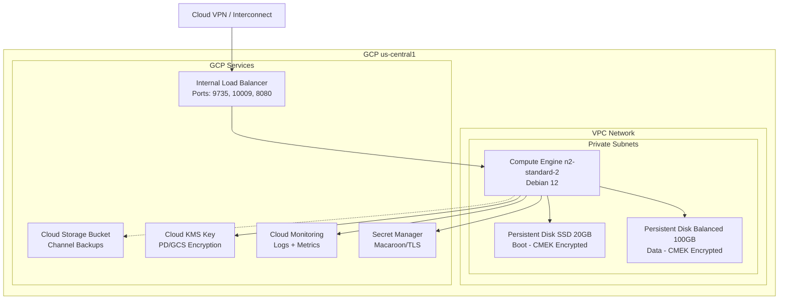

# Tutorial: Deploy LND on GCP Compute Engine

> **Goal**: Deploy a production-ready LND node on GCP Compute Engine with encrypted Persistent Disk, Internal Load Balancer, Cloud Monitoring, and automated GCS backups in ~30 minutes.
>
> **Architecture**: Single VM in private subnet, ILB for internal access, encrypted PD for channel state, GCS for backups. Reference [Figure 1].

## Architecture Overview [Figure 1]

**Figure 1:** Tutorial architecture - GCP Compute Engine LND deployment.

## Step-by-Step Instructions

*This tutorial follows the same structure as [§12.1] (AWS) with GCP-specific commands and services. Full implementation coming soon.*

## Validation Checklist

- [ ] LND service running and synced to chain tip
- [ ] Peers connected (> 3)
- [ ] Channels open (> 1)
- [ ] RPC accessible via ILB
- [ ] Metrics appearing in Cloud Monitoring
- [ ] Backup bucket receiving channel backups daily
- [ ] Alert policies configured

## References

- [GCP LND Terraform Module](https://github.com/ajettesla/lnd-terraform-modules/tree/main/gcp/compute-lnd)
- [LND Operations Guide](https://github.com/lightningnetwork/lnd/blob/master/docs/operation_guide.md)
- [Compute Engine Documentation](https://cloud.google.com/compute/docs)
