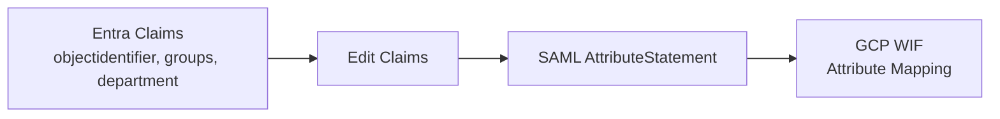
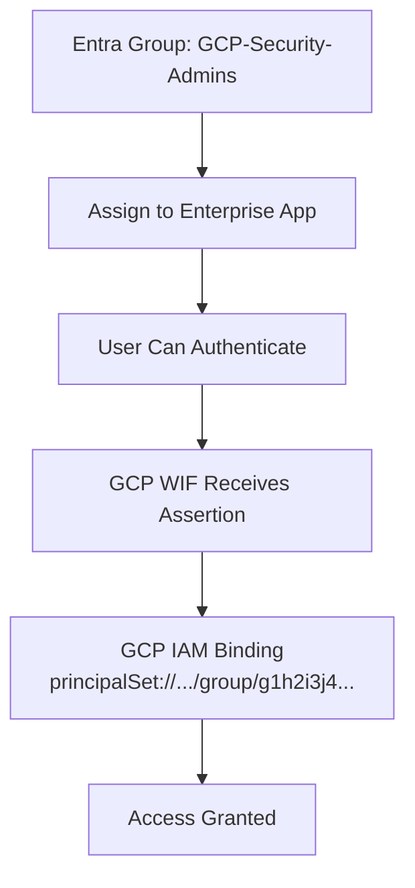
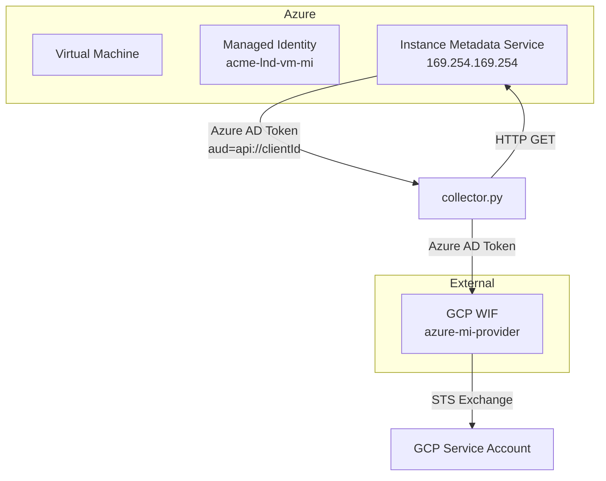
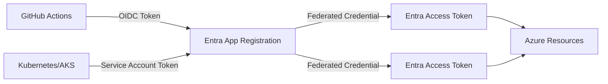
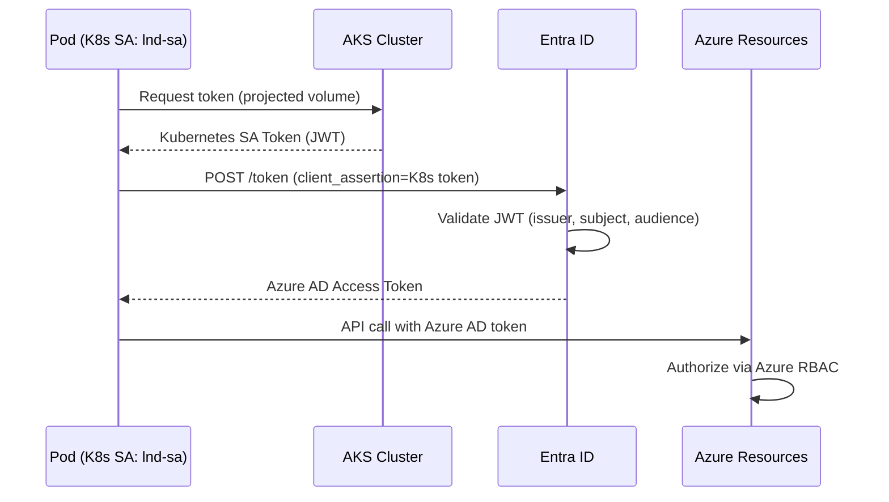
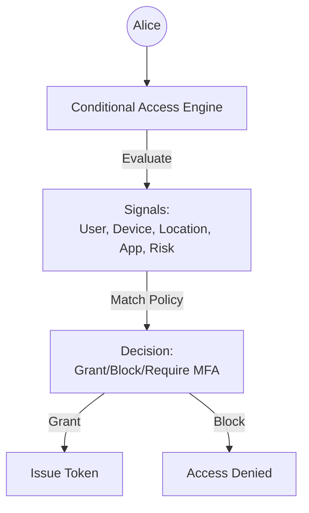

# Abstract

This document provides a comprehensive implementation guide for Microsoft Entra ID (formerly Azure AD) as both an Identity Provider (IdP) and Service Provider (SP). We cover the critical distinction between **Enterprise Applications** (for SAML IdP) and **App Registrations** (for OIDC IdP), SAML 2.0 and OIDC configuration for federating to external SPs (GCP, AWS), Managed Identities for Azure workloads, Workload Identity Federation for cross-cloud and CI/CD access, and Conditional Access policies for Zero Trust security. The running Acme Corp example demonstrates Entra ID as SAML IdP for GCP Workforce Identity Federation [§02.4] and as OIDC IdP for Azure VM workload federation to GCP [§02.5]. Cross-references to SAML/OIDC fundamentals [§02.1], [§02.2], [§02.3] and GCP implementation [§02.4] enable end-to-end understanding.

# 1. Introduction

## 1.1 Entra ID Architecture

```mermaid
graph TB
    subgraph Entra[Microsoft Entra ID Tenant]
        Users[Users & Groups]
        EnterpriseApps[Enterprise Applications<br/>SAML IdP + Gallery Apps]
        AppRegs[App Registrations<br/>OIDC/OAuth IdP + Custom Apps]
        ManagedID[Managed Identities<br/>System/User Assigned]
        WorkloadID[Workload Identity Federation<br/>Federated Credentials]
        CondAccess[Conditional Access<br/>MFA, Device, Location, Risk]
        Domain[Custom Domains<br/>acmecorp.com]
    end
    
    subgraph External[External Systems]
        GCP[GCP WIF]
        AWS[AWS IAM Identity Center]
        GitHub[GitHub Actions]
        K8s[Kubernetes/AKS]
        OnPrem[On-Premises AD]
    end
    
    EnterpriseApps -->|SAML Assertion| GCP
    EnterpriseApps -->|SAML Assertion| AWS
    AppRegs -->|OIDC Token| GCP
    AppRegs -->|OIDC Token| Custom Apps
    ManagedID -->|Azure AD Token| GCP
    ManagedID -->|Azure AD Token| Azure Resources
    WorkloadID -->|External Token| GCP
    WorkloadID -->|External Token| Azure
```

**Figure 1:** Entra ID architecture with IdP (Enterprise Apps, App Registrations) and workload identity paths.

## 1.2 Running Example: Acme Corp on Entra ID

| Element | Configuration |
|---------|---------------|
| **Tenant** | `acmecorp.onmicrosoft.com` |
| **Custom Domain** | `acmecorp.com` (verified) |
| **User** | Alice (`alice@acmecorp.com`, Object ID: `a1b2c3d4-e5f6-7890-abcd-ef1234567890`) |
| **Group** | `GCP-Security-Admins` (Object ID: `g1h2i3j4-k5l6-7890-mnop-qr1234567890`) |
| **Enterprise App (SAML)** | `Google Cloud - Workforce Federation` |
| **App Registration (OIDC)** | `Google Cloud - Workforce OIDC` |
| **Managed Identity** | `acme-lnd-vm-mi` (on Azure VM for collector.py) |
| **Workload Identity Pool** | `gcp-workload-pool` (for GitHub Actions → Azure) |

# 2. SAML IdP: Entra as Identity Provider (Enterprise Applications)

## 2.1 Enterprise Applications vs App Registrations

> **Critical Distinction**: This is the #1 source of Entra configuration errors.

| Aspect | **Enterprise Applications** | **App Registrations** |
|--------|----------------------------|----------------------|
| **Primary Use** | SAML IdP for gallery/custom apps | OIDC/OAuth IdP for custom apps |
| **SAML Config** | ✅ Single sign-on → SAML | ❌ Not supported |
| **OIDC Config** | ❌ Limited | ✅ Authentication → OIDC |
| **Gallery Apps** | ✅ Pre-integrated (Salesforce, etc.) | ❌ |
| **User Assignment** | ✅ Users and groups tab | ❌ (use Enterprise App) |
| **Provisioning (SCIM)** | ✅ Provisioning tab | ❌ |
| **Consent** | Admin consent for org | User/admin consent per app |

**Table 1:** Enterprise Applications vs App Registrations.

**For SAML IdP (GCP WIF, AWS Identity Center)**: Use **Enterprise Applications**.
**For OIDC IdP (Custom apps, GCP WIF OIDC)**: Use **App Registrations**.

## 2.2 Creating Enterprise Application for SAML IdP

### Step-by-Step (Acme Corp → GCP WIF)

1. **Entra Admin Center → Applications → Enterprise Applications**
2. **New Application → Create your own application**
3. **Name**: `Google Cloud - Workforce Federation`
4. **Select**: "Integrate any other application you don't find in the gallery (Non-gallery)"
5. **Create**

### SAML Configuration

| Field | Value (Acme Corp Example) |
|-------|---------------------------|
| **Identifier (Entity ID / Audience)** | `https://iam.googleapis.com/locations/global/workforcePools/entra-workforce-pool/providers/entra-saml-provider` |
| **Reply URL (ACS URL)** | `https://auth.cloud.google/signin-callback/locations/global/workforcePools/entra-workforce-pool/providers/entra-saml-provider` |
| **Relay State** | `https://console.cloud.google/` |
| **Sign-on URL** | (Leave blank — not used by GCP WIF) |
| **Logout URL** | (Leave blank — not used by GCP WIF) |

**Table 2:** Entra Enterprise App SAML configuration for GCP WIF.

> **Source**: These URLs are constructed from GCP Workforce Pool ID (`entra-workforce-pool`) and Provider ID (`entra-saml-provider`). See [§02.4] for GCP-side configuration.

### Claims Configuration (Attributes & Claims)



**Figure 2:** Claims flow: Entra → SAML Assertion → GCP Attribute Mapping.

**Required Claims for GCP WIF**:

| GCP Attribute | Entra Claim URI | Entra Claim Name | Stability |
|---------------|-----------------|------------------|-----------|
| `google.subject` | `http://schemas.microsoft.com/identity/claims/objectidentifier` | `objectidentifier` | ✅ Immutable |
| `google.groups` | `http://schemas.microsoft.com/ws/2008/06/identity/claims/groups` | `groups` (Object IDs) | ✅ Immutable |
| `attribute.department` | `http://schemas.microsoft.com/identity/claims/department` | `department` | ⚠️ Mutable |

**Table 3:** Required Entra SAML claims for GCP WIF.

**Group Claim Configuration**:
- **Groups claim**: "Security groups" or "All groups"
- **Source attribute**: "Group Object ID" (not Display Name)
- **Claim format**: As-is (emits Object IDs)

### Signing Certificate

1. **Enterprise App → Single sign-on → SAML Certificates**
2. **Download Federation Metadata XML** (contains Entity ID, SSO URL, Signing Cert)
3. **Upload to GCP** when creating SAML Workforce Provider

> **Certificate Rotation**: Entra rotates signing certificates automatically. GCP must re-import metadata when certificate changes. Plan for overlap period.

## 2.3 User/Group Assignment



**Figure 3:** Entra group assignment → authentication → GCP IAM authorization.

**Assignment Steps**:
1. Enterprise App → Users and groups → Add user/group
2. Select `GCP-Security-Admins` group
3. Assign

> **Key Point** (from [§02.3]): Entra app assignment controls **who can authenticate** (Gate 1). GCP IAM controls **what they can do** (Gate 2). Both are required.

## 2.4 GCP WIF Provider Creation (Recap from [§02.4])

```bash
# In GCP Console or gcloud:
# 1. Upload Entra Federation Metadata XML
# 2. Configure attribute mapping:
google.subject = assertion.attributes['http://schemas.microsoft.com/identity/claims/objectidentifier']
google.groups  = assertion.attributes['http://schemas.microsoft.com/ws/2008/06/identity/claims/groups']
attribute.department = assertion.attributes['department']
# 3. Set attribute condition:
assertion.attributes['tid'] == 'acmecorp-tenant-id'
```

**Listing 1:** GCP WIF attribute mapping for Entra SAML (recap from [§02.4]).

# 3. OIDC IdP: Entra as Identity Provider (App Registrations)

## 3.1 Creating App Registration for OIDC IdP

### Step-by-Step (Acme Corp → GCP WIF OIDC)

1. **Entra Admin Center → Applications → App Registrations → New registration**
2. **Name**: `Google Cloud - Workforce OIDC`
3. **Supported account types**: "Accounts in this organizational directory only (Single tenant)"
4. **Redirect URI**: Web → `https://auth.cloud.google/oidc-callback` (GCP OIDC callback)
5. **Register**

### Authentication Configuration

| Setting | Value |
|---------|-------|
| **Redirect URI** | `https://auth.cloud.google/oidc-callback` |
| **Implicit grant** | ✅ ID tokens (for hybrid flow) |
| **Supported account types** | Single tenant |
| **Client secret** | Create new (store securely) |

### Token Configuration (Optional Claims)

```json
{
  "accessToken": [],
  "idToken": [
    {
      "name": "groups",
      "source": null,
      "essential": false,
      "additionalProperties": ["emit_as_roles"]
    },
    {
      "name": "department",
      "source": "user",
      "essential": false
    },
    {
      "name": "costcenter",
      "source": "user",
      "essential": false
    }
  ],
  "saml2Token": []
}
```

**Listing 2:** Optional claims configuration for OIDC ID Token.

### GCP WIF OIDC Provider Config

```bash
gcloud iam workforce-pools providers create-oidc entra-oidc-provider \
  --location=global \
  --workforce-pool=entra-workforce-pool \
  --display-name="Entra ID OIDC Provider" \
  --issuer-uri="https://sts.windows.net/acmecorp-tenant-id/" \
  --client-id="<app-registration-client-id>" \
  --client-secret="<client-secret>" \
  --attribute-mapping="google.subject=assertion.oid,google.groups=assertion.groups,attribute.department=assertion.department" \
  --attribute-condition="assertion.tid == 'acmecorp-tenant-id'"
```

**Listing 3:** GCP WIF OIDC provider for Entra App Registration.

> **Note**: OIDC uses `assertion.<claim>` (JWT claims), SAML uses `assertion.attributes['<uri>']`.

# 4. Entra as Service Provider (External IdP → Entra)

## 4.1 SAML IdP → Entra

Configure Entra to trust external SAML IdP (e.g., Okta, ADFS, Ping):

1. **Entra Admin Center → Applications → Enterprise Applications → New Application → Non-gallery**
2. **Single sign-on → SAML**
3. **Upload External IdP Metadata XML**
4. **Configure attribute mapping** (external IdP claims → Entra attributes)
5. **Assign users/groups**

## 4.2 OIDC Federation → Entra

For external OIDC IdP (e.g., Google, GitHub, custom):

1. **App Registrations → New Registration** (or use existing)
2. **Authentication → Add platform → Web**
3. **Configure redirect URI for external IdP**
4. **Use Microsoft Graph API or PowerShell to configure OIDC federation** (not in UI)

```powershell
# Configure OIDC federation via Microsoft Graph
$federationConfig = @{
    "issuer" = "https://accounts.google.com"
    "clientId" = "google-client-id"
    "clientSecret" = "google-client-secret"
    "allowedAudiences" = @("api://entra-app-client-id")
}
```

**Listing 4:** OIDC federation configuration via Graph API.

# 5. Workload Identities

## 5.1 Managed Identities

Managed Identities provide Azure resources with automatically managed credentials.



**Figure 4:** Azure VM Managed Identity → GCP Workload Identity Federation.

### Types of Managed Identities

| Type | Lifecycle | Use Case |
|------|-----------|----------|
| **System-Assigned** | Tied to resource lifecycle | Single VM, App Service |
| **User-Assigned** | Independent lifecycle | Shared across resources, migration |

### Create User-Assigned Managed Identity

```bash
az identity create \
  --name acme-lnd-vm-mi \
  --resource-group acme-lnd-rg \
  --location eastus
```

**Listing 5:** Create user-assigned managed identity.

### Assign to VM

```bash
az vm identity assign \
  --resource-group acme-lnd-rg \
  --name lnd-vm \
  --identities acme-lnd-vm-mi
```

**Listing 6:** Assign managed identity to VM.

### Get Token from IMDS (Inside VM)

```bash
# Request token for GCP WIF audience
TOKEN=$(curl -s -H "Metadata: true" \
  "http://169.254.169.254/metadata/identity/oauth2/token?api-version=2018-02-01&resource=api://m1n2o3p4-q5r6-7890-stuv-wx1234567890" \
  | jq -r .access_token)
```

**Listing 7:** Get Azure AD token from IMDS for GCP WIF audience.

## 5.2 Workload Identity Federation (External Workloads → Entra)

Entra can trust external workloads (GitHub Actions, Kubernetes, on-prem) via **Federated Credentials**.



**Figure 5:** Workload Identity Federation: External workloads → Entra → Azure.

### Configure Federated Credential (GitHub Actions)

1. **App Registrations → Select App → Certificates & secrets → Federated credentials**
2. **Add credential**:
   - **Scenario**: "GitHub Actions deploying Azure resources"
   - **Organization**: `acmecorp`
   - **Repository**: `acmecorp/lnd-infra`
   - **Entity type**: Branch / Tag / Pull Request / Environment
   - **Name**: `github-actions-main`

### Configure Federated Credential (Kubernetes)

```bash
az identity federated-credential create \
  --name kubernetes-federated \
  --identity-name acme-lnd-mi \
  --resource-group acme-lnd-rg \
  --issuer "https://oidc.eks.us-east-1.amazonaws.com/id/EXAMPLED539D4633E53DE1B71EXAMPLE" \
  --subject "system:serviceaccount:lnd:lnd-sa" \
  --audiences "api://<entra-app-client-id>"
```

**Listing 8:** Kubernetes federated credential for Entra.

# 6. Entra Workload Identity (AKS Integration)

## 6.1 Architecture

Native Azure AD workload identity for AKS pods (replaces AAD Pod Identity).



**Figure 6:** AKS Workload Identity flow.

## 6.2 Prerequisites

1. **AKS Cluster with OIDC Issuer** enabled
2. **Entra App Registration** for workload identity
3. **Federated Credential** on Entra App linking K8s SA → Entra App

```bash
# Enable OIDC issuer on AKS
az aks update \
  --name acme-lnd-cluster \
  --resource-group acme-lnd-rg \
  --enable-oidc-issuer \
  --enable-workload-identity
```

**Listing 9:** Enable OIDC issuer and workload identity on AKS.

## 6.3 Federated Credential for AKS

```bash
az identity federated-credential create \
  --name aks-lnd-workload \
  --identity-name acme-lnd-workload-id \
  --resource-group acme-lnd-rg \
  --issuer "https://oidc.aks.azure.com/<cluster-id>/<cluster-oidc-id>" \
  --subject "system:serviceaccount:lnd:lnd-sa" \
  --audiences "api://<entra-app-client-id>"
```

**Listing 10:** Federated credential for AKS workload identity.

## 6.4 Azure RBAC for Workload

```bash
# Grant Azure role to federated identity
az role assignment create \
  --role "Storage Blob Data Contributor" \
  --assignee-object-id <entra-app-object-id> \
  --assignee-principal-type ServicePrincipal \
  --scope "/subscriptions/<sub-id>/resourceGroups/acme-lnd-rg/providers/Microsoft.Storage/storageAccounts/acmelndlogs"
```

**Listing 11:** Azure RBAC assignment for federated workload.

# 7. Conditional Access Policies

## 7.1 Zero Trust with Conditional Access

Conditional Access enforces policies at authentication time.



**Figure 7:** Conditional Access evaluation flow.

## 7.2 Policy Components

| Component | Options |
|-----------|---------|
| **Users/Groups** | Include/exclude specific users, groups, roles |
| **Cloud Apps** | Include/exclude apps (e.g., Google Cloud Enterprise App) |
| **Conditions** | Sign-in risk, Device platform, Location, Client apps |
| **Grant Controls** | Require MFA, Require compliant device, Require hybrid Azure AD join, Require approved client app |
| **Session Controls** | Sign-in frequency, Persistent browser mode |

## 7.3 Example Policies for Acme Corp

### Policy 1: Require MFA for GCP Access

```json
{
  "displayName": "Require MFA for GCP Workforce Federation",
  "state": "enabled",
  "conditions": {
    "users": { "includeGroups": ["GCP-Security-Admins"] },
    "applications": { "includeApplications": ["Google Cloud - Workforce Federation"] },
    "clientAppTypes": ["browser", "mobileAppsAndDesktopClients"]
  },
  "grantControls": {
    "operator": "OR",
    "builtInControls": ["mfa"]
  }
}
```

**Listing 12:** Conditional Access policy requiring MFA for GCP access.

### Policy 2: Block Access from High-Risk Countries

```json
{
  "displayName": "Block High-Risk Locations",
  "state": "enabled",
  "conditions": {
    "users": { "includeRoles": ["Global Administrator", "Security Administrator"] },
    "locations": { "includeLocations": ["HighRiskCountries"], "excludeLocations": ["TrustedLocations"] }
  },
  "grantControls": {
    "operator": "OR",
    "builtInControls": ["block"]
  }
}
```

**Listing 13:** Conditional Access policy blocking high-risk locations.

### Policy 3: Require Compliant Device for Admin Access

```json
{
  "displayName": "Require Compliant Device for Admins",
  "state": "enabled",
  "conditions": {
    "users": { "includeRoles": ["Global Administrator", "Privileged Role Administrator"] },
    "applications": { "includeApplications": ["All cloud apps"] }
  },
  "grantControls": {
    "operator": "AND",
    "builtInControls": ["mfa", "compliantDevice"]
  }
}
```

**Listing 14:** Conditional Access policy requiring compliant device + MFA.

## 7.4 Conditional Access for Workload Identities

Workload identities (Managed Identities, Federated Credentials) **bypass Conditional Access** by design. For workload protection, use:
- **Federated Credential restrictions** (issuer, subject, audience)
- **Azure RBAC** with conditions
- **Network restrictions** (Private Endpoints, Service Endpoints)

# 8. Monitoring & Audit

## 8.1 Entra ID Sign-In Logs

```bash
# Sign-in logs for Enterprise App
az monitor log-analytics query \
  --workspace <workspace-id> \
  --analytics-query "SigninLogs | where AppDisplayName == 'Google Cloud - Workforce Federation' | project TimeGenerated, UserPrincipalName, ResultDescription, Location, DeviceDetail"

# Workload identity token requests
az monitor log-analytics query \
  --workspace <workspace-id> \
  --analytics-query "AADNonInteractiveUserSignInLogs | where ResourceDisplayName == 'Google Cloud - Workforce OIDC' | project TimeGenerated, ServicePrincipalName, AppId, ResultDescription"
```

**Listing 15:** Log Analytics queries for Entra sign-in monitoring.

## 8.2 Audit Logs

```bash
# Audit logs for app registration changes
az monitor log-analytics query \
  --workspace <workspace-id> \
  --analytics-query "AuditLogs | where TargetResources contains 'Enterprise Applications' | project TimeGenerated, InitiatedBy, ActivityDisplayName, TargetResources"
```

**Listing 16:** Audit log query for configuration changes.

# References

[1] Microsoft, "What is Microsoft Entra ID?" https://learn.microsoft.com/entra/fundamentals/whatis
[2] Microsoft, "Enterprise Application SAML Configuration," https://learn.microsoft.com/entra/identity/enterprise-apps/configure-saml-single-sign-on
[3] Microsoft, "App Registration OIDC Configuration," https://learn.microsoft.com/entra/identity-platform/quickstart-register-app
[4] Microsoft, "Managed Identities Overview," https://learn.microsoft.com/entra/identity/managed-identities-azure-resources/overview
[5] Microsoft, "Workload Identity Federation," https://learn.microsoft.com/entra/workload-id/workload-identities-overview
[6] Microsoft, "Conditional Access Overview," https://learn.microsoft.com/entra/identity/conditional-access/overview
[7] Microsoft, "Entra Workload Identity for AKS," https://learn.microsoft.com/azure/aks/workload-identity-overview

# Appendices

## Appendix A: Terraform Module — Entra Enterprise Application (SAML IdP)

```hcl
# modules/azure/entra-enterprise-app/main.tf
variable "display_name" {
  type        = string
  description = "Enterprise Application display name"
}

variable "identifier_uris" {
  type        = list(string)
  description = "SAML Entity ID / Audience URIs"
}

variable "reply_urls" {
  type        = list(string)
  description = "SAML ACS / Reply URLs"
}

variable "relay_state" {
  type        = string
  description = "SAML Relay State for IdP-initiated flow"
  default     = ""
}

variable "claims_mapping" {
  type = map(string)
  description = "SAML claim mappings (Entra claim URI → SAML attribute name)"
  default = {
    "http://schemas.microsoft.com/identity/claims/objectidentifier" = "objectidentifier"
    "http://schemas.microsoft.com/ws/2008/06/identity/claims/groups" = "groups"
  }
}

variable "assigned_groups" {
  type        = list(string)
  description = "Entra Group Object IDs to assign to this application"
  default     = []
}

# Enterprise Application
resource "azuread_application" "enterprise" {
  display_name = var.display_name
  
  # SAML configuration
  saml_metadata = {
    entity_ids                     = var.identifier_uris
    reply_urls                     = var.reply_urls
    relay_state                    = var.relay_state
    logout_url                     = ""  # Not used by GCP WIF
    name_identifier_format         = "urn:oasis:names:tc:SAML:2.0:nameid-format:persistent"
    signing_certificate_update_behavior = "Automatic"
  }
  
  # Optional claims for tokens (not used for SAML but good practice)
  optional_claims = {
    id_token = [
      { name = "groups", source = null, essential = false, additional_properties = ["emit_as_roles"] }
    ]
  }
}

# Service Principal (automatically created with Enterprise App)
resource "azuread_service_principal" "enterprise" {
  application_id = azuread_application.enterprise.application_id
  app_role_assignment_required = true
}

# Group Assignments
resource "azuread_service_principal_assignments" "groups" {
  for_each = toset(var.assigned_groups)
  
  service_principal_id = azuread_service_principal.enterprise.id
  principal_id         = each.value
}

# Output Federation Metadata XML URL (for GCP import)
output "federation_metadata_url" {
  value = "https://login.microsoftonline.com/${data.azuread_client_config.current.tenant_id}/federationmetadata/2007-06/federationmetadata.xml?appid=${azuread_application.enterprise.application_id}"
}
```

**Listing A-1:** Terraform module for Entra Enterprise Application (SAML IdP).

## Appendix B: Terraform Module — Entra App Registration (OIDC IdP)

```hcl
# modules/azure/entra-app-registration/main.tf
variable "display_name" {
  type        = string
  description = "App Registration display name"
}

variable "redirect_uris" {
  type        = list(string)
  description = "OIDC Redirect URIs"
}

variable "client_secret_rotation_days" {
  type        = number
  default     = 90
  description = "Client secret rotation period in days"
}

variable "optional_claims" {
  type = object({
    id_token = list(object({
      name                  = string
      source                = string
      essential             = bool
      additional_properties = list(string)
    }))
  })
  default = {}
}

# App Registration
resource "azuread_application" "oidc" {
  display_name = var.display_name
  
  web {
    redirect_uris = var.redirect_uris
    implicit_grant {
      id_token = true
      access_token = false
    }
  }
  
  optional_claims = var.optional_claims
  
  # Single tenant
  sign_in_audience = "AzureADMyOrg"
}

# Client Secret (with rotation)
resource "azuread_application_password" "client_secret" {
  application_object_id = azuread_application.oidc.object_id
  display_name          = "client-secret-${formatdate("YYYY-MM-DD", timestamp())}"
  end_date_relative     = "${var.client_secret_rotation_days}d"
}

# Service Principal
resource "azuread_service_principal" "oidc" {
  application_id = azuread_application.oidc.application_id
}

# Federated Credentials (for GitHub Actions, Kubernetes, etc.)
resource "azuread_application_federated_identity_credential" "federated" {
  for_each = var.federated_credentials
  
  application_object_id = azuread_application.oidc.object_id
  name                  = each.key
  issuer                = each.value.issuer
  subject               = each.value.subject
  audiences             = each.value.audiences
  description           = each.value.description
}

# Example usage for GitHub Actions
variable "federated_credentials" {
  type = map(object({
    issuer      = string
    subject     = string
    audiences   = list(string)
    description = string
  }))
  default = {}
}
```

**Listing B-1:** Terraform module for Entra App Registration (OIDC IdP) with federated credentials.

## Appendix C: Terraform Module — Managed Identity with Federated Credential

```hcl
# modules/azure/managed-identity/main.tf
variable "name" {
  type        = string
  description = "Managed Identity name"
}

variable "resource_group_name" {
  type        = string
  description = "Resource Group name"
}

variable "location" {
  type        = string
  description = "Azure region"
}

variable "federated_credentials" {
  type = map(object({
    name        = string
    issuer      = string
    subject     = string
    audiences   = list(string)
    description = string
  }))
  default = {}
}

# User-Assigned Managed Identity
resource "azurerm_user_assigned_identity" "mi" {
  name                = var.name
  resource_group_name = var.resource_group_name
  location            = var.location
}

# Federated Credentials on Managed Identity
resource "azurerm_federated_identity_credential" "federated" {
  for_each = var.federated_credentials
  
  name                = each.key
  parent_id           = azurerm_user_assigned_identity.mi.id
  issuer              = each.value.issuer
  subject             = each.value.subject
  audiences           = each.value.audiences
  description         = each.value.description
}

# Example: Azure VM → GCP WIF
# No federated credential needed on Azure side; Azure MI gets token from IMDS
# GCP WIF trusts Azure MI token directly (see [§02.5])

# Example: GitHub Actions → Azure (reverse direction)
# Configure federated credential on Entra App Registration (Appendix B)
# with issuer="https://token.actions.githubusercontent.com", subject="repo:acmecorp/lnd-infra:ref:refs/heads/main"
```

**Listing C-1:** Terraform module for User-Assigned Managed Identity with federated credentials.

## Appendix D: Principal Identifier Formats Reference

| Identity Type | Context | Identifier Format |
|---------------|---------|-------------------|
| **Entra User** | IAM/Graph API | `a1b2c3d4-e5f6-7890-abcd-ef1234567890` (Object ID) |
| **Entra Group** | IAM/Graph API | `g1h2i3j4-k5l6-7890-mnop-qr1234567890` (Object ID) |
| **Enterprise App** | SAML IdP | Application ID (GUID) |
| **App Registration** | OIDC IdP | Application (Client) ID (GUID) |
| **Service Principal** | RBAC/Graph | Object ID (different from App ID) |
| **Managed Identity** | Azure RBAC | Principal ID (Object ID) |
| **Federated Credential** | Token Subject | Configured `subject` (e.g., `system:serviceaccount:ns:sa`) |
| **SAML Assertion** | To External SP | `NameID` = Entra `objectidentifier` |
| **OIDC ID Token** | To External SP | `oid` = Entra `objectidentifier`, `groups` = Group Object IDs |

**Table D-1:** Entra ID principal identifier formats for various contexts.