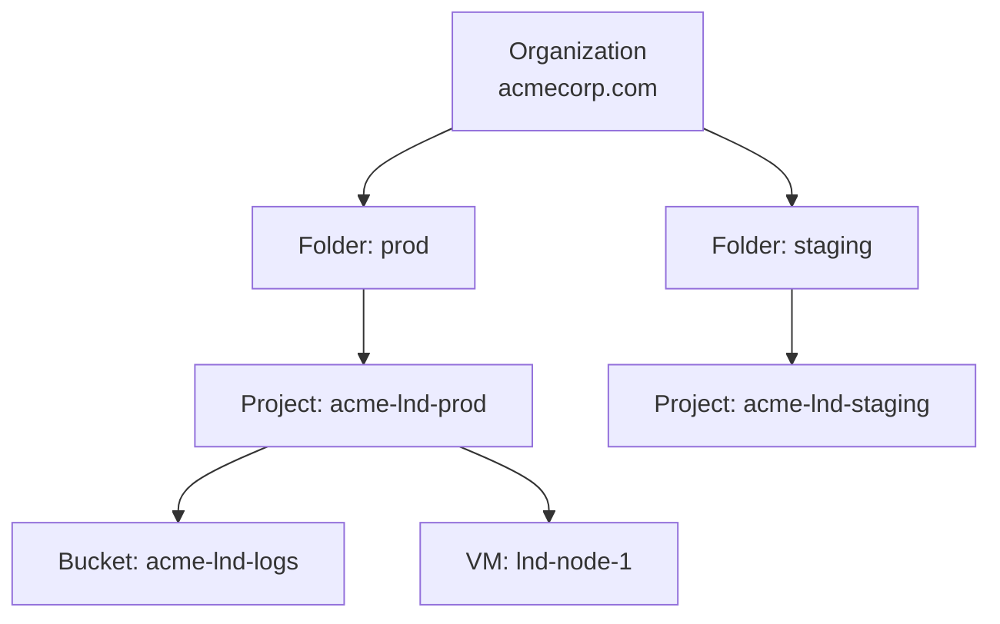
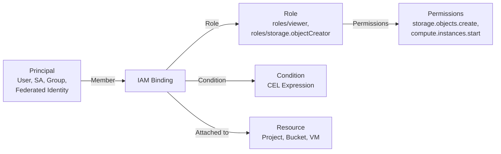
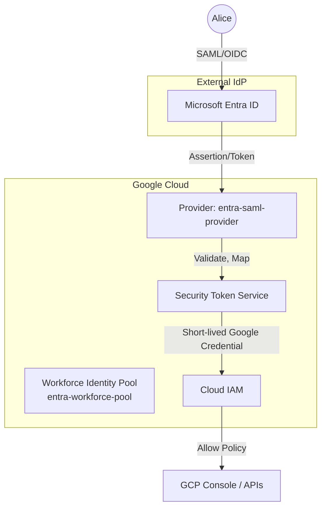
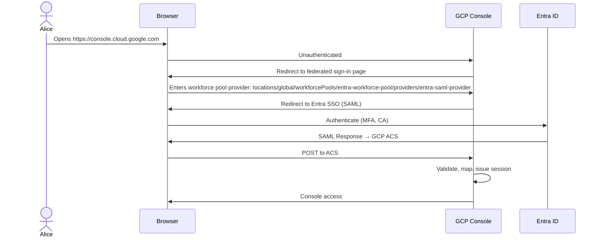
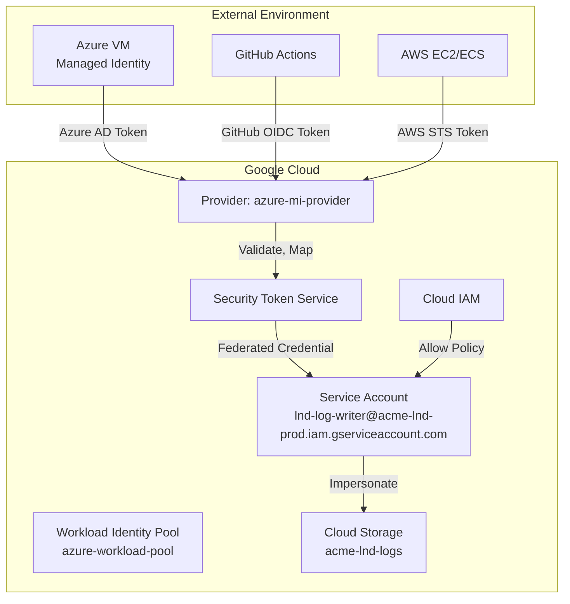
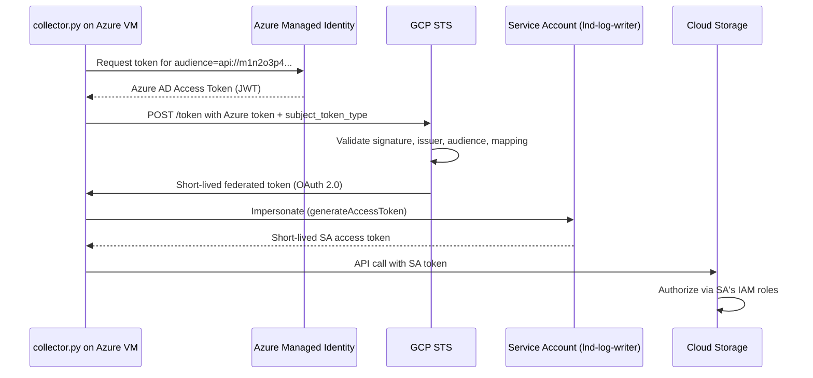

# Abstract

This document provides a comprehensive implementation guide for identity and access management on Google Cloud Platform (GCP). We cover the GCP resource hierarchy, the distinction between Cloud Identity/Google Workspace (identity directory) and the Organization resource (hierarchy root), Google Cloud IAM principles, and detailed implementations of Workforce Identity Federation (for human users) and Workload Identity Federation (for machine workloads). The running Acme Corp example—Alice accessing GCP Console via Entra SAML, and `collector.py` on Azure VM writing to GCS via Azure Managed Identity—demonstrates both patterns. Cross-references to SAML/OIDC fundamentals [§02.1], [§02.2], [§02.3] and Azure Entra configuration [§02.8] enable end-to-end understanding.

# 1. Introduction

## 1.1 GCP Identity Model Overview

Google Cloud separates **identity management** (who you are) from **access control** (what you can do):

```mermaid
graph TB
    subgraph Identity[Identity Layer]
        CI[Cloud Identity /<br/>Google Workspace]
        WIF[Workforce Identity<br/>Federation]
        WLF[Workload Identity<br/>Federation]
    end
    
    subgraph Resource[Resource Hierarchy]
        Org[Organization]
        Folder[Folders]
        Project[Projects]
        Resource[Resources]
    end
    
    subgraph AuthZ[Authorization Layer]
        IAM[Google Cloud IAM]
        Roles[Roles & Permissions]
        Bindings[IAM Bindings]
        Conditions[Conditions]
    end
    
    Identity -->|Authenticated Principals| AuthZ
    AuthZ -->|Allow Policies| Resource
```

**Figure 1:** GCP identity architecture: Identity layer → IAM → Resource hierarchy.

## 1.2 Running Example: Acme Corp on GCP

| Element | Configuration |
|---------|---------------|
| **Organization** | `acmecorp.com` (linked to Cloud Identity) |
| **Project** | `acme-lnd-prod` (production LND workloads) |
| **Bucket** | `acme-lnd-logs` (LND channel backups, logs) |
| **Workforce User** | Alice (`alice@acmecorp.com`, Entra objectId: `a1b2c3d4...`) |
| **Workload** | `collector.py` on Azure VM (Azure MI clientId: `m1n2o3p4...`) |
| **Workforce Pool** | `entra-workforce-pool` |
| **Workforce Provider** | `entra-saml-provider` (SAML) |
| **Workload Pool** | `azure-workload-pool` |
| **Workload Provider** | `azure-mi-provider` (OIDC) |

# 2. GCP Resource Hierarchy & Identity

## 2.1 Resource Hierarchy



**Figure 2:** GCP resource hierarchy (Organization → Folders → Projects → Resources).

Key principles:
- **Single root**: Every resource has exactly one parent
- **Inheritance**: IAM policies inherit down the hierarchy
- **Organization required**: For Workforce Identity Federation, Org Policies, centralized billing

## 2.2 Cloud Identity / Google Workspace vs Organization Resource

| Concept | Purpose | Admin Console |
|---------|---------|---------------|
| **Cloud Identity / Workspace** | Managed identity directory (users, groups, SSO, MFA) | `admin.google.com` |
| **Organization Resource** | Root of resource hierarchy; inherits IAM, Org Policies | Cloud Console → Manage Resources |

> **Critical Distinction** (from [§02.1]): The Organization resource is **not** the identity directory. A company can have Cloud Identity without an Org resource (standalone), or an Org resource linked to Cloud Identity. For enterprise federation, both exist and are linked via verified domain.

## 2.3 Identity Types in GCP

| Principal Type | Format | Description |
|----------------|--------|-------------|
| **Google Account** | `user:alice@gmail.com` | Consumer or unmanaged corporate email |
| **Cloud Identity/Workspace User** | `user:alice@acmecorp.com` | Managed by Cloud Identity/Admin console |
| **Service Account** | `serviceAccount:svc@project.iam.gserviceaccount.com` | Machine identity for workloads on GCP |
| **Group** | `group:security@acmecorp.com` | Managed in Cloud Identity/Admin console |
| **Workforce Federated Principal** | `principal://iam.googleapis.com/locations/global/workforcePools/{pool}/subject/{subject}` | External IdP user (SAML/OIDC) via WIF |
| **Workforce Federated Group** | `principalSet://.../group/{group}` | External IdP group via WIF |
| **Workload Federated Principal** | `principal://iam.googleapis.com/projects/{project}/locations/global/workloadIdentityPools/{pool}/subject/{subject}` | External workload (Azure, AWS, GitHub) via WIF |
| **Workload Federated Group** | `principalSet://.../group/{group}` | External workload group via WIF |

**Table 1:** GCP principal types with identifier formats.

# 3. Google Cloud IAM

## 3.1 IAM Model



**Figure 3:** IAM model: Principal + Role (+ Condition) → Binding on Resource.

## 3.2 Role Types

| Type | Examples | Use Case |
|------|----------|----------|
| **Basic** | `roles/owner`, `roles/editor`, `roles/viewer` | Broad project-level access (avoid in production) |
| **Predefined** | `roles/storage.objectCreator`, `roles/compute.instanceAdmin.v1` | Service-specific, least privilege |
| **Custom** | `projects/acme-lnd-prod/roles/lndOperator` | Tailored permission sets |

## 3.3 IAM Conditions (CEL)

Conditions add attribute-based access control:

```cel
// Time-based access
request.time < timestamp("2026-12-31T23:59:59Z")

// Resource tag-based
resource.matchTag('123456789/environment', 'production')

// Principal attribute (for federated identities)
'principalSet://iam.googleapis.com/locations/global/workforcePools/entra-workforce-pool/group/g1h2i3j4...' in principal.groupMembership
```

**Listing 1:** IAM condition examples.

# 4. Workforce Identity Federation (WIF)

## 4.1 Architecture

Workforce Identity Federation allows human users from external IdPs to access GCP without Cloud Identity/Workspace user accounts.



**Figure 4:** Workforce Identity Federation architecture.

## 4.2 Workforce Identity Pool

- **Organization-level resource** (not project-level)
- Contains one or more **providers** (each for a different IdP)
- Pool ID: globally unique within organization (e.g., `entra-workforce-pool`)
- Display name: human-readable

### Create Pool (Console / gcloud)

```bash
gcloud iam workforce-pools create entra-workforce-pool \
  --location=global \
  --organization=ACME_ORG_ID \
  --display-name="Entra ID Workforce Pool" \
  --description="Federated access for Acme Corp employees via Entra ID"
```

**Listing 2:** Create workforce identity pool.

## 4.3 Workforce Identity Provider (SAML)

### Provider Configuration

| Field | Value (Acme Corp Example) |
|-------|---------------------------|
| **Pool** | `entra-workforce-pool` |
| **Provider ID** | `entra-saml-provider` |
| **Protocol** | SAML |
| **IdP Metadata** | Entra Federation Metadata XML |

### SAML Provider Setup Steps

1. **Create Entra Enterprise Application** (see [§02.8] for details):
   - Identifier (Entity ID): `https://iam.googleapis.com/locations/global/workforcePools/entra-workforce-pool/providers/entra-saml-provider`
   - Reply URL (ACS): `https://auth.cloud.google/signin-callback/locations/global/workforcePools/entra-workforce-pool/providers/entra-saml-provider`
   - RelayState: `https://console.cloud.google/`
   - Claims: `objectidentifier`, `groups` (Object IDs)

2. **Download Entra Federation Metadata XML** (from Enterprise App → SAML Certificates)

3. **Create Provider in GCP**:

```bash
gcloud iam workforce-pools providers create-saml entra-saml-provider \
  --location=global \
  --workforce-pool=entra-workforce-pool \
  --display-name="Entra ID SAML Provider" \
  --idp-metadata-file=entra-metadata.xml \
  --attribute-mapping="google.subject=assertion.attributes['http://schemas.microsoft.com/identity/claims/objectidentifier'],google.groups=assertion.attributes['http://schemas.microsoft.com/ws/2008/06/identity/claims/groups'],attribute.department=assertion.attributes['department']" \
  --attribute-condition="assertion.attributes['tid'] == 'acmecorp-tenant-id'"
```

**Listing 3:** Create SAML workforce provider with attribute mapping and condition.

### Attribute Mapping Reference

| GCP Attribute | Entra SAML Claim URI | Purpose |
|---------------|---------------------|---------|
| `google.subject` | `http://schemas.microsoft.com/identity/claims/objectidentifier` | **Required**: Stable subject identifier |
| `google.groups` | `http://schemas.microsoft.com/ws/2008/06/identity/claims/groups` | Group-based IAM bindings |
| `google.display_name` | `http://schemas.xmlsoap.org/ws/2005/05/identity/claims/name` | Display in Console |
| `attribute.<custom>` | Any claim URI | Custom attributes for conditions |

**Table 2:** Common Entra SAML → GCP attribute mappings.

## 4.4 Workforce Identity Provider (OIDC)

For IdPs supporting OIDC (Entra, Okta, generic):

```bash
gcloud iam workforce-pools providers create-oidc entra-oidc-provider \
  --location=global \
  --workforce-pool=entra-workforce-pool \
  --display-name="Entra ID OIDC Provider" \
  --issuer-uri="https://sts.windows.net/acmecorp-tenant-id/" \
  --client-id="sp-client-id-from-entra-app-reg" \
  --client-secret="client-secret-from-entra" \
  --attribute-mapping="google.subject=assertion.oid,google.groups=assertion.groups,attribute.department=assertion.department" \
  --attribute-condition="assertion.tid == 'acmecorp-tenant-id'"
```

**Listing 4:** Create OIDC workforce provider.

> **Note**: OIDC uses `assertion.<claim>` syntax (JWT claims), SAML uses `assertion.attributes['<claim-uri>']`.

## 4.5 IAM Authorization for Federated Principals

After provider creation, grant IAM roles to federated identities:

```bash
# Grant Project Viewer to Entra group "GCP-Security-Admins"
POOL="entra-workforce-pool"
GROUP_ID="g1h2i3j4-k5l6-7890-mnop-qr1234567890"  # Entra group Object ID
MEMBER="principalSet://iam.googleapis.com/locations/global/workforcePools/${POOL}/group/${GROUP_ID}"

gcloud projects add-iam-policy-binding acme-lnd-prod \
  --member="${MEMBER}" \
  --role="roles/viewer"
```

**Listing 5:** Grant IAM role to federated Entra group.

### Principal Identifier Formats

| Type | Format | Example |
|------|--------|---------|
| Individual | `principal://iam.googleapis.com/locations/global/workforcePools/{pool}/subject/{subject}` | `principal://.../subject/a1b2c3d4...` |
| Group | `principalSet://iam.googleapis.com/locations/global/workforcePools/{pool}/group/{group}` | `principalSet://.../group/g1h2i3j4...` |
| Attribute | `principalSet://iam.googleapis.com/locations/global/workforcePools/{pool}/attribute.{name}/{value}` | `principalSet://.../attribute.department/Security` |

**Table 3:** Workforce federated principal identifiers.

## 4.6 User Sign-In Experience



**Figure 5:** User sign-in flow via Workforce Identity Federation.

# 5. Workload Identity Federation (WIF)

## 5.1 Architecture

Workload Identity Federation enables **machine workloads** running outside GCP (Azure VMs, AWS EC2, GitHub Actions, GitLab CI, on-prem) to access GCP APIs without service account keys.



**Figure 6:** Workload Identity Federation architecture with service account impersonation.

## 5.2 Workload Identity Pool

- **Project-level resource** (unlike workforce pools which are org-level)
- Contains providers for different external platforms
- Pool ID: unique within project

```bash
gcloud iam workload-identity-pools create azure-workload-pool \
  --location=global \
  --project=acme-lnd-prod \
  --display-name="Azure Workload Pool" \
  --description="Federated access for Azure workloads"
```

**Listing 6:** Create workload identity pool.

## 5.3 Workload Identity Provider (Azure Managed Identity)

### Azure → GCP Trust Configuration

```bash
gcloud iam workload-identity-pools providers create-oidc azure-mi-provider \
  --location=global \
  --workload-identity-pool=azure-workload-pool \
  --project=acme-lnd-prod \
  --display-name="Azure Managed Identity Provider" \
  --issuer-uri="https://login.microsoftonline.com/acmecorp-tenant-id/v2.0" \
  --allowed-audiences="api://m1n2o3p4-q5r6-7890-stuv-wx1234567890" \
  --attribute-mapping="google.subject=assertion.azp,attribute.azure_client_id=assertion.azp,attribute.azure_tenant_id=assertion.tid" \
  --attribute-condition="assertion.tid == 'acmecorp-tenant-id'"
```

**Listing 7:** Create Azure Managed Identity workload provider.

### Key Parameters

| Parameter | Value | Source |
|-----------|-------|--------|
| `--issuer-uri` | `https://login.microsoftonline.com/<tenant>/v2.0` | Entra ID OIDC discovery |
| `--allowed-audiences` | Azure MI client ID (`api://<clientId>`) | Validates `aud` claim |
| `google.subject` | `assertion.azp` (client_id) | Stable workload identifier |
| `attribute.azure_client_id` | `assertion.azp` | For IAM conditions |
| `attribute.azure_tenant_id` | `assertion.tid` | Multi-tenant restriction |

## 5.4 Service Account Impersonation Pattern

The recommended pattern: **Federated workload → impersonates → GCP Service Account → accesses resources**.



**Figure 7:** Workload federation with service account impersonation.

### Required IAM Bindings

```bash
# 1. Allow federated workload to impersonate the service account
WORKLOAD_POOL="azure-workload-pool"
PROVIDER="azure-mi-provider"
AZURE_CLIENT_ID="m1n2o3p4-q5r6-7890-stuv-wx1234567890"
SA_EMAIL="lnd-log-writer@acme-lnd-prod.iam.gserviceaccount.com"

# Principal identifier for the Azure workload
WORKLOAD_PRINCIPAL="principal://iam.googleapis.com/projects/acme-lnd-prod/locations/global/workloadIdentityPools/${WORKLOAD_POOL}/subject/${AZURE_CLIENT_ID}"

# Grant workloadIdentityUser on the service account
gcloud iam service-accounts add-iam-policy-binding ${SA_EMAIL} \
  --project=acme-lnd-prod \
  --member="${WORKLOAD_PRINCIPAL}" \
  --role="roles/iam.workloadIdentityUser"

# 2. Grant the service account resource permissions
gcloud storage buckets add-iam-policy-binding gs://acme-lnd-logs \
  --member="serviceAccount:${SA_EMAIL}" \
  --role="roles/storage.objectCreator"
```

**Listing 8:** IAM bindings for workload federation with SA impersonation.

## 5.5 Workload Identity Provider (GitHub Actions)

```bash
gcloud iam workload-identity-pools providers create-oidc github-actions-provider \
  --location=global \
  --workload-identity-pool=github-workload-pool \
  --project=acme-lnd-prod \
  --display-name="GitHub Actions Provider" \
  --issuer-uri="https://token.actions.githubusercontent.com" \
  --allowed-audiences="acme-lnd-prod" \
  --attribute-mapping="google.subject=assertion.sub,attribute.github_repo=assertion.repository,attribute.github_ref=assertion.ref" \
  --attribute-condition="assertion.repository_owner == 'acmecorp'"
```

**Listing 9:** GitHub Actions workload provider.

## 5.6 Workload Identity Provider (AWS)

```bash
gcloud iam workload-identity-pools providers create-oidc aws-provider \
  --location=global \
  --workload-identity-pool=aws-workload-pool \
  --project=acme-lnd-prod \
  --display-name="AWS Provider" \
  --issuer-uri="https://sts.amazonaws.com" \
  --allowed-audiences="acme-lnd-prod" \
  --attribute-mapping="google.subject=assertion.arn,attribute.aws_account=assertion.accountid,attribute.aws_role=assertion.arn" \
  --attribute-condition="assertion.accountid == '123456789012'"
```

**Listing 10:** AWS workload provider (uses AWS STS GetCallerIdentity token).

## 5.7 Principal Identifier Formats (Workload)

| Type | Format | Example |
|------|--------|---------|
| Individual | `principal://iam.googleapis.com/projects/{project}/locations/global/workloadIdentityPools/{pool}/subject/{subject}` | `principal://.../subject/m1n2o3p4...` |
| Group | `principalSet://.../group/{group}` | `principalSet://.../group/github-repo` |
| Attribute | `principalSet://.../attribute.{name}/{value}` | `principalSet://.../attribute.azure_tenant_id/acmecorp...` |

**Table 4:** Workload federated principal identifiers.

# 6. Service Accounts

## 6.1 Service Account Types

| Type | Use Case | Key Management |
|------|----------|----------------|
| **User-managed** | Workloads on GCP (VMs, Cloud Run, GKE) | Google rotates keys |
| **Workload Identity** | GKE pods → IAM via KSAs | No keys; uses cluster OIDC |
| **External Workload** | Via Workload Identity Federation | No keys; federated tokens |
| **Service Account Keys** | Legacy/on-prem only | **Avoid**; manual rotation |

## 6.2 Short-Lived Credentials

```bash
# Generate OIDC token for service account (for external APIs)
gcloud auth print-identity-token --audiences="https://external-api.example.com" \
  --impersonate-service-account=lnd-log-writer@acme-lnd-prod.iam.gserviceaccount.com

# Generate access token for GCP APIs
gcloud auth print-access-token --impersonate-service-account=lnd-log-writer@acme-lnd-prod.iam.gserviceaccount.com
```

**Listing 11:** Generating short-lived credentials via impersonation.

# 7. Monitoring & Audit

## 7.1 Cloud Audit Logs

| Log Type | Description | Enabled By Default |
|----------|-------------|-------------------|
| **Admin Activity** | IAM policy changes, resource creation | ✅ |
| **Data Access** | API calls that read/write data | ❌ (enable per service) |
| **System Event** | GCP infrastructure actions | ✅ |
| **Policy Denied** | IAM denials | ✅ |

## 7.2 Key Log Queries

```bash
# Federated sign-in events (Workforce)
gcloud logging read 'protoPayload.authenticationInfo.principalEmail=~"principal://"' \
  --project=acme-lnd-prod --limit=50

# Workload federation token exchanges
gcloud logging read 'protoPayload.serviceName="sts.googleapis.com" AND protoPayload.methodName="GenerateAccessToken"' \
  --project=acme-lnd-prod --limit=50

# Service account impersonation
gcloud logging read 'protoPayload.serviceName="iamcredentials.googleapis.com" AND protoPayload.methodName="GenerateAccessToken"' \
  --project=acme-lnd-prod --limit=50
```

**Listing 12:** Audit log queries for federation monitoring.

# 8. Terraform Modules (Appendix A, B)

Complete Terraform modules for Workforce and Workload Federation are provided in Appendices A and B.

# References

[1] Google Cloud, "Resource Hierarchy," https://cloud.google.com/resource-manager/docs/cloud-platform-resource-hierarchy
[2] Google Cloud, "Cloud Identity Overview," https://cloud.google.com/identity/docs/overview
[3] Google Cloud, "IAM Overview," https://cloud.google.com/iam/docs/overview
[4] Google Cloud, "Workforce Identity Federation," https://cloud.google.com/iam/docs/workforce-identity-federation
[5] Google Cloud, "Configure Workforce Identity Federation with Microsoft Entra ID," https://cloud.google.com/iam/docs/workforce-sign-in-microsoft-entra-id
[6] Google Cloud, "Workload Identity Federation," https://cloud.google.com/iam/docs/workload-identity-federation
[7] Google Cloud, "Workload Identity Federation with AWS or Azure VMs," https://cloud.google.com/iam/docs/workload-identity-federation-with-other-clouds
[8] Google Cloud, "Service Account Impersonation," https://cloud.google.com/iam/docs/create-short-lived-credentials-direct
[9] Google Cloud, "Audit Logging," https://cloud.google.com/logging/docs/audit
[10] Google Cloud, "IAM Conditions," https://cloud.google.com/iam/docs/conditions-overview

# Appendices

## Appendix A: Terraform Module — Workforce Identity Federation

```hcl
# modules/gcp/workforce-federation/main.tf
variable "org_id" {
  type        = string
  description = "Google Cloud Organization ID"
}

variable "pool_id" {
  type        = string
  description = "Workforce Identity Pool ID (e.g., entra-workforce-pool)"
}

variable "providers" {
  type = map(object({
    provider_id     = string
    display_name    = string
    protocol        = string # "SAML" or "OIDC"
    # SAML
    idp_metadata_xml = optional(string)
    # OIDC
    issuer_uri       = optional(string)
    client_id        = optional(string)
    client_secret    = optional(string)
    # Common
    attribute_mapping = map(string)
    attribute_condition = optional(string)
  }))
  description = "Map of provider configurations"
}

# Workforce Identity Pool
resource "google_iam_workforce_pool" "pool" {
  workforce_pool_id = var.pool_id
  location          = "global"
  organization      = var.org_id
  display_name      = "Workforce Pool: ${var.pool_id}"
  description       = "Federated workforce access for ${var.pool_id}"
  state             = "ACTIVE"
}

# Providers
resource "google_iam_workforce_pool_provider" "providers" {
  for_each = var.providers
  
  provider_id      = each.value.provider_id
  location         = "global"
  workforce_pool   = google_iam_workforce_pool.pool.workforce_pool_id
  display_name     = each.value.display_name
  description      = "Provider for ${each.key}"
  state            = "ACTIVE"
  
  dynamic "saml" {
    for_each = each.value.protocol == "SAML" ? [each.value] : []
    content {
      idp_metadata_xml = saml.value.idp_metadata_xml
    }
  }
  
  dynamic "oidc" {
    for_each = each.value.protocol == "OIDC" ? [each.value] : []
    content {
      issuer_uri   = oidc.value.issuer_uri
      client_id    = oidc.value.client_id
      client_secret = oidc.value.client_secret
    }
  }
  
  attribute_mapping = each.value.attribute_mapping
  attribute_condition = each.value.attribute_condition
}

# Example usage
module "entra_workforce" {
  source = "./modules/gcp/workforce-federation"
  
  org_id  = "123456789012"
  pool_id = "entra-workforce-pool"
  
  providers = {
    saml = {
      provider_id     = "entra-saml-provider"
      display_name    = "Entra ID SAML"
      protocol        = "SAML"
      idp_metadata_xml = file("entra-metadata.xml")
      attribute_mapping = {
        "google.subject" = "assertion.attributes['http://schemas.microsoft.com/identity/claims/objectidentifier']"
        "google.groups"  = "assertion.attributes['http://schemas.microsoft.com/ws/2008/06/identity/claims/groups']"
        "attribute.department" = "assertion.attributes['department']"
      }
      attribute_condition = "assertion.attributes['tid'] == 'acmecorp-tenant-id'"
    }
  }
}
```

**Listing A-1:** Terraform module for GCP Workforce Identity Federation.

## Appendix B: Terraform Module — Workload Identity Federation

```hcl
# modules/gcp/workload-federation/main.tf
variable "project_id" {
  type        = string
  description = "GCP Project ID"
}

variable "pool_id" {
  type        = string
  description = "Workload Identity Pool ID"
}

variable "providers" {
  type = map(object({
    provider_id        = string
    display_name       = string
    issuer_uri         = string
    allowed_audiences  = list(string)
    attribute_mapping  = map(string)
    attribute_condition = optional(string)
  }))
  description = "Workload Identity Provider configurations"
}

# Workload Identity Pool
resource "google_iam_workload_identity_pool" "pool" {
  workload_identity_pool_id = var.pool_id
  location                  = "global"
  project                   = var.project_id
  display_name              = "Workload Pool: ${var.pool_id}"
  description               = "Federated workload access for ${var.pool_id}"
  state                     = "ACTIVE"
}

# Providers
resource "google_iam_workload_identity_pool_provider" "providers" {
  for_each = var.providers
  
  provider_id                = each.value.provider_id
  location                   = "global"
  workload_identity_pool     = google_iam_workload_identity_pool.pool.workload_identity_pool_id
  display_name               = each.value.display_name
  description                = "Provider for ${each.key}"
  state                      = "ACTIVE"
  
  oidc {
    issuer_uri        = each.value.issuer_uri
    allowed_audiences = each.value.allowed_audiences
  }
  
  attribute_mapping = each.value.attribute_mapping
  attribute_condition = each.value.attribute_condition
}

# Service Account for workloads
resource "google_service_account" "workload_sa" {
  for_each = var.workload_service_accounts
  
  account_id   = each.key
  display_name = each.value.display_name
  description  = each.value.description
  project      = var.project_id
}

# IAM: Allow federated workload to impersonate SA
resource "google_service_account_iam_member" "workload_impersonation" {
  for_each = var.workload_impersonation_bindings
  
  service_account_id = google_service_account.workload_sa[each.value.sa_key].name
  role               = "roles/iam.workloadIdentityUser"
  member             = each.value.member
}

# Example usage
module "azure_workload" {
  source = "./modules/gcp/workload-federation"
  
  project_id = "acme-lnd-prod"
  pool_id    = "azure-workload-pool"
  
  providers = {
    azure_mi = {
      provider_id       = "azure-mi-provider"
      display_name      = "Azure Managed Identity"
      issuer_uri        = "https://login.microsoftonline.com/acmecorp-tenant-id/v2.0"
      allowed_audiences = ["api://m1n2o3p4-q5r6-7890-stuv-wx1234567890"]
      attribute_mapping = {
        "google.subject"        = "assertion.azp"
        "attribute.azure_client_id" = "assertion.azp"
        "attribute.azure_tenant_id" = "assertion.tid"
      }
      attribute_condition = "assertion.tid == 'acmecorp-tenant-id'"
    }
  }
  
  workload_service_accounts = {
    lnd_log_writer = {
      display_name = "LND Log Writer"
      description  = "Writes LND logs and channel backups to GCS"
    }
  }
  
  workload_impersonation_bindings = {
    azure_mi_to_lnd_writer = {
      sa_key = "lnd_log_writer"
      member = "principal://iam.googleapis.com/projects/acme-lnd-prod/locations/global/workloadIdentityPools/azure-workload-pool/subject/m1n2o3p4-q5r6-7890-stuv-wx1234567890"
    }
  }
}
```

**Listing B-1:** Terraform module for GCP Workload Identity Federation with service account impersonation.

## Appendix C: Principal Identifier Formats Reference

| Federation Type | Principal Type | Format |
|-----------------|----------------|--------|
| **Workforce** | Individual | `principal://iam.googleapis.com/locations/global/workforcePools/{pool}/subject/{subject}` |
| **Workforce** | Group | `principalSet://iam.googleapis.com/locations/global/workforcePools/{pool}/group/{group}` |
| **Workforce** | Attribute | `principalSet://iam.googleapis.com/locations/global/workforcePools/{pool}/attribute.{name}/{value}` |
| **Workload** | Individual | `principal://iam.googleapis.com/projects/{project}/locations/global/workloadIdentityPools/{pool}/subject/{subject}` |
| **Workload** | Group | `principalSet://iam.googleapis.com/projects/{project}/locations/global/workloadIdentityPools/{pool}/group/{group}` |
| **Workload** | Attribute | `principalSet://iam.googleapis.com/projects/{project}/locations/global/workloadIdentityPools/{pool}/attribute.{name}/{value}` |

**Table C-1:** Complete principal identifier format reference.