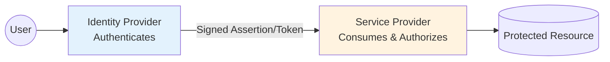
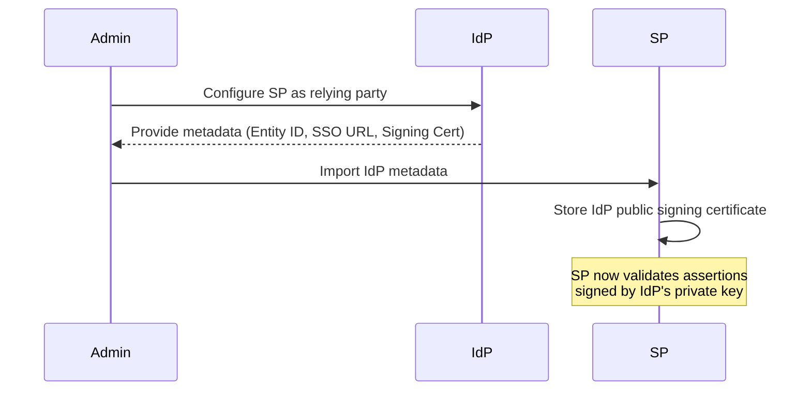
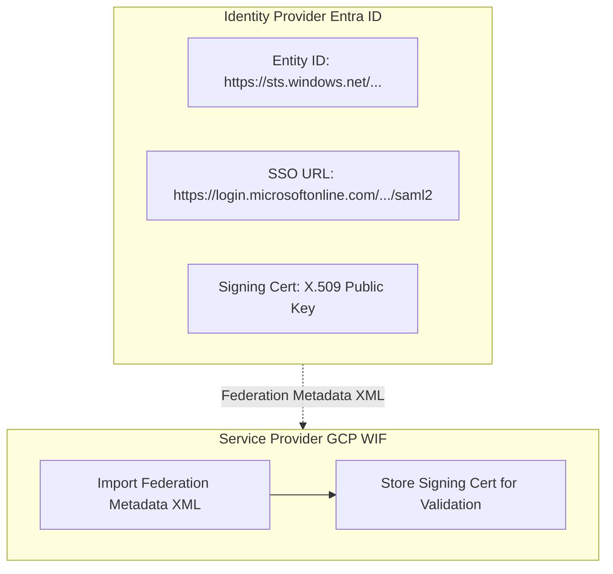
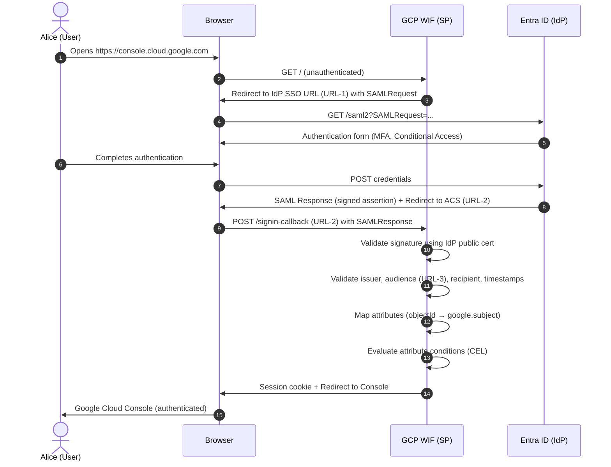
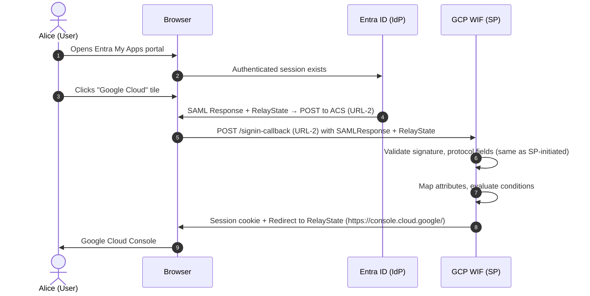
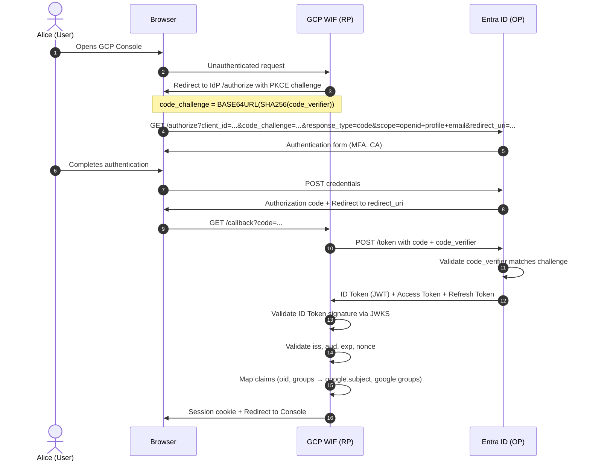
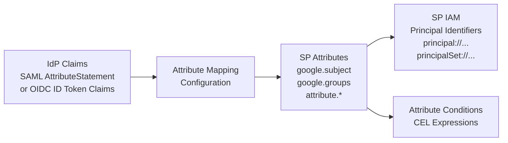
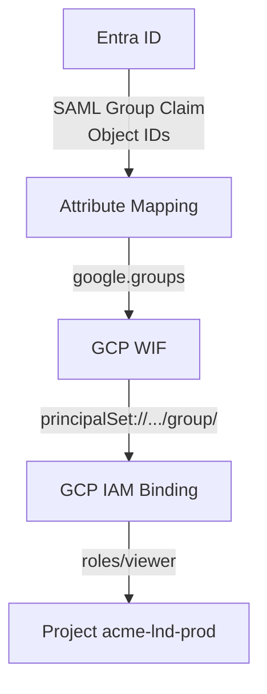
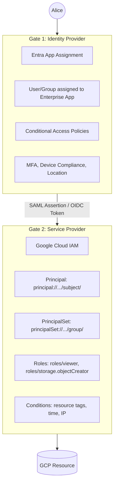

# Abstract

This document provides a comprehensive architectural explanation of SAML 2.0 and OpenID Connect (OIDC) as the foundational protocols for federated identity across cloud platforms. We explain the roles of Identity Providers (IdP) and Service Providers (SP), how trust is established through metadata exchange and cryptographic signatures, the browser-based flows for both protocols, and how attributes are mapped from IdP assertions to SP authorization decisions. A running example—Acme Corp using Microsoft Entra ID to access Google Cloud—threads through all sections to provide continuity. This foundation enables understanding of cloud-specific implementations in [§02.4], [§02.6], [§02.8], and cross-cloud patterns in [§02.10].

# 1. Introduction

## 1.1 Problem Statement

Modern organizations operate across multiple cloud platforms (AWS, GCP, Azure) and SaaS applications. Each platform traditionally maintains its own identity directory, leading to:

- **Credential sprawl**: Users manage separate usernames/passwords per system
- **Inconsistent security**: MFA, password policies, and conditional access differ per platform
- **Operational overhead**: Provisioning/deprovisioning users across N systems
- **Audit complexity**: No centralized view of who has access to what

## 1.2 Federated Identity Solution

**Federation** delegates authentication to a trusted Identity Provider (IdP) while each Service Provider (SP) retains authorization control. The IdP authenticates the user once; the SP trusts the IdP's assertion about the user's identity.



**Figure 1:** Federation model: IdP handles authentication; SP handles authorization.

## 1.3 Running Example: Acme Corp

Throughout this document, we use a consistent scenario:

| Element | Value |
|---------|-------|
| **Organization** | Acme Corp |
| **Primary IdP** | Microsoft Entra ID (tenant: `acmecorp.onmicrosoft.com`) |
| **User** | Alice, Security Engineer (`alice@acmecorp.com`, Entra objectId: `a1b2c3d4-e5f6-7890-abcd-ef1234567890`) |
| **Workload** | `collector.py` on Azure VM (Managed Identity clientId: `m1n2o3p4-q5r6-7890-stuv-wx1234567890`) |
| **Target SP (Workforce)** | Google Cloud Console via Workforce Identity Federation |
| **Target SP (Workload)** | Google Cloud Storage bucket `acme-lnd-logs` via Workload Identity Federation |

This example illustrates both **workforce** (human) and **workload** (machine) federation patterns.

# 2. Core Concepts

## 2.1 Identity Provider (IdP)

The **Identity Provider** is the authoritative system that:
- Authenticates principals (users, workloads)
- Issues cryptographically signed assertions/tokens
- Maintains identity attributes (name, email, groups, roles)
- Enforces authentication policies (MFA, conditional access, passwordless)

**Examples**: Microsoft Entra ID, Okta, Ping Identity, Keycloak, Google Workspace, AWS IAM Identity Center.

## 2.2 Service Provider (SP)

The **Service Provider** (also called Relying Party) is the system that:
- Consumes assertions/tokens from trusted IdPs
- Validates signature, issuer, audience, expiration
- Maps IdP claims to local attributes
- Makes authorization decisions based on mapped attributes

**Examples**: Google Cloud Console, AWS Management Console, Azure Portal, custom applications, Kubernetes API servers.

## 2.3 Trust Establishment

Trust is **unidirectional**: SP trusts IdP, not vice versa. Established through:



**Figure 2:** Trust establishment via metadata exchange.

## 2.4 Principal

A **principal** is the authenticated identity making a request. In federation:
- IdP identifies principal by **subject identifier** (e.g., Entra `objectId`)
- SP represents principal as **federated principal** (e.g., `principal://.../subject/a1b2c3d4...`)

## 2.5 Metadata

**Metadata** is structured XML (SAML) or JSON (OIDC) describing:
- Entity ID (unique identifier)
- Endpoints (SSO, ACS, token, JWKS)
- Public signing/encryption certificates
- Supported protocols, bindings, algorithms

# 3. SAML 2.0 Architecture

## 3.1 Protocol Overview

SAML (Security Assertion Markup Language) 2.0 is an XML-based framework for exchanging authentication and authorization data. Key characteristics:
- **Browser-based**: Designed for web SSO via HTTP redirects/POSTs
- **Assertion-centric**: IdP issues signed XML assertions
- **Metadata-driven**: Trust configured via XML metadata exchange
- **Enterprise-standard**: Widely supported by IdPs and SPs

## 3.2 Three Critical URLs (Often Confused)

The most common source of SAML misconfiguration is confusing these three distinct URLs:

| URL | Official Name | Direction | Purpose | Example (Acme Corp → GCP) |
|-----|--------------|-----------|---------|---------------------------|
| **URL-1** | IdP SingleSignOnService URL | Browser → IdP | Where browser is sent to authenticate | `https://login.microsoftonline.com/acmecorp.onmicrosoft.com/saml2` |
| **URL-2** | SP AssertionConsumerService (ACS) URL | Browser → SP | Where IdP posts the SAML Response | `https://auth.cloud.google/signin-callback/locations/global/workforcePools/entra-workforce-pool/providers/entra-saml-provider` |
| **URL-3** | SP Entity ID / Audience | IdP → SP (in assertion) | Identifies intended SP; validated by SP | `https://iam.googleapis.com/locations/global/workforcePools/entra-workforce-pool/providers/entra-saml-provider` |

**Table 1:** Three SAML URLs with Acme Corp → GCP example.

> **Critical**: URL-1 is an **IdP endpoint** (imported by SP from metadata). URL-2 is an **SP endpoint** (configured in IdP as Reply URL). URL-3 is an **identifier** (configured in IdP as Entity ID/Audience). They serve completely different purposes.

## 3.3 SAML Metadata Exchange



**Figure 3:** Metadata exchange: IdP publishes metadata; SP imports it to obtain signing certificate.

The **Federation Metadata XML** contains:
- `entityID`: IdP's unique identifier (e.g., `https://sts.windows.net/<tenantId>/`)
- `SingleSignOnService`: URL-1 (where browser redirects for auth)
- `KeyDescriptor` with `use="signing"`: X.509 certificate containing IdP's public key

## 3.4 SP-Initiated Flow (User Starts at SP)

This is the most common flow for workforce access.



**Figure 4:** SAML SP-initiated flow with validation steps.

### Key Validation Steps at SP (Step 12-14)

1. **Signature validation**: Verify XML signature using IdP's public signing certificate from metadata
2. **Protocol validation**:
   - `Issuer` matches IdP Entity ID from metadata
   - `Audience` matches SP Entity ID (URL-3)
   - `Recipient` matches ACS URL (URL-2)
   - `NotBefore`/`NotOnOrAfter` timestamps valid
   - `InResponseTo` matches original `SAMLRequest` ID
3. **Attribute mapping**: Extract claims → SP attributes
4. **Attribute conditions**: Evaluate CEL expressions (e.g., `assertion.attributes.tenantid == '...'`)

## 3.5 IdP-Initiated Flow (User Starts at IdP)



**Figure 5:** SAML IdP-initiated flow with RelayState.

### RelayState Purpose

- **Not an authentication endpoint**
- Carries post-authentication destination context
- For GCP WIF IdP-initiated: `https://console.cloud.google/`
- Only used in IdP-initiated flow

## 3.6 Signing vs Encryption Certificates

| Aspect | Signing Certificate | Encryption Certificate |
|--------|---------------------|------------------------|
| **Purpose** | Prove assertion origin & integrity | Confidentiality of assertion content |
| **Key Holder** | IdP (private key) | SP (private key) |
| **Public Key** | In IdP metadata (imported by SP) | In SP metadata (provided to IdP) |
| **Direction** | IdP signs → SP validates | IdP encrypts with SP public key → SP decrypts |
| **Mandatory** | Yes (for assertion trust) | Optional (GCP supports but not required) |

**Table 2:** Signing vs encryption certificates.

> **Analogy**: Signing = notarized letter (proves author, detects tampering). Encryption = sealed envelope (prevents reading in transit). They use separate key pairs and can be enabled independently.

### GCP WIF Encryption (Optional)

1. GCP generates key pair for workforce provider; retains private key
2. Admin downloads GCP public certificate, uploads to Entra
3. Entra encrypts SAML assertions with GCP public key
4. GCP decrypts with its private key

**This is separate from the normal signing certificate flow.** Do not confuse the two.

## 3.7 SAML Assertion Structure (Simplified)

```xml
<samlp:Response xmlns:samlp="urn:oasis:names:tc:SAML:2.0:protocol"
                ID="_response-id" Version="2.0" IssueInstant="2026-11-21T10:00:00Z"
                Destination="https://auth.cloud.google/.../signin-callback">
  <saml:Issuer xmlns:saml="urn:oasis:names:tc:SAML:2.0:assertion">
    https://sts.windows.net/acmecorp-tenant-id/
  </saml:Issuer>
  <ds:Signature xmlns:ds="http://www.w3.org/2000/09/xmldsig#">
    <!-- Signed by Entra private key; validated by GCP using Entra public cert -->
  </ds:Signature>
  <samlp:Status><samlp:StatusCode Value="urn:oasis:names:tc:SAML:2.0:status:Success"/></samlp:Status>
  <saml:Assertion ID="_assertion-id" IssueInstant="2026-11-21T10:00:00Z"
                  Version="2.0">
    <saml:Issuer>https://sts.windows.net/acmecorp-tenant-id/</saml:Issuer>
    <ds:Signature>...</ds:Signature>
    <saml:Subject>
      <saml:NameID Format="urn:oasis:names:tc:SAML:2.0:nameid-format:persistent">
        a1b2c3d4-e5f6-7890-abcd-ef1234567890
      </saml:NameID>
      <saml:SubjectConfirmation Method="urn:oasis:names:tc:SAML:2.0:cm:bearer">
        <saml:SubjectConfirmationData Recipient="https://auth.cloud.google/.../signin-callback"
                                      NotOnOrAfter="2026-11-21T10:05:00Z"
                                      InResponseTo="_request-id"/>
      </saml:SubjectConfirmation>
    </saml:Subject>
    <saml:Conditions NotBefore="2026-11-21T10:00:00Z"
                     NotOnOrAfter="2026-11-21T10:05:00Z">
      <saml:AudienceRestriction>
        <saml:Audience>https://iam.googleapis.com/locations/global/workforcePools/entra-workforce-pool/providers/entra-saml-provider</saml:Audience>
      </saml:AudienceRestriction>
    </saml:Conditions>
    <saml:AttributeStatement>
      <saml:Attribute Name="http://schemas.microsoft.com/identity/claims/objectidentifier">
        <saml:AttributeValue>a1b2c3d4-e5f6-7890-abcd-ef1234567890</saml:AttributeValue>
      </saml:Attribute>
      <saml:Attribute Name="http://schemas.microsoft.com/ws/2008/06/identity/claims/groups">
        <saml:AttributeValue>g1h2i3j4-k5l6-7890-mnop-qr1234567890</saml:AttributeValue>
      </saml:Attribute>
    </saml:AttributeStatement>
  </saml:Assertion>
</samlp:Response>
```

**Listing 1:** Simplified SAML Response with signed assertion containing objectId and group claims.

# 4. OIDC Architecture

## 4.1 Protocol Overview

OpenID Connect (OIDC) is an identity layer on top of OAuth 2.0. Key characteristics:
- **JSON/REST-based**: Modern, API-friendly
- **Token-centric**: IdP issues JWT tokens (ID Token, Access Token)
- **Discovery-driven**: Configuration via `/.well-known/openid-configuration`
- **Multiple flows**: Authorization Code (with PKCE), Implicit, Hybrid, Client Credentials

## 4.2 Authorization Code Flow with PKCE (Recommended)

This is the standard flow for browser-based and native applications.



**Figure 6:** OIDC Authorization Code Flow with PKCE.

### Key Parameters

| Parameter | Purpose |
|-----------|---------|
| `client_id` | SP identifier registered at IdP |
| `redirect_uri` | SP callback endpoint (must match registration) |
| `response_type=code` | Request authorization code |
| `scope=openid profile email` | Request OIDC standard claims |
| `code_challenge` / `code_challenge_method=S256` | PKCE: prevents code interception |
| `state` | CSRF protection; SP generates, validates on callback |
| `nonce` | Replay protection; SP generates, validates in ID Token |

## 4.3 Discovery Document & JWKS

OIDC uses automatic configuration discovery:

```mermaid
graph LR
    SP[SP] -->|GET /.well-known/openid-configuration| IdP[IdP]
    IdP -->|JSON: endpoints, JWKS URI, issuer| SP
    SP -->|GET /keys (JWKS URI)| IdP
    IdP -->|JSON Web Key Set (public keys)| SP
    SP -->|Cache keys for token validation| SP
```

**Figure 7:** OIDC discovery and JWKS retrieval.

**Discovery Document** (`https://login.microsoftonline.com/<tenant>/v2.0/.well-known/openid-configuration`) contains:
- `issuer`: `https://sts.windows.net/<tenantId>/`
- `authorization_endpoint`: URL for `/authorize`
- `token_endpoint`: URL for `/token`
- `jwks_uri`: URL for public keys
- `scopes_supported`, `response_types_supported`, etc.

**JWKS** (JSON Web Key Set) contains public keys for validating JWT signatures:
```json
{
  "keys": [
    {
      "kty": "RSA",
      "use": "sig",
      "kid": "key-id-1",
      "n": "base64url-modulus",
      "e": "AQAB"
    }
  ]
}
```

## 4.4 Token Types

| Token | Format | Purpose | Lifetime | Audience |
|-------|--------|---------|----------|----------|
| **ID Token** | JWT | Identity information (authN) | ~1 hour | SP (`client_id`) |
| **Access Token** | JWT or opaque | API authorization (authZ) | ~1 hour | Resource Server (API) |
| **Refresh Token** | Opaque | Obtain new tokens without re-auth | Days/weeks | IdP token endpoint |

**Table 3:** OIDC token types.

### ID Token Claims (Standard + Entra-Specific)

```json
{
  "iss": "https://sts.windows.net/acmecorp-tenant-id/",
  "sub": "a1b2c3d4-e5f6-7890-abcd-ef1234567890",
  "aud": "sp-client-id",
  "exp": 1700563200,
  "iat": 1700559600,
  "nonce": "sp-generated-nonce",
  "name": "Alice Engineer",
  "preferred_username": "alice@acmecorp.com",
  "oid": "a1b2c3d4-e5f6-7890-abcd-ef1234567890",
  "tid": "acmecorp-tenant-id",
  "groups": ["g1h2i3j4-k5l6-7890-mnop-qr1234567890"],
  "scp": "openid profile email",
  "auth_time": 1700559500
}
```

**Listing 2:** Example OIDC ID Token claims from Entra ID.

> **Critical**: Use `oid` (objectId) as stable subject identifier, not `preferred_username` or `email` which can change. The `tid` (tenant ID) enables multi-tenant restrictions.

## 4.5 Client Authentication Patterns

| Pattern | Use Case | Credential |
|---------|----------|------------|
| **Public Client (PKCE only)** | Browser apps, mobile, SPA | None (PKCE replaces secret) |
| **Confidential Client** | Server-side apps, backend services | Client secret or certificate |
| **Client Credentials Flow** | Machine-to-machine (no user) | Client secret / certificate / federated credential |

**Table 4:** OIDC client authentication patterns.

For workforce federation, GCP WIF acts as a **public client** using PKCE (no client secret stored). For workload federation, the external workload (Azure VM, GitHub Actions) uses its platform-issued token directly with GCP STS.

# 5. Attribute Mapping & Trust

## 5.1 From IdP Claims to SP Attributes

Attribute mapping translates IdP-specific claim names into SP-standard attributes:



**Figure 8:** Attribute mapping pipeline: IdP claims → SP attributes → IAM principals + conditions.

## 5.2 Stable Identifiers: Why objectId > Email

| Identifier | Stability | Use as Subject? |
|------------|-----------|-----------------|
| `objectId` (Entra) / `sub` (OIDC) | Immutable, globally unique | ✅ **Yes** |
| `userPrincipalName` / `email` | Can change (marriage, rebrand) | ❌ No |
| `displayName` | Mutable, not unique | ❌ No |
| `employeeId` | Stable if HR system consistent | ⚠️ If guaranteed |

**Table 5:** Identifier stability comparison.

**Acme Corp Example**:
- Alice's Entra `objectId`: `a1b2c3d4-e5f6-7890-abcd-ef1234567890` (never changes)
- Alice's email: `alice@acmecorp.com` → could become `alice.smith@acmecorp.com`
- **Map `objectId` → `google.subject`**

## 5.3 Groups for Authorization

Groups enable role-based access without individual user management:



**Figure 9:** Group-based authorization flow.

### Group Claim Configuration (Entra SAML)

In Entra Enterprise Application → Attributes & Claims:
- **Group claim**: Select "Security groups" or "All groups"
- **Claim format**: "Group Object IDs" (stable) — not display names
- **Attribute name**: `http://schemas.microsoft.com/ws/2008/06/identity/claims/groups` (default)

### GCP WIF Mapping Example

```yaml
# Google WIF Provider Attribute Mapping
google.subject = assertion.attributes['http://schemas.microsoft.com/identity/claims/objectidentifier']
google.groups  = assertion.attributes['http://schemas.microsoft.com/ws/2008/06/identity/claims/groups']
attribute.department = assertion.attributes['department']
attribute.costcenter = assertion.attributes['costcenter']
```

**Listing 3:** GCP WIF attribute mapping for Entra SAML.

## 5.4 Attribute Conditions (CEL)

Common Expression Language (CEL) conditions restrict which identities can use the provider:

```cel
# Restrict to specific Entra tenant
assertion.attributes['tid'] == 'acmecorp-tenant-id'

# Restrict to specific domain
assertion.attributes['preferred_username'].endsWith('@acmecorp.com')

# Require specific group membership
'g1h2i3j4-k5l6-7890-mnop-qr1234567890' in assertion.attributes['http://schemas.microsoft.com/ws/2008/06/identity/claims/groups']

# Require department attribute
assertion.attributes['department'] == 'Security'
```

**Listing 4:** CEL attribute condition examples.

Conditions are evaluated **after** authentication but **before** token issuance. Failed conditions = authentication denied.

## 5.5 Sync-less vs Provisioned Federation

| Model | User Provisioning | Use Case |
|-------|-------------------|----------|
| **Sync-less (WIF)** | None — IdP assertions directly mapped | Workforce access to cloud consoles, APIs |
| **Provisioned (SCIM)** | IdP pushes users/groups to SP directory | Google Workspace apps (Gmail, Drive), Looker, Gemini Enterprise |

**Table 6:** Federation models.

> **Key Point**: Standard GCP WIF for Cloud Console access is **sync-less**. No Google Workspace/Cloud Identity user is created. The federated principal is represented as `principal://.../subject/<objectId>` in IAM.

# 6. Trust Boundaries: Authentication ≠ Authorization

## 6.1 Two Independent Gates



**Figure 10:** Two independent authorization gates.

### Gate 1: IdP Side (Entra)
- **Enterprise App Assignment**: Controls who can authenticate to this SP
- **Conditional Access**: Enforces MFA, compliant device, trusted location
- **Result**: SAML Assertion / OIDC Token issued

### Gate 2: SP Side (GCP)
- **IAM Allow Policy**: Controls what the authenticated identity can do
- **Principal Identifiers**: `principal://` (individual), `principalSet://` (group/attribute)
- **Result**: Access allowed/denied on specific resource

> **Critical**: Passing Gate 1 ≠ Passing Gate 2. Alice can authenticate via Entra but see "Permission denied" in GCP if no IAM binding exists.

## 6.2 Principal Identifier Formats (GCP WIF)

| Principal Type | Format | Example |
|----------------|--------|---------|
| **Individual** | `principal://iam.googleapis.com/locations/global/workforcePools/{pool}/subject/{subject}` | `principal://iam.googleapis.com/locations/global/workforcePools/entra-workforce-pool/subject/a1b2c3d4...` |
| **Group** | `principalSet://iam.googleapis.com/locations/global/workforcePools/{pool}/group/{group}` | `principalSet://iam.googleapis.com/locations/global/workforcePools/entra-workforce-pool/group/g1h2i3j4...` |
| **Attribute** | `principalSet://iam.googleapis.com/locations/global/workforcePools/{pool}/attribute.{name}/{value}` | `principalSet://.../attribute.department/Security` |
| **All in Pool** | `principalSet://iam.googleapis.com/locations/global/workforcePools/{pool}/*` | (Broad — avoid in production) |

**Table 7:** GCP WIF principal identifier formats.

## 6.3 IAM Binding Example (GCP)

```bash
# Grant Project Viewer to Entra group "GCP-Security-Admins"
# Group Object ID: g1h2i3j4-k5l6-7890-mnop-qr1234567890
POOL_ID="entra-workforce-pool"
GROUP_ID="g1h2i3j4-k5l6-7890-mnop-qr1234567890"
MEMBER="principalSet://iam.googleapis.com/locations/global/workforcePools/${POOL_ID}/group/${GROUP_ID}"

gcloud projects add-iam-policy-binding acme-lnd-prod \
  --member="${MEMBER}" \
  --role="roles/viewer"
```

**Listing 5:** Granting IAM role to federated Entra group.

# 7. Troubleshooting Matrix

| Symptom | Likely Cause | Resolution |
|---------|--------------|------------|
| "Invalid signature" | IdP signing cert rotated; SP metadata stale | Re-import Federation Metadata XML in SP |
| "Audience mismatch" | SP Entity ID in IdP ≠ SP configured Entity ID | Align Identifier (Entity ID) in IdP with SP provider config |
| "Recipient mismatch" | ACS URL in IdP ≠ SP ACS endpoint | Align Reply URL in IdP with SP provider ACS URL |
| "User authenticated but access denied" | Gate 1 passed; Gate 2 (IAM) missing binding | Add IAM binding for `principal://` or `principalSet://` |
| "Group-based access fails" | Group claim missing, wrong format, or mapping incorrect | Verify Entra group claim emits Object IDs; check mapping attribute name |
| "Attribute condition fails" | CEL expression references missing/wrong attribute | Use "Debug IdP token" tool to inspect raw assertion attributes |
| "Certificate validation fails" | IdP metadata lacks valid signing key | Ensure Federation Metadata XML includes `KeyDescriptor use="signing"` |
| "InResponseTo mismatch" | SP didn't track SAMLRequest ID (stateless) | Enable SAML request ID tracking or use IdP-initiated flow |

**Table 8:** Common SAML/OIDC federation troubleshooting.

# 8. Conclusion

SAML 2.0 and OIDC provide standardized, interoperable frameworks for federated identity. The key architectural insights:

1. **Trust is unidirectional**: SP trusts IdP via imported metadata (signing certificate)
2. **Three URLs in SAML** serve distinct purposes — confusing them is the #1 misconfiguration
3. **OIDC uses discovery + JWKS** for dynamic configuration; PKCE prevents code interception
4. **Attribute mapping** bridges IdP-specific claims to SP-standard attributes
5. **Stable identifiers** (objectId, not email) are essential for durable authorization
6. **Two gates**: IdP controls *who can authenticate*; SP controls *what they can do*

These fundamentals apply identically across all cloud providers. Cloud-specific implementations in [§02.4] (GCP), [§02.6] (AWS), [§02.8] (Azure) build on this foundation. Cross-cloud patterns in [§02.10] extend these principles to workload federation and multi-cloud trust.

# References

[1] OASIS, "Security Assertion Markup Language (SAML) V2.0 Technical Overview," 2008.
[2] OpenID Foundation, "OpenID Connect Core 1.0 incorporating errata set 2," 2014.
[3] IETF, "RFC 6749: The OAuth 2.0 Authorization Framework," 2012.
[4] IETF, "RFC 9700: OAuth 2.0 Security Best Current Practice," 2024.
[5] Google Cloud, "Workforce Identity Federation Overview," https://cloud.google.com/iam/docs/workforce-identity-federation
[6] Google Cloud, "Configure Workforce Identity Federation with Microsoft Entra ID," https://cloud.google.com/iam/docs/workforce-sign-in-microsoft-entra-id
[7] Microsoft, "How the Microsoft identity platform uses the SAML protocol," https://learn.microsoft.com/entra/identity-platform/saml-protocol-reference
[8] Microsoft, "Microsoft Entra ID SAML single sign-on configuration," https://learn.microsoft.com/entra/identity/enterprise-apps/configure-saml-single-sign-on
[9] IETF, "RFC 7522: Security Assertion Markup Language (SAML) 2.0 Profile for OAuth 2.0 Client Authentication and Authorization Grants," 2015.
[10] Google Cloud, "Workforce Identity Federation Principal Identifiers," https://cloud.google.com/iam/docs/configuring-workforce-identity-federation

# Appendices

## Appendix A: SAML Federation Metadata XML Example

```xml
<?xml version="1.0" encoding="UTF-8"?>
<EntityDescriptor xmlns="urn:oasis:names:tc:SAML:2.0:metadata"
                  entityID="https://sts.windows.net/acmecorp-tenant-id/">
  <IDPSSODescriptor protocolSupportEnumeration="urn:oasis:names:tc:SAML:2.0:protocol">
    <KeyDescriptor use="signing">
      <KeyInfo xmlns="http://www.w3.org/2000/09/xmldsig#">
        <X509Data>
          <X509Certificate>
            MIID...base64-encoded-public-certificate...
          </X509Certificate>
        </X509Data>
      </KeyInfo>
    </KeyDescriptor>
    <SingleSignOnService Binding="urn:oasis:names:tc:SAML:2.0:bindings:HTTP-Redirect"
                         Location="https://login.microsoftonline.com/acmecorp-tenant-id/saml2"/>
    <SingleSignOnService Binding="urn:oasis:names:tc:SAML:2.0:bindings:HTTP-POST"
                         Location="https://login.microsoftonline.com/acmecorp-tenant-id/saml2"/>
  </IDPSSODescriptor>
</EntityDescriptor>
```

**Listing A-1:** Minimal Entra ID Federation Metadata XML (signing key + SSO endpoints).

## Appendix B: OIDC Discovery Document Example

```json
{
  "issuer": "https://sts.windows.net/acmecorp-tenant-id/",
  "authorization_endpoint": "https://login.microsoftonline.com/acmecorp-tenant-id/oauth2/v2.0/authorize",
  "token_endpoint": "https://login.microsoftonline.com/acmecorp-tenant-id/oauth2/v2.0/token",
  "jwks_uri": "https://login.microsoftonline.com/acmecorp-tenant-id/discovery/v2.0/keys",
  "response_types_supported": ["code", "id_token", "code id_token"],
  "subject_types_supported": ["pairwise"],
  "id_token_signing_alg_values_supported": ["RS256"],
  "scopes_supported": ["openid", "profile", "email", "offline_access"],
  "claims_supported": ["sub", "name", "preferred_username", "email", "oid", "tid", "groups"],
  "code_challenge_methods_supported": ["S256"]
}
```

**Listing B-1:** OIDC Discovery Document from Entra ID.

## Appendix C: CEL Attribute Condition Patterns

```cel
// Multi-tenant restriction (allow only specific tenant)
assertion.attributes['tid'] in ['tenant-id-1', 'tenant-id-2']

// Domain restriction
assertion.attributes['preferred_username'].endsWith('@acmecorp.com')

// Group membership (Entra SAML group claim)
'g1h2i3j4-k5l6-7890-mnop-qr1234567890' in assertion.attributes['http://schemas.microsoft.com/ws/2008/06/identity/claims/groups']

// Group membership (OIDC groups claim)
'g1h2i3j4-k5l6-7890-mnop-qr1234567890' in assertion.attributes['groups']

// Department attribute
assertion.attributes['department'] == 'Security'

// Cost center attribute
assertion.attributes['costcenter'].startsWith('SEC-')

// Combined: tenant + group + department
assertion.attributes['tid'] == 'acmecorp-tenant-id' &&
'g1h2i3j4-k5l6-7890-mnop-qr1234567890' in assertion.attributes['groups'] &&
assertion.attributes['department'] == 'Security'

// Workload-specific: Azure client ID allowlist
assertion.attributes['azp'] in ['m1n2o3p4-q5r6-7890-stuv-wx1234567890']
```

**Listing C-1:** CEL condition patterns for workforce and workload federation.