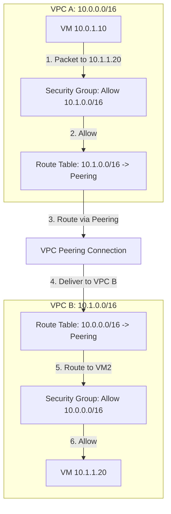

# Abstract

Comparison of core network components across AWS, GCP, and Azure: routers, switches (implicit), NAT gateways, shared VPC, firewalls, load balancers, and VPN gateways.

# 1. Network Component Comparison

| Component | AWS | GCP | Azure |
|-----------|-----|-----|-------|
| **Router** | Transit Gateway (TGW), VPC Router (implicit) | Cloud Router (BGP), NCC Hub | Virtual WAN Hub, VNet Gateway |
| **Switch** | Implicit (VPC = distributed switch) | Implicit (VPC = global distributed switch) | Implicit (VNet = distributed switch) |
| **NAT Gateway** | NAT Gateway (managed, 45 Gbps, per AZ) | Cloud NAT (managed, regional, 1-100 Gbps) | NAT Gateway (zoned, up to 50 Gbps) |
| **Firewall** | Network Firewall, Security Groups, NACLs | Cloud NGFW, Firewall Rules (Hierarchical) | Azure Firewall, NSG, ASG |
| **Load Balancer** | NLB, ALB, GWLB, CLB | Cloud LB (Global/Regional), Cloud CDN | LB (Standard), Front Door, App Gateway |
| **VPN Gateway** | Virtual Private Gateway / Transit Gateway | Cloud VPN (HA VPN) | VPN Gateway |
| **Direct Connect** | Direct Connect, Transit Gateway Connect | Cloud Interconnect (Dedicated/Partner) | ExpressRoute (Standard/Direct) |

# 2. NAT Gateway Comparison

| Feature | AWS NAT Gateway | GCP Cloud NAT | Azure NAT Gateway |
|---------|-----------------|---------------|-------------------|
| **Type** | Managed, per AZ | Managed, regional | Managed, zonal |
| **Throughput** | 45 Gbps (burst to 100 Gbps) | Up to 100 Gbps (auto-scale) | Up to 50 Gbps |
| **Elastic IPs** | Up to 8 per gateway | Auto-assigned (shared) or BYOIP | Up to 16 public IPs |
| **Private IP Source** | Subnet route table | Subnet route table (custom) | Subnet route table |
| **Logging** | VPC Flow Logs | Cloud Logging (VPC Flow Logs) | NSG Flow Logs |
| **Cost** | $0.045/hour + $0.045/GB | $0.01/VM/hour + $0.045/GB | $0.045/hour + $0.045/GB |
| **High Availability** | Per AZ (deploy 1 per AZ for HA) | Regional (automatic) | Zone-redundant (Standard SKU) |

# 3. Shared VPC (Multi-Project/Tenant Networking)

| Feature | AWS | GCP | Azure |
|---------|-----|-----|-------|
| **Concept** | Shared VPCs (Resource Access Manager) | Shared VPC (Host Project + Service Projects) | VNet Sharing (via RBAC) / Azure Virtual Network Manager |
| **Central Management** | VPC Owner account shares subnets | Host Project owns VPC, Service Projects attach | Central IT owns VNet, delegates subnets via RBAC |
| **IPAM** | AWS IPAM (cross-account) | Cloud IPAM (global) | Azure IPAM (via Azure Network Manager) |
| **Security Boundaries** | Security Groups + NACLs per subnet | Hierarchical Firewall Policies (Org → Folder → Project) | NSG + ASG per subnet, Azure Firewall Manager policies |
| **Billing** | Owner pays for VPC resources; Service Projects pay for their resources | Host Project pays for VPC; Service Projects pay for their resources | Central pays for VNet; Service Projects pay for their resources |
| **Use Case** | Multi-account orgs, central network team | Multi-project orgs, central network team | Multi-subscription orgs, central network team |

# 4. VPC Peering Communication Flow

**Key Points:**
1. **No Gateway/Router**: Peering is a direct Layer 3 connection between VPC routers
2. **No Single Point of Failure**: Distributed, highly available
3. **Security Groups/NSGs**: Still evaluate traffic (source/destination CIDR)
4. **MTU**: 9001 (jumbo frames) supported on AWS/GCP/Azure
5. **No Transitive Routing**: A↔B and B↔C ≠ A↔C (use TGW/NCC/Virtual WAN for transit)

# 5. Manual Router/Switch in Cloud

| Capability | AWS | GCP | Azure |
|------------|-----|-----|-------|
| **Custom Router (BGP/OSPF)** | Yes (EC2 with FRR/BIRD, Transit Gateway Connect) | Yes (VM with FRR/BIRD, NCC third-party spoke) | Yes (VM with FRR/BIRD, Virtual WAN NVA) |
| **Virtual Switch** | Not directly (VPC is the switch) | Not directly (VPC is the switch) | Not directly (VNet is the switch) |
| **Layer 2 Extension** | No (VPC is L3) | No (VPC is L3) | No (VNet is L3) |
| **Use Cases** | SD-WAN integration, on-prem routing protocols | Hybrid routing, third-party NVA | NVA, SD-WAN, ExpressRoute BGP |
| **Marketplace NVAs** | Cisco CSR, Aviatrix, Fortinet, Palo Alto, Versa | Palo Alto, Fortinet, Check Point, Cisco | Cisco CSR, Palo Alto, Fortinet, Check Point, Versa |

> **Key Insight**: Cloud VPCs/VNets are **Layer 3 fabrics** (distributed routers). You cannot create a traditional Layer 2 switch or bridge between subnets. For L2 adjacency, use:
> - **AWS**: Transit Gateway Connect + SD-WAN appliance
> - **GCP**: NCC + Partner Interconnect + appliance
> - **Azure**: Virtual WAN + NVA

# References

[1] AWS, "Transit Gateway Documentation," https://docs.aws.amazon.com/vpc/latest/tgw/
[2] Google Cloud, "Cloud Router Documentation," https://cloud.google.com/network-connectivity/docs/router
[3] Microsoft, "Virtual WAN Documentation," https://learn.microsoft.com/azure/virtual-wan/
[4] AWS, "NAT Gateway Documentation," https://docs.aws.amazon.com/vpc/latest/userguide/vpc-nat-gateway.html
[5] Google Cloud, "Cloud NAT Documentation," https://cloud.google.com/nat/docs/overview
[6] Microsoft, "NAT Gateway Documentation," https://learn.microsoft.com/azure/virtual-network/nat-gateway
[7] AWS, "VPC Sharing Documentation," https://docs.aws.amazon.com/vpc/latest/userguide/vpc-sharing.html
[8] Google Cloud, "Shared VPC Documentation," https://cloud.google.com/vpc/docs/shared-vpc
[9] Microsoft, "Virtual Network Peering," https://learn.microsoft.com/azure/virtual-network/virtual-network-peering-overview
