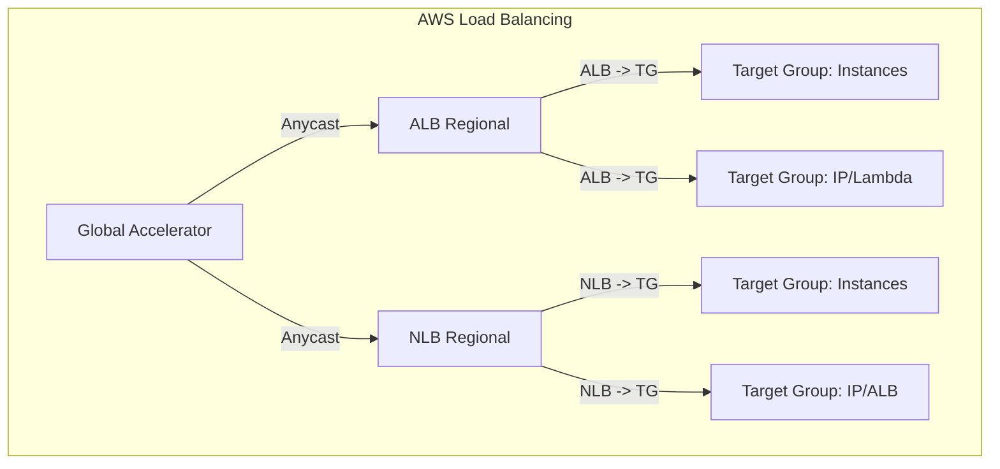
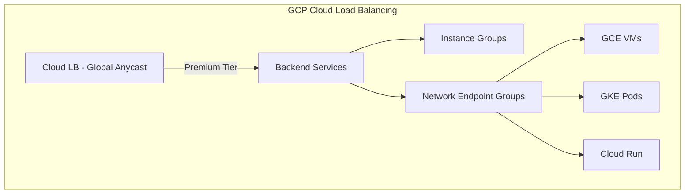
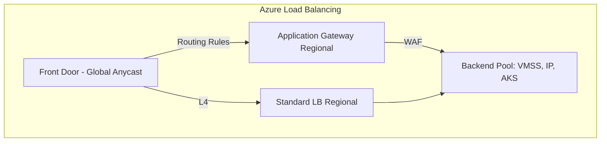

# Abstract

Comparison of load balancing services across AWS (NLB, ALB), GCP (Cloud LB), and Azure (Standard LB, Front Door, Application Gateway).

# 1. Load Balancer Comparison

| Feature | AWS | GCP | Azure |
|---------|-----|-----|-------|
| **L4 (Network)** | NLB (Layer 4, TLS passthrough) | Cloud LB (External TCP/UDP, SSL Proxy) | Standard LB (Layer 4), Front Door (L4 preview) |
| **L7 (Application)** | ALB (HTTP/HTTPS/gRPC), CLB (legacy) | Cloud LB (External HTTP/S, Internal HTTP/S) | Application Gateway (v2), Front Door |
| **Global Anycast** | Global Accelerator (separate) | Cloud LB (Premium Tier: native anycast) | Front Door (native anycast) |
| **TLS Termination** | ALB, NLB (TLS listener), Global Accelerator | Cloud LB (managed certs, self-managed) | App Gateway, Front Door (managed certs) |
| **Health Checks** | TCP, HTTP, HTTPS, gRPC | TCP, HTTP, HTTPS, gRPC, gRPC health | TCP, HTTP, HTTPS |
| **WAF Integration** | AWS WAF (ALB, CloudFront, API GW) | Cloud Armor (native) | Azure WAF (App Gateway, Front Door) |
| **Backend Types** | Instance, IP, Lambda, ALB | Instance groups, NEGs (GCE, GKE, Cloud Run) | VMSS, IP, App Service, AKS, Functions |
| **Session Affinity** | ALB (cookie), NLB (source IP) | Client IP, Generated cookie, Header | App Gateway (cookie), Front Door (cookie) |
| **Cost Model** | Hourly + LCU | Hourly + GB processed | Hourly + GB processed |

# 2. Load Balancer Architecture

### AWS

### GCP

### Azure

# 3. LND-Specific Load Balancer Configuration

| LND Service | Port | Protocol | Recommended LB | Health Check |
|-------------|------|----------|----------------|--------------|
| **P2P Gossip** | 9735 | TCP | NLB / TCP LB / Standard LB | TCP (SYN) |
| **gRPC** | 10009 | HTTP/2 | ALB / Cloud LB HTTP / App Gateway | gRPC Health Check |
| **REST API** | 8080 | HTTP/1.1 | ALB / Cloud LB HTTP / App Gateway | HTTP GET /health |

# References

[1] AWS, "Elastic Load Balancing Documentation," https://docs.aws.amazon.com/elasticloadbalancing/
[2] Google Cloud, "Cloud Load Balancing Documentation," https://cloud.google.com/load-balancing/docs
[3] Microsoft, "Azure Load Balancer Documentation," https://learn.microsoft.com/azure/load-balancer/
