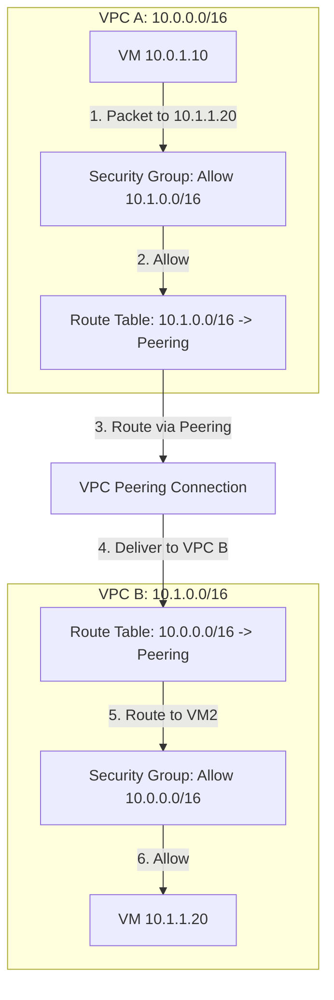

# Abstract

Comparison of VPC peering and private connectivity across AWS, GCP, and Azure including peering limits, transitivity, cross-account/region, and private service access.

# 1. VPC Peering Comparison

| Feature | AWS VPC Peering | GCP VPC Peering | Azure VNet Peering |
|---------|-----------------|-----------------|-------------------|
| **Scope** | Region-scoped (inter-region via Transit Gateway) | Global (single VPC spans regions) | Region-scoped (Global peering for cross-region) |
| **Transitivity** | Non-transitive (requires TGW for hub-spoke) | Non-transitive (export/import custom routes) | Non-transitive (Global peering + Virtual WAN for transit) |
| **Max Connections** | 125 per VPC (soft limit) | 25 per VPC (soft limit) | 500 per VNet |
| **Cross-Account** | Yes (requires acceptance) | Yes (requires IAM permissions) | Yes (requires RBAC permissions) |
| **Cross-Region** | Inter-Region Peering (since 2020) | Native (global VPC) | Global VNet Peering |
| **IP Overlap** | Not allowed | Not allowed | Not allowed |
| **Bandwidth** | Same as instance type limits | 1-2 Gbps per VM (up to 200 Gbps with NCC) | Same as VM size limits |
| **Cost** | Free (data transfer at normal rates) | Free (data transfer at normal rates) | Free (data transfer at normal rates) |

# 2. Private Service Access (PaaS without Public IP)

| Service | AWS PrivateLink | GCP Private Service Connect (PSC) | Azure Private Link |
|---------|-----------------|-----------------------------------|-------------------|
| **Mechanism** | Interface VPC Endpoint (ENI in subnet) | PSC Endpoint (internal IP in subnet) | Private Endpoint (NIC in subnet) |
| **Supported Services** | 100+ (S3, DynamoDB, RDS, CloudWatch, etc.) | 50+ (Cloud SQL, Storage, AI, custom) | 100+ (Storage, SQL, Cosmos, Key Vault, custom) |
| **DNS Integration** | Private Hosted Zone (auto) | Cloud DNS Private Zone (auto) | Private DNS Zone (auto) |
| **Access Control** | VPC Endpoint Policy | IAM on PSC Endpoint | RBAC on Private Endpoint |
| **Cost** | $0.01/hour/endpoint + $0.01/GB | $0.01/hour/endpoint + $0.01/GB | Free (endpoint) + $0.01/GB |
| **Custom Services** | Yes (Network Load Balancer + Endpoint Service) | Yes (PSC for custom services) | Yes (Private Link Service) |

# 3. VPC Peering Communication Flow

**Key Points:**
1. **No Gateway/Router**: Peering is a direct Layer 3 connection between VPC routers
2. **No Single Point of Failure**: Distributed, highly available
3. **Security Groups/NSGs**: Still evaluate traffic (source/destination CIDR)
4. **MTU**: 9001 (jumbo frames) supported on AWS/GCP/Azure
5. **No Transitive Routing**: A↔B and B↔C ≠ A↔C (use TGW/NCC/Virtual WAN for transit)

# References

[1] AWS, "VPC Peering Documentation," https://docs.aws.amazon.com/vpc/latest/userguide/vpc-peering.html
[2] Google Cloud, "VPC Peering Documentation," https://cloud.google.com/vpc/docs/vpc-peering
[3] Microsoft, "Virtual Network Peering," https://learn.microsoft.com/azure/virtual-network/virtual-network-peering-overview
