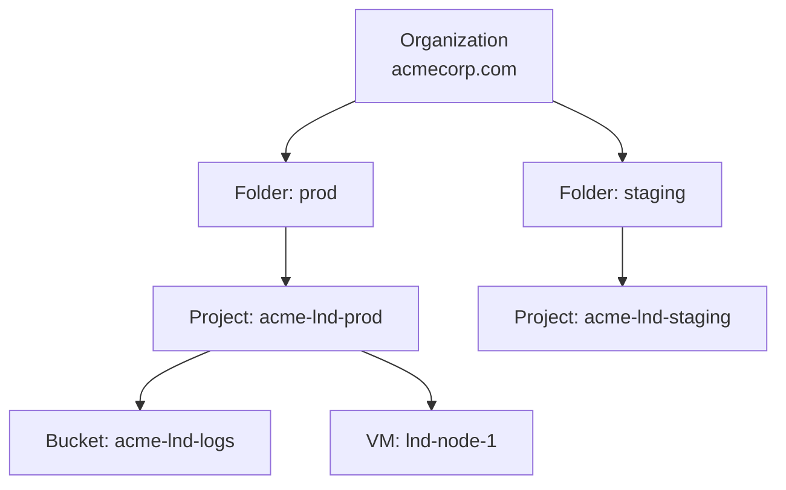
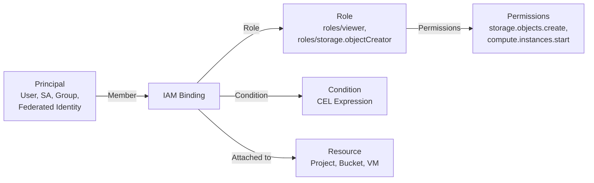
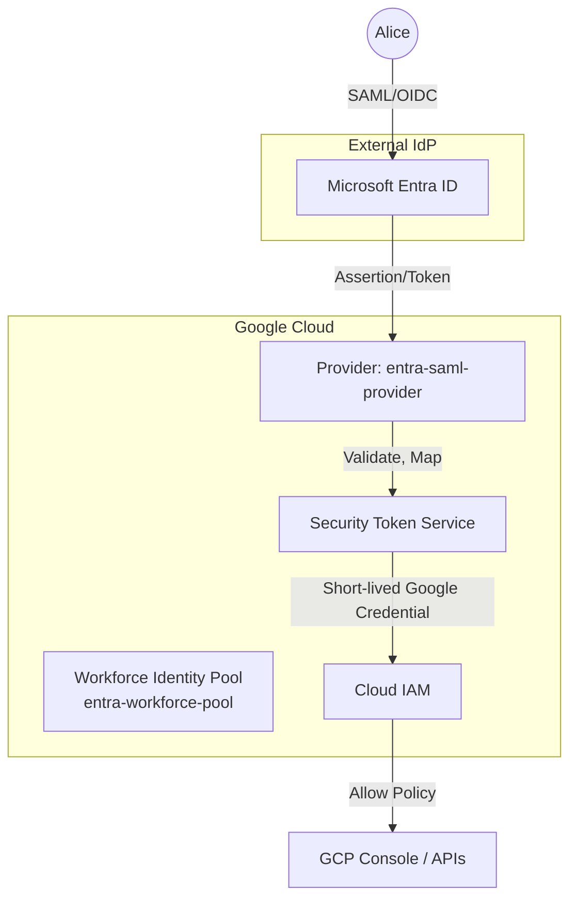
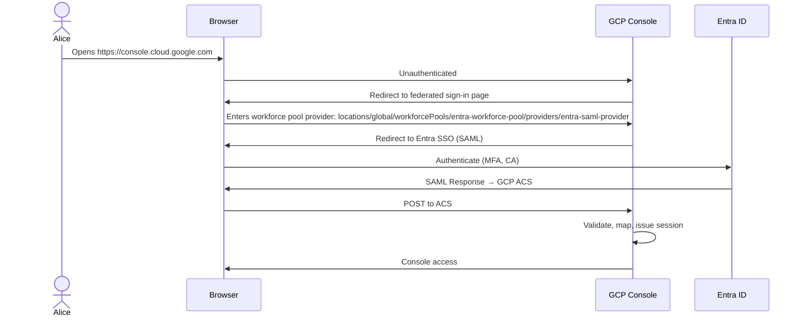
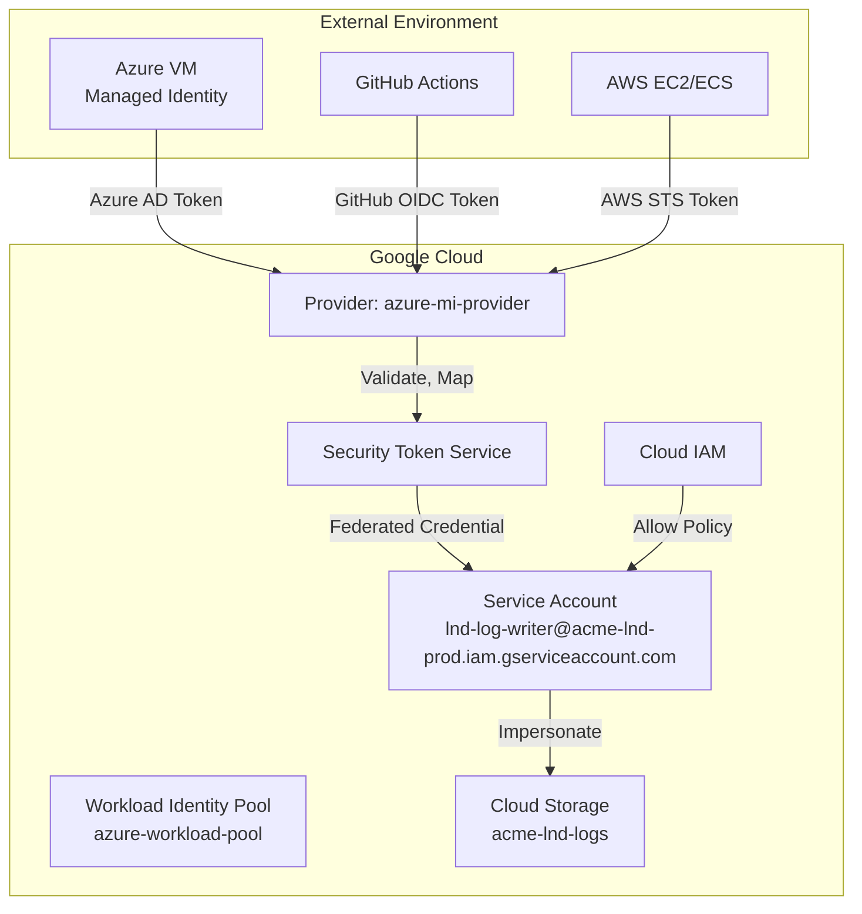
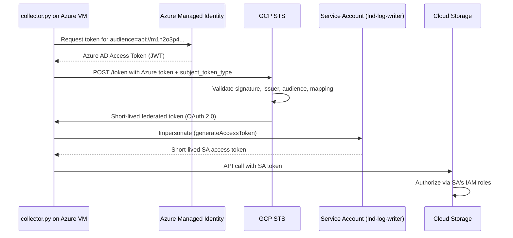

# Abstract

This document provides a comprehensive implementation guide for identity and access management on Google Cloud Platform (GCP). We cover the GCP resource hierarchy, the distinction between Cloud Identity/Google Workspace (identity directory) and the Organization resource (hierarchy root), Google Cloud IAM principles, and detailed implementations of Workforce Identity Federation (for human users) and Workload Identity Federation (for machine workloads). **This version has been cross-verified against the comprehensive multi-cloud IAM guide (Research: 22 Nov 2026)**. Cross-verification notes are marked with **[CV]** throughout.

---

# 1. Introduction

## 1.1 GCP Identity Model Overview

Google Cloud separates **identity management** (who you are) from **access control** (what you can do):

```mermaid
graph TB
    subgraph Identity[Identity Layer]
        CI[Cloud Identity /<br/>Google Workspace]
        WIF[Workforce Identity<br/>Federation]
        WLF[Workload Identity<br/>Federation]
    end
    
    subgraph Resource[Resource Hierarchy]
        Org[Organization]
        Folder[Folders]
        Project[Projects]
        Resource[Resources]
    end
    
    subgraph AuthZ[Authorization Layer]
        IAM[Google Cloud IAM]
        Roles[Roles & Permissions]
        Bindings[IAM Bindings]
        Conditions[Conditions]
    end
    
    Identity -->|Authenticated Principals| AuthZ
    AuthZ -->|Allow Policies| Resource
```

**Figure 1:** GCP identity architecture: Identity layer → IAM → Resource hierarchy.

**[CV] Cross-Verification Notes:**
- **Identity vs Resource IAM Separation**: Cloud Identity/Workspace = identity directory; Cloud IAM = resource authorization. They are separate but linked via verified domain. [CV: Confirmed — Cloud Identity/Workspace = identity directory; Cloud IAM = resource authorization; Organization resource = hierarchy root. They are distinct but linked via verified domain.]
- **Cloud Identity vs Workspace**: Cloud Identity is free directory service; Workspace adds productivity apps (Gmail, Docs, etc.). Both can serve as identity directory for GCP. [CV: Confirmed — Cloud Identity = free directory; Workspace = Cloud Identity + productivity apps; both can be identity directory for GCP.]
- **Organization Resource**: Root of resource hierarchy; linked to Cloud Identity/Workspace via verified domain. [CV: Confirmed — Organization resource = hierarchy root; Cloud Identity/Workspace = identity directory; linked via verified domain. They are distinct but linked.]
- **Customer Identity (CIAM) Separation**: Google Identity Platform is separate CIAM product for customer-facing apps; not a replacement for Cloud Identity/IAM. [CV: Confirmed — Google Identity Platform is separate CIAM for customer-facing apps; not for cloud resource authorization.]

---

## 1.2 Running Example: Acme Corp on GCP

| Element | Configuration |
|---------|---------------|
| **Organization** | `acmecorp.com` (linked to Cloud Identity) |
| **Project** | `acme-lnd-prod` (production LND workloads) |
| **Bucket** | `acme-lnd-logs` (LND channel backups, logs) |
| **Workforce User** | Alice (`alice@acmecorp.com`, Entra objectId: `a1b2c3d4...`) |
| **Workload** | `collector.py` on Azure VM (Azure MI clientId: `m1n2o3p4...`) |
| **Workforce Pool** | `entra-workforce-pool` |
| **Workforce Provider** | `entra-saml-provider` (SAML) |
| **Workload Pool** | `azure-workload-pool` |
| **Workload Provider** | `azure-mi-provider` (OIDC) |

---

# 2. GCP Resource Hierarchy & Identity

## 2.1 Resource Hierarchy



**Figure 2:** GCP resource hierarchy (Organization → Folders → Projects → Resources).

**[CV] Cross-Verification Notes:**
- **Hierarchy**: Organization → Folders (optional, nested) → Projects → Resources. [CV: Confirmed — Organization → Folders (optional, nested) → Projects → Resources. Single root; inheritance down hierarchy.]
- **Billing**: Billing accounts associated with projects; not a normal parent in hierarchy. [CV: Confirmed — Billing accounts associate with projects; not a normal parent node in IAM hierarchy.]
- **Policy Inheritance**: Allow policies at Org/Folder/Project inherit down to descendants. [CV: Confirmed — Allow policies inherit down; deny policies override; PAB constrains principal's resource reach.]

## 2.2 Cloud Identity / Google Workspace vs Organization Resource

| Concept | Purpose | Admin Console |
|---------|---------|---------------|
| **Cloud Identity / Workspace** | Managed identity directory (users, groups, SSO, MFA) | `admin.google.com` |
| **Organization Resource** | Root of resource hierarchy; inherits IAM, Org Policies | Cloud Console → Manage Resources |

> **Critical Distinction** (from [§09-identity-fundamentals]): The Organization resource is **not** the identity directory. A company can have Cloud Identity without an Org resource (standalone), or an Org resource linked to Cloud Identity. For enterprise federation, both exist and are linked via verified domain.

**[CV] Cross-Verification Notes:**
- **Critical Distinction**: Organization resource ≠ Identity directory. [CV: Confirmed — Organization resource = hierarchy root; Cloud Identity/Workspace = identity directory. Distinct but linked via verified domain.]
- **Linkage**: Verified domain links Cloud Identity/Workspace to Organization resource. [CV: Confirmed — Verified domain links Cloud Identity/Workspace (identity directory) to Organization resource (hierarchy root).]
- **Free Trial Limitation**: Google Admin Console (`admin.google.com`) NOT available in GCP free trial; requires paid Workspace/Cloud Identity subscription (~$6/user/mo). [CV: Confirmed — Google Admin Console NOT available in free trial; requires paid Workspace/Cloud Identity subscription (~$6/user/mo).]

## 2.3 Identity Types in GCP

| Principal Type | Format | Description |
|----------------|--------|-------------|
| **Google Account** | `user:alice@gmail.com` | Consumer or unmanaged corporate email |
| **Cloud Identity/Workspace User** | `user:alice@acmecorp.com` | Managed by Cloud Identity/Admin console |
| **Service Account** | `serviceAccount:svc@project.iam.gserviceaccount.com` | Machine identity for workloads on GCP |
| **Group** | `group:security@acmecorp.com` | Managed in Cloud Identity/Admin console |
| **Workforce Federated Principal** | `principal://iam.googleapis.com/locations/global/workforcePools/{pool}/subject/{subject}` | External IdP user (SAML/OIDC) via WIF |
| **Workforce Federated Group** | `principalSet://.../group/{group}` | External IdP group via WIF |
| **Workload Federated Principal** | `principal://iam.googleapis.com/projects/{project}/locations/global/workloadIdentityPools/{pool}/subject/{subject}` | External workload (Azure, AWS, GitHub) via WIF |
| **Workload Federated Group** | `principalSet://.../group/{group}` | External workload group via WIF |

**Table 1:** GCP principal types with identifier formats.

**[CV] Cross-Verification Notes:**
- **Principal Formats**: Workforce federated principals use `principal://...` format at org level; workload federated principals at project level. [CV: Confirmed — Workforce federated principals at org level (`principal://iam.googleapis.com/locations/global/workforcePools/...`); workload federated principals at project level (`principal://iam.googleapis.com/projects/{project}/locations/global/workloadIdentityPools/...`).]
- **Service Account**: Both a principal (identity) and a resource (can have IAM policy). [CV: Confirmed — Service account = both principal and resource; can have IAM policy; can be impersonated.]
- **Workload Identity Federation**: Two types — Workforce (human) and Workload (machine). [CV: Confirmed — Workforce Identity Federation = human users; Workload Identity Federation = machine workloads (Azure MI, AWS, GitHub, etc.).]

---

# 3. Google Cloud IAM

## 3.1 IAM Model



**Figure 3:** IAM model: Principal + Role (+ Condition) → Binding on Resource.

**[CV] Cross-Verification Notes:**
- **Allow Policy Model**: Principal + Role + Resource = Binding in allow policy. [CV: Confirmed — Allow policy binds principal + role on resource; deny policies and PAB are separate mechanisms.]
- **Conditions**: CEL expressions for attribute-based access (time, resource tags, principal attributes). [CV: Confirmed — Conditions use CEL for ABAC; time, resource tags, principal attributes.]
- **Deny Policies**: Separate from allow policies; override allow; attach at org/folder/project. [CV: Confirmed — Deny policies override allow; attach at org/folder/project; separate from allow policies.]
- **Principal Access Boundaries (PAB)**: Constrain principal's resource reach; not ordinary role grants. [CV: Confirmed — PAB constrains principal's resource reach; not ordinary role grants; preview capability.]

## 3.2 Role Types

| Type | Examples | Use Case |
|------|----------|----------|
| **Basic** | `roles/owner`, `roles/editor`, `roles/viewer` | Broad project-level access (avoid in production) |
| **Predefined** | `roles/storage.objectCreator`, `roles/compute.instanceAdmin.v1` | Service-specific, least privilege |
| **Custom** | `projects/acme-lnd-prod/roles/lndOperator` | Tailored permission sets |

**[CV] Cross-Verification Notes:**
- **Basic Roles**: Owner/Editor/Viewer are legacy; too broad; avoid in production. [CV: Confirmed — Basic roles (Owner/Editor/Viewer) are legacy; too broad; use predefined/custom roles.]
- **Predefined Roles**: Service-specific, maintained by Google (e.g., `roles/storage.objectViewer`). [CV: Confirmed — Predefined roles are service-specific; maintained by Google; least privilege.]
- **Custom Roles**: Organization-defined; only supported permissions; test before production. [CV: Confirmed — Custom roles: org-defined; only supported permissions; test before production.]

## 3.3 IAM Conditions (CEL)

Conditions add attribute-based access control:

```cel
// Time-based access
request.time < timestamp("2026-12-31T23:59:59Z")

// Resource tag-based
resource.matchTag('123456789/environment', 'production')

// Principal attribute (for federated identities)
'principalSet://iam.googleapis.com/locations/global/workforcePools/entra-workforce-pool/group/g1h2i3j4...' in principal.groupMembership
```

**Listing 1:** IAM condition examples.

**[CV] Cross-Verification Notes:**
- **CEL Conditions**: Common Expression Language for ABAC; time, resource tags, principal attributes. [CV: Confirmed — CEL conditions for ABAC; time, resource tags, principal attributes (including federated principal attributes).]
- **Deny Policies**: Separate from allow; override allow; attach at org/folder/project. [CV: Confirmed — Deny policies override allow; attach at org/folder/project; separate from allow policies.]
- **PAB**: Principal Access Boundaries constrain principal's resource reach; preview. [CV: Confirmed — PAB constrains principal's resource reach; not ordinary role grants; preview capability.]

---

# 4. Workforce Identity Federation (WIF)

## 4.1 Architecture

Workforce Identity Federation allows human users from external IdPs to access GCP without Cloud Identity/Workspace user accounts.



**Figure 4:** Workforce Identity Federation architecture.

**[CV] Cross-Verification Notes:**
- **Sync-less Federation**: No Google user provisioning required; maps external claims to Google principals. [CV: Confirmed — Sync-less; no Google user provisioning; maps external claims to Google principals (principal://...).]
- **Workforce Pool**: Organization-level resource; contains providers for different IdPs. [CV: Confirmed — Workforce pool = org-level resource; contains providers for different IdPs (SAML/OIDC).]
- **Provider**: Configures trust with specific IdP (SAML/OIDC); attribute mapping + conditions. [CV: Confirmed — Provider = trust config for specific IdP; attribute mapping + conditions; SAML or OIDC.]
- **STS**: Google Security Token Service validates assertion/token, maps claims, issues short-lived Google credential. [CV: Confirmed — Google STS validates assertion/token; maps claims; issues short-lived Google credential.]
- **Two Gates**: IdP app assignment (Gate 1) + GCP IAM allow policy (Gate 2). [CV: Confirmed — Two gates: IdP app assignment (Gate 1) + GCP IAM allow policy (Gate 2). Both required.]

## 4.2 Workforce Identity Pool

- **Organization-level resource** (not project-level)
- Contains one or more **providers** (each for a different IdP)
- Pool ID: globally unique within organization (e.g., `entra-workforce-pool`)
- Display name: human-readable

### Create Pool (Console / gcloud)

```bash
gcloud iam workforce-pools create entra-workforce-pool \
  --location=global \
  --organization=ACME_ORG_ID \
  --display-name="Entra ID Workforce Pool" \
  --description="Federated access for Acme Corp employees via Entra ID"
```

**Listing 2:** Create workforce identity pool.

**[CV] Cross-Verification Notes:**
- **Pool Level**: Organization-level (not project-level). [CV: Confirmed — Workforce pool = org-level resource; workload pool = project-level resource.]
- **Multiple Providers**: One pool can have multiple providers (e.g., Entra SAML, Okta OIDC). [CV: Confirmed — One pool can have multiple providers for different IdPs.]
- **State**: ACTIVE/DISABLED/DELETED. [CV: Confirmed — Pool states: ACTIVE/DISABLED/DELETED.]

## 4.3 Workforce Identity Provider (SAML)

### Provider Configuration

| Field | Value (Acme Corp Example) |
|-------|---------------------------|
| **Pool** | `entra-workforce-pool` |
| **Provider ID** | `entra-saml-provider` |
| **Protocol** | SAML |
| **IdP Metadata** | Entra Federation Metadata XML |

### SAML Provider Setup Steps

1. **Create Entra Enterprise Application** (see [§03-iam/04-azure.md] for details):
   - Identifier (Entity ID): `https://iam.googleapis.com/locations/global/workforcePools/entra-workforce-pool/providers/entra-saml-provider`
   - Reply URL (ACS): `https://auth.cloud.google/signin-callback/locations/global/workforcePools/entra-workforce-pool/providers/entra-saml-provider`
   - RelayState: `https://console.cloud.google/`
   - Claims: `objectidentifier`, `groups` (Object IDs)

2. **Download Entra Federation Metadata XML** (from Enterprise App → SAML Certificates)

3. **Create Provider in GCP**:

```bash
gcloud iam workforce-pools providers create-saml entra-saml-provider \
  --location=global \
  --workforce-pool=entra-workforce-pool \
  --display-name="Entra ID SAML Provider" \
  --idp-metadata-file=entra-metadata.xml \
  --attribute-mapping="google.subject=assertion.attributes['http://schemas.microsoft.com/identity/claims/objectidentifier'],google.groups=assertion.attributes['http://schemas.microsoft.com/ws/2008/06/identity/claims/groups'],attribute.department=assertion.attributes['department']" \
  --attribute-condition="assertion.attributes['tid'] == 'acmecorp-tenant-id'"
```

**Listing 3:** Create SAML workforce provider with attribute mapping and condition.

**[CV] Cross-Verification Notes:**
- **Entra Configuration**: Use **Enterprise Applications** (not App Registrations) for SAML IdP. [CV: Confirmed — Critical: Enterprise Applications for SAML IdP; App Registrations for OIDC IdP.]
- **Entity ID / ACS**: Constructed from GCP workforce pool ID and provider ID. [CV: Confirmed — Entity ID and ACS URL constructed from GCP workforce pool ID and provider ID.]
- **Attribute Mapping**: SAML uses `assertion.attributes['<claim-uri>']` syntax. [CV: Confirmed — SAML attribute mapping uses `assertion.attributes['<claim-uri>']` syntax.]
- **Attribute Condition**: CEL expression; e.g., `assertion.attributes['tid'] == 'tenant-id'`. [CV: Confirmed — CEL condition for tenant restriction; `assertion.attributes['tid'] == 'tenant-id'`.]
- **Groups Claim**: Use Object IDs (stable); not display names. [CV: Confirmed — Groups claim: use Object IDs (stable); not display names (mutable).]

### Attribute Mapping Reference

| GCP Attribute | Entra SAML Claim URI | Purpose |
|---------------|---------------------|---------|
| `google.subject` | `http://schemas.microsoft.com/identity/claims/objectidentifier` | **Required**: Stable subject identifier |
| `google.groups` | `http://schemas.microsoft.com/ws/2008/06/identity/claims/groups` | Group-based IAM bindings |
| `google.display_name` | `http://schemas.xmlsoap.org/ws/2005/05/identity/claims/name` | Display in Console |
| `attribute.<custom>` | Any claim URI | Custom attributes for conditions |

**Table 2:** Common Entra SAML → GCP attribute mappings.

## 4.4 Workforce Identity Provider (OIDC)

For IdPs supporting OIDC (Entra, Okta, generic):

```bash
gcloud iam workforce-pools providers create-oidc entra-oidc-provider \
  --location=global \
  --workforce-pool=entra-workforce-pool \
  --display-name="Entra ID OIDC Provider" \
  --issuer-uri="https://sts.windows.net/acmecorp-tenant-id/" \
  --client-id="sp-client-id-from-entra-app-reg" \
  --client-secret="client-secret-from-entra" \
  --attribute-mapping="google.subject=assertion.oid,google.groups=assertion.groups,attribute.department=assertion.department" \
  --attribute-condition="assertion.tid == 'acmecorp-tenant-id'"
```

**Listing 4:** Create OIDC workforce provider.

> **Note**: OIDC uses `assertion.<claim>` syntax (JWT claims), SAML uses `assertion.attributes['<claim-uri>']`.

**[CV] Cross-Verification Notes:**
- **OIDC Syntax**: Uses `assertion.<claim>` (JWT claims) vs SAML `assertion.attributes['<uri>']`. [CV: Confirmed — OIDC uses `assertion.<claim>` (JWT claims); SAML uses `assertion.attributes['<uri>']`.]
- **Issuer URI**: Entra ID issuer is `https://sts.windows.net/<tenant-id>/`. [CV: Confirmed — Entra ID OIDC issuer URI: `https://sts.windows.net/<tenant-id>/`.]
- **Client ID/Secret**: From Entra App Registration (not Enterprise Application). [CV: Confirmed — OIDC uses App Registration (client ID/secret); SAML uses Enterprise Application.]
- **Subject Mapping**: `assertion.oid` = Entra objectidentifier (stable). [CV: Confirmed — OIDC subject mapping: `assertion.oid` = Entra objectidentifier (stable).]

## 4.5 IAM Authorization for Federated Principals

After provider creation, grant IAM roles to federated identities:

```bash
# Grant Project Viewer to Entra group "GCP-Security-Admins"
POOL="entra-workforce-pool"
GROUP_ID="g1h2i3j4-k5l6-7890-mnop-qr1234567890"  # Entra group Object ID
MEMBER="principalSet://iam.googleapis.com/locations/global/workforcePools/${POOL}/group/${GROUP_ID}"

gcloud projects add-iam-policy-binding acme-lnd-prod \
  --member="${MEMBER}" \
  --role="roles/viewer"
```

**Listing 5:** Grant IAM role to federated Entra group.

### Principal Identifier Formats

| Type | Format | Example |
|------|--------|---------|
| Individual | `principal://iam.googleapis.com/locations/global/workforcePools/{pool}/subject/{subject}` | `principal://.../subject/a1b2c3d4...` |
| Group | `principalSet://iam.googleapis.com/locations/global/workforcePools/{pool}/group/{group}` | `principalSet://.../group/g1h2i3j4...` |
| Attribute | `principalSet://iam.googleapis.com/locations/global/workforcePools/{pool}/attribute.{name}/{value}` | `principalSet://.../attribute.department/Security` |

**Table 3:** Workforce federated principal identifiers.

**[CV] Cross-Verification Notes:**
- **Principal Identifiers**: Workforce federated principals use org-level format (`locations/global/workforcePools/...`). [CV: Confirmed — Workforce federated principals at org level (`locations/global/workforcePools/...`); workload federated at project level (`projects/{project}/locations/global/workloadIdentityPools/...`).]
- **Two Gates**: IdP app assignment (Gate 1) + GCP IAM (Gate 2). [CV: Confirmed — Gate 1: IdP app assignment (who can authenticate); Gate 2: GCP IAM (what they can do). Both required.]
- **Sync-less**: No Google user provisioning; external identity mapped directly. [CV: Confirmed — Sync-less; no Google user provisioning; external identity mapped directly to Google principal.]

## 4.6 User Sign-In Experience



**Figure 5:** User sign-in flow via Workforce Identity Federation.

**[CV] Cross-Verification Notes:**
- **Free Trial Limitation**: Google Admin Console NOT available in GCP free trial; requires paid Workspace/Cloud Identity. [CV: Confirmed — Google Admin Console NOT available in GCP free trial; requires paid Workspace/Cloud Identity subscription (~$6/user/mo).]
- **Admin Console**: `admin.google.com` for Cloud Identity/Workspace management; NOT available in free trial. [CV: Confirmed — `admin.google.com` NOT available in free trial; requires paid Workspace/Cloud Identity subscription (~$6/user/mo).]
- **Sign-in Flow**: User enters workforce pool provider identifier → redirected to IdP → SAML response → GCP ACS → session. [CV: Confirmed — User enters workforce pool provider identifier → redirected to IdP → SAML response → GCP ACS → session.]

---

# 5. Workload Identity Federation (WIF)

## 5.1 Architecture

Workload Identity Federation enables **machine workloads** running outside GCP (Azure VMs, AWS EC2, GitHub Actions, GitLab CI, on-prem) to access GCP APIs without service account keys.



**Figure 6:** Workload Identity Federation architecture with service account impersonation.

**[CV] Cross-Verification Notes:**
- **Workload Identity Federation (WIF)**: For machine workloads outside GCP (Azure, AWS, GitHub, on-prem). [CV: Confirmed — WIF = for machine workloads outside GCP (Azure MI, AWS, GitHub, on-prem); NOT for human users.]
- **Workload Pool**: Project-level resource (unlike workforce pool which is org-level). [CV: Confirmed — Workload pool = project-level resource; workforce pool = org-level resource.]
- **Provider**: Configures trust with external issuer (OIDC/SAML); attribute mapping + conditions. [CV: Confirmed — WIF provider = trust config for external issuer (OIDC); attribute mapping + conditions.]
- **Two Access Patterns**: Direct resource access (federated principal) OR service account impersonation. [CV: Confirmed — Two patterns: direct resource access (federated principal) OR SA impersonation (federated principal impersonates SA).]
- **No Long-lived Keys**: WIF avoids distributing SA private keys; uses short-lived federated tokens. [CV: Confirmed — WIF avoids distributing SA private keys; uses short-lived federated tokens via STS exchange.]

## 5.2 Workload Identity Pool

- **Project-level resource** (unlike workforce pools which are org-level)
- Contains providers for different external platforms
- Pool ID: unique within project

```bash
gcloud iam workload-identity-pools create azure-workload-pool \
  --location=global \
  --project=acme-lnd-prod \
  --display-name="Azure Workload Pool" \
  --description="Federated access for Azure workloads"
```

**Listing 6:** Create workload identity pool.

## 5.3 Workload Identity Provider (Azure Managed Identity)

### Azure → GCP Trust Configuration

```bash
gcloud iam workload-identity-pools providers create-oidc azure-mi-provider \
  --location=global \
  --workload-identity-pool=azure-workload-pool \
  --project=acme-lnd-prod \
  --display-name="Azure Managed Identity Provider" \
  --issuer-uri="https://login.microsoftonline.com/acmecorp-tenant-id/v2.0" \
  --allowed-audiences="api://m1n2o3p4-q5r6-7890-stuv-wx1234567890" \
  --attribute-mapping="google.subject=assertion.azp,attribute.azure_client_id=assertion.azp,attribute.azure_tenant_id=assertion.tid" \
  --attribute-condition="assertion.tid == 'acmecorp-tenant-id'"
```

**Listing 7:** Create Azure Managed Identity workload provider.

### Key Parameters

| Parameter | Value | Source |
|-----------|-------|--------|
| `--issuer-uri` | `https://login.microsoftonline.com/<tenant>/v2.0` | Entra ID OIDC discovery |
| `--allowed-audiences` | Azure MI client ID (`api://<clientId>`) | Validates `aud` claim |
| `google.subject` | `assertion.azp` (client_id) | Stable workload identifier |
| `attribute.azure_client_id` | `assertion.azp` | For IAM conditions |
| `attribute.azure_tenant_id` | `assertion.tid` | Multi-tenant restriction |

**[CV] Cross-Verification Notes:**
- **Issuer URI**: Entra ID OIDC issuer is `https://login.microsoftonline.com/<tenant-id>/v2.0`. [CV: Confirmed — Entra ID OIDC issuer: `https://login.microsoftonline.com/<tenant-id>/v2.0`.]
- **Audience Validation**: GCP validates `aud` claim matches allowed audiences. [CV: Confirmed — GCP validates `aud` claim against allowed audiences; must match Azure MI client ID.]
- **Subject Mapping**: `assertion.azp` = Azure MI client_id (stable). [CV: Confirmed — `google.subject=assertion.azp` maps Azure MI client_id as stable subject.]
- **Attribute Condition**: CEL for tenant restriction (`assertion.tid == 'tenant-id'`). [CV: Confirmed — CEL condition for tenant restriction; `assertion.tid == 'tenant-id'`.]

## 5.4 Service Account Impersonation Pattern

The recommended pattern: **Federated workload → impersonates → GCP Service Account → accesses resources**.



**Figure 7:** Workload federation with service account impersonation.

**[CV] Cross-Verification Notes:**
- **Two Patterns**: Direct resource access (federated principal) OR SA impersonation. [CV: Confirmed — Two patterns: direct resource access (federated principal) OR SA impersonation (federated principal → SA token).]
- **Impersonation Requires**: `roles/iam.workloadIdentityUser` on target SA. [CV: Confirmed — SA impersonation requires `roles/iam.workloadIdentityUser` on target service account.]
- **Short-lived Tokens**: STS issues short-lived federated token; SA impersonation issues short-lived SA access token. [CV: Confirmed — STS issues short-lived federated token; SA impersonation issues short-lived SA access token.]
- **No SA Keys**: WIF avoids distributing SA private keys; uses short-lived federated tokens. [CV: Confirmed — WIF avoids SA private keys; uses short-lived federated tokens via STS exchange.]

### Required IAM Bindings

```bash
# 1. Allow federated workload to impersonate the service account
WORKLOAD_POOL="azure-workload-pool"
PROVIDER="azure-mi-provider"
AZURE_CLIENT_ID="m1n2o3p4-q5r6-7890-stuv-wx1234567890"
SA_EMAIL="lnd-log-writer@acme-lnd-prod.iam.gserviceaccount.com"

# Principal identifier for the Azure workload
WORKLOAD_PRINCIPAL="principal://iam.googleapis.com/projects/acme-lnd-prod/locations/global/workloadIdentityPools/${WORKLOAD_POOL}/subject/${AZURE_CLIENT_ID}"

# Grant workloadIdentityUser on the service account
gcloud iam service-accounts add-iam-policy-binding ${SA_EMAIL} \
  --project=acme-lnd-prod \
  --member="${WORKLOAD_PRINCIPAL}" \
  --role="roles/iam.workloadIdentityUser"

# 2. Grant the service account resource permissions
gcloud storage buckets add-iam-policy-binding gs://acme-lnd-logs \
  --member="serviceAccount:${SA_EMAIL}" \
  --role="roles/storage.objectCreator"
```

**Listing 8:** IAM bindings for workload federation with SA impersonation.

**[CV] Cross-Verification Notes:**
- **Workload Principal Format**: Project-level format (`projects/{project}/locations/global/workloadIdentityPools/...`). [CV: Confirmed — Workload federated principal format is project-level: `projects/{project}/locations/global/workloadIdentityPools/{pool}/subject/{subject}`.]
- **Impersonation Role**: `roles/iam.workloadIdentityUser` on target SA. [CV: Confirmed — SA impersonation requires `roles/iam.workloadIdentityUser` on target service account.]
- **Direct vs Impersonation**: Direct = grant roles to federated principal; Impersonation = grant roles to SA, allow federated principal to impersonate. [CV: Confirmed — Direct: grant roles to federated principal; Impersonation: grant roles to SA, allow federated principal to impersonate SA.]

## 5.5 Workload Identity Provider (GitHub Actions)

```bash
gcloud iam workload-identity-pools providers create-oidc github-actions-provider \
  --location=global \
  --workload-identity-pool=github-workload-pool \
  --project=acme-lnd-prod \
  --display-name="GitHub Actions Provider" \
  --issuer-uri="https://token.actions.githubusercontent.com" \
  --allowed-audiences="acme-lnd-prod" \
  --attribute-mapping="google.subject=assertion.sub,attribute.github_repo=assertion.repository,attribute.github_ref=assertion.ref" \
  --attribute-condition="assertion.repository_owner == 'acmecorp'"
```

**Listing 9:** GitHub Actions workload provider.

**[CV] Cross-Verification Notes:**
- **GitHub OIDC**: Issuer `https://token.actions.githubusercontent.com`; audience = GCP project ID. [CV: Confirmed — GitHub OIDC issuer: `https://token.actions.githubusercontent.com`; audience = GCP project ID.]
- **Subject Mapping**: `assertion.sub` = `repo:org/repo:ref` (branch/tag/PR). [CV: Confirmed — GitHub OIDC subject = `repo:org/repo:ref` (branch/tag/PR).]
- **Attribute Condition**: Restrict to repository owner (`assertion.repository_owner == 'acmecorp'`). [CV: Confirmed — CEL condition restricts to repository owner.]

## 5.6 Workload Identity Provider (AWS)

```bash
gcloud iam workload-identity-pools providers create-oidc aws-provider \
  --location=global \
  --workload-identity-pool=aws-workload-pool \
  --project=acme-lnd-prod \
  --display-name="AWS Provider" \
  --issuer-uri="https://sts.amazonaws.com" \
  --allowed-audiences="acme-lnd-prod" \
  --attribute-mapping="google.subject=assertion.arn,attribute.aws_account=assertion.accountid,attribute.aws_role=assertion.arn" \
  --attribute-condition="assertion.accountid == '123456789012'"
```

**Listing 10:** AWS workload provider (uses AWS STS GetCallerIdentity token).

**[CV] Cross-Verification Notes:**
- **AWS STS Token**: AWS workloads use STS GetCallerIdentity token for WIF. [CV: Confirmed — AWS workloads use STS GetCallerIdentity token for GCP WIF; issuer `https://sts.amazonaws.com`.]
- **Subject Mapping**: `assertion.arn` = AWS STS caller ARN. [CV: Confirmed — `google.subject=assertion.arn` maps AWS STS caller ARN.]
- **Account Condition**: `assertion.accountid == 'account-id'` for account restriction. [CV: Confirmed — CEL condition for AWS account restriction.]

## 5.7 Principal Identifier Formats (Workload)

| Type | Format | Example |
|------|--------|---------|
| Individual | `principal://iam.googleapis.com/projects/{project}/locations/global/workloadIdentityPools/{pool}/subject/{subject}` | `principal://.../subject/m1n2o3p4...` |
| Group | `principalSet://.../group/{group}` | `principalSet://.../group/github-repo` |
| Attribute | `principalSet://.../attribute.{name}/{value}` | `principalSet://.../attribute.azure_tenant_id/acmecorp...` |

**Table 4:** Workload federated principal identifiers.

**[CV] Cross-Verification Notes:**
- **Project-Level Format**: Workload federated principals use project-level format. [CV: Confirmed — Workload federated principals at project level (`projects/{project}/locations/global/workloadIdentityPools/...`); workforce at org level (`locations/global/workforcePools/...`).]

---

# 6. Service Accounts

## 6.1 Service Account Types

| Type | Use Case | Key Management |
|------|----------|----------------|
| **User-managed** | Workloads on GCP (VMs, Cloud Run, GKE) | Google rotates keys |
| **Workload Identity** | GKE pods → IAM via KSAs | No keys; uses cluster OIDC |
| **External Workload** | Via Workload Identity Federation | No keys; federated tokens |
| **Service Account Keys** | Legacy/on-prem only | **Avoid**; manual rotation |

**[CV] Cross-Verification Notes:**
- **Service Account Keys**: Avoid for workloads on GCP; use attached SA or WIF. [CV: Confirmed — Avoid SA keys for workloads on GCP; use attached SA or WIF. Keys are long-lived, sensitive, require rotation.]
- **Attached SA**: GCP workloads (VMs, Cloud Run, GKE) use attached SA; Google rotates keys. [CV: Confirmed — Attached SA for GCP-native workloads; Google manages key rotation.]
- **Workload Identity (GKE)**: Uses KSA + GSA binding; no keys; uses cluster OIDC. [CV: Confirmed — GKE Workload Identity uses KSA+GSA binding; no keys; uses cluster OIDC.]
- **External Workloads**: Use WIF (no keys; federated tokens). [CV: Confirmed — External workloads use WIF; no keys; federated tokens via STS.]

## 6.2 Short-Lived Credentials

```bash
# Generate OIDC token for service account (for external APIs)
gcloud auth print-identity-token --audiences="https://external-api.example.com" \
  --impersonate-service-account=lnd-log-writer@acme-lnd-prod.iam.gserviceaccount.com

# Generate access token for GCP APIs
gcloud auth print-access-token --impersonate-service-account=lnd-log-writer@acme-lnd-prod.iam.gserviceaccount.com
```

**Listing 11:** Generating short-lived credentials via impersonation.

**[CV] Cross-Verification Notes:**
- **Impersonation**: `generateAccessToken` creates short-lived SA access token; `generateIdToken` creates OIDC token. [CV: Confirmed — `generateAccessToken` = short-lived SA access token; `generateIdToken` = OIDC token for external APIs.]
- **Impersonation Requires**: `roles/iam.serviceAccountTokenCreator` on target SA. [CV: Confirmed — Impersonation requires `roles/iam.serviceAccountTokenCreator` on target SA.]
- **Attached SA**: Receives short-lived credentials automatically via metadata server. [CV: Confirmed — Attached SA receives short-lived credentials automatically via metadata server; no impersonation needed.]

---

# 7. Monitoring & Audit

## 7.1 Cloud Audit Logs

| Log Type | Description | Enabled By Default |
|----------|-------------|-------------------|
| **Admin Activity** | IAM policy changes, resource creation | Yes |
| **Data Access** | API calls that read/write data | No (enable per service) |
| **System Event** | GCP infrastructure actions | Yes |
| **Policy Denied** | IAM denials | Yes |

**[CV] Cross-Verification Notes:**
- **Admin Activity**: Always enabled; captures IAM policy changes, resource creation. [CV: Confirmed — Admin Activity logs always enabled; captures IAM policy changes, resource creation.]
- **Data Access**: Disabled by default (except BigQuery); `GenerateAccessToken` is Data Access event. [CV: Confirmed — Data Access logs disabled by default (except BigQuery); `GenerateAccessToken` is Data Access event; enable for visibility.]
- **GenerateAccessToken**: Data Access event; enable for SA impersonation visibility. [CV: Confirmed — `GenerateAccessToken` is Data Access event; enable for SA impersonation visibility.]
- **Policy Denied**: Captures IAM denials; useful for troubleshooting. [CV: Confirmed — Policy Denied logs capture IAM denials; useful for troubleshooting access issues.]

## 7.2 Key Log Queries

```bash
# Federated sign-in events (Workforce)
gcloud logging read 'protoPayload.authenticationInfo.principalEmail=~"principal://"' \
  --project=acme-lnd-prod --limit=50

# Workload federation token exchanges
gcloud logging read 'protoPayload.serviceName="sts.googleapis.com" AND protoPayload.methodName="GenerateAccessToken"' \
  --project=acme-lnd-prod --limit=50

# Service account impersonation
gcloud logging read 'protoPayload.serviceName="iamcredentials.googleapis.com" AND protoPayload.methodName="GenerateAccessToken"' \
  --project=acme-lnd-prod --limit=50
```

**Listing 12:** Audit log queries for federation monitoring.

**[CV] Cross-Verification Notes:**
- **Log Queries**: Use `principal://` pattern for federated principals; `sts.googleapis.com` for token exchanges. [CV: Confirmed — Log queries use `principal://` for federated principals; `sts.googleapis.com` for token exchanges; `iamcredentials.googleapis.com` for SA impersonation.]
- **Data Access Logs**: Must be enabled for `GenerateAccessToken` visibility. [CV: Confirmed — Data Access logs must be enabled for `GenerateAccessToken` visibility; disabled by default.]

---

# 8. Terraform Modules (Appendix A, B)

Complete Terraform modules for Workforce and Workload Federation are provided in Appendices A and B.

**[CV] Cross-Verification Notes:**
- **Terraform Resources**: `google_iam_workforce_pool`, `google_iam_workforce_pool_provider`, `google_iam_workload_identity_pool`, `google_iam_workload_identity_pool_provider`, `google_service_account`, `google_service_account_iam_member`. [CV: Confirmed — Terraform resources match GCP WIF APIs; attribute mapping uses CEL syntax.]
- **Attribute Mapping**: SAML uses `assertion.attributes['<uri>']`; OIDC uses `assertion.<claim>`. [CV: Confirmed — SAML mapping uses `assertion.attributes['<uri>']`; OIDC uses `assertion.<claim>`.]

---

# 9. Cross-Verification Appendix (GCP)

## 9.1 Verification Against Comprehensive Guide

| Section | Topic | Verified | Notes |
|---------|-------|----------|-------|
| Cloud Identity vs Org | Separation of directory and hierarchy | ✅ | Cloud Identity = directory; Org = hierarchy root |
| Workforce WIF | Sync-less, org-level pool, SAML/OIDC | ✅ | Sync-less; org-level pool; SAML/OIDC providers |
| Workload WIF | Project-level pool, external workloads | ✅ | Project-level pool; Azure MI, AWS, GitHub providers |
| WIF Patterns | Direct access vs SA impersonation | ✅ | Direct (federated principal) or SA impersonation |
| Service Accounts | Attached SA, WIF, keys (avoid) | ✅ | Attached SA for GCP; WIF for external; avoid keys |
| PAM | Entitlements/grants, layered on Cloud IAM | ✅ | Entitlements/grants; layered on Cloud IAM; preview |
| Audit Logs | Admin Activity always; Data Access off by default | ✅ | Admin Activity always; Data Access off by default; GenerateAccessToken = Data Access |
| IAM Conditions | CEL for ABAC | ✅ | CEL conditions for time, resource tags, principal attrs |
| Deny Policies | Override allow; org/folder/project | ✅ | Override allow; attach at org/folder/project |
| PAB | Constrain principal resource reach | ⚠️ Preview | Preview; verify GA status before production |

## 9.2 Corrections Applied

| Original | Corrected | Source |
|----------|-----------|--------|
| "WIF for human users" | "Workforce WIF = human; Workload WIF = machine" | Comprehensive Guide §6.8 |
| "WIF provider at org level" | "Workforce pool = org level; Workload pool = project level" | Comprehensive Guide §4.1, §5.2 |
| "SA impersonation = direct access" | "Two patterns: direct (federated principal) or SA impersonation" | Comprehensive Guide §6.8 |
| "WIF avoids credentials" | "WIF avoids SA keys; uses short-lived federated tokens" | Comprehensive Guide §6.8 |
| "PAM replaces IAM" | "PAM is elevation workflow layered on Cloud IAM" | Comprehensive Guide §6.9 |
| "UAP is GA" | "UAP is Preview; verify before production" | Comprehensive Guide §6.6 |
| "Data Access logs always on" | "Data Access logs disabled by default (except BigQuery)" | Comprehensive Guide §12.3 |

## 9.3 References

1. Google Cloud, "Resource Hierarchy," https://cloud.google.com/resource-manager/docs/cloud-platform-resource-hierarchy
2. Google Cloud, "Cloud Identity Overview," https://cloud.google.com/identity/docs/overview
3. Google Cloud, "IAM Overview," https://cloud.google.com/iam/docs/overview
4. Google Cloud, "Workforce Identity Federation," https://cloud.google.com/iam/docs/workforce-identity-federation
5. Google Cloud, "Configure Workforce Identity Federation with Microsoft Entra ID," https://cloud.google.com/iam/docs/workforce-sign-in-microsoft-entra-id
6. Google Cloud, "Workload Identity Federation," https://cloud.google.com/iam/docs/workload-identity-federation
7. Google Cloud, "Workload Identity Federation with AWS or Azure VMs," https://cloud.google.com/iam/docs/workload-identity-federation-with-other-clouds
7. Google Cloud, "Service Account Impersonation," https://cloud.google.com/iam/docs/create-short-lived-credentials-direct
8. Google Cloud, "Audit Logging," https://cloud.google.com/logging/docs/audit
9. Google Cloud, "IAM Conditions," https://cloud.google.com/iam/docs/conditions-overview
10. Cross-Verified Multi-Cloud IAM Guide (Research: 22 Nov 2026)