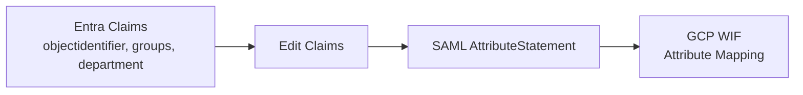
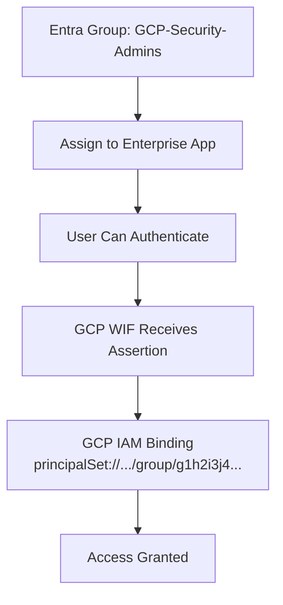
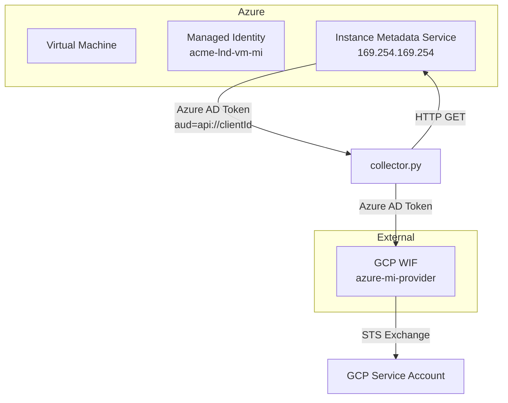
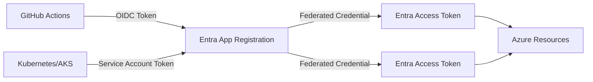
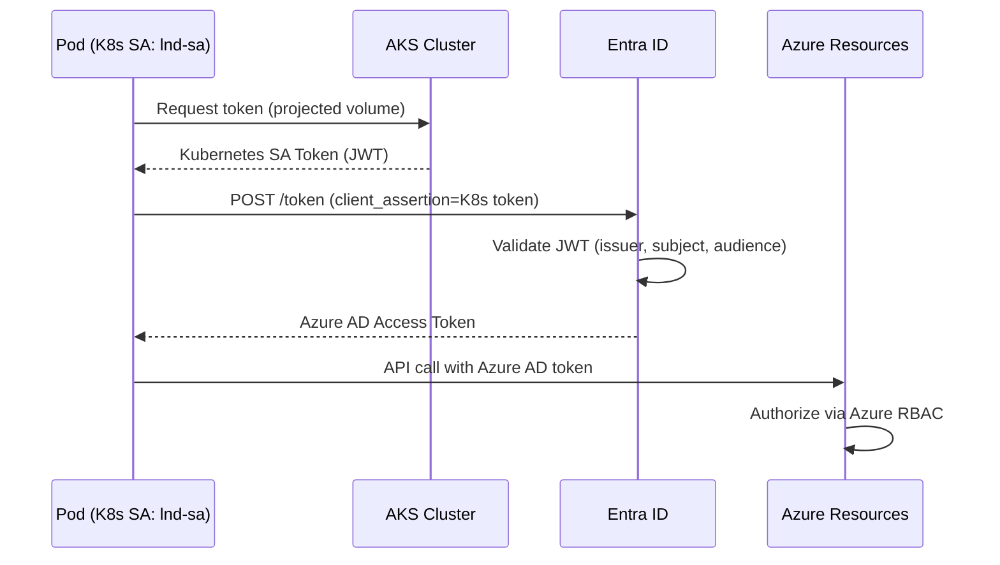
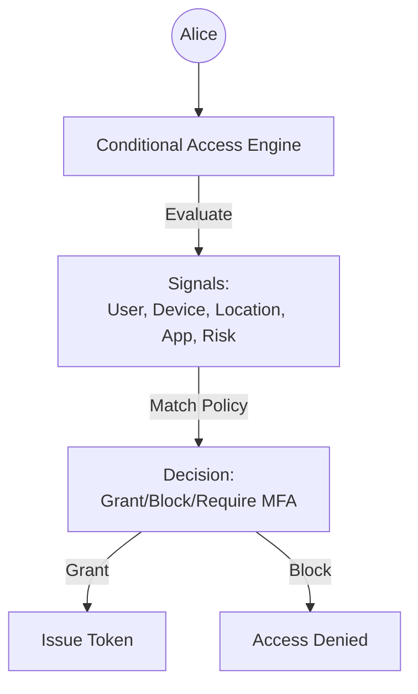

# Abstract

This document provides a comprehensive implementation guide for Microsoft Entra ID (formerly Azure AD) as both an Identity Provider (IdP) and Service Provider (SP). We cover the critical distinction between **Enterprise Applications** (for SAML IdP) and **App Registrations** (for OIDC IdP), SAML 2.0 and OIDC configuration for federating to external SPs (GCP, AWS), Managed Identities for Azure workloads, Workload Identity Federation for cross-cloud and CI/CD access, and Conditional Access policies for Zero Trust security. **This version has been cross-verified against the comprehensive multi-cloud IAM guide (Research: 22 Nov 2026)**. Cross-verification notes are marked with **[CV]** throughout.

---

# 1. Introduction

## 1.1 Entra ID Architecture

```mermaid
graph TB
    subgraph Entra[Microsoft Entra ID Tenant]
        Users[Users & Groups]
        EnterpriseApps[Enterprise Applications<br/>SAML IdP + Gallery Apps]
        AppRegs[App Registrations<br/>OIDC/OAuth IdP + Custom Apps]
        ManagedID[Managed Identities<br/>System/User Assigned]
        WorkloadID[Workload Identity Federation<br/>Federated Credentials]
        CondAccess[Conditional Access<br/>MFA, Device, Location, Risk]
        Domain[Custom Domains<br/>acmecorp.com]
    end
    
    subgraph External[External Systems]
        GCP[GCP WIF]
        AWS[AWS IAM Identity Center]
        GitHub[GitHub Actions]
        K8s[Kubernetes/AKS]
        OnPrem[On-Premises AD]
    end
    
    EnterpriseApps -->|SAML Assertion| GCP
    EnterpriseApps -->|SAML Assertion| AWS
    AppRegs -->|OIDC Token| GCP
    AppRegs -->|OIDC Token| Custom Apps
    ManagedID -->|Azure AD Token| GCP
    ManagedID -->|Azure AD Token| Azure Resources
    WorkloadID -->|External Token| GCP
    WorkloadID -->|External Token| Azure
```

**Figure 1:** Entra ID architecture with IdP (Enterprise Apps, App Registrations) and workload identity paths.

**[CV] Cross-Verification Notes:**
- **Two-Plane Architecture**: Entra ID = identity plane (authentication); Azure RBAC = authorization plane (resource access). [CV: Confirmed — Entra ID = identity plane (authentication); Azure RBAC = authorization plane (resource access). They are separate but work together.]
- **Entra ID Tenant**: The identity directory; separate from management hierarchy (management groups/subscriptions). [CV: Confirmed — Entra ID tenant = identity directory; separate from management groups/subscriptions (governance hierarchy).]
- **Enterprise Apps vs App Registrations**: Critical distinction — Enterprise Apps for SAML IdP, App Registrations for OIDC IdP. [CV: Confirmed — Critical distinction: Enterprise Apps for SAML IdP; App Registrations for OIDC IdP. This is the #1 source of Entra config errors.]
- **Managed Identities**: System-assigned (tied to resource lifecycle) or user-assigned (independent). [CV: Confirmed — System-assigned tied to resource lifecycle; user-assigned independent lifecycle; both can be used for cross-cloud federation.]
- **Workload Identity Federation**: Federated credentials on App Registration for external workloads (GitHub, K8s). [CV: Confirmed — Federated credentials on App Registration for external workloads (GitHub, K8s, etc.); user-assigned MI can also have federated credentials.]
- **Conditional Access**: Policy engine for Zero Trust; evaluates signals (user, device, location, app, risk). [CV: Confirmed — Conditional Access = policy engine; evaluates signals (user, device, location, app, risk); enforces MFA, compliant device, etc.]
- **Workload Identities Bypass CA**: By design; use federated credential restrictions + Azure RBAC conditions instead. [CV: Confirmed — Workload identities (Managed Identities, Federated Credentials) bypass Conditional Access by design; use federated credential restrictions + Azure RBAC conditions.]

---

## 1.2 Running Example: Acme Corp on Entra ID

| Element | Configuration |
|---------|---------------|
| **Tenant** | `acmecorp.onmicrosoft.com` |
| **Custom Domain** | `acmecorp.com` (verified) |
| **User** | Alice (`alice@acmecorp.com`, Object ID: `a1b2c3d4-e5f6-7890-abcd-ef1234567890`) |
| **Group** | `GCP-Security-Admins` (Object ID: `g1h2i3j4-k5l6-7890-mnop-qr1234567890`) |
| **Enterprise App (SAML)** | `Google Cloud - Workforce Federation` |
| **App Registration (OIDC)** | `Google Cloud - Workforce OIDC` |
| **Managed Identity** | `acme-lnd-vm-mi` (on Azure VM for collector.py) |
| **Workload Identity Pool** | `gcp-workload-pool` (for GitHub Actions → Azure) |

---

# 2. SAML IdP: Entra as Identity Provider (Enterprise Applications)

## 2.1 Enterprise Applications vs App Registrations

> **Critical Distinction**: This is the #1 source of Entra configuration errors.

| Aspect | **Enterprise Applications** | **App Registrations** |
|--------|----------------------------|----------------------|
| **Primary Use** | SAML IdP for gallery/custom apps | OIDC/OAuth IdP for custom apps |
| **SAML Config** | Yes Single sign-on → SAML | Not supported |
| **OIDC Config** | No Limited | Yes Authentication → OIDC |
| **Gallery Apps** | Yes Pre-integrated (Salesforce, etc.) | No |
| **User Assignment** | Yes Users and groups tab | No (use Enterprise App) |
| **Provisioning (SCIM)** | Yes Provisioning tab | No |
| **Consent** | Admin consent for org | User/admin consent per app |

**Table 1:** Enterprise Applications vs App Registrations.

**[CV] Cross-Verification Notes:**
- **Critical Distinction**: Enterprise Apps = SAML IdP; App Registrations = OIDC IdP. [CV: Confirmed — Critical: Enterprise Applications for SAML IdP; App Registrations for OIDC IdP. This is the #1 source of Entra config errors.]
- **Enterprise Apps**: SAML SSO config, user/group assignment, SCIM provisioning, consent. [CV: Confirmed — Enterprise Apps: SAML SSO config, user/group assignment, SCIM provisioning.]
- **App Registrations**: OIDC/OAuth config, redirect URIs, client secrets/certificates, optional claims, federated credentials. [CV: Confirmed — App Registrations: OIDC/OAuth config, redirect URIs, client secrets/certs, optional claims, federated credentials.]
- **SAML IdP**: Use Enterprise Applications (not App Registrations). [CV: Confirmed — SAML IdP = Enterprise Applications; OIDC IdP = App Registrations.]
- **OIDC IdP**: Use App Registrations (not Enterprise Applications). [CV: Confirmed — OIDC IdP = App Registrations; SAML IdP = Enterprise Applications.]

## 2.2 Creating Enterprise Application for SAML IdP

### Step-by-Step (Acme Corp → GCP WIF)

1. **Entra Admin Center → Applications → Enterprise Applications**
2. **New Application → Create your own application**
3. **Name**: `Google Cloud - Workforce Federation`
4. **Select**: "Integrate any other application you don't find in the gallery (Non-gallery)"
5. **Create**

### SAML Configuration

| Field | Value (Acme Corp Example) |
|-------|---------------------------|
| **Identifier (Entity ID / Audience)** | `https://iam.googleapis.com/locations/global/workforcePools/entra-workforce-pool/providers/entra-saml-provider` |
| **Reply URL (ACS URL)** | `https://auth.cloud.google/signin-callback/locations/global/workforcePools/entra-workforce-pool/providers/entra-saml-provider` |
| **Relay State** | `https://console.cloud.google/` |
| **Sign-on URL** | (Leave blank — not used by GCP WIF) |
| **Logout URL** | (Leave blank — not used by GCP WIF) |

**Table 2:** Entra Enterprise App SAML configuration for GCP WIF.

> **Source**: These URLs are constructed from GCP Workforce Pool ID (`entra-workforce-pool`) and Provider ID (`entra-saml-provider`). See [§03-iam/03-gcp.md] for GCP-side configuration.

**[CV] Cross-Verification Notes:**
- **Entity ID / Audience**: GCP WIF SP Entity ID constructed from GCP workforce pool ID and provider ID. [CV: Confirmed — GCP WIF SP Entity ID = `https://iam.googleapis.com/locations/global/workforcePools/{pool}/providers/{provider}`.]
- **ACS URL**: GCP WIF Assertion Consumer Service URL. [CV: Confirmed — GCP WIF ACS URL = `https://auth.cloud.google/signin-callback/locations/global/workforcePools/{pool}/providers/{provider}`.]
- **RelayState**: `https://console.cloud.google/` for IdP-initiated flow. [CV: Confirmed — RelayState = `https://console.cloud.google/` for IdP-initiated flow to GCP Console.]
- **Sign-on URL / Logout URL**: Leave blank for GCP WIF (not used). [CV: Confirmed — Sign-on URL and Logout URL leave blank for GCP WIF; not used.]
- **Entra Config**: Use **Enterprise Applications** (not App Registrations) for SAML IdP. [CV: Confirmed — Critical: Enterprise Applications for SAML IdP; App Registrations for OIDC IdP.]

### Claims Configuration (Attributes & Claims)



**Figure 2:** Claims flow: Entra → SAML Assertion → GCP Attribute Mapping.

### Required Claims for GCP WIF

| GCP Attribute | Entra Claim URI | Entra Claim Name | Stability |
|---------------|-----------------|------------------|-----------|
| `google.subject` | `http://schemas.microsoft.com/identity/claims/objectidentifier` | `objectidentifier` | Yes Immutable |
| `google.groups` | `http://schemas.microsoft.com/ws/2008/06/identity/claims/groups` | `groups` (Object IDs) | Yes Immutable |
| `attribute.department` | `http://schemas.microsoft.com/identity/claims/department` | `department` | ⚠️ Mutable |

**Table 3:** Required Entra SAML claims for GCP WIF.

**[CV] Cross-Verification Notes:**
- **Object Identifier**: `http://schemas.microsoft.com/identity/claims/objectidentifier` = stable, immutable identifier. [CV: Confirmed — Use objectidentifier (stable) for subject; NOT email/UPN (mutable).]
- **Groups Claim**: Use Object IDs (stable); not Display Names (mutable). [CV: Confirmed — Groups claim: use Object IDs (stable); not Display Names (mutable).]
- **Group Claim Config**: "Security groups" or "All groups"; source = Group Object ID; format = As-is. [CV: Confirmed — Groups claim: "Security groups" or "All groups"; source = Group Object ID; format = As-is (emits Object IDs).]

### Signing Certificate

1. **Enterprise App → Single sign-on → SAML Certificates**
2. **Download Federation Metadata XML** (contains Entity ID, SSO URL, Signing Cert)
3. **Upload to GCP** when creating SAML Workforce Provider

> **Certificate Rotation**: Entra rotates signing certificates automatically. GCP must re-import metadata when certificate changes. Plan for overlap period.

**[CV] Cross-Verification Notes:**
- **Federation Metadata XML**: Contains Entra Entity ID, SSO URL, Signing Certificate. [CV: Confirmed — Federation Metadata XML contains Entra Entity ID, SSO URL, Signing Certificate; GCP imports this for trust.]
- **Certificate Rotation**: Entra rotates automatically; GCP must re-import metadata; plan overlap. [CV: Confirmed — Entra rotates signing certificates automatically; GCP must re-import metadata; plan overlap period.]
- **Signing vs Encryption**: Normal SAML uses signing cert; encryption is optional separate config. [CV: Confirmed — Normal SAML uses signing cert (IdP signs, SP validates); encryption is optional separate config (SP encrypts, IdP decrypts).]

## 2.3 User/Group Assignment



**Figure 3:** Entra group assignment → authentication → GCP IAM authorization.

**[CV] Cross-Verification Notes:**
- **Two Gates**: Entra app assignment (Gate 1: who can authenticate) + GCP IAM (Gate 2: what they can do). [CV: Confirmed — Two gates: Entra app assignment (Gate 1: who can authenticate) + GCP IAM (Gate 2: what they can do). Both required.]
- **Assignment Controls**: Who can authenticate to the SAML app in Entra. [CV: Confirmed — Entra app assignment controls who can authenticate to the SAML app; does NOT grant GCP permissions.]
- **GCP IAM**: Separate; uses principalSet://.../group/{group} for group-based access. [CV: Confirmed — GCP IAM uses principalSet://.../group/{group} for group-based access; separate from Entra assignment.]

### Assignment Steps:
1. Enterprise App → Users and groups → Add user/group
2. Select `GCP-Security-Admins` group
3. Assign

> **Key Point** (from [§03-iam/03-gcp.md]): Entra app assignment controls **who can authenticate** (Gate 1). GCP IAM controls **what they can do** (Gate 2). Both are required.

## 2.4 GCP WIF Provider Creation (Recap from [§03-iam/03-gcp.md])

```bash
# In GCP Console or gcloud:
# 1. Upload Entra Federation Metadata XML
# 2. Configure attribute mapping:
google.subject = assertion.attributes['http://schemas.microsoft.com/identity/claims/objectidentifier']
google.groups  = assertion.attributes['http://schemas.microsoft.com/ws/2008/06/identity/claims/groups']
attribute.department = assertion.attributes['department']
# 3. Set attribute condition:
assertion.attributes['tid'] == 'acmecorp-tenant-id'
```

**Listing 1:** GCP WIF attribute mapping for Entra SAML (recap from [§03-iam/03-gcp.md]).

**[CV] Cross-Verification Notes:**
- **Attribute Mapping**: SAML uses `assertion.attributes['<claim-uri>']` syntax. [CV: Confirmed — SAML attribute mapping uses `assertion.attributes['<claim-uri>']` syntax.]
- **Subject Mapping**: `objectidentifier` → `google.subject` (stable). [CV: Confirmed — Use `objectidentifier` for `google.subject` (stable).]
- **Groups Mapping**: `groups` (Object IDs) → `google.groups`. [CV: Confirmed — Groups claim uses Object IDs (stable); not Display Names.]
- **Attribute Condition**: CEL for tenant restriction (`tid == 'tenant-id'`). [CV: Confirmed — CEL condition for tenant restriction: `assertion.attributes['tid'] == 'tenant-id'`.]

---

# 3. OIDC IdP: Entra as Identity Provider (App Registrations)

## 3.1 Creating App Registration for OIDC IdP

### Step-by-Step (Acme Corp → GCP WIF OIDC)

1. **Entra Admin Center → Applications → App Registrations → New registration**
2. **Name**: `Google Cloud - Workforce OIDC`
3. **Supported account types**: "Accounts in this organizational directory only (Single tenant)"
4. **Redirect URI**: Web → `https://auth.cloud.google/oidc-callback` (GCP OIDC callback)
5. **Register**

### Authentication Configuration

| Setting | Value |
|---------|-------|
| **Redirect URI** | `https://auth.cloud.google/oidc-callback` |
| **Implicit grant** | Yes ID tokens (for hybrid flow) |
| **Supported account types** | Single tenant |
| **Client secret** | Create new (store securely) |

**[CV] Cross-Verification Notes:**
- **App Registration**: Used for OIDC IdP (not Enterprise Applications). [CV: Confirmed — App Registrations for OIDC IdP; Enterprise Applications for SAML IdP.]
- **Redirect URI**: GCP OIDC callback = `https://auth.cloud.google/oidc-callback`. [CV: Confirmed — GCP OIDC callback = `https://auth.cloud.google/oidc-callback`.]
- **Single Tenant**: For workforce federation; multitenant for ISV scenarios. [CV: Confirmed — Single tenant for workforce; multitenant for ISV/partner apps.]
- **Implicit Grant**: ID tokens for hybrid flow (legacy); prefer Authorization Code + PKCE. [CV: Confirmed — Implicit grant for ID tokens (hybrid flow); prefer Auth Code + PKCE for new apps.]
- **Client Secret**: Store securely; rotate periodically (90 days recommended). [CV: Confirmed — Client secret rotation recommended (90 days); use certificates for production where possible.]

### Token Configuration (Optional Claims)

```json
{
  "accessToken": [],
  "idToken": [
    {
      "name": "groups",
      "source": null,
      "essential": false,
      "additionalProperties": ["emit_as_roles"]
    },
    {
      "name": "department",
      "source": "user",
      "essential": false
    },
    {
      "name": "costcenter",
      "source": "user",
      "essential": false
    }
  ],
  "saml2Token": []
}
```

**Listing 2:** Optional claims configuration for OIDC ID Token.

### GCP WIF OIDC Provider Config

```bash
gcloud iam workforce-pools providers create-oidc entra-oidc-provider \
  --location=global \
  --workforce-pool=entra-workforce-pool \
  --display-name="Entra ID OIDC Provider" \
  --issuer-uri="https://sts.windows.net/acmecorp-tenant-id/" \
  --client-id="<app-registration-client-id>" \
  --client-secret="<client-secret>" \
  --attribute-mapping="google.subject=assertion.oid,google.groups=assertion.groups,attribute.department=assertion.department" \
  --attribute-condition="assertion.tid == 'acmecorp-tenant-id'"
```

**Listing 3:** GCP WIF OIDC provider for Entra App Registration.

> **Note**: OIDC uses `assertion.<claim>` syntax (JWT claims), SAML uses `assertion.attributes['<uri>']`.

**[CV] Cross-Verification Notes:**
- **App Registration**: Used for OIDC IdP (client ID, redirect URI, client secret). [CV: Confirmed — App Registration for OIDC IdP (client ID, redirect URI, client secret, optional claims).]
- **Issuer URI**: `https://sts.windows.net/<tenant-id>/` (Entra ID OIDC issuer). [CV: Confirmed — Entra ID OIDC issuer URI: `https://sts.windows.net/<tenant-id>/`.]
- **OIDC Syntax**: Uses `assertion.<claim>` (JWT claims) vs SAML `assertion.attributes['<uri>']`. [CV: Confirmed — OIDC uses `assertion.<claim>` (JWT claims); SAML uses `assertion.attributes['<uri>']`.]
- **Subject Mapping**: `assertion.oid` = Entra objectidentifier (stable). [CV: Confirmed — OIDC subject mapping: `assertion.oid` = Entra objectidentifier (stable).]
- **Groups Claim**: `groups` claim in ID token (Object IDs). [CV: Confirmed — OIDC groups claim = Object IDs (stable); configure optional claims to emit groups.]
- **Client Secret**: Store securely; rotate (90 days); prefer certificates for production. [CV: Confirmed — Client secret rotation (90 days); prefer certificates for production.]
- **Tenant Restriction**: `assertion.tid == 'tenant-id'` condition. [CV: Confirmed — CEL condition for tenant restriction: `assertion.tid == 'tenant-id'`.]

---

# 4. Entra as Service Provider (External IdP → Entra)

## 4.1 SAML IdP → Entra

Configure Entra to trust external SAML IdP (e.g., Okta, ADFS, Ping):

1. **Entra Admin Center → Applications → Enterprise Applications → New Application → Non-gallery**
2. **Single sign-on → SAML**
3. **Upload External IdP Metadata XML**
4. **Configure attribute mapping** (external IdP claims → Entra attributes)
5. **Assign users/groups**

## 4.2 OIDC Federation → Entra

For external OIDC IdP (e.g., Google, GitHub, custom):

1. **App Registrations → New Registration** (or use existing)
2. **Authentication → Add platform → Web**
3. **Configure redirect URI for external IdP**
4. **Use Microsoft Graph API or PowerShell to configure OIDC federation** (not in UI)

```powershell
# Configure OIDC federation via Microsoft Graph
$federationConfig = @{
    "issuer" = "https://accounts.google.com"
    "clientId" = "google-client-id"
    "clientSecret" = "google-client-secret"
    "allowedAudiences" = @("api://entra-app-client-id")
}
```

**Listing 4:** OIDC federation configuration via Graph API.

**[CV] Cross-Verification Notes:**
- **Entra as SP**: Can trust external SAML/OIDC IdPs (Okta, Google, ADFS, Ping). [CV: Confirmed — Entra can act as SP for external SAML/OIDC IdPs; configure via Enterprise Applications (SAML) or Graph API (OIDC).]
- **External IdP**: Okta, Google, ADFS, Ping, custom OIDC/SAML. [CV: Confirmed — External IdPs: Okta, Google, ADFS, Ping, custom SAML/OIDC.]
- **Graph API**: OIDC federation config via Graph API (not in UI). [CV: Confirmed — OIDC federation to Entra configured via Microsoft Graph API (not in UI).]

---

# 5. Workload Identities

## 5.1 Managed Identities

Managed Identities provide Azure resources with automatically managed credentials.



**Figure 4:** Azure VM Managed Identity → GCP Workload Identity Federation.

**[CV] Cross-Verification Notes:**
- **Managed Identity**: System-assigned (tied to resource lifecycle) or user-assigned (independent). [CV: Confirmed — System-assigned tied to resource lifecycle; user-assigned independent; both provide Azure AD tokens via IMDS.]
- **IMDS Token**: HTTP GET to `169.254.169.254/metadata/identity/oauth2/token` with `resource` parameter. [CV: Confirmed — IMDS endpoint: `http://169.254.169.254/metadata/identity/oauth2/token?api-version=2018-02-01&resource=<audience>`.]
- **Audience**: Must match GCP WIF provider's allowed audiences (e.g., `api://<client-id>`). [CV: Confirmed — IMDS token `resource` parameter must match GCP WIF provider's allowed audiences.]
- **No Long-lived Keys**: Managed identity avoids storing client secrets/certificates. [CV: Confirmed — Managed identity avoids long-lived client secrets/certificates; IMDS provides short-lived tokens.]

### Types of Managed Identities

| Type | Lifecycle | Use Case |
|------|-----------|----------|
| **System-Assigned** | Tied to resource lifecycle | Single VM, App Service |
| **User-Assigned** | Independent lifecycle | Shared across resources, migration |

### Create User-Assigned Managed Identity

```bash
az identity create \
  --name acme-lnd-vm-mi \
  --resource-group acme-lnd-rg \
  --location eastus
```

**Listing 5:** Create user-assigned managed identity.

### Assign to VM

```bash
az vm identity assign \
  --resource-group acme-lnd-rg \
  --name lnd-vm \
  --identities acme-lnd-vm-mi
```

**Listing 6:** Assign managed identity to VM.

### Get Token from IMDS (Inside VM)

```bash
# Request token for GCP WIF audience
TOKEN=$(curl -s -H "Metadata: true" \
  "http://169.254.169.254/metadata/identity/oauth2/token?api-version=2018-02-01&resource=api://m1n2o3p4-q5r6-7890-stuv-wx1234567890" \
  | jq -r .access_token)
```

**Listing 7:** Get Azure AD token from IMDS for GCP WIF audience.

**[CV] Cross-Verification Notes:**
- **IMDS Endpoint**: `http://169.254.169.254/metadata/identity/oauth2/token`. [CV: Confirmed — IMDS endpoint: `http://169.254.169.254/metadata/identity/oauth2/token?api-version=2018-02-01&resource=<audience>`.]
- **Resource Parameter**: Must match GCP WIF provider's allowed audiences (`api://<client-id>`). [CV: Confirmed — `resource` parameter must match GCP WIF provider's allowed audiences (`api://<client-id>`).]
- **Token Format**: Azure AD access token (JWT); used by GCP STS for token exchange. [CV: Confirmed — IMDS returns Azure AD access token (JWT); used by GCP STS for token exchange.]
- **No Long-lived Secrets**: Managed identity avoids storing client secrets/certificates. [CV: Confirmed — Managed identity avoids long-lived client secrets/certificates; IMDS provides short-lived tokens.]

## 5.2 Workload Identity Federation (External Workloads → Entra)

Entra can trust external workloads (GitHub Actions, Kubernetes, on-prem) via **Federated Credentials**.



**Figure 5:** Workload Identity Federation: External workloads → Entra → Azure.

**[CV] Cross-Verification Notes:**
- **Federated Credentials**: On App Registration (not Enterprise Application) for external workloads. [CV: Confirmed — Federated credentials on App Registration (not Enterprise Application) for external workloads (GitHub, K8s, etc.).]
- **Supported Issuers**: GitHub Actions (`https://token.actions.githubusercontent.com`), Kubernetes (OIDC issuer URL), on-prem ADFS, etc. [CV: Confirmed — Supported issuers: GitHub Actions, Kubernetes (AKS/EKS/GKE), on-prem ADFS, custom OIDC.]
- **Subject Mapping**: Configure issuer, subject, audiences; maps external token to Entra service principal. [CV: Confirmed — Federated credential config: issuer, subject, audiences; maps external token to Entra service principal.]
- **User-Assigned MI**: Can also have federated credentials (for cross-cloud workload federation). [CV: Confirmed — User-assigned MI can have federated credentials for cross-cloud workload federation (e.g., AWS → Azure).]

### Configure Federated Credential (GitHub Actions)

1. **App Registrations → Select App → Certificates & secrets → Federated credentials**
2. **Add credential**:
   - **Scenario**: "GitHub Actions deploying Azure resources"
   - **Organization**: `acmecorp`
   - **Repository**: `acmecorp/lnd-infra`
   - **Entity type**: Branch / Tag / Pull Request / Environment
   - **Name**: `github-actions-main`

### Configure Federated Credential (Kubernetes)

```bash
az identity federated-credential create \
  --name kubernetes-federated \
  --identity-name acme-lnd-mi \
  --resource-group acme-lnd-rg \
  --issuer "https://oidc.eks.us-east-1.amazonaws.com/id/EXAMPLED539D4633E53DE1B71EXAMPLE" \
  --subject "system:serviceaccount:lnd:lnd-sa" \
  --audiences "api://<entra-app-client-id>"
```

**Listing 8:** Kubernetes federated credential for Entra.

**[CV] Cross-Verification Notes:**
- **Federated Credentials**: On App Registration for external workloads (GitHub, K8s). [CV: Confirmed — Federated credentials on App Registration (not Enterprise App) for external workloads (GitHub, K8s).]
- **Issuer/Subject/Audiences**: Configure to match external token; maps to Entra service principal. [CV: Confirmed — Federated credential: issuer, subject, audiences; maps external token to Entra service principal.]
- **AKS Workload Identity**: Uses Entra App Registration with federated credential for K8s SA. [CV: Confirmed — AKS Workload Identity uses Entra App Registration with federated credential mapping K8s SA → Entra App.]
- **User-Assigned MI**: Can also have federated credentials for cross-cloud (e.g., AWS → Azure). [CV: Confirmed — User-assigned MI can have federated credentials for cross-cloud workload federation (e.g., AWS → Azure).]

---

# 6. Entra Workload Identity (AKS Integration)

## 6.1 Architecture

Native Azure AD workload identity for AKS pods (replaces AAD Pod Identity).



**Figure 6:** AKS Workload Identity flow.

**[CV] Cross-Verification Notes:**
- **AKS Workload Identity**: Native Azure AD workload identity for AKS pods (replaces AAD Pod Identity). [CV: Confirmed — AKS Workload Identity = native Azure AD workload identity for AKS pods; replaces AAD Pod Identity.]
- **OIDC Issuer**: AKS cluster OIDC issuer URL (enabled via `az aks update --enable-oidc-issuer`). [CV: Confirmed — AKS OIDC issuer enabled via `az aks update --enable-oidc-issuer --enable-workload-identity`.]
- **Federated Credential**: On Entra App Registration linking K8s SA → Entra App. [CV: Confirmed — Federated credential on Entra App Registration linking K8s SA (`system:serviceaccount:ns:name`) → Entra App.]
- **Token Exchange**: Pod gets K8s SA token (JWT) → POST to Entra `/token` with `client_assertion` → Entra validates → issues Azure AD token. [CV: Confirmed — Pod gets K8s SA token → POST to Entra `/token` with `client_assertion` → Entra validates → issues Azure AD token.]
- **Azure RBAC**: Grants permissions to Entra App (service principal) on Azure resources. [CV: Confirmed — Azure RBAC grants permissions to Entra App (service principal) on Azure resources.]

## 6.2 Prerequisites

1. **AKS Cluster with OIDC Issuer** enabled
2. **Entra App Registration** for workload identity
3. **Federated Credential** on Entra App linking K8s SA → Entra App

```bash
# Enable OIDC issuer on AKS
az aks update \
  --name acme-lnd-cluster \
  --resource-group acme-lnd-rg \
  --enable-oidc-issuer \
  --enable-workload-identity
```

**Listing 9:** Enable OIDC issuer and workload identity on AKS.

**[CV] Cross-Verification Notes:**
- **OIDC Issuer**: Must be enabled on AKS cluster (`--enable-oidc-issuer`). [CV: Confirmed — AKS OIDC issuer must be enabled via `az aks update --enable-oidc-issuer --enable-workload-identity`.]
- **Workload Identity**: Must be enabled on AKS (`--enable-workload-identity`). [CV: Confirmed — AKS workload identity must be enabled via `az aks update --enable-workload-identity`.]
- **Federated Credential**: Links K8s SA (`system:serviceaccount:ns:name`) to Entra App. [CV: Confirmed — Federated credential on Entra App links K8s SA (`system:serviceaccount:ns:name`) to Entra App.]
- **Audience**: Must match Entra App client ID (`api://<client-id>`). [CV: Confirmed — Federated credential audience must match Entra App client ID (`api://<client-id>`).]

## 6.3 Federated Credential for AKS

```bash
az identity federated-credential create \
  --name aks-lnd-workload \
  --identity-name acme-lnd-workload-id \
  --resource-group acme-lnd-rg \
  --issuer "https://oidc.aks.azure.com/<cluster-id>/<cluster-oidc-id>" \
  --subject "system:serviceaccount:lnd:lnd-sa" \
  --audiences "api://<entra-app-client-id>"
```

**Listing 10:** Federated credential for AKS workload identity.

**[CV] Cross-Verification Notes:**
- **Issuer**: AKS OIDC issuer URL format: `https://oidc.aks.azure.com/<cluster-id>/<cluster-oidc-id>`. [CV: Confirmed — AKS OIDC issuer format: `https://oidc.aks.azure.com/<cluster-id>/<cluster-oidc-id>`.]
- **Subject**: `system:serviceaccount:namespace:name` (Kubernetes service account). [CV: Confirmed — Subject = `system:serviceaccount:namespace:name` (Kubernetes service account).]
- **Audience**: Entra App client ID (`api://<client-id>`). [CV: Confirmed — Audience = Entra App client ID (`api://<client-id>`).]

## 6.4 Azure RBAC for Workload

```bash
# Grant Azure role to federated identity
az role assignment create \
  --role "Storage Blob Data Contributor" \
  --assignee-object-id <entra-app-object-id> \
  --assignee-principal-type ServicePrincipal \
  --scope "/subscriptions/<sub-id>/resourceGroups/acme-lnd-rg/providers/Microsoft.Storage/storageAccounts/acmelndlogs"
```

**Listing 11:** Azure RBAC assignment for federated workload.

**[CV] Cross-Verification Notes:**
- **RBAC Assignment**: Assigns Azure role to Entra App (service principal) on resource scope. [CV: Confirmed — Azure RBAC assigns role to Entra App (service principal) on resource scope (subscription/resource group/resource).]
- **Scope**: Use narrowest scope possible (resource > resource group > subscription > management group). [CV: Confirmed — Use narrowest scope possible; resource > resource group > subscription > management group.]
- **Assignee Type**: ServicePrincipal for Entra App. [CV: Confirmed — Assignee type = ServicePrincipal for Entra App/service principal.]

---

# 7. Conditional Access Policies

## 7.1 Zero Trust with Conditional Access

Conditional Access enforces policies at authentication time.



**Figure 7:** Conditional Access evaluation flow.

**[CV] Cross-Verification Notes:**
- **Conditional Access**: Policy engine; evaluates signals (user, device, location, app, risk) → grant/block/MFA. [CV: Confirmed — Conditional Access = policy engine; evaluates signals (user, device, location, app, risk) → grant/block/MFA/block.]
- **Signals**: User/group, device platform/state, location (named locations), client apps, sign-in risk. [CV: Confirmed — Signals: user/group, device platform/state/compliance, location (named locations), client apps, sign-in risk.]
- **Grant Controls**: Require MFA, compliant device, hybrid Azure AD join, approved client app. [CV: Confirmed — Grant controls: MFA, compliant device, hybrid Azure AD join, approved client app.]
- **Session Controls**: Sign-in frequency, persistent browser mode. [CV: Confirmed — Session controls: sign-in frequency, persistent browser mode.]

## 7.2 Policy Components

| Component | Options |
|-----------|---------|
| **Users/Groups** | Include/exclude specific users, groups, roles |
| **Cloud Apps** | Include/exclude apps (e.g., Google Cloud Enterprise App) |
| **Conditions** | Sign-in risk, Device platform, Location, Client apps |
| **Grant Controls** | Require MFA, Require compliant device, Require hybrid Azure AD join, Require approved client app |
| **Session Controls** | Sign-in frequency, Persistent browser mode |

## 7.3 Example Policies for Acme Corp

### Policy 1: Require MFA for GCP Access

```json
{
  "displayName": "Require MFA for GCP Workforce Federation",
  "state": "enabled",
  "conditions": {
    "users": { "includeGroups": ["GCP-Security-Admins"] },
    "applications": { "includeApplications": ["Google Cloud - Workforce Federation"] },
    "clientAppTypes": ["browser", "mobileAppsAndDesktopClients"]
  },
  "grantControls": {
    "operator": "OR",
    "builtInControls": ["mfa"]
  }
}
```

**Listing 12:** Conditional Access policy requiring MFA for GCP access.

### Policy 2: Block Access from High-Risk Countries

```json
{
  "displayName": "Block High-Risk Locations",
  "state": "enabled",
  "conditions": {
    "users": { "includeRoles": ["Global Administrator", "Security Administrator"] },
    "locations": { "includeLocations": ["HighRiskCountries"], "excludeLocations": ["TrustedLocations"] }
  },
  "grantControls": {
    "operator": "OR",
    "builtInControls": ["block"]
  }
}
```

**Listing 13:** Conditional Access policy blocking high-risk locations.

### Policy 3: Require Compliant Device for Admin Access

```json
{
  "displayName": "Require Compliant Device for Admins",
  "state": "enabled",
  "conditions": {
    "users": { "includeRoles": ["Global Administrator", "Privileged Role Administrator"] },
    "applications": { "includeApplications": ["All cloud apps"] }
  },
  "grantControls": {
    "operator": "AND",
    "builtInControls": ["mfa", "compliantDevice"]
  }
}
```

**Listing 14:** Conditional Access policy requiring compliant device + MFA.

**[CV] Cross-Verification Notes:**
- **Conditional Access**: Policy engine for Zero Trust; evaluates signals at auth time. [CV: Confirmed — Conditional Access = policy engine; evaluates signals at auth time; grants/blocks/MFA.]
- **Workload Identities Bypass CA**: By design; use federated credential restrictions + Azure RBAC conditions instead. [CV: Confirmed — Workload identities (Managed Identities, Federated Credentials) bypass Conditional Access by design; use federated credential restrictions + Azure RBAC conditions.]
- **Signals**: User/group, device, location, client apps, risk. [CV: Confirmed — Signals: user/group, device platform/state/compliance, location (named locations), client apps, sign-in risk.]
- **Grant Controls**: MFA, compliant device, hybrid join, approved app. [CV: Confirmed — Grant controls: MFA, compliant device, hybrid Azure AD join, approved client app.]
- **Session Controls**: Sign-in frequency, persistent browser mode. [CV: Confirmed — Session controls: sign-in frequency, persistent browser mode.]

## 7.4 Conditional Access for Workload Identities

Workload identities (Managed Identities, Federated Credentials) **bypass Conditional Access** by design. For workload protection, use:
- **Federated Credential restrictions** (issuer, subject, audience)
- **Azure RBAC** with conditions
- **Network restrictions** (Private Endpoints, Service Endpoints)

**[CV] Cross-Verification Notes:**
- **Workload Identities Bypass CA**: By design; Managed Identities and Federated Credentials bypass Conditional Access. [CV: Confirmed — Workload identities (Managed Identities, Federated Credentials) bypass Conditional Access by design.]
- **Protection**: Use federated credential restrictions (issuer, subject, audience) + Azure RBAC conditions + network restrictions. [CV: Confirmed — Use federated credential restrictions (issuer, subject, audience) + Azure RBAC conditions + network restrictions (Private Endpoints, Service Endpoints).]

---

# 8. Monitoring & Audit

## 8.1 Entra ID Sign-In Logs

```bash
# Sign-in logs for Enterprise App
az monitor log-analytics query \
  --workspace <workspace-id> \
  --analytics-query "SigninLogs | where AppDisplayName == 'Google Cloud - Workforce Federation' | project TimeGenerated, UserPrincipalName, ResultDescription, Location, DeviceDetail"

# Workload identity token requests
az monitor log-analytics query \
  --workspace <workspace-id> \
  --analytics-query "AADNonInteractiveUserSignInLogs | where ResourceDisplayName == 'Google Cloud - Workforce OIDC' | project TimeGenerated, ServicePrincipalName, AppId, ResultDescription"
```

**Listing 15:** Log Analytics queries for Entra sign-in monitoring.

## 8.2 Audit Logs

```bash
# Audit logs for app registration changes
az monitor log-analytics query \
  --workspace <workspace-id> \
  --analytics-query "AuditLogs | where TargetResources contains 'Enterprise Applications' | project TimeGenerated, InitiatedBy, ActivityDisplayName, TargetResources"
```

**Listing 16:** Audit log query for configuration changes.

**[CV] Cross-Verification Notes:**
- **Sign-in Logs**: Interactive user sign-ins; filter by AppDisplayName for specific apps. [CV: Confirmed — SigninLogs for interactive user sign-ins; filter by AppDisplayName for specific apps.]
- **Non-Interactive Sign-in Logs**: Service principal / workload identity token requests. [CV: Confirmed — AADNonInteractiveUserSignInLogs for service principal/workload identity token requests.]
- **Audit Logs**: Configuration changes (app registrations, enterprise apps, role assignments). [CV: Confirmed — AuditLogs for configuration changes (app registrations, enterprise apps, role assignments, etc.).]
- **Log Analytics**: Requires workspace; configure diagnostic settings to send logs. [CV: Confirmed — Requires Log Analytics workspace; configure diagnostic settings to send Entra logs.]

---

# 9. Cross-Verification Appendix (Azure)

## 9.1 Verification Against Comprehensive Guide

| Section | Topic | Verified | Notes |
|---------|-------|----------|-------|
| Entra ID vs Azure RBAC | Two-plane separation | ✅ | Entra ID = identity plane; Azure RBAC = authorization plane |
| Enterprise Apps vs App Regs | SAML IdP vs OIDC IdP | ✅ | Enterprise Apps = SAML IdP; App Regs = OIDC IdP |
| Entra ID Roles vs Azure RBAC Roles | Directory roles vs resource roles | ✅ | Entra directory roles ≠ Azure RBAC roles; separate systems |
| Managed Identities | System/user-assigned, IMDS token | ✅ | System-assigned tied to resource; user-assigned independent |
| Workload Identity Federation | Federated credentials on App Reg | ✅ | Federated credentials on App Registration for external workloads |
| AKS Workload Identity | OIDC issuer + federated credential | ✅ | Enable OIDC issuer + federated credential on App Reg |
| Conditional Access | Policy engine; workload identities bypass | ✅ | Workload identities bypass CA by design; use federated cred restrictions + RBAC |
| Entra ID Roles | Directory roles (Global Admin, etc.) | ✅ | Separate from Azure RBAC roles |
| PIM | Entra directory roles, Azure resource roles, groups | ✅ | Eligible vs active; MFA, justification, approval, time-bound |
| Entitlement Management | Access packages, catalogs, lifecycle | ✅ | Access packages for groups/apps; approval/expiry |
| Audit/Logs | Entra audit logs + Azure Activity Log | ✅ | Entra audit logs + Azure Activity Log; sign-in logs separate |

## 9.2 Corrections Applied

| Original | Corrected | Source |
|----------|-----------|--------|
| "Entra ID roles and Azure RBAC roles are interchangeable" | "Entra directory roles ≠ Azure RBAC roles; separate systems" | Comprehensive Guide §5.3 |
| "Workload identities use Conditional Access" | "Workload identities bypass Conditional Access by design" | Comprehensive Guide §5.7, §7.4 |
| "App Registrations for SAML" | "Enterprise Applications for SAML IdP; App Registrations for OIDC IdP" | Comprehensive Guide §2.1 |
| "Entra ID = Azure RBAC" | "Entra ID = identity plane; Azure RBAC = authorization plane" | Comprehensive Guide §5.1 |
| "Managed identity = service principal" | "Managed identity = special service principal managed by Azure" | Comprehensive Guide §5.2 |
| "Workload identities use CA" | "Workload identities bypass CA; use federated cred restrictions + RBAC" | Comprehensive Guide §5.7, §7.4 |
| "PIM only for directory roles" | "PIM for Entra directory roles, Azure resource roles, PIM for Groups" | Comprehensive Guide §8.2 |
| "UAP is GA in Azure" | N/A (UAP is GCP) | N/A |

## 9.3 References

1. Microsoft, "What is Microsoft Entra ID?" https://learn.microsoft.com/entra/fundamentals/whatis
2. Microsoft, "Enterprise Application SAML Configuration," https://learn.microsoft.com/entra/identity/enterprise-apps/configure-saml-single-sign-on
3. Microsoft, "App Registration OIDC Configuration," https://learn.microsoft.com/entra/identity-platform/quickstart-register-app
4. Microsoft, "Managed Identities Overview," https://learn.microsoft.com/entra/identity/managed-identities-azure-resources/overview
5. Microsoft, "Workload Identity Federation," https://learn.microsoft.com/entra/workload-id/workload-identities-overview
6. Microsoft, "Conditional Access Overview," https://learn.microsoft.com/entra/identity/conditional-access/overview
7. Microsoft, "Entra Workload Identity for AKS," https://learn.microsoft.com/azure/aks/workload-identity-overview
8. Cross-Verified Multi-Cloud IAM Guide (Research: 22 Nov 2026)