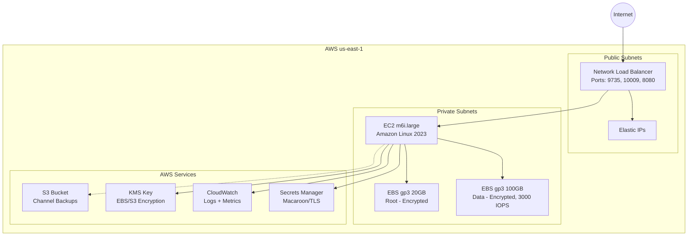

# Tutorial: Deploy LND on AWS EC2 with EBS and Network Load Balancer

> **Goal**: Deploy a production-ready LND node on AWS EC2 with encrypted EBS volumes, Network Load Balancer for high availability, CloudWatch monitoring, and automated S3 backups in ~30 minutes.
>
> **Architecture**: Single EC2 instance in private subnet, NLB in public subnets, encrypted EBS for channel state, S3 for backups. Reference [Figure 1].

## Prerequisites Checklist

- [ ] AWS CLI v2 configured (`aws configure`)
- [ ] Terraform >= 1.9 installed (`terraform version`)
- [ ] SSH key pair generated (`ssh-keygen -t ed25519 -f ~/.ssh/lnd-aws`)
- [ ] AWS account with appropriate permissions
- [ ] Estimated cost reviewed: ~$190/month on-demand [§07.1]

## Architecture Overview [Figure 1]



**Figure 1:** Tutorial architecture - AWS EC2 LND deployment.

## Step 1: Prepare Repository & Variables

```bash
# Clone the guide repository
git clone https://github.com/ajettesla/cloud-plaform-lnd-guide
cd cloud-plaform-lnd-guide/tutorials/aws-lnd-vm

# Copy and customize variables
cp terraform.tfvars.example terraform.tfvars
# Edit terraform.tfvars with your values
```

**Expected `terraform.tfvars`:**
```hcl
# Listing 1: Example terraform.tfvars
aws_region       = "us-east-1"
instance_type    = "m6i.large"
root_volume_size = 20
data_volume_size = 100
data_volume_type = "gp3"
data_volume_iops = 3000
ssh_public_key   = "ssh-ed25519 AAAAC3... user@host"
key_pair_name    = "lnd-aws"
domain_name      = "lnd.example.com"  # optional, for TLS
enable_monitoring = true
backup_schedule  = "0 3 * * *"  # Daily 3 AM UTC
lnd_version      = "0.18.2-beta"
bitcoin_network  = "mainnet"
```

**Listing 1:** Tutorial-specific Terraform variables.

## Step 2: Initialize & Plan

```bash
terraform init
terraform plan -out=tfplan
```

**Verify plan output shows:**
- [ ] VPC with public/private subnets across 2 AZs
- [ ] Security groups allowing 9735 (P2P), 10009 (gRPC), 8080 (REST)
- [ ] KMS key for EBS/S3 encryption
- [ ] IAM role for EC2 with least privilege
- [ ] NLB with health checks on port 10009
- [ ] S3 bucket with versioning and lifecycle
- [ ] CloudWatch log group and metric filters
- [ ] EC2 instance with user data for LND install

## Step 3: Apply Infrastructure

```bash
terraform apply tfplan
```

**Expected outputs:**
```
Outputs:
instance_id        = "i-0abc123def456"
instance_public_ip = "54.123.45.67"
instance_private_ip = "10.0.1.42"
nlb_dns_name       = "lnd-nlb-123456789.us-east-1.elb.amazonaws.com"
backup_bucket      = "lnd-backups-abc123"
kms_key_id         = "arn:aws:kms:us-east-1:123456789:key/..."
cloudwatch_log_group = "/aws/ec2/lnd"
```

## Step 4: Verify LND Deployment

```bash
# SSH via Session Manager (no bastion needed)
aws ssm start-session --target i-0abc123def456

# Or traditional SSH
ssh -i ~/.ssh/lnd-aws ec2-user@54.123.45.67

# Check LND service status
sudo systemctl status lnd

# Verify LND is running and synced
lncli getinfo | jq '{version: .version, synced: .synced_to_chain, peers: .num_peers, channels: .num_active_channels, block_height: .block_height}'

# Verify RPC access via NLB (from local machine)
lncli --rpcserver=lnd-nlb-123456789.us-east-1.elb.amazonaws.com:10009 \
  --macaroonpath=~/admin.macaroon \
  --tlscertpath=~/tls.cert \
  getinfo
```

**Expected output:**
```json
{
  "version": "0.18.2-beta commit=v0.18.2-beta",
  "synced": true,
  "peers": 8,
  "channels": 3,
  "block_height": 867530
}
```

## Step 5: Configure Monitoring & Alerting

```bash
# Access CloudWatch dashboard
# Console: CloudWatch > Dashboards > LND-aws-lnd-vm

# Verify key metrics flowing:
# - lnd_chain_sync_status (1 = synced)
# - lnd_num_peers (> 3)
# - lnd_num_active_channels (> 0)
# - lnd_htlc_throughput_per_second
# - lnd_pending_htlcs
# - DiskSpaceUtilization (< 80%)
# - CPUUtilization (< 85%)
```

**Key CloudWatch Alarms (created by Terraform):**
| Alarm | Threshold | Action |
|-------|-----------|--------|
| LNDSyncLost | sync_status < 1 for 5 min | SNS → PagerDuty/Email |
| LNDPeerLoss | peers < 3 for 10 min | SNS → PagerDuty/Email |
| DiskSpaceHigh | > 85% for 5 min | SNS → PagerDuty/Email |
| CPUHigh | > 85% for 15 min | Auto Scaling (if enabled) |

## Step 6: Test Backup & Recovery

```bash
# Trigger manual backup
sudo /usr/local/bin/lnd-backup.sh

# Verify backup in S3
aws s3 ls s3://lnd-backups-abc123/

# Expected: channel.backup, lnd.conf, timestamped snapshots

# Test restore procedure (documented in [§10.4])
# 1. Stop LND: sudo systemctl stop lnd
# 2. Restore channel.backup to /var/lib/lnd/
# 3. Start LND: sudo systemctl start lnd
# 4. Verify: lncli listchannels
```

## Step 7: Open First Channel (Optional)

```bash
# Get node URI for sharing
lncli getinfo | jq -r '"\(.identity_pubkey)@\(.uris[0])"'

# Example output: 02abc123...@54.123.45.67:9735

# Connect to a well-known peer (e.g., ACINQ)
lncli connect 03864ef025fde8fb587d989186ce6a4a186895ee44a926bfc370e2c366597a3f8f@34.239.230.56:9735

# Open channel (1M sat local, 500k sat push)
lncli openchannel --node_key=03864ef025fde8fb587d989186ce6a4a186895ee44a926bfc370e2c366597a3f8f --local_amt=1000000 --push_amt=500000
```

## Validation Checklist

- [ ] LND service running and synced to chain tip
- [ ] Peers connected (> 3)
- [ ] Channels open (> 1)
- [ ] RPC accessible via NLB DNS name
- [ ] Metrics appearing in CloudWatch
- [ ] Backup bucket receiving channel backups daily
- [ ] Alarms configured and tested
- [ ] SSH/SSM access working

## Cleanup

```bash
# Close channels first (cooperative close)
lncli closechannel --channel_point=<channel_point>

# Wait for on-chain confirmation (~1 hour)

# Destroy infrastructure
terraform destroy -auto-approve
```

## Troubleshooting Quick Reference

| Issue | Check | Fix |
|-------|-------|-----|
| LND not starting | `journalctl -u lnd -n 50` | Config syntax, permissions, disk space |
| No peers | Security group port 9735 | Allow inbound 9735/TCP from 0.0.0.0/0 |
| RPC connection refused | TLS/macaroon paths | Verify paths in lncli command |
| Sync stuck at block | `lncli getinfo` → synced_to_chain | Check bitcoind, restart LND |
| NLB health check failing | Target group health | Ensure LND RPC listening on 0.0.0.0:10009 |

## Next Steps

- [ ] Configure Watchtower [§10.3] for channel breach protection
- [ ] Set up channel rebalancing automation [§10.2.5]
- [ ] Implement multi-node HA [§10.5] for higher availability
- [ ] Customize Grafana dashboards for LND metrics
- [ ] Document runbooks for operations team

## References

- [AWS LND Terraform Module](https://github.com/ajettesla/lnd-terraform-modules/tree/main/aws/ec2-lnd)
- [LND Operations Guide](https://github.com/lightningnetwork/lnd/blob/master/docs/operation_guide.md)
- [AWS EC2 User Guide](https://docs.aws.amazon.com/ec2/)
- [Network Load Balancer Guide](https://docs.aws.amazon.com/elasticloadbalancing/latest/network/)
