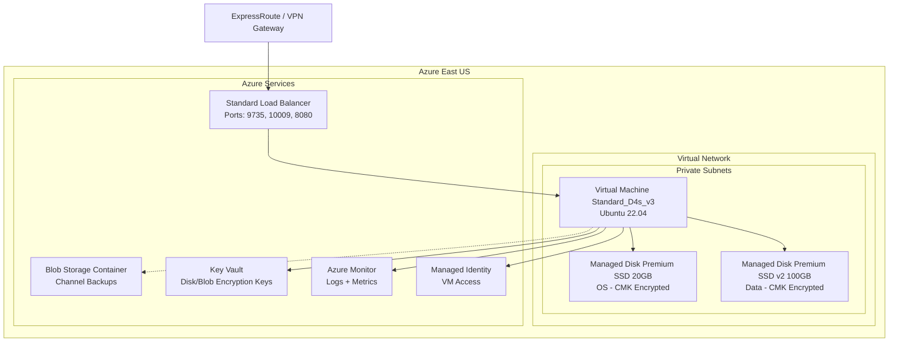

# Tutorial: Deploy LND on Azure Virtual Machines

> **Goal**: Deploy a production-ready LND node on Azure Virtual Machines with encrypted Managed Disks, Standard Load Balancer, Azure Monitor, and automated Blob Storage backups in ~30 minutes.
>
> **Architecture**: Single VM in private subnet, Standard Load Balancer, encrypted Managed Disks for channel state, Blob Storage for backups. Reference [Figure 1].

## Architecture Overview [Figure 1]

**Figure 1:** Tutorial architecture - Azure VM LND deployment.

## Step-by-Step Instructions

*This tutorial follows the same structure as [§12.1] (AWS) with Azure-specific commands and services. Full implementation coming soon.*

## Validation Checklist

- [ ] LND service running and synced to chain tip
- [ ] Peers connected (> 3)
- [ ] Channels open (> 1)
- [ ] RPC accessible via Load Balancer
- [ ] Metrics appearing in Azure Monitor
- [ ] Backup container receiving channel backups daily
- [ ] Alert rules configured

## References

- [Azure LND Terraform Module](https://github.com/ajettesla/lnd-terraform-modules/tree/main/azure/vm-lnd)
- [LND Operations Guide](https://github.com/lightningnetwork/lnd/blob/master/docs/operation_guide.md)
- [Azure Virtual Machines Documentation](https://learn.microsoft.com/azure/virtual-machines/)
