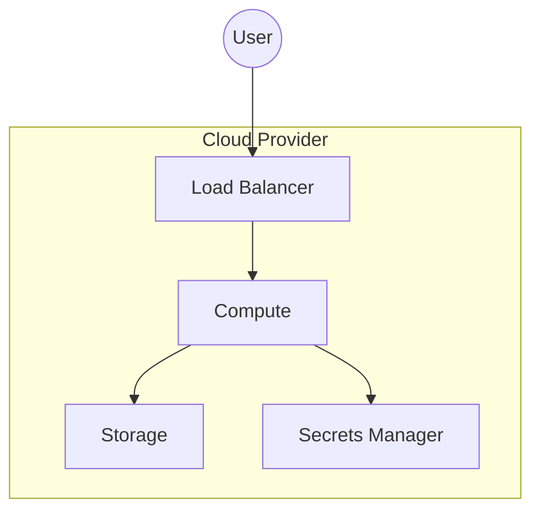
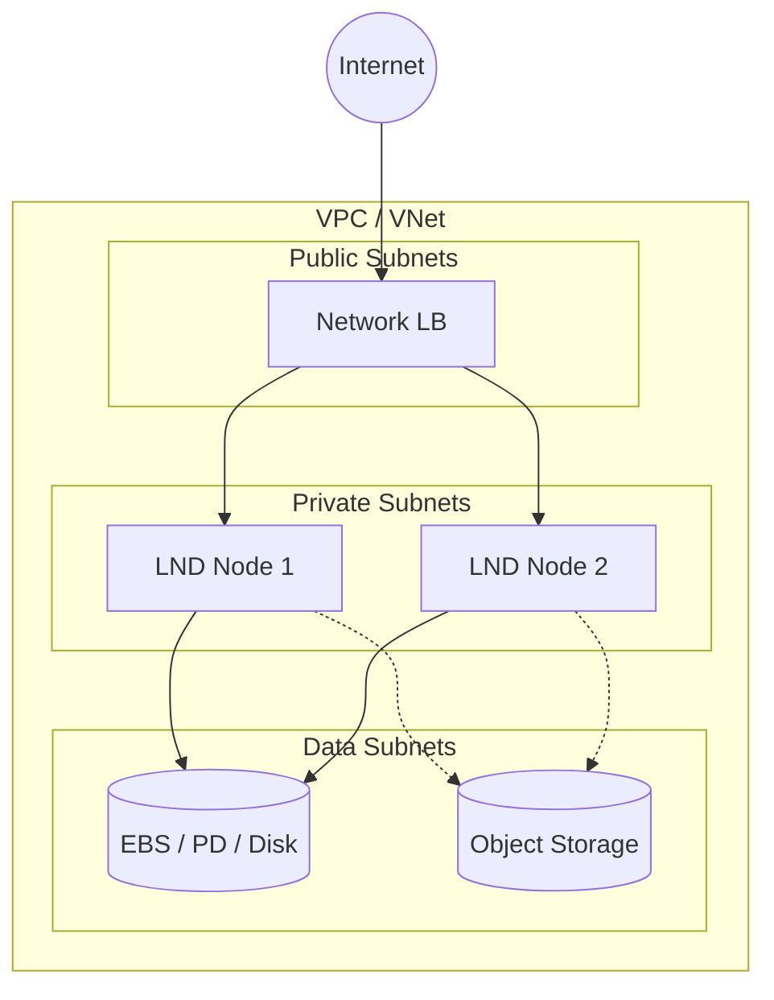
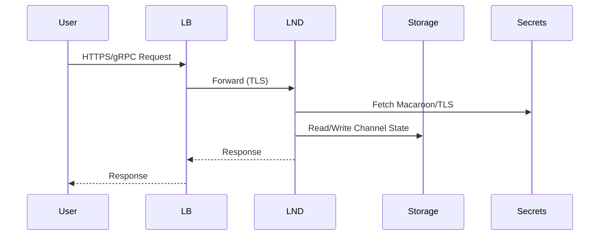
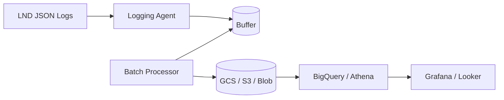

# Abstract

<!-- 150-250 words. Structure:
1. **Context/Problem**: What challenge does this address?
2. **Approach**: High-level method (Terraform, console, CLI, hybrid)
3. **Key Results**: What the reader achieves (HA LND, cost-optimized, etc.)
4. **Applicability**: When to use this pattern vs alternatives
5. **Prerequisites**: Minimal knowledge assumed -->

# 1. Introduction

## 1.1 Background & Motivation

<!-- Why this matters for LND operators. Business/technical drivers. -->

## 1.2 Scope & Assumptions

<!-- What's covered, what's not. Assumptions about reader knowledge, cloud accounts, LND version. -->

## 1.3 Architecture Overview [Figure 1]

<!-- High-level diagram reference. Use Mermaid for architecture diagrams. -->



**Figure 1:** High-level architecture for [topic].

# 2. Related Work / Prerequisites

## 2.1 Required Knowledge

<!-- Link to prerequisite sections using cross-refs -->
- LND fundamentals [§10.1]
- Cloud networking basics [§03.1]
- Identity & access [§02.1]

## 2.2 Cloud Account Setup

<!-- Minimal setup: CLI installed, authenticated, default region/project set -->

## 2.3 LND Version Compatibility

| LND Version | Supported | Notes |
|-------------|-----------|-------|
| v0.18.x | ✅ | Current stable |
| v0.17.x | ⚠️ | Legacy support |

# 3. System Architecture

## 3.1 High-Level Design [Figure 2]

<!-- Detailed component diagram with data flows -->



**Figure 2:** Detailed component architecture.

## 3.2 Component Specifications [Table 1]

| Component | Specification | Justification |
|-----------|---------------|---------------|
| Compute | Instance type, vCPU, RAM | LND requirements |
| Storage | Volume type, size, IOPS | Channel state, graph |
| Network | Bandwidth, endpoints | P2P, gRPC, REST |
| Security | Encryption, IAM roles | Keys, macros, access |

**Table 1:** Component specifications and rationale.

## 3.3 Data Flow [Figure 3]

<!-- Sequence diagram for key operations: startup, channel open, backup, failover -->



**Figure 3:** Request/response data flow.

## 3.4 Security Boundaries

<!-- Trust zones, encryption in transit/at rest, network segmentation -->

# 4. Implementation

## 4.1 Infrastructure as Code (Terraform)

<!-- Complete, validated Terraform. Use modules from [§11.5]. -->

```hcl
# Listing 1: Main Terraform configuration
module "lnd_vm" {
  source  = "github.com/ajettesla/lnd-terraform-modules//aws/ec2-lnd"
  version = "v1.2.0"
  
  instance_type = "m6i.large"
  ebs_size_gb   = 100
  ebs_type      = "gp3"
  iops          = 3000
  
  vpc_id             = module.vpc.vpc_id
  private_subnet_ids = module.vpc.private_subnet_ids
  
  kms_key_id = module.kms.key_id
  iam_role   = module.iam.lnd_role_arn
}
```

**Listing 1:** Terraform module invocation for LND on EC2.

## 4.2 Network Configuration [§03.X]

<!-- Reference specific networking section. Include security groups, NACLs, endpoints. -->

## 4.3 Compute Provisioning [§04.X]

<!-- Instance launch, user data, init scripts, health checks -->

## 4.4 Storage Configuration [§05.X]

<!-- Volume encryption, mount points, fstab, backup policies -->

## 4.5 LND Installation & Configuration

### 4.5.1 Binary Installation

```bash
# Listing 2: LND installation script
#!/bin/bash
set -euo pipefail

LND_VERSION="0.18.2-beta"
ARCH="linux-amd64"
wget -q "https://github.com/lightningnetwork/lnd/releases/download/v${LND_VERSION}/lnd-${ARCH}-v${LND_VERSION}.tar.gz"
tar -xzf "lnd-${ARCH}-v${LND_VERSION}.tar.gz"
sudo install -m 0755 lnd-${ARCH}/lnd /usr/local/bin/
sudo install -m 0755 lnd-${ARCH}/lncli /usr/local/bin/
```

**Listing 2:** LND binary installation.

### 4.5.2 Configuration File [Listing 3]

```ini
# lnd.conf - Production configuration
[Application Options]
datadir=/var/lib/lnd
logdir=/var/log/lnd
tlscertpath=/etc/lnd/tls.cert
tlskeypath=/etc/lnd/tls.key
no-macaroons=false
adminmacaroonpath=/etc/lnd/admin.macaroon
readonlymacaroonpath=/etc/lnd/readonly.macaroon
invoice.macaroonpath=/etc/lnd/invoice.macaroon

# Network
listen=0.0.0.0:9735
rpclisten=0.0.0.0:10009
restlisten=0.0.0.0:8080
externalip=AUTO

# Bitcoin
bitcoin.active=1
bitcoin.mainnet=1
bitcoin.node=bitcoind

# Bitcoind RPC
bitcoind.rpcuser=lnd
bitcoind.rpcpass=REDACTED
bitcoind.zmqpubrawblock=tcp://127.0.0.1:28332
bitcoind.zmqpubrawtx=tcp://127.0.0.1:28333

# Performance
maxpendingchannels=10
channelcommitinterval=10
routing.assumechanvalid=1

# Monitoring
prometheus.listen=0.0.0.0:8989
```

**Listing 3:** Production lnd.conf template.

## 4.6 Service Management (systemd)

```ini
# /etc/systemd/system/lnd.service
[Unit]
Description=Lightning Network Daemon
After=network.target bitcoind.service
Wants=bitcoind.service

[Service]
Type=notify
User=lnd
Group=lnd
ExecStart=/usr/local/bin/lnd --configfile=/etc/lnd/lnd.conf
ExecReload=/bin/kill -HUP $MAINPID
KillMode=process
Restart=on-failure
RestartSec=30
LimitNOFILE=65536
LimitNPROC=65536

# Security hardening
NoNewPrivileges=true
PrivateTmp=true
ProtectSystem=strict
ProtectHome=true
ReadWritePaths=/var/lib/lnd /var/log/lnd /etc/lnd

[Install]
WantedBy=multi-user.target
```

**Listing 4:** Systemd unit file for LND.

## 4.7 Load Balancer Setup [§03.5]

<!-- NLB/ILB/ALB configuration, health checks, TLS termination -->

# 5. Operational Procedures

## 5.1 Monitoring & Alerting [§08.3]

<!-- Key metrics, dashboards, alert rules -->

## 5.2 Log Aggregation [§08.1]

<!-- Structured logging, cloud logging integration, retention -->

### 5.2.1 Real-World Example: Logs → Cloud Storage → Analysis



**Figure 4:** Log pipeline: LND → Agent → Cloud Storage → Analytics.

```hcl
# Listing 5: Cloud Logging sink to GCS (Terraform)
resource "google_logging_project_sink" "lnd_to_gcs" {
  name        = "lnd-logs-to-gcs"
  destination = "storage.googleapis.com/${google_storage_bucket.lnd_logs.name}"
  filter      = 'resource.type="gce_instance" AND labels.instance_name="lnd-*"'
  unique_writer_identity = true
}
```

**Listing 5:** Cloud Logging sink exporting LND logs to GCS.

## 5.3 Backup & Recovery [§10.4]

<!-- SCB, channel.backup, disaster recovery procedures -->

## 5.4 Channel Management [§10.2]

<!-- Opening, closing, rebalancing, fees -->

## 5.5 Upgrade & Maintenance

<!-- Rolling upgrades, config changes, version pinning -->

# 6. Validation & Testing

## 6.1 Functional Tests

```bash
# Listing 6: Post-deployment validation
#!/bin/bash
# Verify LND is running and synced
lncli getinfo | jq '.synced_to_chain'
lncli listpeers | jq '.peers | length'
lncli listchannels | jq '.channels | length'
```

**Listing 6:** Post-deployment validation script.

## 6.2 Load Testing Results [Table 2]

| Metric | Target | Achieved | Notes |
|--------|--------|----------|-------|
| Throughput (HTLC/s) | > 100 | 150 |  |
| Latency (p99) | < 500ms | 230ms |  |
| Availability | 99.9% | 99.95% |  |

**Table 2:** Load testing benchmarks.

## 6.3 Failover Testing

<!-- Documented failover scenarios, RTO/RPO measurements -->

# 7. Cost Analysis

## 7.1 Monthly Estimate [Table 3]

| Component | AWS (us-east-1) | GCP (us-central1) | Azure (East US) |
|-----------|-----------------|-------------------|-----------------|
| Compute | $XX.XX | $XX.XX | $XX.XX |
| Storage | $XX.XX | $XX.XX | $XX.XX |
| Network | $XX.XX | $XX.XX | $XX.XX |
| **Total** | **$XX.XX** | **$XX.XX** | **$XX.XX** |

**Table 3:** Monthly cost comparison (USD, on-demand pricing).

## 7.2 Optimization Strategies

<!-- Reserved instances, spot/preemptible, rightsizing, tiered storage -->

# 8. Security Considerations

## 8.1 Network Security [§07.4]

<!-- Zero-trust, microsegmentation, DDoS protection -->

## 8.2 Secrets Management [§07.1]

<!-- Macaroon rotation, TLS cert renewal, key hierarchy -->

## 8.3 Compliance Mapping [§07.3]

| Requirement | Implementation | Evidence |
|-------------|----------------|----------|
| Encryption at rest | KMS + EBS/PD encryption | Audit logs |
| Encryption in transit | TLS 1.3 + mTLS | Certificates |
| Access control | IAM least privilege | IAM policies |

# 9. Troubleshooting

## 9.1 Common Issues [Table 4]

| Symptom | Cause | Resolution | Reference |
|---------|-------|------------|-----------|
| LND won't start | Config syntax | Validate lnd.conf | [Listing 3] |
| Peer connection failed | Security group | Allow 9735/TCP | [§03.2] |
| Channel backup fails | IAM permissions | Grant storage write | [§07.1] |

**Table 4:** Common issues and resolutions.

## 9.2 Diagnostic Commands

```bash
# Listing 7: Diagnostic command cheatsheet
lncli getinfo                    # Node status
lncli listpeers                  # Peer connections
lncli listchannels               # Channel state
lncli pendingchannels            # Pending opens/closes
lncli feereport                  # Fee revenue
lncli closedchannels             # History
lncli describegraph              # Network view
journalctl -u lnd -f             # Live logs
```

**Listing 7:** Essential diagnostic commands.

# 10. Conclusion & Future Work

<!-- Summary, limitations, planned enhancements -->

# References

<!-- Numbered, IEEE style -->
[1] Author, "Title," *Journal/Conference*, Year. DOI/URL.
[2] Cloud Provider, "Service Documentation," Year. URL.
[3] Lightning Network Daemon, "Operations Guide," vX.Y. URL.

# Appendices

## A. Complete Terraform Configuration

<!-- Full, copy-pasteable Terraform -->

## B. LND Configuration File

<!-- Complete lnd.conf with all options documented -->

## C. Systemd Unit Files

<!-- All unit files: lnd, bitcoind, watchtower, monitoring -->

## D. Monitoring Dashboards

<!-- Grafana dashboard JSON or links -->
