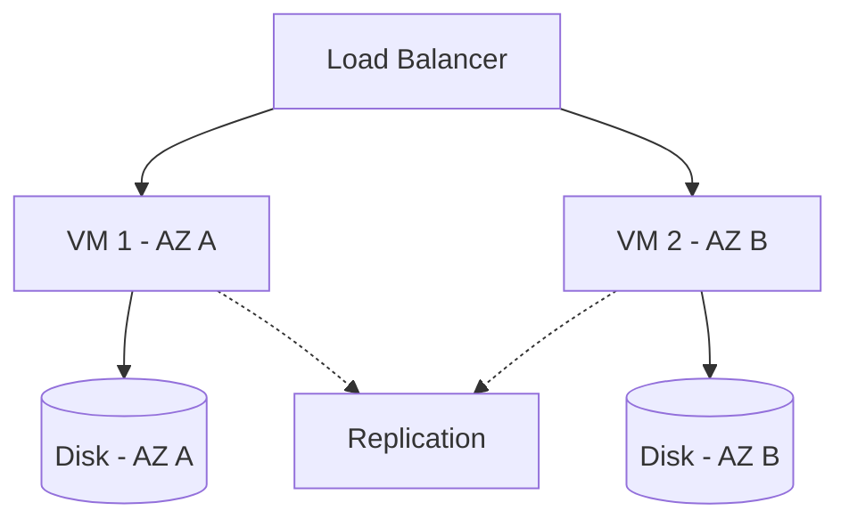

# Reference: [Cloud Provider] [Service Category]

> Quick reference for [service]. For implementation guides, see [§04], [§05], [§08]. For tutorials, see [§12].

## Service Limits & Quotas [Table 1]

| Resource | Default Limit | Max Limit | Increase Process |
|----------|---------------|-----------|------------------|
| [Resource 1] | [Value] | [Value] | [Process] |
| [Resource 2] | [Value] | [Value] | [Process] |

**Table 1:** [Cloud] [Service] default and maximum limits.

## Pricing (USD, [Region], [Date]) [Table 2]

| Component | Unit | On-Demand | Reserved (1yr) | Spot/Preemptible |
|-----------|------|-----------|----------------|------------------|
| [Component 1] | [Unit] | $X.XX | $X.XX | $X.XX |
| [Component 2] | [Unit] | $X.XX | $X.XX | $X.XX |

**Table 2:** Pricing comparison. *Prices subject to change; verify in cloud console.*

## CLI Cheatsheet

### [CLI Name] (`aws` / `gcloud` / `az`)

```bash
# === Resource Management ===
# Create
aws ec2 run-instances --cli-input-json file://instance.json
gcloud compute instances create INSTANCE --zone=ZONE --machine-type=TYPE
az vm create --resource-group RG --name NAME --image IMAGE --size SIZE

# List
aws ec2 describe-instances --filters "Name=tag:Name,Values=lnd-*"
gcloud compute instances list --filter="labels.app=lnd"
az vm list --resource-group RG --query "[?tags.app=='lnd']"

# Get Details
aws ec2 describe-instances --instance-ids i-XXXX
gcloud compute instances describe INSTANCE --zone=ZONE
az vm show --resource-group RG --name NAME

# Delete
aws ec2 terminate-instances --instance-ids i-XXXX
gcloud compute instances delete INSTANCE --zone=ZONE
az vm delete --resource-group RG --name NAME
```

### Service-Specific Commands

```bash
# === [Service] Specific ===
# [Command category]
aws [service] [command] --param value
gcloud [service] [command] --param=value
az [service] [command] --param value
```

## Terraform Resources

### Key Resources

| Resource | Purpose | Required Args |
|----------|---------|---------------|
| `aws_instance` / `google_compute_instance` / `azurerm_linux_virtual_machine` | VM | [args] |
| `aws_ebs_volume` / `google_compute_disk` / `azurerm_managed_disk` | Block storage | [args] |
| `aws_lb` / `google_compute_global_forwarding_rule` / `azurerm_lb` | Load balancer | [args] |

### Minimal Example

```hcl
# Listing 1: Minimal [service] resource
resource "aws_instance" "lnd" {
  ami           = data.aws_ami.ubuntu.id
  instance_type = "m6i.large"
  subnet_id     = aws_subnet.private[0].id
  
  root_block_device {
    volume_size = 20
    volume_type = "gp3"
    encrypted   = true
  }
  
  ebs_block_device {
    device_name = "/dev/sdf"
    volume_size = 100
    volume_type = "gp3"
    iops        = 3000
    encrypted   = true
  }
  
  vpc_security_group_ids = [aws_security_group.lnd.id]
  iam_instance_profile   = aws_iam_instance_profile.lnd.name
  
  user_data = filebase64("${path.module}/user-data.sh")
  
  tags = {
    Name        = "lnd-${var.environment}"
    Environment = var.environment
    ManagedBy   = "terraform"
  }
}
```

**Listing 1:** Minimal Terraform resource for [service].

### Module Usage

```hcl
# Listing 2: Using shared module [§11.5]
module "lnd_compute" {
  source  = "github.com/ajettesla/lnd-terraform-modules//[cloud]/[service]"
  version = "v1.2.0"
  
  # Required
  name        = "lnd-prod"
  environment = "production"
  
  # Compute
  instance_type = "m6i.large"
  
  # Storage
  data_volume_size_gb = 100
  data_volume_type    = "gp3"
  data_volume_iops    = 3000
  
  # Network
  vpc_id             = module.vpc.vpc_id
  private_subnet_ids = module.vpc.private_subnet_ids
  
  # Security
  kms_key_id = module.kms.key_id
  iam_role   = module.iam.role_arn
}
```

**Listing 2:** Module invocation for production LND.

## Common Patterns

### Pattern 1: High Availability



**Figure 1:** HA pattern - Active/Passive across AZs.

### Pattern 2: Cost Optimization

```hcl
# Spot/Preemptible with fallback
resource "aws_instance" "lnd_spot" {
  instance_type       = "m6i.large"
  instance_market_options {
    market_type = "spot"
    spot_options {
      max_price               = "0.05"
      instance_interruption_behavior = "stop"
    }
  }
  # ... rest of config
}
```

**Listing 3:** Spot instance with interruption handling.

### Pattern 3: Security Hardening

```hcl
# Encrypted everything, least privilege IAM
resource "aws_ebs_volume" "lnd_data" {
  size              = 100
  type              = "gp3"
  encrypted         = true
  kms_key_id        = aws_kms_key.lnd.arn
  availability_zone = var.az
}
```

**Listing 4:** Encrypted volume with customer-managed KMS key.

## Troubleshooting Quick Reference

| Error | Cause | Resolution |
|-------|-------|------------|
| `InsufficientInstanceCapacity` | AZ out of capacity | Try different AZ or instance type |
| `LimitExceeded` | Quota exceeded | Request quota increase |
| `UnauthorizedOperation` | IAM permissions | Add required policy |
| `VolumeInUse` | Volume attached | Detach first or force delete |

## Related Sections

- Implementation Guide: [§04.X]
- Storage Config: [§05.X]
- Networking: [§03.X]
- Security: [§07.X]
- Tutorials: [§12.X]

## Official Documentation

- [Cloud Provider Service Docs](URL)
- [Cloud Provider CLI Reference](URL)
- [Cloud Provider Terraform Provider Docs](URL)
- [LND Integration Guide](URL)
