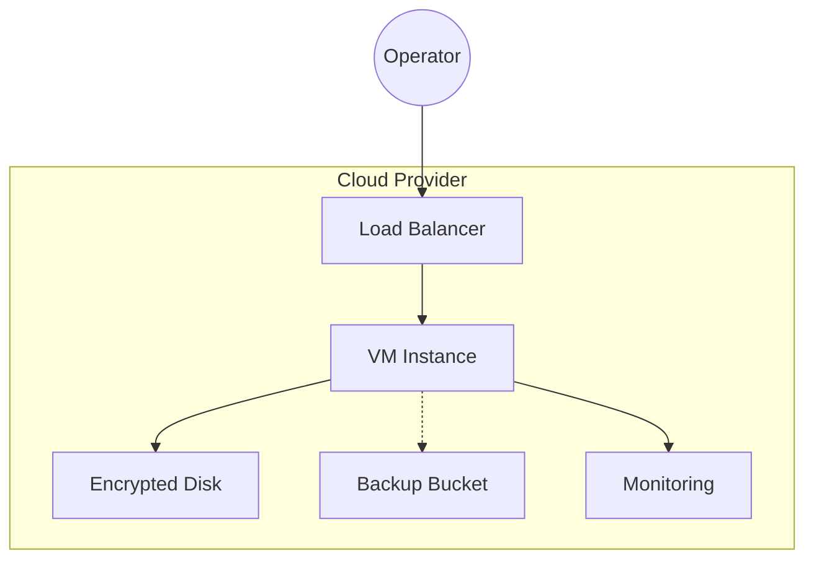

# Tutorial: Deploy LND on [Cloud Provider] [Compute Type]

> **Goal**: Deploy a production-ready LND node on [Cloud] [Compute] with encrypted storage, load balancing, monitoring, and automated backups in ~XX minutes.
>
> **Architecture**: [Brief one-line architecture summary. Reference Figure 1.]

## Prerequisites Checklist

- [ ] [Cloud] CLI configured (`aws configure` / `gcloud auth login` / `az login`)
- [ ] Terraform >= 1.9 installed (`terraform version`)
- [ ] SSH key pair generated for instance access
- [ ] Domain name (optional, for TLS)
- [ ] Estimated cost reviewed [§07.1]

## Architecture Overview [Figure 1]



**Figure 1:** Tutorial architecture - [description].

## Step 1: Clone Repository & Configure Variables

```bash
# Clone the guide repository (contains Terraform modules)
git clone https://github.com/ajettesla/cloud-plaform-lnd-guide
cd cloud-plaform-lnd-guide/tutorials/[cloud]-[compute]-lnd

# Copy and customize variables
cp terraform.tfvars.example terraform.tfvars
# Edit terraform.tfvars with your values
```

**Expected `terraform.tfvars`:**
```hcl
# Listing 1: Example terraform.tfvars
region          = "us-east-1"
instance_type   = "m6i.large"
ebs_size_gb     = 100
ebs_type        = "gp3"
ebs_iops        = 3000
ssh_public_key  = "ssh-ed25519 AAAAC3... user@host"
domain_name     = "lnd.example.com"  # optional
enable_monitoring = true
backup_schedule = "0 3 * * *"  # Daily 3 AM UTC
```

**Listing 1:** Tutorial-specific Terraform variables.

## Step 2: Initialize & Plan

```bash
terraform init
terraform plan -out=tfplan
```

**Verify plan output shows:**
- [ ] VPC/VNet with public/private subnets
- [ ] Security groups / firewall rules (ports 9735, 10009, 8080)
- [ ] Encrypted block storage (EBS/PD/Disk)
- [ ] Load balancer (NLB/ILB/LB)
- [ ] IAM roles / service accounts with least privilege
- [ ] Monitoring resources (optional)

## Step 3: Apply Infrastructure

```bash
terraform apply tfplan
```

**Expected outputs:**
```
Outputs:
lnd_public_ip     = "XX.XX.XX.XX"
lnd_private_ip    = "10.0.X.X"
load_balancer_dns = "lnd-lb-XXXX.us-east-1.elb.amazonaws.com"
backup_bucket     = "lnd-backups-XXXX"
monitoring_url    = "https://console.cloud.google.com/monitoring/..."
```

## Step 4: Verify LND Deployment

```bash
# SSH to instance (or use SSM/Serial Console)
ssh -i ~/.ssh/your-key ubuntu@<lnd_public_ip>

# Check LND status
sudo systemctl status lnd
lncli getinfo | jq '{version: .version, synced: .synced_to_chain, peers: .num_peers, channels: .num_active_channels}'

# Verify RPC access
lncli --rpcserver=<lnd_private_ip>:10009 --macaroonpath=/etc/lnd/admin.macaroon --tlscertpath=/etc/lnd/tls.cert getinfo
```

**Expected output:**
```json
{
  "version": "0.18.2-beta commit=v0.18.2-beta",
  "synced": true,
  "peers": 8,
  "channels": 3
}
```

## Step 5: Configure Monitoring & Alerting

```bash
# Access monitoring dashboard
# AWS: CloudWatch → Dashboards → LND-[stack-name]
# GCP: Cloud Monitoring → Dashboards → LND-[project]
# Azure: Monitor → Workbooks → LND-[resource-group]

# Verify key metrics flowing:
# - lnd_chain_sync_status (1 = synced)
# - lnd_num_peers (> 0)
# - lnd_num_active_channels (> 0)
# - lnd_htlc_throughput_per_second
```

## Step 6: Test Backup & Recovery

```bash
# Trigger manual backup
sudo /usr/local/bin/lnd-backup.sh

# Verify backup in cloud storage
# AWS: aws s3 ls s3://<backup_bucket>/
# GCP: gsutil ls gs://<backup_bucket>/
# Azure: az storage blob list --container-name <container> --account-name <account>

# Test restore procedure (documented in [§10.4])
```

## Step 7: Open Channel (Optional)

```bash
# Get node URI
lncli getinfo | jq -r '"\(.identity_pubkey)@\(.uris[0])"'

# Connect to peer
lncli connect <peer_pubkey>@<peer_host>:9735

# Open channel
lncli openchannel --node_key=<peer_pubkey> --local_amt=1000000 --push_amt=500000
```

## Validation Checklist

- [ ] LND service running and synced to chain
- [ ] Peers connected (> 3)
- [ ] Channels open (> 1)
- [ ] RPC accessible via load balancer
- [ ] Metrics appearing in monitoring
- [ ] Backup bucket receiving channel backups
- [ ] Alerts configured for: sync loss, peer loss, channel close, disk space

## Cleanup

```bash
# Close channels first (cooperative close)
lncli closechannel --channel_point=<channel_point>

# Wait for confirms, then destroy infrastructure
terraform destroy
```

## Troubleshooting Quick Reference

| Issue | Check | Fix |
|-------|-------|-----|
| LND not starting | `journalctl -u lnd -n 50` | Config syntax, permissions, disk space |
| No peers | Security group port 9735 | Allow inbound 9735/TCP |
| RPC connection refused | TLS/macaroon paths | Verify paths in lncli command |
| Sync stuck | `lncli getinfo` → synced_to_chain | Check bitcoind, restart LND |

## Next Steps

- [ ] Configure Watchtower [§10.3]
- [ ] Set up channel rebalancing automation [§10.2.5]
- [ ] Implement multi-node HA [§10.5]
- [ ] Customize Grafana dashboards
- [ ] Document runbooks for operations team

## References

- [Cloud Provider LND Module](https://github.com/ajettesla/lnd-terraform-modules)
- [LND Operations Guide](https://github.com/lightningnetwork/lnd/blob/master/docs/operation_guide.md)
- [Cloud Provider Best Practices]
